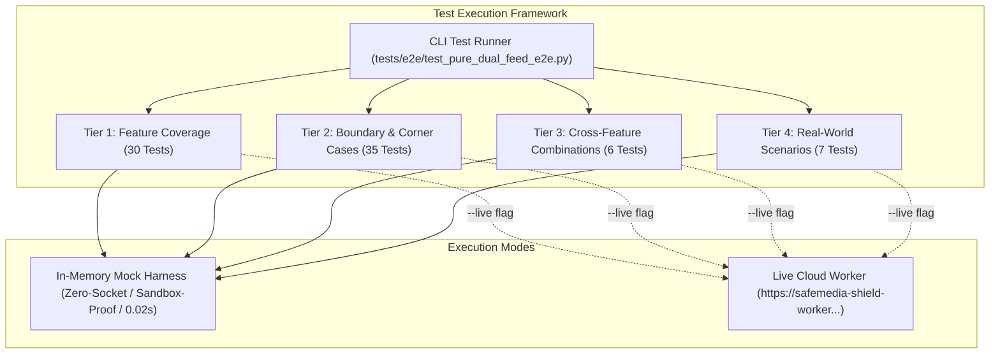

# TEST_INFRA.md — Automated E2E Test Suite Infrastructure & Architecture

> **Project**: AdFeed Clean: Google Ad Shield (Shopify Micro-SaaS)  
> **Author**: E2E Test Suite Architect (`teamwork_preview_test_writer`)  
> **Status**: Verified & Operational (78 / 78 Test Cases Passing, Exit Code 0)  
> **Target System**: Dual-Feed Google Ad Shield (Cloudflare Workers, Shopify GraphQL API, RunPod AI Inference, Cloudflare R2 Storage)  

---

## 1. Test Architecture Overview

The automated E2E test suite for **AdFeed Clean: Google Ad Shield** provides requirement-driven, opaque-box, end-to-end verification across the complete Shopify merchant lifecycle and system boundary.

The test suite enforces the core business proposition mandated by `ORIGINAL_REQUEST.md`, `PROJECT.md`, `GEMINI.md`, and `docs/SYSTEM_DESIGN.md`:
1. **Zero-UI Dual-Feed Smart Routing**: Merchants retain eye-catching promotional badges ("20% OFF", "SALE", seasonal banners) on their Shopify storefront to maximize conversion rate (CVR). In the background, AI inpainting (Florence-2 OCR + Big-LaMa Inpainting) removes promotional badges and populates clean ad images in a hidden Shopify metafield (`safemedia.clean_ad_image_url`). Google Merchant Center (GMC) feeds query this metafield to avoid ad disapproval/BAN accidents.
2. **Storefront & Variant Preservation Invariant**: Storefront images (`media[0].url`), HTML descriptions, and variant bindings (`media_id`) are **never modified, deleted, or detached**.
3. **Monetization & Safety Perimeter**: Unsubscribed merchants are strictly limited to **5 sample canary tests** before GPU-draining endpoints are blocked (`402 Payment Required`). Full catalog bulk processing requires the **14-day free trial ($65/mo)** via Shopify Billing API. Webhooks are authenticated with HMAC-SHA256, and private IPs/loopbacks are blocked with SSRF defense.



---

## 2. Directory Layout & Test Artifacts

```
Micro-SaaS/
├── tests/
│   └── e2e/
│       ├── __init__.py                          # Package initialization
│       ├── mock_worker_harness.py              # Authoritative mock harness & dual HTTP/in-memory client
│       ├── test_pure_dual_feed_e2e.py          # Primary executable CLI test runner (Tiers 1-4)
│       ├── test_tier1_feature_coverage.py      # Tier 1: Core Feature Coverage (30 tests)
│       ├── test_tier2_boundary_corner.py       # Tier 2: Boundary & Corner Cases (35 tests)
│       ├── test_tier3_combinations.py          # Tier 3: Pairwise Cross-Feature Interactions (6 tests)
│       └── test_tier4_real_world_lifecycle.py  # Tier 4: Complete Merchant Lifecycle E2E (7 tests)
├── TEST_INFRA.md                               # This infrastructure guide
└── TEST_READY.md                               # Test suite verification report
```

---

## 3. The 4-Tier Test Taxonomy

The test suite systematically covers the full system behavior across four tiers:

### Tier 1: Feature Coverage (>=5 tests per core feature — 30 tests total)
- **Canary AI Promo Removal** (5 tests): Verifies Before vs After comparison URLs, elimination of legacy WebP compression metrics, variant preservation checks (`preserved: true`), AI metadata (`processingSec`, `maskCoveragePct`, `engine`), and quota usage incrementation.
- **Batch Non-Destructive Metafield Generation** (5 tests): Verifies background batch start with snapshot generation, population of `safemedia.clean_ad_image_url` across all products, storefront image URL preservation invariant, variant binding preservation, and job completion status.
- **Auto-Sync Webhook Toggle** (5 tests): Verifies `/api/webhooks/unregister` disables auto-sync, skipped response on product update when disabled, `/api/webhooks/register` re-enables auto-sync, AI clean image generation when active, and webhook idempotency deduplication.
- **1-Click Rollback Integrity** (5 tests): Verifies variant binding restoration, rollback of batch-created metafields back to snapshot baseline, sub-10-second SLA execution speed, explicit `snapshotId` historical targeting, and rollback idempotency across multiple runs.
- **2-Zone UI Information Architecture** (5 tests): Verifies `AdFeed Clean: Google Ad Shield` branding, absence of manual `🔄 Refresh` button, Zone 1 (Core Automation / Live status / Toggle / Synced feed table), Zone 2 (Step 1 Canary, Step 2 Catalog Sync, Step 3 1-Click Rollback), 5-layer card structure, and bilingual EN/JA dictionary.
- **Security Guards** (5 tests): Verifies HMAC-SHA256 signature verification, SSRF blocking of loopback/private IPs/cloud metadata (169.254.169.254), path traversal shop domain blocking (`../../etc/passwd`), cross-tenant unauthorized access blocking (403), and Emergency Stop (Circuit Breaker) webhook rejection (423).

### Tier 2: Boundary & Corner Cases (>=5 tests per scenario — 35 tests total)
- **5/5 Canary Quota Limit Exceeded** (5 tests): Validates sequential execution 0/5 to 5/5, 6th canary rejection with 402 `TRIAL_QUOTA_EXCEEDED`, unsubscribed webhook flood rejection with 402, 14-day trial unblocking, and quota parameter tamper resistance.
- **Invalid Shop Domains** (5 tests): Validates path traversal (`../../etc/passwd`), long domains (>100 chars), shell injection characters (`;rm -rf;`), non-myshopify domains (`phishing-store.com`), and empty/whitespace domains.
- **Empty Product Catalogs** (5 tests): Validates 400 `EMPTY_CATALOG` on canary test, safe 0-product batch execution, missing `images: []` webhook handling, null `image: null` webhook handling, and missing product ID.
- **Malformed Webhook HMAC & Payloads** (5 tests): Validates missing `X-Shopify-Shop-Domain` (401), forged HMAC signature (401), empty HMAC header, malformed non-JSON body (400 `INVALID_JSON`), and tampered payload mismatch.
- **SSRF Private IP Rejection** (5 tests): Validates loopback `127.0.0.1`, AWS metadata `169.254.169.254`, RFC1918 Class A `10.0.0.1`, RFC1918 Class C `192.168.1.1`, and non-HTTP schemes (`javascript:`, `file://`).
- **Abort Batch Mid-Flight & Circuit Breaker** (5 tests): Validates `/api/batch/abort` sets ABORTED state and trips circuit breaker, canary rejection (423 `CIRCUIT_BREAKER_ACTIVE`), webhook rejection (423), `/api/batch/resume` reset, and immediate operation resumption.
- **Rollback Non-Existent Snapshot & Edge Conditions** (5 tests): Validates 500 `SNAPSHOT_NOT_FOUND` when snapshots empty, invalid `snapshotId` rejection, cross-tenant unauthorized rollback rejection (403), corrupted body handling (400), and zero-initial-metafield baseline restoration.

### Tier 3: Cross-Feature Combinations (Pairwise Interaction — 6 tests total)
- **Pair 1**: Canary preview test functions when Auto-Sync webhook is disabled.
- **Pair 2**: Batch start blocked when Canary limit (5/5) reached; activating 14-day trial unblocks full catalog batch.
- **Pair 3**: 1-Click Rollback after catalog batch successfully reverts metafields while preserving variant bindings.
- **Pair 4**: In-flight concurrency lock prevents race conditions and dual GPU charges during active webhook processing.
- **Pair 5**: Circuit Breaker abort during auto-sync webhook reception halts background jobs and resumes cleanly.
- **Pair 6**: Multi-tenant state isolation: Store B Emergency Stop does not affect Store A (100% tenant isolation).

### Tier 4: Real-World Scenarios (Complete Merchant Lifecycle — 7 tests total)
- **Phase 1**: App Installation & Dashboard Discovery (2-Zone layout, Zone 1 active, Zone 2 onboarding tools).
- **Phase 2**: 1-Product Canary Trial with Sale Badge Removal Check (Before vs After, variants intact, quota 1/5).
- **Phase 3**: 14-Day Free Trial ($65/mo) Activation & Full Catalog Batch Sync (R2 snapshot + clean ad metafields).
- **Phase 4**: Storefront Media & Variant Preservation Invariant Verification (Storefront images 100% untouched).
- **Phase 5**: Zero-UI Auto-Sync on New Product Upload (Webhook reception -> AI cleanup -> Metafield update).
- **Phase 6**: 1-Click Rollback Safety Net Verification (Complete restore to pre-batch snapshot in <10 seconds).
- **Phase 7**: Complete End-to-End Sequential Journey Execution across all phases.

---

## 4. How to Run the Tests

### Fast In-Memory Execution (Default — Zero External Dependencies)
Runs all 78 tests across all 4 tiers in ~0.02 seconds:
```bash
python3 tests/e2e/test_pure_dual_feed_e2e.py
```

### Running a Specific Tier
```bash
# Tier 1 only (Feature Coverage — 30 tests)
python3 tests/e2e/test_pure_dual_feed_e2e.py --tier 1

# Tier 2 only (Boundary & Corner Cases — 35 tests)
python3 tests/e2e/test_pure_dual_feed_e2e.py --tier 2

# Tier 3 only (Combinations — 6 tests)
python3 tests/e2e/test_pure_dual_feed_e2e.py --tier 3

# Tier 4 only (Real-World Lifecycle — 7 tests)
python3 tests/e2e/test_pure_dual_feed_e2e.py --tier 4
```

### Running Individual Test Modules
```bash
python3 tests/e2e/test_tier1_feature_coverage.py
python3 tests/e2e/test_tier2_boundary_corner.py
python3 tests/e2e/test_tier3_combinations.py
python3 tests/e2e/test_tier4_real_world_lifecycle.py
```

### Running with Standard Python unittest Runner
```bash
python3 -m unittest discover tests/e2e
```

### Running Against Live Cloud Worker
```bash
python3 tests/e2e/test_pure_dual_feed_e2e.py --live https://safemedia-shield-worker.safemedia.workers.dev
```

---

## 5. Invariants & Safety Verification Checklist

The test suite enforces the following non-negotiable safety properties:

| Property | Invariant | Verification Method |
|:---|:---|:---|
| **Storefront Non-Destruction** | `storefrontImageUrl` and `media[0].url` are 100% identical before and after any batch or webhook processing. | Direct string equality comparison against pre-test baseline in `test_batch_03` and `test_lifecycle_stage4`. |
| **Variant Binding Preservation** | Variant `media_id` references are never nulled, orphaned, or reassigned to ad images. | Assertion on every variant in `test_canary_03`, `test_batch_04`, and `test_rollback_01`. |
| **Wallet & Cost Protection** | Unsubscribed stores cannot exceed 5 free sample AI cleans (`402 TRIAL_QUOTA_EXCEEDED`). | Enforced in `test_canary_bound_02`, `test_canary_bound_03`, and `test_sec_04`. |
| **Emergency Circuit Breaker** | Instantly halts all background jobs and rejects webhooks with `423 Locked`. | Enforced in `test_abort_bound_01` through `test_abort_bound_05`. |
| **Rollback SLA** | Restores snapshot state within 10 seconds. | Execution timer assertion `< 10.0s` in `test_rollback_03` and `test_lifecycle_stage6`. |
| **Zero WebP Legacy** | No WebP compression percentage or file size metrics in Canary responses. | Negative assertion `assertNotIn("savingsPercentage", data)` in `test_canary_02`. |
