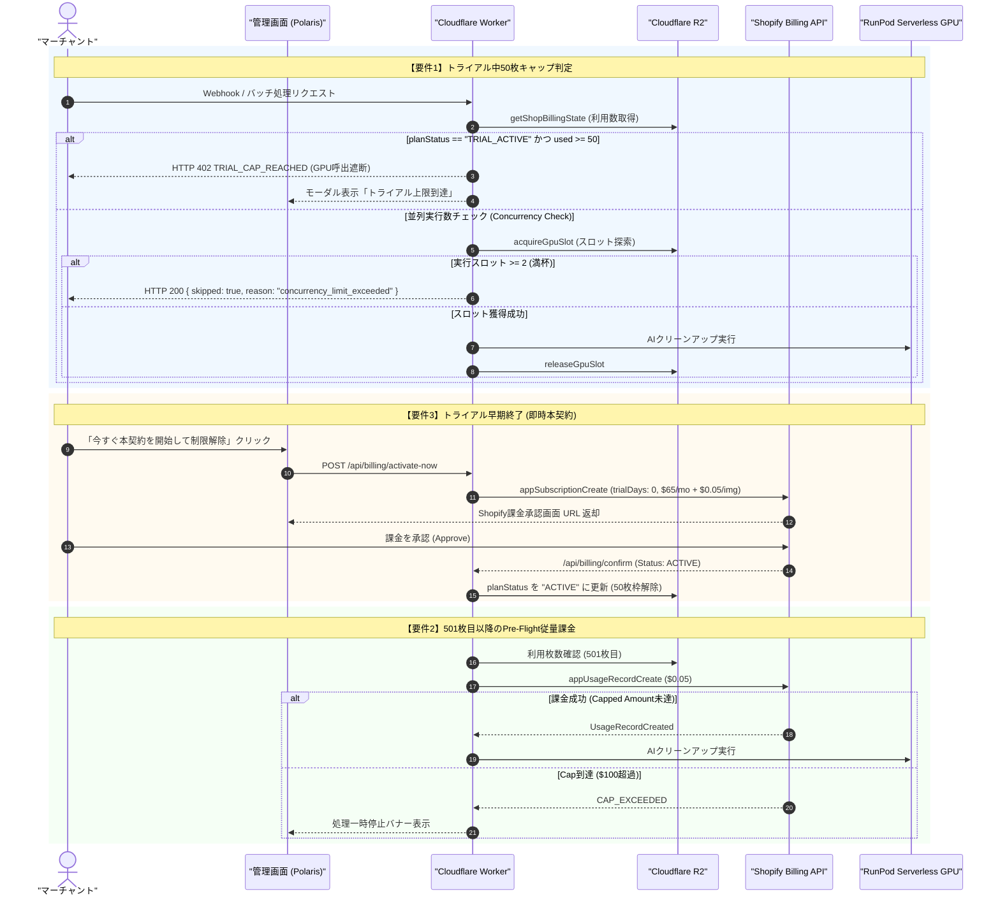

# 追加仕様要件定義書: 課金破産防衛・ハイブリッド従量課金・トライアル早期終了

> **作成日時**: 2026-11-03  
> **対象バージョン**: SafeMedia Shield (AdFeed Clean) Backend / Billing Engine  
> **ステータス**: 設計完了・実装準備中  
> **関連ドキュメント**: [`docs/SYSTEM_DESIGN.md`](file:///Users/yusuke/antigravity/Micro-SaaS/docs/SYSTEM_DESIGN.md), [`docs/POST_APPROVAL_ROADMAP.md`](file:///Users/yusuke/antigravity/Micro-SaaS/docs/POST_APPROVAL_ROADMAP.md)

---

## 1. 目的と解決する課題 (Why)

### 1.1 課題とリスク
1. **トライアル期間中の課金破産（Denial of Wallet）リスク**:
   - 現行実装では、14日間無料トライアル承認後（`TRIAL_ACTIVE`）に枚数上限のチェックが存在せず「無制限」となっていました。
   - 大規模ストアが14日間の無料期間中に数千〜数万枚のバッチ同期やWebhook一括更新を実行し、課金前に解約した場合、GPUコスト（1枚約3円 × 1万枚 = 3万円）が全額アプリ側の赤字（未回収損失）となる構造的欠陥がありました。
2. **Webhookバースト時の並列GPU過大課金**:
   - 商品一括インポート等で同一ストアから数十〜数百件の `products/update` Webhookが短時間に到達した場合、Workerが個別にRunPod Serverless `/run` を叩くため、GPUインスタンスが大量に起動して瞬間的に高額なGPU利用料が発生していました。
3. **固定月額制（$65/月）による逆ザヤリスク**:
   - SKU数10,000件の大規模ストアが毎月全商品をクリーンアップした場合、月額$65（約9,800円）の受取に対してGPU原価が約3万円となり、売上を超過する逆ザヤ（赤字）が発生していました。
4. **高意欲ユーザーの課金・利用ブロック**:
   - トライアル枠に上限を設けた際、「今すぐ全カタログを処理したい」という優良マーチャントが14日間待たされ、熱量が冷めて離脱する恐れがありました。

### 1.2 達成ゴール（定量的指標）
- トライアル中の無料AI処理上限を **最大50枚** に物理遮断し、トライアル中のGPU損失リスクを最大150円（3円 × 50枚）に抑え込む。
- 同一ストアのWebhook並列GPU実行数を **最大2並列** に制限し、GPUインスタンスのバースト起動を防止する。
- **基本料金 $65（500枚内包）＋ 超過1枚 $0.05（約8円）** のハイブリッド従量課金へ移行し、大規模ストアでの粗利率60%以上を恒久的に保証する。
- 50枚到達時に **「トライアル早期終了（即時本契約）」** 導線を提供し、優良マーチャントの即日有料転換率（即時MRR化）を最大化する。

---

## 2. 追加仕様詳細 (What)

### 【要件 1】トライアル中50枚キャップ & Webhook同時実行制限（2並列）

#### 1. トライアル中50枚キャップ制御
- **ライフサイクル状態遷移**:
  1. `CANARY_TRIAL`: インストール直後。カナリアテスト枠 **最大5枚**。
  2. `TRIAL_ACTIVE`: 14日間無料トライアル承認済み。上限 **50枚**（`trialLimit: 50`）。
  3. `TRIAL_CAP_REACHED`: トライアル利用数が50枚に到達。以降のAIクリーンアップを即時遮断（`HTTP 402 Payment Required`、エラーコード `TRIAL_CAP_REACHED`）。
  4. `ACTIVE`: 本契約移行後。基本500枚＋超過従量課金。

#### 2. Webhook同時実行数リミッター（Concurrency Cap: 2並列）
- **対象**: `POST /webhooks/products/update`
- **制御ロジック**:
  - Cloudflare R2 / In-Memory を用いた分散セマフォキー `locks/${shop}/gpu_slot_${slotId}.json`（スロット 1〜2）を管理。
  - Webhook受信時、空きスロット（同時実行数 < 2）を探索してアトミックに獲得（TTL 30秒）。
  - **空きスロットがない場合（2並列稼働中）**:
    - 即時エラーとせず、`{ success: true, skipped: true, reason: "concurrency_limit_exceeded" }` で即座に `200 OK` を返却し、ジョブ状態（`pendingSync`）にマークしてバッチ待機へ委ねる。
    - これにより、Shopify側のWebhookタイムアウト（5秒）や再送嵐を防ぎつつ、RunPodコンテナの急激なスピンアップを完全遮断。

---

### 【要件 2】Shopify Billing API ハイブリッド従量課金モデルへの全面改修

#### 1. 価格ストラクチャ仕様
| 項目 | 設定値 | 目的・根拠 |
| :--- | :--- | :--- |
| **基本月額料金 (Recurring)** | **$65.00 USD / 月** | B2Bで稟議不要の即決クレジットカード価格。月間 **500枚** までの処理を内包。 |
| **超過従量課金 (Usage)** | **$0.05 USD / 枚** (約8円) | 501枚目以降に適用。GPU原価（約3円/枚）に対し粗利60%以上を確保。 |
| **月間請求上限 (Capped Amount)** | **$100.00 USD / 月** | 想定外の高額請求を防止（Shopify Billing APIの必須要件）。最大約1,500枚（内包500枚＋従量1,000枚）。 |
| **利用規約文言 (Terms)** | `"$0.05 per cleaned image beyond 500 images/mo (Max $100/mo)"` | 課金承認画面に明記。 |

#### 2. Shopify GraphQL `appSubscriptionCreate` 定義
```graphql
mutation CreateHybridAppSubscription($returnUrl: URL!, $trialDays: Int!) {
  appSubscriptionCreate(
    name: "SafeMedia Shield Smart Protection Plan"
    returnUrl: $returnUrl
    trialDays: $trialDays
    lineItems: [
      {
        plan: {
          appRecurringPricingDetails: {
            price: { amount: 65.0, currencyCode: USD }
            interval: EVERY_30_DAYS
          }
        }
      },
      {
        plan: {
          appUsagePricingDetails: {
            terms: "$0.05 per cleaned image beyond 500 images/mo (Max $100/mo)"
            cappedAmount: { amount: 100.0, currencyCode: USD }
          }
        }
      }
    ]
  ) {
    appSubscription {
      id
      status
    }
    confirmationUrl
    userErrors {
      field
      message
    }
  }
}
```

#### 3. Pre-Flight Usage Charge（未回収リスクゼロの事前課金保証）
- 月間利用枚数が500枚を超過した場合、RunPod GPU呼び出しの**直前**に `appUsageRecordCreate` を実行。
- Shopify側で課金レコードの作成が成功（Status 200）したことを確認してから初めてGPU推論を実行する。
- `cappedAmount`（$100）に達した場合は即座にサーキットブレーカーを作動させ、処理を中断してPolaris画面に上限引き上げ案内を表示する。

---

### 【要件 3】トライアル早期終了（即時本契約・制限解除）

#### 1. ユーザー体験（UI/UX フロー）
- トライアル中に50枚に到達したマーチャントには、画面上にPolarisモーダルを表示：
  > **🎉 Free Trial Quota (50/50 Images) Completed!**  
  > 50枚のクリーン画像が生成され、Google広告ポリシー適合が確認されました。  
  > 残りの全カタログも今すぐクリーンアップしますか？  
  >  
  > - **[ 今すぐ本契約を開始して全件処理する ($65/月) ]** *(主要アクション)*  
  > - **[ 14日間のトライアル終了を待つ ]** *(副次アクション)*

#### 2. 即時本契約 API (`POST /api/billing/activate-now`)
- マーチャントが「今すぐ本契約を開始」をクリックすると、Workerは `trialDays: 0` で新規サブスクリプションを発行。
- Shopifyの課金承認画面へ遷移し、マーチャントが承認した瞬間に本契約（`ACTIVE`）が確定。
- 即座にトライアル上限が解除され、全カタログのバッチ処理（またはWebhook自動同期）が再開される。

---

## 3. 全体アーキテクチャ・処理フロー (How)



---

## 4. 変更対象ファイル一覧

| ファイルパス | 変更種別 | 変更内容の要約 |
| :--- | :---: | :--- |
| [`cloudflare_worker/src/types.ts`](file:///Users/yusuke/antigravity/Micro-SaaS/cloudflare_worker/src/types.ts) | 修正 | `TenantBillingState` に `trialUsedCount`, `trialLimit: 50`, `monthlyIncludedCount: 500`, `usageLineItemId` を追加。 |
| [`cloudflare_worker/src/shopify.ts`](file:///Users/yusuke/antigravity/Micro-SaaS/cloudflare_worker/src/shopify.ts) | 修正 | `createAppSubscription` のハイブリッド課金化（`appRecurringPricingDetails` + `appUsagePricingDetails`）。`createAppUsageRecord` の新設。 |
| [`cloudflare_worker/src/index.ts`](file:///Users/yusuke/antigravity/Micro-SaaS/cloudflare_worker/src/index.ts) | 修正 | ① 50枚トライアルキャップ判定、② Webhook同時実行数リミッター（2並列）、③ `POST /api/billing/activate-now`（即時本契約）、④ Pre-flight従量課金判定の追加。 |
| [`cloudflare_worker/src/ui.ts`](file:///Users/yusuke/antigravity/Micro-SaaS/cloudflare_worker/src/ui.ts) | 修正 | 50枚到達時の「トライアル早期終了モーダル」描画、従量課金メーター表示（500枚中の利用数表示）。 |
| [`docs/SYSTEM_DESIGN.md`](file:///Users/yusuke/antigravity/Micro-SaaS/docs/SYSTEM_DESIGN.md) | 同期更新 | ハイブリッド課金体系、50枚トライアルキャップ、同時実行制限アーキテクチャの同期反映。 |

---

## 5. 異常系・フェイルセーフ設計

1. **TOCTOU（二重予約）防止**:
   - カナリア枠と同様に、AI推論実行前に `trialUsedCount += 1` を事前予約し、R2へ永続化。
   - GPU推論またはShopify書き込みが回復不能なエラーで失敗した場合は、直ちにスロットを返却（インクリメント取り消し）。
2. **GPU同時実行スロットのデッドロック防止**:
   - スロットロック（`locks/${shop}/gpu_slot_*.json`）には **TTL 45秒** を設定。
   - Workerがクラッシュした場合でも45秒後に自動解放され、恒久的なデッドロックを防止。
3. **Shopify Billing API障害時のフェイルセーフ**:
   - `appUsageRecordCreate` でShopify側が一時的な500/503を返した場合は、指数バックオフで2回再試行。
   - それでも失敗した場合はGPU処理を中断し、未課金でのAI処理実行を物理的に防止。

---

## 6. 検証・テスト計画 (Verification Plan)

- [ ] **単体・統合テスト 1: 50枚トライアルキャップ到達検証**:
  - `trialUsedCount = 49` から2回連続でWebhookを発行し、50枚目で成功、51枚目で `HTTP 402 TRIAL_CAP_REACHED` が返りGPUが起動しないことを確認。
- [ ] **単体・統合テスト 2: Webhook 2並列リミッター検証**:
  - 同一店舗に対して異なる商品IDのWebhookを3件同時に送信。2件が処理スロットを獲得し、3件目が即座に `skipped: true, reason: "concurrency_limit_exceeded"` となることを確認。
- [ ] **単体・統合テスト 3: トライアル早期終了（即時本契約）検証**:
  - `POST /api/billing/activate-now` を呼び出し、発行される `appSubscriptionCreate` の `trialDays` が `0` であることを確認。
  - 承認後に `planStatus` が `ACTIVE` に更新され、50枚の制限が解除されることを確認。
- [ ] **単体・統合テスト 4: 501枚目以降のPre-flight従量課金検証**:
  - `monthlyUsageCount = 500` の状態で処理をキックし、`appUsageRecordCreate`（$0.05）が正常に呼ばれてからGPUが起動することを確認。
