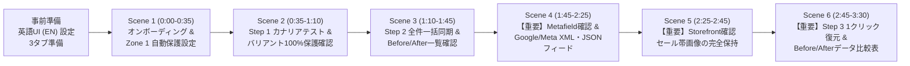

# AdFeed Clean: Google Shopping — Shopify App Review (4.5.3) E2E録画シナリオ & 日英字幕ガイド

> **対象要件**: Shopify App Store 審査指摘 `4.5.3. Include a demo screencast`  
> **関連ドキュメント**: [SYSTEM_DESIGN.md](file:///Users/yusuke/antigravity/Micro-SaaS/docs/SYSTEM_DESIGN.md) / [APP_STORE_LISTING.md](file:///Users/yusuke/antigravity/Micro-SaaS/docs/APP_STORE_LISTING.md)  
> **関連UI実装**: [ui.ts](file:///Users/yusuke/antigravity/Micro-SaaS/cloudflare_worker/src/ui.ts)  
> **最終更新日**: 2026-11-18

---

## 1. Shopify審査チームの指摘内容と必須証明4項目

Shopify App Review 要件 `4.5.3` の指摘に対応するため、単なる機能紹介ではなく**最初から最後までの切れ目のない一連の操作（Complete End-to-End Recording）**として、以下の4点を映像と英語字幕で明確に証明する必要があります。

| # | 審査員の指摘内容（原文要約） | 動画内で必ず映すべき画面・操作 | 対応UI / 設計実装箇所 |
| :-: | :--- | :--- | :--- |
| **①** | **Onboarding & setup of core features**<br>（オンボーディングと主要機能のセットアップ手順） | ・アプリ起動（英語UI表示）<br>・14日間無料トライアル承認（または有効状態の提示）<br>・Zone 1 常時自動保護（`🟢 Active`）<br>・Zone 2 Step 1（カナリアテスト）＆ Step 2（一括同期） | [ui.ts#L175-L245](file:///Users/yusuke/antigravity/Micro-SaaS/cloudflare_worker/src/ui.ts#L175-L245)<br>[ui.ts#L329-L512](file:///Users/yusuke/antigravity/Micro-SaaS/cloudflare_worker/src/ui.ts#L329-L512) |
| **②** | **How cleaned images are mapped and delivered specifically to Google Shopping and Meta ad feeds via product metafields**<br>（クリーン画像が商品メタフィールド経由でGoogle Shopping・Meta広告フィードへマッピング・配信される仕組み） | ・Shopify管理画面の商品詳細ページ最下部で `safemedia.clean_ad_image_url` にクリーン画像URLが格納されている画面<br>・アプリ内「Ad Feed Channel Distribution Status」の **`RSS XML Feed ↗`**（`g:image_link`）と **`JSON Feed ↗`**（`image_link`）を開き、Google/Metaへ配信される実データを表示 | [SYSTEM_DESIGN.md#L735-L776](file:///Users/yusuke/antigravity/Micro-SaaS/docs/SYSTEM_DESIGN.md#L735-L776)<br>[ui.ts#L372-L408](file:///Users/yusuke/antigravity/Micro-SaaS/cloudflare_worker/src/ui.ts#L372-L408) |
| **③** | **While preserving the original badged images on the storefront**<br>（オンラインストア側では元のセール帯付き画像が維持されていること） | ・オンラインストアの商品ページ（Storefront）を開き、元の「SALE / 20% OFF」等のバッジ付き画像が**1ピクセルも変わらず表示されている**画面<br>・アプリ内 `Recent Synced Product Feed` テーブルのBefore/After並列表示 | [ui.ts#L266-L309](file:///Users/yusuke/antigravity/Micro-SaaS/cloudflare_worker/src/ui.ts#L266-L309)<br>[ui.ts#L1722-L1791](file:///Users/yusuke/antigravity/Micro-SaaS/cloudflare_worker/src/ui.ts#L1722-L1791) |
| **④** | **One-click snapshot rollback in action + clear before-and-after comparison of the product data**<br>（1クリック・ロールバックの実行と、復元前後の商品データ比較） | ・Step 3でスナップショット一覧を確認 ➔ `⏮️ Revert to Previous Snapshot` ➔ `Yes, Restore Now` を実行<br>・直後に展開される **`Rollback Before vs. After Product Data Comparison`**（6列比較テーブル）を拡大表示 | [SYSTEM_DESIGN.md#L385-L443](file:///Users/yusuke/antigravity/Micro-SaaS/docs/SYSTEM_DESIGN.md#L385-L443)<br>[ui.ts#L1260-L1379](file:///Users/yusuke/antigravity/Micro-SaaS/cloudflare_worker/src/ui.ts#L1260-L1379) |

---

## 2. 録画の全体構成と事前準備（推奨尺：3分〜3分30秒）



### 録画前の事前準備（3タブ構成）
録画開始前に、ブラウザで以下の**3つのタブ**を開いておくと画面遷移がスムーズです。

1. **Tab 1（メイン）**: Shopify管理画面内の **AdFeed Clean アプリ画面**（右上言語切替が **`EN`** になっていることを確認）
2. **Tab 2（商品管理）**: Shopify Admin ➔ **Products** ➔ テスト対象商品（セール帯付き画像が登録されている商品）の編集画面
3. **Tab 3（ストアフロント）**: 同じ商品の **Online Store（実際の販売ページ）** プレビュー画面

> [!IMPORTANT]
> 審査要件 *"The screencast should be in English or have English subtitles."* に準拠するため、アプリのUI言語は必ず **`EN`（英語）** の状態で録画し、動画のテロップには下記の **英語テキスト（EN）** を挿入してください。

---

## 3. シーン別 録画シナリオ & 説明テキスト（英語 / 日本語）

### Scene 1: オンボーディング & 常時自動保護（Zone 1）とガイドの確認
- **目安時間**: `0:00 - 0:35`（35秒）

#### 🎥 画面操作（Action）
1. **Tab 1（アプリ画面）** を映す。
   - 未課金（`Free Sample Preview`）から始める場合は、`🚀 Start 14-Day Free Trial ($65/mo)` をクリックしてShopify課金承認画面で `Approve` し、アプリ画面へ戻る流れを録画する。
   - すでに `Active` / `Trial Active` の場合は、プランステータスバーをマウスカーソルで示す。
2. **Zone 1: Core Automation (Always-On Ad Shield)** のステータスが `🟢 Active` であることをカーソルで示す。
3. 画面を少しスクロールし、**Zone 2** 冒頭の **`📋 Step-by-Step Onboarding & Channel Mapping Guide`**（Step 1〜Step 4の4列ガイドと、Google Shopping / Meta Ad Feed のマッピングカード）を2〜3秒映す。

#### 📝 動画内説明テキスト（Captions / Subtitles）
- **[1-A] 導入・トライアル有効化**
  - **EN**: `Step 1: Onboarding & Setup. After installing AdFeed Clean and approving the 14-day free trial, Always-On Auto-Protection (Zone 1) is automatically enabled.`
  - **JA**: `Step 1: オンボーディングと初期設定。アプリをインストールし14日間無料トライアルを承認すると、Zone 1の「常時自動保護」が自動的に有効（Active）になります。`
- **[1-B] デュアルフィードの仕組みと4ステップガイド**
  - **EN**: `Whenever a product with promotional badges is added or updated, our webhook automatically generates a clean ad image into the product metafield (safemedia.clean_ad_image_url) without altering storefront photos.`
  - **JA**: `セール帯付きの商品画像が登録・更新されると、Webhookが自動起動し、ストアフロント画像を一切変更することなく、商品メタフィールド（safemedia.clean_ad_image_url）に広告用クリーン画像を生成します。`

---

### Scene 2: Step 1 カナリアプレビュー（1商品シミュレーション & バリアント保護確認）
- **目安時間**: `0:35 - 1:10`（35秒）

#### 🎥 画面操作（Action）
1. **Zone 2 ➔ Step 1: Test on 1 Sample Product (Canary Preview)** カードへ移動する。
2. `Target Product` ドロップダウンでセール帯付きの商品を選択（または `🎯 Auto-select` のまま）し、**`🔍 Test on 1 Sample Product`** ボタンをクリックする。
3. AI処理完了後、表示された左右のプレビュー画像をカーソルで示す：
   - 左側：`Storefront Image (With Promo Badges)`（セール帯あり）
   - 右側：`Google Ad-Feed Image (Policy-Safe Clean Version)`（AI消去済クリーン画像）
4. 下部の4大テレメトリバッジ（`⏱️ Time`, `✂️ Mask`, `🛡️ Policy: Compliant`, `🏷️ Metafield: safemedia.clean_ad_image_url`）を映す。
5. 一番下のカラー/サイズ等の **バリアントピルボタン（`.variant-pill`）** を2〜3個クリックして、画像リンクが正常に切り替わり `✅ 100% Variant Links Preserved` となっていることを実演する。

#### 📝 動画内説明テキスト（Captions / Subtitles）
- **[2-A] 1商品カナリアテストの実行**
  - **EN**: `Step 2: Canary Preview Test. Select a sample product with a promotional overlay and click "Test on 1 Sample Product" to verify AI badge removal.`
  - **JA**: `Step 2: カナリアプレビューテスト。セール帯の入ったサンプル商品を選択し、「Test on 1 Sample Product」をクリックしてAI消去の品質を検証します。`
- **[2-B] Before/After比較とバリアント紐付け保持の確認**
  - **EN**: `Left shows the original storefront image with the sale badge intact. Right shows the AI-cleaned image saved to metafield "safemedia.clean_ad_image_url". Clicking variant options confirms 100% variant-image link preservation.`
  - **JA**: `左がストア表示用の元画像（セール帯保持）、右がメタフィールド「safemedia.clean_ad_image_url」に保存されたAIクリーン画像です。バリアントボタンをクリックすると、全バリエーションの画像紐付けが100%維持されていることを確認できます。`

---

### Scene 3: Step 2 カタログ全件一括同期（Full Catalog Batch Sync）
- **目安時間**: `1:10 - 1:45`（35秒）

#### 🎥 画面操作（Action）
1. **Zone 2 ➔ Step 2: Sync All Existing Products (Full Catalog Ad-Feed Generation)** カードへスクロールする。
2. **`⚡ Start Full Catalog Batch Sync`** ボタンをクリックする。
3. プログレスバーが `100%`（`🎉 All catalog ad feeds generated!`）になるまで映す（最初に自動バックアップが作成されてから一括生成される様子を見せる）。
4. 画面上部の **Zone 1 ➔ `Recent Synced Product Feed`** テーブルと、その下の **`🖼️ Visual Before & After Ad Image Pairs`** へスクロールし、各商品のステータスが `✅ Clean Ad Image Ready` になり、Storefront画像（Before）とClean Ad-Feed画像（After）がペアで並んでいることを映す。

#### 📝 動画内説明テキスト（Captions / Subtitles）
- **[3-A] カタログ一括同期の開始**
  - **EN**: `Step 3: Full Catalog Batch Sync. Click "Start Full Catalog Batch Sync". The app automatically creates a cloud safety snapshot first, then generates clean ad images for all products non-destructively.`
  - **JA**: `Step 3: カタログ全件一括同期。「Start Full Catalog Batch Sync」をクリックすると、最初にクラウドバックアップが自動作成され、全商品の広告用クリーン画像が非破壊で一括生成されます。`
- **[3-B] 同期済みフィード一覧テーブルの確認**
  - **EN**: `In the "Recent Synced Product Feed" table, all products now show "Clean Ad Image Ready", displaying the unmodified Storefront image alongside the AI-cleaned Ad-Feed image.`
  - **JA**: `「Recent Synced Product Feed」テーブルにて、全商品が「Clean Ad Image Ready」となり、無傷のストアフロント画像とAIクリーン画像が並列で確認できます。`

---

### Scene 4: 【審査指摘の核心①】商品メタフィールドと Google Shopping / Meta 広告フィードへのマッピング・配信証明
- **目安時間**: `1:45 - 2:25`（40秒）

#### 🎥 画面操作（Action）
1. **Tab 2（Shopify Adminの商品詳細画面）** に切り替え、ページをリロードして一番下の **Metafields（メタフィールド）** セクションを映す。
   - ピン留めされた **`clean_ad_image_url`**（`safemedia.clean_ad_image_url`）にクリーン画像のURLが格納されていることをカーソルで示す。
   - URLをクリック（または別タブで開く）し、**セール帯が消去されたクリーン画像**が表示されることを2〜3秒映す。
2. **Tab 1（アプリ画面）** に戻り、Zone 2上部の **`Ad Feed Channel Distribution Status (Supplemental Feeds)`** パネルを映す。
   - `🛍️ Google Shopping (GMC): Target g:image_link ➔ safemedia.clean_ad_image_url (🟢 Supplemental Feed Ready)`
   - `📱 Meta Ad Feed (Facebook/IG): Target image_link ➔ safemedia.clean_ad_image_url (🟢 Supplementary Feed Ready)`
   をカーソルでなぞる。
3. 右上の **`RSS XML Feed ↗`** リンクをクリックして新しいタブで開く。
   - XML内の `<g:id>` と `<g:image_link>https://.../clean-media/...</g:image_link>` をハイライト（マウス選択）し、Google Merchant Centerへクリーン画像URLがマッピング・配信されていることを明確に示す。
4. 戻って **`JSON Feed ↗`** リンクもクリックして新しいタブで開く。
   - `channelMappings`（`googleShopping` の `g:image_link` と `metaCatalog` の `image_link`）および各商品の `googleShoppingFeedItem` / `metaCatalogFeedItem` にクリーン画像URLが格納されていることをハイライトして示す。

#### 📝 動画内説明テキスト（Captions / Subtitles）
- **[4-A] Shopify商品管理画面でのメタフィールド確認**
  - **EN**: `Step 4: Verifying Product Metafield in Shopify Admin. In the Shopify Product page under Metafields, the AI-cleaned image URL is automatically stored in "safemedia.clean_ad_image_url".`
  - **JA**: `Step 4: Shopify管理画面での商品メタフィールド確認。商品編集ページの「メタフィールド」欄にて、AIクリーン画像のURLが「safemedia.clean_ad_image_url」に自動格納されていることが確認できます。`
- **[4-B] Google Shopping & Meta 広告フィードへのマッピング確認**
  - **EN**: `In the Channel Distribution Status panel, "safemedia.clean_ad_image_url" is mapped directly to Google Shopping (g:image_link) and Meta Catalog (image_link) via live Supplemental Feeds.`
  - **JA**: `チャネル配信状況パネルでは、「safemedia.clean_ad_image_url」がGoogle Shopping（g:image_link）およびMetaカタログ（image_link）の補助フィードへ直接マッピングされています。`
- **[4-C] ライブXMLフィード・JSONフィードの実データ証明**
  - **EN**: `Opening the live RSS XML Feed and JSON Feed confirms that Google Merchant Center (<g:image_link>) and Meta Commerce Manager (<image_link>) receive the clean, policy-compliant image URLs.`
  - **JA**: `ライブ配信されているRSS XMLフィードとJSONフィードを開くと、Google Merchant Center（<g:image_link>）およびMeta（<image_link>）に対して、ポリシー準拠のクリーン画像URLが確実に配信されていることが確認できます。`

---

### Scene 5: 【審査指摘の核心②】オンラインストア（Storefront）の元画像・セール帯が100%保持されている証明
- **目安時間**: `2:25 - 2:45`（20秒）

#### 🎥 画面操作（Action）
1. **Tab 3（オンラインストアの商品販売ページ）** に切り替える（または `Recent Synced Product Feed` テーブルの `Storefront (Decorated)` リンクをクリックする）。
2. ページをリロードし、買い物客が見るストアフロント上では **元のセール帯（SALE / 20% OFFバッジ等）が入った商品画像が1ピクセルも変更されずそのまま表示されている** ことをカーソルで示す。
3. バリアント選択肢（色・サイズ等）があれば1回クリックし、ストアフロントの動作も完全に正常であることを示す。

#### 📝 動画内説明テキスト（Captions / Subtitles）
- **[5-A] ストアフロントの装飾画像100%保持の証明**
  - **EN**: `Step 5: Storefront Verification. Refreshing the live Online Store product page confirms that the original promotional badged image remains 100% untouched on the storefront to maximize conversion.`
  - **JA**: `Step 5: ストアフロントの非破壊確認。実際のオンラインストア商品ページを再読み込みすると、買い物客向けのセール帯付き元画像は100%無傷で保持されていることが確認できます。`

---

### Scene 6: 【審査指摘の核心③】1クリック・スナップショットロールバック実演 & 復元前後の商品データ比較
- **目安時間**: `2:45 - 3:30`（45秒）

#### 🎥 画面操作（Action）
1. **Tab 1（アプリ画面）** に戻り、一番下の **Zone 2 ➔ Step 3: 1-Click Rollback (Time Machine)** カードへスクロールする。
2. `🗄️ View Stored Backup Points` アコーディオンをクリックして開き、Cloudflare R2に保存されているスナップショット一覧（`🛡️ Virgin Baseline` や `🟢 Latest Backup`）を2秒ほど映す。
   - **ポイント**: クリーン化前の初期状態へ戻す変化を明確に見せるため、ロールバック先には **`🛡️ Virgin Baseline (Initial Virgin State)`** を選ぶのが最も効果的です。
3. **`⏮️ Revert to Previous Snapshot`** ボタンをクリックし、確認モーダル（`Restore Store to Previous Backup?`）を開く。
4. ドロップダウン（`Select Backup Point to Restore`）から **`🛡️ Virgin Baseline (Initial Virgin State...)`** を選択し、赤い **`Yes, Restore Now`** ボタンをクリックする。
5. 復元完了通知（`✅ Store Restored Successfully`）が表示された直後、カード下部に自動展開される **`Rollback Before vs. After Product Data Comparison`**（6列の復元前後比較テーブル）を画面中央に映し、各列をゆっくりカーソルでなぞる：
   - **Storefront Media**: `100% UNCHANGED`
   - **Metafield (Before ➔ After)**: `Before: clean_xxx.jpg` ➔ `After: Purged to Virgin`（またはスナップショット時点の値）
   - **Ad Feed Link**: `GMC / Meta` の変化
   - **Variant Preservation**: `🔗 N/N Preserved`
   - **Snapshot Ref**: 適用されたスナップショットIDと時刻
6. 最後に **Tab 2（Shopify Adminの商品詳細画面）**（またはアプリ上部の `Recent Synced Product Feed` テーブル）を映し、メタフィールドが実際にロールバック前の状態（初期状態）へ戻っていることを見せて録画を終了する。

#### 📝 動画内説明テキスト（Captions / Subtitles）
- **[6-A] 1クリック・ロールバックの実行**
  - **EN**: `Step 6: 1-Click Snapshot Rollback in Action. In Step 3 (Time Machine), click "Revert to Previous Snapshot", select the initial Virgin Baseline snapshot, and click "Yes, Restore Now".`
  - **JA**: `Step 6: 1クリック・ロールバックの実演。Step 3（タイムマシン復元）にて「Revert to Previous Snapshot」をクリックし、初期原本スナップショット（Virgin Baseline）を選択して「Yes, Restore Now」を実行します。`
- **[6-B] 復元前後の商品データ比較（Before vs. After Product Data Comparison）**
  - **EN**: `Within seconds, all product data is reverted. The "Rollback Before vs. After Product Data Comparison" table clearly shows each product's Metafield and Ad Feed links before and after revert, while Storefront Media remains 100% unchanged and all variant links are preserved.`
  - **JA**: `数秒で全商品データが復元されます。自動表示される「Rollback Before vs. After Product Data Comparison（復元前後の商品データ比較）」テーブルにより、各商品のメタフィールドと広告フィードURLの変化（Before ➔ After）、ストア画像の不変性（100% UNCHANGED）、およびバリアント紐付け保持が一目で確認できます。`
- **[6-C] ロールバック後の商品データ最終確認**
  - **EN**: `Checking the product feed table and Shopify Admin confirms that the product metafields have been cleanly reverted to the selected snapshot state. Thank you for reviewing AdFeed Clean!`
  - **JA**: `フィード一覧テーブルおよびShopify商品管理画面を確認すると、メタフィールドが選択したスナップショット時点の状態へ完全に復元されていることが確認できます。`

---

## 4. 動画編集ソフト用 コピペ字幕一覧表（タイムコード目安付き）

CapCut、Premiere Pro、Loom、Screen Studio 等でそのまま貼り付けて使える字幕テキスト一覧です。

| 字幕番号 | 目安時間 | 英語字幕（動画内に表示するテキスト） | 日本語訳（作業確認用） |
| :-: | :---: | :--- | :--- |
| **01** | `0:00 - 0:18` | **Step 1: Onboarding & Setup.** After installing AdFeed Clean and approving the 14-day free trial, Always-On Auto-Protection (Zone 1) is automatically enabled. | **Step 1: オンボーディングと初期設定。** インストールと14日間無料トライアル承認後、Zone 1の常時自動保護が自動的に有効になります。 |
| **02** | `0:18 - 0:35` | Whenever a product with promo badges is updated, our webhook generates a clean ad image into metafield `safemedia.clean_ad_image_url` without altering storefront photos. | セール帯付き商品が更新されると、Webhookがストア画像を変更せずにメタフィールド `safemedia.clean_ad_image_url` へクリーン画像を自動生成します。 |
| **03** | `0:35 - 0:52` | **Step 2: Canary Preview Test.** Select a product with a promotional badge and click "Test on 1 Sample Product" to verify AI badge removal. | **Step 2: カナリアプレビューテスト。** セール帯付き商品を選択し、「Test on 1 Sample Product」をクリックしてAI消去を検証します。 |
| **04** | `0:52 - 1:10` | Left: Original storefront image (badge kept). Right: AI-cleaned image for ad feeds. Clicking variant options confirms 100% variant-image link preservation. | 左：ストア用元画像（セール帯保持）。右：広告フィード用AIクリーン画像。バリアントをクリックし、画像紐付けが100%保持されていることを確認します。 |
| **05** | `1:10 - 1:28` | **Step 3: Full Catalog Batch Sync.** Click "Start Full Catalog Batch Sync". The app backs up the store first, then generates clean ad images for all products. | **Step 3: カタログ全件一括同期。** 「Start Full Catalog Batch Sync」をクリック。事前バックアップ後、全商品のクリーン画像を非破壊で一括生成します。 |
| **06** | `1:28 - 1:45` | In the "Recent Synced Product Feed" table, all products now show "Clean Ad Image Ready" with side-by-side Storefront (Before) and Clean Ad-Feed (After) previews. | 「Recent Synced Product Feed」テーブルで全商品が準備完了となり、ストア画像（Before）と広告用クリーン画像（After）を並列確認できます。 |
| **07** | `1:45 - 2:05` | **Step 4: Product Metafield & Ad Feed Mapping.** In Shopify Admin under Product Metafields, the clean image URL is stored in `safemedia.clean_ad_image_url`. | **Step 4: メタフィールドと広告フィード連携。** Shopify管理画面の商品メタフィールド欄にて、`safemedia.clean_ad_image_url` にクリーン画像URLが格納されています。 |
| **08** | `2:05 - 2:25` | In Channel Distribution Status, opening the live **RSS XML Feed** (`<g:image_link>`) and **JSON Feed** (`image_link`) confirms direct delivery to Google Shopping & Meta ad feeds. | チャネル配信状況パネルから **RSS XML Feed**（`<g:image_link>`）と **JSON Feed**（`image_link`）を開き、Google ShoppingとMeta広告への直接配信を確認します。 |
| **09** | `2:25 - 2:45` | **Step 5: Storefront Preservation.** Viewing the live Online Store page confirms the original badged image remains 100% untouched on the storefront. | **Step 5: ストアフロント画像の保持確認。** 実際のオンラインストア画面を開き、セール帯付きの元画像が100%無傷で表示されていることを確認します。 |
| **10** | `2:45 - 3:05` | **Step 6: 1-Click Snapshot Rollback.** In Step 3 (Time Machine), click "Revert to Previous Snapshot", select the Virgin Baseline snapshot, and click "Yes, Restore Now". | **Step 6: 1クリック・ロールバック実演。** Step 3にて「Revert to Previous Snapshot」を押し、初期スナップショットを選択して復元を実行します。 |
| **11** | `3:05 - 3:30` | The **Rollback Before vs. After Product Data Comparison** table clearly shows the reverted Metafield (`Before ➔ After`) and Ad Feed URLs while Storefront Media & Variants stay 100% intact. | **復元前後の商品データ比較テーブル**が自動表示され、メタフィールドと広告フィードURLの復元前後差分（Before ➔ After）およびストア画像・バリアントの完全保持が証明されます。 |

---

## 5. Shopify審査画面への提出テンプレート（Proof of resolution）

録画した動画をYouTube（限定公開 / Unlisted）やLoom、Vimeo等にアップロードし、App Store Listingのデモ動画URLを更新した上で、Shopify Partner Dashboard の **`Proof of resolution *`** 欄に動画URLを入力して **`Mark resolved`** をクリックしてください。

審査メモ（Testing Instructions）に追記する場合の英文テンプレート：

```text
Updated End-to-End Demo Screencast (Requirement 4.5.3):
[ここに新しい動画のURLを貼る]

What this updated E2E screencast demonstrates with English captions:
1. Onboarding & Setup (0:00 - 0:35): 14-day free trial activation, Zone 1 Always-On Auto-Sync (products/update webhook), and the 4-Step Channel Mapping Guide.
2. 1-Product Canary Test & Variant Preservation (0:35 - 1:10): AI badge removal preview and interactive verification of 100% variant-image link preservation.
3. Full Catalog Batch Sync (1:10 - 1:45): Automatic pre-sync cloud snapshot and non-destructive metafield generation across the catalog.
4. Metafield & Google Shopping / Meta Ad Feed Delivery (1:45 - 2:25): Verification of the pinned product metafield (safemedia.clean_ad_image_url) in Shopify Admin and live inspection of the Google Merchant Center RSS XML Supplemental Feed (<g:image_link>) and Meta Catalog JSON Feed (image_link).
5. Storefront Badged Image Preservation (2:25 - 2:45): Live verification on the Online Store showing original promotional badges remain 100% unaltered.
6. 1-Click Snapshot Rollback & Before/After Product Data Comparison (2:45 - 3:30): Live execution of 1-click rollback to a previous snapshot alongside the 6-column "Rollback Before vs. After Product Data Comparison" table showing exact before-and-after product metafield and feed states.
```
