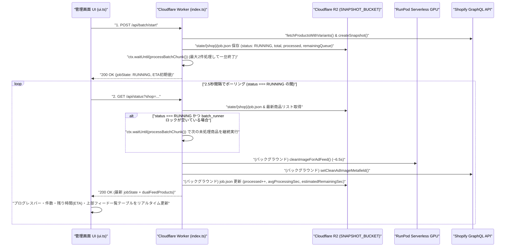

# Phase 3–5 実装・検証引き継ぎ仕様書：一括カタログ同期（Batch Sync）の30秒制限回避・リアルタイム進捗＆推定残り時間（ETA）可視化

- **作成日**: 2026-11-03
- **ステータス**: 設計合意済・実装待機（Phase 3〜Phase 5 実行用インプット）
- **対象システム**: SafeMedia Shield (AdFeed Clean for Google Shopping)
- **関連マスター文書**:
  - システム設計書: [`docs/SYSTEM_DESIGN.md`](file:///Users/yusuke/antigravity/Micro-SaaS/docs/SYSTEM_DESIGN.md)
  - 総合テスト仕様書: [`docs/TEST_SPEC_SHOPIFY_INTEGRATION.md`](file:///Users/yusuke/antigravity/Micro-SaaS/docs/TEST_SPEC_SHOPIFY_INTEGRATION.md)
  - フェーズ実行定義スキル: [`.agents/skills/adfeed-clean-rules/SKILL.md`](file:///Users/yusuke/antigravity/Micro-SaaS/.agents/skills/adfeed-clean-rules/SKILL.md)

---

## 1. エグゼクティブ・サマリー（目的と結論）

### 1.1 解決する課題（Why）
総合テスト（[`docs/TEST_SPEC_SHOPIFY_INTEGRATION.md`](file:///Users/yusuke/antigravity/Micro-SaaS/docs/TEST_SPEC_SHOPIFY_INTEGRATION.md)）の **【項目 D-2】** 実施にあたり、管理画面の Step 2「Sync All Existing Products (Full Catalog Ad-Feed Generation)」を実行した際、画面上は4秒で「100%完了」と表示されたにもかかわらず、実際には18商品中1商品しか追加処理されず、一覧テーブルも `Pending` のまま更新されない事象が発生した。

### 1.2 確定した4つの根本原因（Fact）
1. **フロントエンドのダミータイマー** ([`cloudflare_worker/src/ui.ts` L1539-L1561](file:///Users/yusuke/antigravity/Micro-SaaS/cloudflare_worker/src/ui.ts#L1539-L1561)):
   - [`startBatch()`](file:///Users/yusuke/antigravity/Micro-SaaS/cloudflare_worker/src/ui.ts#L1513-L1562) がバックエンドの進捗を参照せず、`setInterval` で `800ms` ごとに `+20%` ずつ進める固定アニメーションになっており、`4.0秒` で強制的に100%完了表示になっていた。
2. **Cloudflare Workers `ctx.waitUntil` の30秒制限による途中終了** ([`cloudflare_worker/src/index.ts` L2623-L2701](file:///Users/yusuke/antigravity/Micro-SaaS/cloudflare_worker/src/index.ts#L2623-L2701)):
   - 1商品あたりのRunPod AI推論＋メタフィールド保存に実測 `6.0〜7.5秒` 要するため、全18商品を単一HTTPリクエスト内の `ctx.waitUntil` で直列ループ処理すると約 `110〜135秒` かかる。しかしCloudflare Workersの単一リクエスト後処理（`ctx.waitUntil`）は最大 `30秒` で打ち切られるため、1〜2件目を処理した時点でプロセスが強制終了していた。
3. **バッチジョブ状態（`jobStatesByShop`）のインメモリ揮発** ([`cloudflare_worker/src/index.ts` L26](file:///Users/yusuke/antigravity/Micro-SaaS/cloudflare_worker/src/index.ts#L26), [`L813-L827`](file:///Users/yusuke/antigravity/Micro-SaaS/cloudflare_worker/src/index.ts#L813-L827)):
   - `jobStatesByShop` がWorkerプロセスのメモリ内 `Map` にしか保存されておらず、Cloudflare R2に永続化されていないため、別Isolateへリクエストがルーティングされると進捗状態が失われていた。
4. **上部フィードテーブル（`#synced_feed_rows`）のリアルタイム未更新** ([`cloudflare_worker/src/ui.ts` L1152-L1178](file:///Users/yusuke/antigravity/Micro-SaaS/cloudflare_worker/src/ui.ts#L1152-L1178)):
   - ダミータイマー終了時（開始4秒後）に1度しか [`refreshStatus()`](file:///Users/yusuke/antigravity/Micro-SaaS/cloudflare_worker/src/ui.ts#L992-L1005) が呼ばれないため、バックグラウンドで生成されたメタフィールドが画面テーブルに反映されなかった。

### 1.3 達成ゴール（定量指標）
- **完走保証**: 商品数が18件〜数百件であっても、Cloudflare Workersの `30秒` 制限に抵触せず100%完走すること。
- **リアルタイム進捗・ETA表示**: `2.5〜3.0秒` 間隔のポーリングにより、実測の完了件数（`processed / total`）、進捗率（`%`）、現在処理中の商品名、および直近の実測平均処理秒数に基づく **推定残り時間（ETA：例 `約 1分 15秒`）** をリアルタイムに表示すること。
- **フィード一覧テーブルの即時連動**: 商品が1件完了するごとに、ページリロードなしで上部テーブル（`#synced_feed_rows`）のステータスが `Pending` ➔ `✅ Clean Ad Image Ready` へ動的に切り替わること。

---

## 2. 現在のテスト進捗と環境コンテキスト（別チャット引き継ぎ情報）

### 2.1 本番・検証環境情報（確定事実）
- **対象Shopifyストア**: `safemedia-test-20261011.myshopify.com`（全18商品登録済）
- **Cloudflare Worker URL**: `https://safemedia-shield-worker.safemedia.workers.dev`
- **Cloudflare R2 バケット**: `safemedia-snapshots`（バインディング名: `SNAPSHOT_BUCKET`）
  - ストアの有効なOAuthトークンは R2 `state/safemedia-test-20261011.myshopify.com/auth.json` に保存済。
  - 課金・トライアル状態は R2 `state/safemedia-test-20261011.myshopify.com/billing.json`（現在 `planStatus: "TRIAL_14D_ACTIVE"`）に保存済。
- **RunPod Serverless エンドポイント**:
  - Endpoint ID: `cho9rydg8gsc9w`（`idleTimeout: 60`秒、`workersMax: 3`、Workerシークレット `RUNPOD_API_KEY` 登録済）
  - クライアント実装: [`cloudflare_worker/src/runpod_client.ts` L115-L176](file:///Users/yusuke/antigravity/Micro-SaaS/cloudflare_worker/src/runpod_client.ts#L115-L176)（非同期 `/run` ＋ `/status/{id}` ポーリング方式へ改修済、実測約6.07秒/枚で正常稼働中）

### 2.2 総合テスト仕様書（`docs/TEST_SPEC_SHOPIFY_INTEGRATION.md`）の消化状況
| テストグループ / 項目 | 状態 | 備考 |
| :--- | :---: | :--- |
| **グループ A**（インストール・OAuth・14日トライアル課金承認） | ✅ **PASS** | 完了済 |
| **グループ B**（2-Zone英語標準UI・GMC/Metaフィードマッピング可視化） | ✅ **PASS** | 完了済 |
| **【項目 C-1】** 1商品カナリアプレビューテスト | ✅ **PASS** | `Multi-Variant Pro Snowboard` で実画像文字消去（6.07秒）確認済 |
| **【項目 C-2】** RunPod GPU処理時間・画像品質・推論原価の自動判定 | ✅ **PASS** | 6.07秒 ≦ 15秒、0.187円/枚 ≦ 3円/枚、HTTP 200 JPEG確認済 |
| **【項目 C-3】** 自社ストアフロント画像非破壊の厳格検証 | ✅ **PASS** | GraphQL照合＆公開オンラインストア目視確認済 |
| **【項目 D-1】** 複数バリアント商品のバリアント紐付け保持検証 | ✅ **PASS** | 3バリアントの `ProductImage` ID完全一致＆公開ストア切替確認済 |
| **【項目 D-2】** ワンクリック・ロールバック実演 ＆ 比較テーブル描画 | 🔄 **進行中** | **本仕様書のPhase 3〜4修正をデプロイ後、Step 2一括処理 ➔ Step 3復元で確認する** |
| **【項目 E-1】** サーキットブレーカー（緊急停止 ＆ 再開）の即時応答性 | ⏳ **未着手** | **本仕様書のPhase 3〜4修正をデプロイ後、一括処理中に停止ボタンを押して確認する** |
| **【項目 E-2】** セキュリティ・テナント隔離・HMAC署名検証の自動監査 | ⏳ **未着手** | D-2・E-1完了後にスクリプト実行で確認する |

---

## 3. Phase 1〜5 スコープ見極めと変更対象ファイル一覧

[`.agents/skills/adfeed-clean-rules/SKILL.md` L30-L78](file:///Users/yusuke/antigravity/Micro-SaaS/.agents/skills/adfeed-clean-rules/SKILL.md#L30-L78) に定義された5工程のうち、**Phase 1（Architecture）および Phase 2（Foundation）のやり直しは不要**であり、**Phase 3（Backend）〜 Phase 5（Audit & Test）の局所改修のみ**で完結する。

| 工程 | やり直し要否 | 対象ファイル・シンボル | 変更行数目安 |
| :--- | :---: | :--- | :---: |
| **Phase 1: Architecture** | **不要** | 既存のエンドポイント（`/api/batch/start`, `/api/batch/abort`, `/api/status`）およびR2バケット構成を変更しないため影響なし。 | 0行 |
| **Phase 2: Foundation** | **不要** | OAuth認証、セッション検証、Shopify Billing API連携、R2バインディングには一切変更なし。 | 0行 |
| **Phase 3: Backend** | **要（局所修正）** | 1. [`cloudflare_worker/src/types.ts`](file:///Users/yusuke/antigravity/Micro-SaaS/cloudflare_worker/src/types.ts#L107-L117) (`BatchJobState` 型拡張)<br/>2. [`cloudflare_worker/src/index.ts`](file:///Users/yusuke/antigravity/Micro-SaaS/cloudflare_worker/src/index.ts#L813-L827) (`getShopJobState` / `saveShopJobState` R2永続化)<br/>3. [`cloudflare_worker/src/index.ts`](file:///Users/yusuke/antigravity/Micro-SaaS/cloudflare_worker/src/index.ts#L1542-L1633) & [`L2591-L2735`](file:///Users/yusuke/antigravity/Micro-SaaS/cloudflare_worker/src/index.ts#L2591-L2735) (チャンク継続実行＆ETA算出) | 約70行 |
| **Phase 4: Frontend** | **要（局所修正）** | [`cloudflare_worker/src/ui.ts`](file:///Users/yusuke/antigravity/Micro-SaaS/cloudflare_worker/src/ui.ts#L375-L388) & [`L1512-L1580`](file:///Users/yusuke/antigravity/Micro-SaaS/cloudflare_worker/src/ui.ts#L1512-L1580) (ダミータイマー廃止、実測ポーリング、ETA表示、テーブル連動更新) | 約50行 |
| **Phase 5: Audit & Test** | **要（検証実行）** | 既存自動テスト3本のPASS確認、デプロイ、および [`docs/TEST_SPEC_SHOPIFY_INTEGRATION.md`](file:///Users/yusuke/antigravity/Micro-SaaS/docs/TEST_SPEC_SHOPIFY_INTEGRATION.md) の項目 D-2・E-1・E-2 の完遂。 | テスト実行 |

---

## 4. アーキテクチャ・処理フロー設計（How）

Cloudflare Workersの単一リクエスト `ctx.waitUntil` の30秒制限を突破するため、**「R2永続化ジョブ状態（`state/{shop}/job.json`）＋ R2分散ランナーロック（`locks/{shop}/batch_runner.json`）＋ `/api/status` ポーリング連動のチャンク継続実行」**を採用する。



---

## 5. Phase 3（Backend）詳細実装仕様

### 5.1 型定義の拡張（[`cloudflare_worker/src/types.ts`](file:///Users/yusuke/antigravity/Micro-SaaS/cloudflare_worker/src/types.ts#L107-L117)）
[`BatchJobState`](file:///Users/yusuke/antigravity/Micro-SaaS/cloudflare_worker/src/types.ts#L107-L117) に、ETA算出および進捗表示用のオプショナルフィールドを追加する（既存の必須フィールドは一切変更しない）。

```typescript
export interface BatchJobState {
  jobId: string;
  shop?: string;
  status: "IDLE" | "RUNNING" | "COMPLETED" | "ABORTED" | "FAILED";
  total: number;
  processed: number;
  skippedCount?: number;            // 既にクリーン済または画像なしでスキップした件数
  cleanedCount?: number;            // 今回のバッチで新規AIクリーンアップした件数
  currentProductId?: string;        // 現在処理中の商品GID
  currentProductTitle?: string;     // 現在処理中の商品名
  avgProcessingSec?: number;        // 1件あたりの平均AI処理秒数（初期値 6.8秒、実測で動的更新）
  estimatedRemainingSec?: number;   // 推定残り秒数（残り要AI処理件数 × avgProcessingSec）
  errors: string[];
  startedAt?: string;
  updatedAt?: string;
  finishedAt?: string;
}
```

### 5.2 バッチジョブ状態のR2永続化（[`cloudflare_worker/src/index.ts`](file:///Users/yusuke/antigravity/Micro-SaaS/cloudflare_worker/src/index.ts#L813-L827)）
現在メモリ内の `jobStatesByShop` のみを使っている [`getShopJobState(shop)`](file:///Users/yusuke/antigravity/Micro-SaaS/cloudflare_worker/src/index.ts#L813-L827) を、直下の [`getShopBillingState(env, shop)`](file:///Users/yusuke/antigravity/Micro-SaaS/cloudflare_worker/src/index.ts#L829-L864) と同じ **メモリキャッシュ ＋ R2（`state/{shop}/job.json`）永続化方式** に拡張する。

- **`loadShopJobState(env: Env, shop: string): Promise<BatchJobState>`**:
  - `env.SNAPSHOT_BUCKET.get("state/" + shop + "/job.json")` から読み込み、`jobStatesByShop` を更新して返す。存在しない場合は初期状態（`status: "IDLE", total: 0, processed: 0, errors: []`）を返す。
- **`saveShopJobState(env: Env, shop: string, state: BatchJobState): Promise<void>`**:
  - `state.updatedAt = new Date().toISOString()` をセットし、`jobStatesByShop.set(shop, state)` と `env.SNAPSHOT_BUCKET.put("state/" + shop + "/job.json", JSON.stringify(state))` の両方に保存する。

### 5.3 チャンク駆動バッチワーカーと30秒制限回避ロジック（[`cloudflare_worker/src/index.ts`](file:///Users/yusuke/antigravity/Micro-SaaS/cloudflare_worker/src/index.ts#L2591-L2735)）

1. **バッチランナー排他ロック（多重起動防止）**:
   - R2キー `locks/${shop}/batch_runner.json`（TTL: `20,000ms`＝20秒）を使用し、同時に複数のWorker Isolateが同じショップのバッチループを重複実行しないよう制御する。
2. **1回のチャンク実行上限（`MAX_ITEMS_PER_CHUNK = 2` または経過時間 `18秒` 以内）**:
   - 1回の `ctx.waitUntil(runBatchChunk(...))` では、AI推論が必要な商品を **最大2件（約12〜15秒）** 処理したら一旦ロックを解放して正常終了する（これによりCloudflareの30秒強制終了に絶対にかからない）。
   - ※すでにメタフィールド生成済みの商品や画像がない商品は `0.05秒` で即座にスキップカウントされるため、チャンク上限に含めず一気に進める。
3. **初期カウントとETA（推定残り時間）の精密計算**:
   - `/api/batch/start` 開始時（および各チャンク実行時）に全商品リスト `products` を確認し、以下を算出する：
     - すでに `cleanAdImageUrl` が存在し、かつ元画像URLが一致する商品（および元画像が0枚の商品）は「完了済（スキップ対象）」として即座に `processed` に計上する。
     - 残りの「実際にRunPod AI推論が必要な未処理商品数（`remainingToClean`）」を特定する。
     - 推定残り秒数:
       $$\text{estimatedRemainingSec} = \text{remainingToClean} \times \text{avgProcessingSec}$$
       （`avgProcessingSec` の初期値は実測中央値の `6.8` 秒とし、1件AI処理が完了するごとに移動平均で更新する）。
4. **`GET /api/status` からの自動継続トリガー** ([`cloudflare_worker/src/index.ts` L1542-L1633](file:///Users/yusuke/antigravity/Micro-SaaS/cloudflare_worker/src/index.ts#L1542-L1633)):
   - `GET /api/status` が呼ばれた際、`jobState.status === "RUNNING"` かつ ` !billingState.circuitBreakerTripped` であり、バッチランナーロック（`locks/${shop}/batch_runner.json`）が解放状態（前チャンク完了済、または20秒以上経過）であれば、`ctx.waitUntil(runBatchChunk(...))` を非同期起動して次のチャンク（1〜2商品）を継続処理する。
   - これにより、フロントエンドがポーリングを続ける限り、何百件の商品があっても2件ずつ確実にバトンを繋いで100%完走する。
5. **緊急停止（`/api/batch/abort`）の即時反映** ([`cloudflare_worker/src/index.ts` L2718-L2735](file:///Users/yusuke/antigravity/Micro-SaaS/cloudflare_worker/src/index.ts#L2718-L2735)):
   - `/api/batch/abort` 受信時は、`jobState.status = "ABORTED"`, `jobState.estimatedRemainingSec = 0` を即座に R2 `state/{shop}/job.json` に保存し、`billingState.circuitBreakerTripped = true` も保存する。

---

## 6. Phase 4（Frontend）詳細実装仕様

### 6.1 既存テスト互換性の維持（絶対遵守事項）
既存の自動テストスイート（[`tests/empirical_dom_challenger_m2.py`](file:///Users/yusuke/antigravity/Micro-SaaS/tests/empirical_dom_challenger_m2.py), [`tests/test_m2_bilingual_parity.py`](file:///Users/yusuke/antigravity/Micro-SaaS/tests/test_m2_bilingual_parity.py)）が検証している以下のDOM ID・関数名・I18N辞書キーは**一切削除・リネームせずそのまま維持**する：
- 維持必須DOM ID: `#batch-progress-section`, `#batch-progress-inner`, `#batch-status-text`, `#batch-percentage`, `#batch-progress-bar`, `#batch-details`, `#btn-start-batch`, `#btn-abort-batch`, `#synced_feed_rows`
- 維持必須関数名: `startBatch()`, `abortBatch()`, `refreshStatus()`, `renderStatusData()`

### 6.2 `startBatch()` の改修と実測ポーリング化（[`cloudflare_worker/src/ui.ts` L1512-L1580](file:///Users/yusuke/antigravity/Micro-SaaS/cloudflare_worker/src/ui.ts#L1512-L1580)）
1. `800ms` ごとに `progress += 20` していたダミー `setInterval` を完全削除する。
2. 代わりに、`POST /api/batch/start` 成功直後から `2,500ms`（2.5秒）間隔で `pollBatchStatus()`（内部で `refreshStatus()` を呼び出し、`lastStatusData.jobState` を描画）を実行する。
3. **`renderBatchProgress(jobState)` の表示内容**:
   - **進捗率 (`#batch-percentage` & `#batch-progress-bar`)**:
     - `pct = jobState.total > 0 ? Math.min(100, Math.round((jobState.processed / jobState.total) * 100)) : 0`
   - **ステータステキスト (`#batch-status-text`)**:
     - 実行中（`RUNNING`）:
       - 英語: `⚡ Processing: ${jobState.processed} / ${jobState.total} products (${pct}%) — ⏱️ Est. remaining: ${formatEta(jobState.estimatedRemainingSec, 'en')}`
       - 日本語: `⚡ 処理中: ${jobState.processed} / ${jobState.total} 商品 (${pct}%) — ⏱️ 残り時間目安: ${formatEta(jobState.estimatedRemainingSec, 'ja')}`
     - 完了時（`COMPLETED`）:
       - 英語: `🎉 All catalog ad feeds generated! (${jobState.total}/${jobState.total} products • 100%)`
       - 日本語: `🎉 全商品の広告フィード用画像生成が完了しました！ (${jobState.total}/${jobState.total} 商品 • 100%)`
   - **詳細ボックス (`#batch-details`)**:
     - 実行中（`RUNNING`）:
       - 英語: `Current: ${jobState.currentProductTitle || 'Preparing...'} | Avg speed: ~${(jobState.avgProcessingSec || 6.8).toFixed(1)}s/item | Storefront images & variants 100% preserved.`
       - 日本語: `現在処理中: ${jobState.currentProductTitle || '準備中...'} | 平均処理速度: 約${(jobState.avgProcessingSec || 6.8).toFixed(1)}秒/件 | ストア画像・バリアント紐付け保護中`
   - **推定残り時間フォーマッタ (`formatEta(sec, lang)`)**:
     - `sec <= 0`: `Almost done...` / `まもなく完了...`
     - `sec < 60`: `~${Math.ceil(sec)}s` / `約 ${Math.ceil(sec)}秒`
     - `sec >= 60`: `~${Math.floor(sec / 60)}m ${Math.ceil(sec % 60)}s` / `約 ${Math.floor(sec / 60)}分 ${Math.ceil(sec % 60)}秒`
4. **ページ再読み込み時の自動復帰**:
   - [`renderStatusData(data)`](file:///Users/yusuke/antigravity/Micro-SaaS/cloudflare_worker/src/ui.ts#L1007) 内で `data.jobState && data.jobState.status === 'RUNNING'` を検知した場合、ページをリロードした後でも自動的にプログレスバー（`#batch-progress-inner`）を表示し、ポーリングタイマーを再開する。
5. **上部テーブル（`#synced_feed_rows`）での処理中バッジ表示**:
   - [`renderStatusData(data)`](file:///Users/yusuke/antigravity/Micro-SaaS/cloudflare_worker/src/ui.ts#L1157-L1177) で各商品行を描画する際、`data.jobState?.status === 'RUNNING'` かつ該当商品が `currentProductId`（または `currentProductTitle`）に一致する場合は、Status列に青色パルスバッジ `🔄 Processing AI...`（日本語: `🔄 AI処理中...`）を表示し、完了した商品から順次緑バッジ `✅ Clean Ad Image Ready` へリアルタイムに切り替える。

---

## 7. 異常系・フェイルセーフ設計

1. **個別商品のAI推論エラー時の継続性（Fault Isolation）**:
   - 特定の商品（例：壊れた画像URLや外部サーバーの404等）でRunPod推論が失敗した場合でも、バッチ全体をクラッシュさせず、`jobState.errors` にエラー内容を記録した上で `processed++` して次の商品へ進む。
2. **ロックのデッドロック防止（TTL Auto-Expiry）**:
   - バッチランナーロック（`locks/${shop}/batch_runner.json`）には `20秒` の有効期限（TTL）を設定する。万一Workerがネットワーク瞬断等で異常終了しても、20秒後の `/api/status` ポーリング時にロックが自動失効し、残りの処理が確実に再開される。
3. **サーキットブレーカー（緊急停止）の最優先チェック**:
   - チャンク内の各商品ループの先頭で必ず R2 上の `job.json`（`status === "ABORTED"`）および `billing.json`（`circuitBreakerTripped === true`）を確認し、緊急停止ボタンが押された場合は次の商品のRunPod呼び出しを即座に中止する。

---

## 8. Phase 5（Audit & Test）検証計画と実行手順

別チャットでの実装完了後、以下の順序で品質ゲートと実機テストを実行すること。

### Step 1: 自動品質ゲート（Auto Quality Gate）の実行
1つのコマンドでTypeScript型チェックおよび既存テストスイート3本をすべて実行し、全件 `[PASS]` を確認する：
```bash
cd /Users/yusuke/antigravity/Micro-SaaS/cloudflare_worker && npx tsc --noEmit && cd /Users/yusuke/antigravity/Micro-SaaS && python3 tests/empirical_dom_challenger_m2.py && python3 tests/test_m2_bilingual_parity.py && python3 tests/test_legal_and_store_assets.py
```

### Step 2: Cloudflare Workers 本番デプロイ
```bash
cd /Users/yusuke/antigravity/Micro-SaaS/cloudflare_worker && npx wrangler deploy
```

### Step 3: 総合テスト仕様書（`docs/TEST_SPEC_SHOPIFY_INTEGRATION.md`）の残項目完遂
1. **一括処理とリアルタイム進捗・ETAの確認**:
   - Shopify管理画面で **Step 2「Start Full Catalog Batch Sync」** をクリックし、プログレスバーの件数（`X / 18 products`）、パーセンテージ、**推定残り時間（ETA）** がリアルタイムにカウントダウンされ、上部テーブル（`RECENT SYNCED PRODUCT FEED`）の各行が順次 `✅ Clean Ad Image Ready` になることを確認する。
2. **【項目 E-1】緊急停止（Circuit Breaker）＆再開の確認**:
   - 一括処理の進行中に赤い **「⛔ Instant Stop (Circuit Breaker)」** ボタンをクリックし、即座に処理が停止（`🛑 Emergency Stop Active`）すること、および上部の **「▶️ Resume Protection」** で再開できることを確認する。
3. **【項目 D-2】1クリック・ロールバック実演 ＆ Before/After比較テーブル確認**:
   - **Step 3「⏮️ Revert to Previous Snapshot」** ➔ **「Yes, Restore Now」** をクリックし、10秒以内にスナップショット時点へロールバックされ、画面下部に **「Rollback Before vs. After Product Data Comparison」** テーブルが描画されることを確認する。
4. **【項目 E-2】セキュリティ・テナント隔離・HMAC署名検証の自動監査**:
   - 総合テスト仕様書のグループE-2に従い、不正HMAC（401）、クロステナントアクセス拒否（403）、SSRF拒否（400）を検証して全項目 PASS を完了させる。
