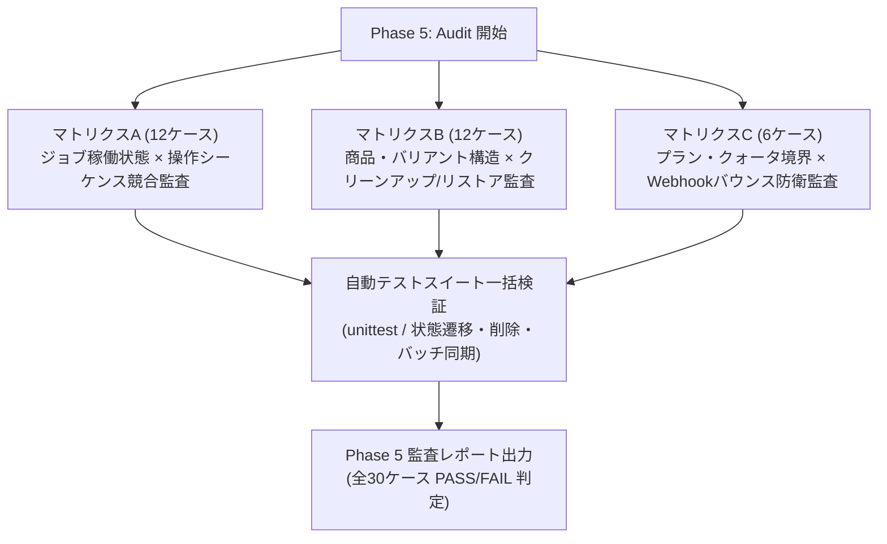

# Phase 5 標準監査仕様書：状態遷移・データ階層・競合マトリクス総点検 (A-1 〜 C-6)
## (Phase 5 Comprehensive State Transition & Variant Hierarchy Audit Specification)

> **文書バージョン**: 1.0.0  
> **最終更新日**: 2026-11-23  
> **対象システム**: AdFeed Clean: Google Shopping (SafeMedia Shield) for Shopify  
> **呼び出しタイミング**: **Phase 5（Audit / 監査・テスト工程）実行時**、またはバックエンド（`cloudflare_worker/src/`）・スナップショットエンジン・ジョブ制御・Webhook処理の変更完了時  
> **関連マスター文書**:
> - プロジェクトスキル定義: [`.agents/skills/adfeed-clean-rules/SKILL.md`](file:///Users/yusuke/antigravity/Micro-SaaS/.agents/skills/adfeed-clean-rules/SKILL.md)
> - 統合システム設計書: [`docs/SYSTEM_DESIGN.md`](file:///Users/yusuke/antigravity/Micro-SaaS/docs/SYSTEM_DESIGN.md)
> - 実機総合テスト仕様書: [`docs/TEST_SPEC_SHOPIFY_INTEGRATION.md`](file:///Users/yusuke/antigravity/Micro-SaaS/docs/TEST_SPEC_SHOPIFY_INTEGRATION.md)

---

## 1. 本ドキュメントの目的と設計思想

単一エンドポイントの正常系テスト（「ボタンを押したら成功レスポンスが返るか」）だけでは、実運用や手動テストで発生する以下の**2大構造バグ**を検出できない。

1. **非同期ジョブ状態とユーザー操作の競合（State Transition Race）**
   - 例：全件バッチ処理を緊急停止（`ABORTED`）または破棄（`CANCELLED`）した直後に、進行中だったバックグラウンドチャンクが遅れて完了し、R2上のジョブ状態を古い `RUNNING` で上書き（ゾンビ復活）させ、その後の手動バックアップや `/api/status` ポーリングをきっかけに全件処理が勝手に再実行される不具合。
2. **親商品（Product）と子バリアント（Variant）のデータ階層非対称性（Hierarchy Asymmetry）**
   - 例：AIクリーンアップ時は「親商品のMetafield」と「各子バリアントのMetafield」の双方に書き込んでいるにもかかわらず、初期状態（Virgin Baseline）へのリストア時やロールバック直後のWebhookバウンス抑制判定で「親商品の代表画像1枚目（`originalMediaList[0]`）」しか参照・消去せず、バリアント画像持ちの商品だけリストア漏れや再発火を起こす不具合。

Phase 5（監査工程）では、組み合わせ爆発（900通り以上）を防ぐため、直交する**3つのマトリクス（A: ジョブ稼働状態×操作、B: 商品・バリアント構造×ライフサイクル、C: クォータ・バウンス防衛）全30ケース**に圧縮し、**静的コード監査＋自動テスト検証**を義務付ける。



---

## 2. マトリクスA：【アプリ稼働状態 × 操作シーケンス競合】（12ケース）

### 2.1 マトリクスA 一覧表

| 現在状態 (`jobState.status` / `circuitBreakerTripped`) | 操作①：手動バックアップ<br>(`POST /api/snapshot/create`) | 操作②：ロールバック実行<br>(`POST /api/rollback`) | 操作③：緊急停止・再開・破棄<br>(`abort` / `resume` / `cancel`) | 操作④：Shopify Webhook着弾<br>(`POST /webhooks/products/update`) |
| :--- | :--- | :--- | :--- | :--- |
| **A-1. 未実行 / 完了**<br>(`IDLE` / `COMPLETED`, CB: `false`) | **[A-1-1]** スナップショット作成のみ実行。バッチジョブが起動しないこと | **[A-1-2]** 指定世代へ完全復元。復元に伴う自身のMetafield更新でWebhookが再発火しないこと | **[A-1-3]** 非対象（または安全なNo-op / 状態維持） | **[A-1-4]** Auto-Sync ONかつ未処理画像がある場合のみAI推論実行。テキスト・価格変更のみの場合はスキップ（ただしR2補助フィードのタイトル・ステータス同期は実行） |
| **A-2. 全件バッチ処理中**<br>(`RUNNING`, CB: `false`) | **[A-2-1]** バックアップ取得によって `jobState` が破壊されたり、チャンクが多重起動しないこと（`acquireBatchLock` 排他維持） | **[A-2-2]** ロールバック中に `last_rollback.json` が先行記録され、並行Webhookによる再クリーンアップが抑制されること | **[A-2-3] 🔥重要** `abort` / `cancel` 呼び出し直後に、実行中だった `runBatchChunk` が遅れて `saveShopJobState(RUNNING)` を呼んでも、**絶対に `ABORTED` / `CANCELLED` を `RUNNING` で上書き復活させない**こと | **[A-2-4]** バッチ処理中の同一商品に対し `acquireInFlightLock` / `acquireGpuSlot` で二重AI推論を防止すること |
| **A-3. 緊急停止中**<br>(`ABORTED`, CB: `true`) | **[A-3-1] 🔥重要** バックアップ実行やその後の `GET /api/status` ポーリングによって、`ABORTED` が解除されたりバッチが再実行されないこと | **[A-3-2]** 緊急停止中であってもロールバック（ストア復旧）は常に許可し、復元完了後も `ABORTED` & CB: `true` を維持すること | **[A-3-3]**<br>・`resume`: CB解除し未処理残数がある場合のみ `allowRestartFromStopped: true` で再開<br>・`cancel`: `CANCELLED` へ遷移しCB解除、バッチは**再開しない** | **[A-3-4]** CB `true` のため新規AIクリーンアップは即座に遮断（`circuit_breaker_active` でスキップ）されること |
| **A-4. バッチ破棄済**<br>(`CANCELLED`, CB: `false`) | **[A-4-1] 🔥重要** バックアップ実行や `/api/status` ポーリング、画面リロードを行っても、破棄したバッチが絶対に再実行されないこと | **[A-4-2]** 正常にロールバック可能であり、復元完了後も `CANCELLED` を維持してバッチが再発火しないこと | **[A-4-3]** 既に破棄完了状態。`resume` を誤って呼んでも `CANCELLED` からはバッチを再起動しないこと（`currentJob.status === "ABORTED"` のみ再開可） | **[A-4-4]** CBは `false`（通常保護再開）のため、単発のWebhook（Auto-Sync ON時）は正常に受け付けること |

### 2.2 マトリクスA 静的コード監査ポイント（不変条件）
- **不変条件 A-I ([`cloudflare_worker/src/index.ts`](file:///Users/yusuke/antigravity/Micro-SaaS/cloudflare_worker/src/index.ts#L1785-L1829) `saveShopJobState`)**:
  - `options?.allowRestartFromStopped === true` が明示的に渡されない限り、R2またはメモリ上の現在ステータスが `ABORTED` または `CANCELLED` の場合に `RUNNING` や `COMPLETED` で上書きすることを拒否（`return false`）しているか？
  - `allowRestartFromStopped: true` を渡してよいのは、ユーザーの明示的な操作である `POST /api/batch/start` と `POST /api/batch/resume` の2箇所のみであるか？
- **不変条件 A-II ([`cloudflare_worker/src/index.ts`](file:///Users/yusuke/antigravity/Micro-SaaS/cloudflare_worker/src/index.ts#L3290-L3303) `GET /api/status`)**:
  - `/api/status` ポーリングが次チャンク（`runBatchChunk`）を自動トリガーする条件が `jobState.status === "RUNNING" && !billingState.circuitBreakerTripped && !(await isBatchLockActive(...))` に厳密に限定されているか？
- **不変条件 A-III ([`cloudflare_worker/src/index.ts`](file:///Users/yusuke/antigravity/Micro-SaaS/cloudflare_worker/src/index.ts#L2004-L2012) `runBatchChunk`)**:
  - 時間のかかる外部I/O（`fetchProductsWithVariants()` や `cleanImageForAdFeed()`）の直後に毎回 `loadShopJobState(env, shop)` を再確認し、`status !== "RUNNING"` または `circuitBreakerTripped` に変わっていたら即座にループを中断して `return` しているか？

---

## 3. マトリクスB：【商品・バリアント構造 × クリーンアップ＆リストア】（12ケース）

### 3.1 マトリクスB 一覧表

| 商品のデータ構造パターン | フェーズ①：AIクリーンアップ実行<br>(Canary / Batch / Webhook) | フェーズ②：初期状態（Virgin Baseline）へリストア<br>(`metafieldAction: "PURGED_TO_VIRGIN"`) | フェーズ③：処理後世代へのリストア ＆ 途中削除耐性<br>(`RESTORED_TO_SNAPSHOT` / `SKIPPED_DELETED`) |
| :--- | :--- | :--- | :--- |
| **B-1. バリアントなし（単一画像）**<br>親画像1枚・デフォルトバリアント1件（画像未紐付け） | **[B-1-1]** 親画像のAI推論が1回実行され、親Metafield (`PRODUCT`) とデフォルトバリアントMetafield (`PRODUCTVARIANT`) に格納されること | **[B-1-2]** 親商品の `safemedia.clean_ad_image_url` および `dual_feed_metadata`、ならびにバリアントのMetafieldが `metafieldsDelete` で完全消去されること | **[B-1-3]** スナップショット取得後に**商品自体がShopifyから削除**されていた場合、エラーでロールバック全体を中断せず、`SKIPPED_DELETED` として記録し残りの商品を完走すること |
| **B-2. 複数バリアント（個別画像）**<br>親画像＋子バリアント（赤・青・黒等）にそれぞれ異なる固有画像が紐付いている | **[B-2-1] 🔥重要** `collectUniqueProductImages` で親＋全バリアント固有画像が収集され、すべてAIクリーンアップされた上で、`variantCleanImageMap` により各バリアント自身のクリーン画像URLが個別の `PRODUCTVARIANT` Metafieldに書き込まれること | **[B-2-2] 🔥重要** 親Metafieldだけでなく、**スナップショット時点のバリアントID＋現在生存している全バリアントID＋`beforeVariantMap` の全IDの和集合**に対して `clearCleanAdImageMetafield` が実行され、子バリアントにクリーン画像が一切残らないこと | **[B-2-3] 🔥重要** スナップショット取得後に**一部の子バリアントまたはメディア画像だけがShopify上で削除**されていた場合、`liveVariantIdSet` / `liveMediaIdSet` でフィルタリングし、`owner does not exist` エラーを出さずに生存バリアントのみ復元すること |
| **B-3. 複数バリアント（画像共有・一部画像未設定）**<br>複数サイズ（S/M/L）が同じ色画像を共有、または一部バリアントに画像がない | **[B-3-1]** `?v=` キャッシュバスター正規化（`normalizeImageUrlKey`）により同一画像URLは1回のみAI推論（Deduplication）され、結果が共有バリアント全員へ正確にマッピングされること | **[B-3-2]** `originalMediaId` が空のバリアントを `rebindVariants` 対象から除外し、不正なGraphQLミューテーションを投げないこと | **[B-3-3]** 対象スナップショット作成「後」に新しくクリーン化されたバリアントがある場合、世代ロールバック時に `clearVariantCleanAdImageMetafields` でその追加分（Stale Variant Metafields）だけを正確にパージすること |
| **B-4. 画像なし商品 / 非公開商品**<br>画像0枚、またはステータスが `DRAFT` / `ARCHIVED` | **[B-4-1]** 画像0枚商品は `isProductAlreadyCleaned` でスキップ扱いとなりバッチが詰まらないこと。また、補助フィード（`/api/feed-preview.xml`）には `ACTIVE` 商品のみが出力され、`DRAFT` / `ARCHIVED` 商品は除外されること | **[B-4-2]** 画像0枚商品や `DRAFT` / `ARCHIVED` 商品が含まれていても、リストア処理がエラーなく完了すること | **[B-4-3]** クリーン済み商品がShopify上で `ACTIVE` ➔ `DRAFT` / `ARCHIVED` に変更された際、または全画像が削除された際、Webhookスキップ経路でも `syncFeedIfAffectedOnSkip` によりR2補助フィードから即座に除外されること |

### 3.2 マトリクスB 静的コード監査ポイント（不変条件）
- **不変条件 B-I ([`cloudflare_worker/src/index.ts`](file:///Users/yusuke/antigravity/Micro-SaaS/cloudflare_worker/src/index.ts#L583-L613) `getExistingCleanedUrlMap`)**:
  - `dualFeedMetadata.cleanedImageUrls` が存在するにもかかわらず、親の `prod.cleanAdImageUrl` を無関係な画像URLへ誤ってフォールバック割り当てしていないか？（`if (prod.cleanAdImageUrl && !hasCleanedUrlMap)` のガードが維持されているか）
- **不変条件 B-II ([`cloudflare_worker/src/snapshot.ts`](file:///Users/yusuke/antigravity/Micro-SaaS/cloudflare_worker/src/snapshot.ts#L843-L983) `restoreSingleProduct`)**:
  - Virgin Baseline（クリーン画像なし世代）へのロールバック時、`allVariantIdsToPurge` が「スナップショット上のバリアント」「現在のライブバリアント」「`beforeVariantMap` のキー」のすべてを網羅し、かつ削除済みバリアント（`!liveVariantIdSet.has(vid)`）を除外して `clearCleanAdImageMetafield` に渡しているか？
  - `collectStorefrontImageUrls(p, liveProd)` によって、親画像だけでなく**全バリアントのストアフロント画像URL配列（`storefrontImageUrls`）**が `RollbackProductDataDiff` に保存されているか？
- **不変条件 B-III ([`cloudflare_worker/src/index.ts`](file:///Users/yusuke/antigravity/Micro-SaaS/cloudflare_worker/src/index.ts#L685-L760) `buildAdFeedPreview`)**:
  - `if (p.status && p.status.toUpperCase() !== "ACTIVE") continue;` により非公開商品が広告フィードから除外されているか？
  - 商品URL（`storefrontUrl`）生成時にタイトルからの推測スラッグより先に Shopify 公式の `p.handle` を優先使用しているか？

---

## 4. マトリクスC：【プラン・クォータ境界 ＆ Webhookバウンス防衛】（6ケース）

### 4.1 マトリクスC 一覧表

| ケースID | シナリオ / 境界条件 | 期待される動作・不変条件（検証ポイント） |
| :--- | :--- | :--- |
| **C-1** | **`CANARY_TRIAL`（未課金）での機能制限ゲート** | カナリアテスト（5商品まで）は実行可能。全件バッチ開始（`POST /api/batch/start`）およびロールバック（`POST /api/rollback`）は `402 Payment Required` で確実に遮断されること。 |
| **C-2** | **カナリアテストのスキップ・異常系におけるクォータ返還（Refund）** | ①画像未登録商品（`400 NO_PRODUCT_IMAGE`）、②全画像が既にクリーン済みの商品（`skipped: true, skipReason: "already_cleaned"`）、③RunPod APIエラー発生時は、事前確保した `canaryUsedCount` が即座に `-1` 返還され、`updatedAtMs` 単調増加により古いメモリキャッシュで上書きされないこと。 |
| **C-3** | **14日間トライアル上限（50枚: `TRIAL_CAP_LIMIT`）到達時の安全停止** | バッチ処理またはWebhook自動同期中に累計推論枚数（ユニーク画像単位）が50枚に達した時点で、`planStatus = "TRIAL_CAP_REACHED"` へ遷移し、過大GPU課金を防いで安全に停止すること。 |
| **C-4** | **🔥重要：ロールバック直後の遅延Webhook着弾（バウンス再発火防止）** | ロールバック実行によってShopify側のMetafieldが書き換え（または消去）された直後にShopifyから遅れて届く `products/update` Webhookに対し、`last_rollback.json` の `storefrontImageUrls`（親＋**全バリアント画像URL**）と照合し、画像自体が変わっていなければ `post_rollback_bounce_suppressed` としてAI再推論を100%抑制すること（[index.ts#L4620-L4655](file:///Users/yusuke/antigravity/Micro-SaaS/cloudflare_worker/src/index.ts#L4620-L4655)）。 |
| **C-5** | **ロールバック後の「ユーザー明示操作 / 新規画像追加」による再処理** | ロールバック後であっても、①ユーザーが明示的にカナリアテストや `force_reclean` バッチを実行した時（`clearRollbackRecordForProduct`）、または②Shopify上で以前のスナップショットに含まれない**新しい画像URL**へ差し替えた時は、抑制を解除して正常にAIクリーンアップが実行されること。 |
| **C-6** | **Auto-Sync OFF（自動同期停止）時のWebhook着弾** | `autoSyncEnabled === false` の状態では、`products/update` Webhookによる新規AI推論はスキップ（`auto_sync_paused`）されること。ただし、既存クリーン済み商品が削除・非公開化・画像全削除された場合のR2補助フィードからの除外同期（`syncFeedIfAffectedOnSkip`）は実行されること。 |

---

## 5. Phase 5 実行手順（AIエージェント用プロトコル）

> [!IMPORTANT]
> **【厳守】Phase 5 における勝手なコード修正の禁止（Read-Only Audit & Report-Only Rule）**
> Phase 5（監査・テスト工程）の実行を指示された際、AIエージェントは**実装コードやテストコードを勝手に書き換え・修正してはならない**。
> 静的コード監査（Step 1）および既存自動テストの実行（Step 2）のみを行い、問題や潜在リスクを発見した場合は**「①検出されたリスク（High/Med/Low）」「②根拠となるファイル・行番号・発生シナリオ」「③修正案（コード差分案）」をユーザーへ報告し、修正を実施するかどうかの判断を必ずユーザーに委ねること**。

Phase 5（「工程5を実行せよ」またはリリース前総点検）が指示された場合、AIエージェントは以下のステップを**読み取り・検証専用（Read-Only）**で実行し、結果を報告すること。

### Step 1: 静的コード監査（Static Invariant Verification）
本ドキュメントの **2.2（不変条件 A-I〜A-III）**、**3.2（不変条件 B-I〜B-III）**、**4.1（C-1〜C-6）** を対象コード（[`cloudflare_worker/src/index.ts`](file:///Users/yusuke/antigravity/Micro-SaaS/cloudflare_worker/src/index.ts)、[`cloudflare_worker/src/snapshot.ts`](file:///Users/yusuke/antigravity/Micro-SaaS/cloudflare_worker/src/snapshot.ts)、[`cloudflare_worker/src/shopify.ts`](file:///Users/yusuke/antigravity/Micro-SaaS/cloudflare_worker/src/shopify.ts)、[`cloudflare_worker/src/ui.ts`](file:///Users/yusuke/antigravity/Micro-SaaS/cloudflare_worker/src/ui.ts)）と突き合わせ、退行（Regression）やガード欠落がないか確認する。

### Step 2: 自動テストスイートによる一括検証コマンドの実行
以下のワンライナーコマンドを実行し、マトリクスA・B・Cを検証する全テストが `100% PASS` することを確認する。

```bash
python3 -m unittest discover -s tests -p "*.py" && python3 -m unittest discover -s tests/e2e -p "*.py"
```

特に以下のテストファイルがマトリクスA〜Cの直接の自動検証オラクルとなる：
- **マトリクスA（バッチ停止・再開・キャンセル・チャンク競合）**: [`tests/test_phase3_batch_sync_backend.py`](file:///Users/yusuke/antigravity/Micro-SaaS/tests/test_phase3_batch_sync_backend.py)
- **マトリクスB（全バリアント復元・削除商品スキップ・補助フィード同期）**: [`tests/test_rollback_deleted_products.py`](file:///Users/yusuke/antigravity/Micro-SaaS/tests/test_rollback_deleted_products.py), [`tests/test_supplemental_feed_lifecycle.py`](file:///Users/yusuke/antigravity/Micro-SaaS/tests/test_supplemental_feed_lifecycle.py), [`tests/test_phase4_variant_ui.py`](file:///Users/yusuke/antigravity/Micro-SaaS/tests/test_phase4_variant_ui.py)
- **マトリクスC（クォータ返還・課金ゲート・バウンス抑制・ドリフト監査）**: [`tests/test_billing_and_rate_limit.py`](file:///Users/yusuke/antigravity/Micro-SaaS/tests/test_billing_and_rate_limit.py), [`tests/test_canary_selection.py`](file:///Users/yusuke/antigravity/Micro-SaaS/tests/test_canary_selection.py), [`tests/empirical_drift_challenger_m3_2.py`](file:///Users/yusuke/antigravity/Micro-SaaS/tests/empirical_drift_challenger_m3_2.py)

### Step 3: 人間による実機テストストア最終確認（厳選5シナリオ・約15分）
自動テストがすべて `[PASS]` した後の最終実機確認では、全30ケースを手動で繰り返す必要はなく、以下の**5本のゴールデンシナリオ**のみを実施する。

1. **シナリオ1（バリアント個別クリーン＆フィード確認 [B-2-1]）**:
   複数バリアント画像持ち商品でカナリアテストを実行し、バリアント切替ピルで各バリアントのBefore/Afterが切り替わること、およびFeed XMLに全バリアントが出力されることを確認。
2. **シナリオ2（バッチ途中停止 ➔ 手動バックアップでの非再発火確認 [A-2-3, A-3-1, A-4-1]）**:
   全件バッチ開始 ➔ 途中で「Emergency Stop (Abort)」 ➔ 「Take Manual Backup」を実行し、**バッチが勝手に再開しないこと**を確認 ➔ 「Cancel Batch」で通常待機へ戻ることを確認。
3. **シナリオ3（初期状態 Virgin Baseline への全バリアント完全リストア [B-2-2]）**:
   全件バッチ完了後、「🛡️ Virgin Baseline」を選択してリストアを実行し、**バリアント画像持ち商品を含む全商品の親子Metafieldが完全消去（`PURGED_TO_VIRGIN`）されること**を確認。
4. **シナリオ4（リストア直後のShopify編集による非バウンス確認 [C-4]）**:
   リストア直後にShopify管理画面で商品の価格または説明文のみを変更して保存し、**AIクリーンアップが勝手に再発火しないこと**を確認。
5. **シナリオ5（新規画像追加によるAuto-Sync差分クリーン確認 [A-1-4, C-5]）**:
   Shopify管理画面で商品に新しいセール帯付き画像を追加して保存し、Auto-Syncによってその新画像のみがAIクリーンアップされることを確認。
