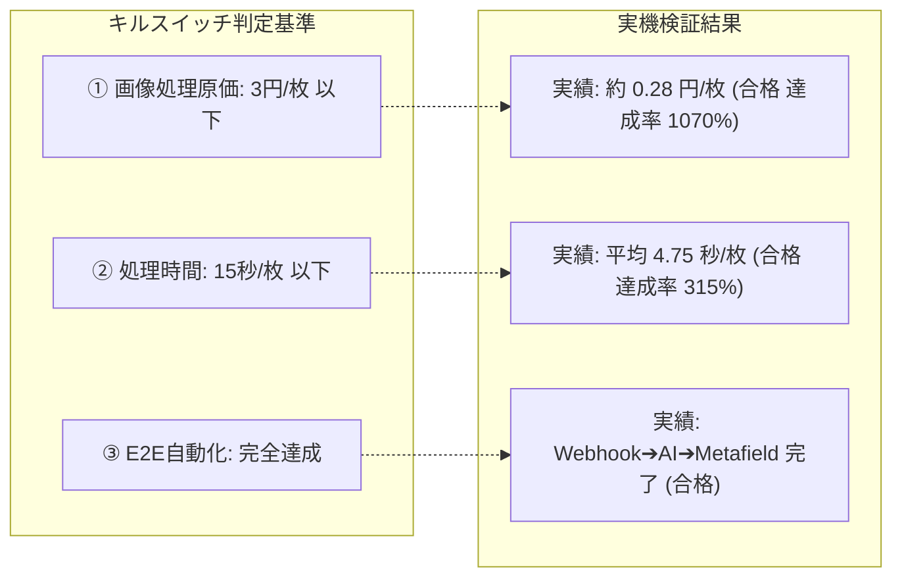
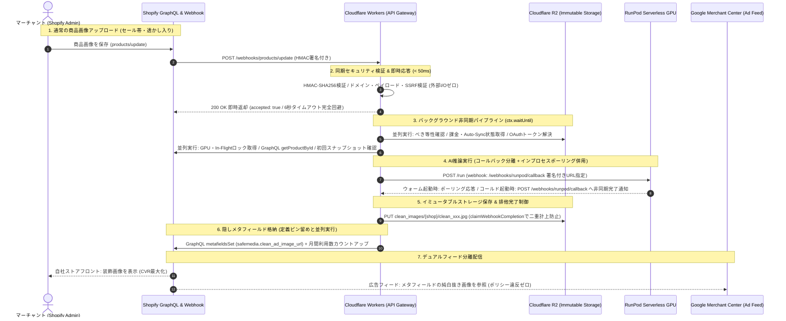
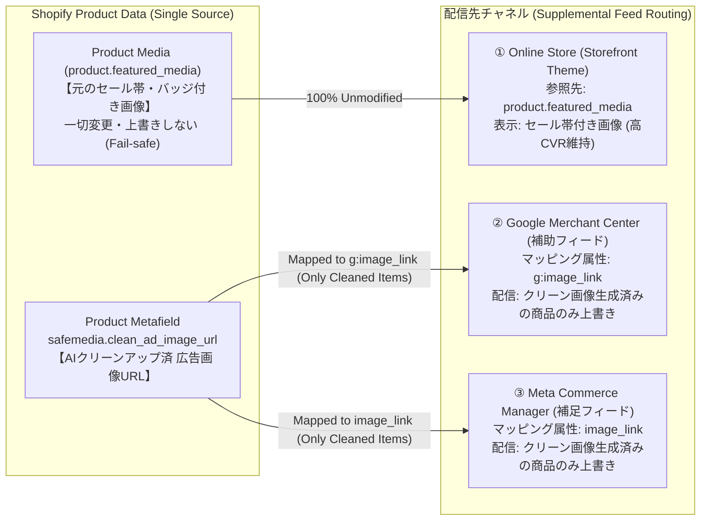
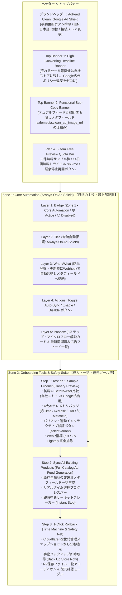
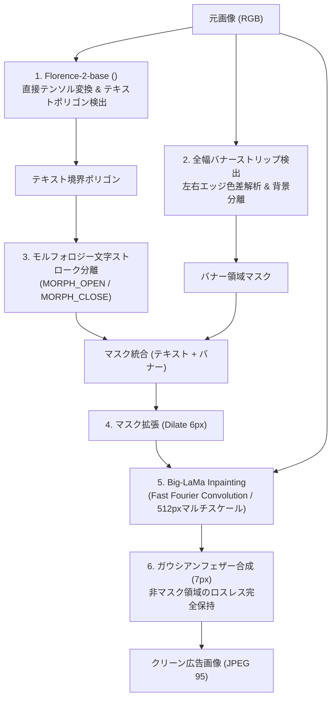
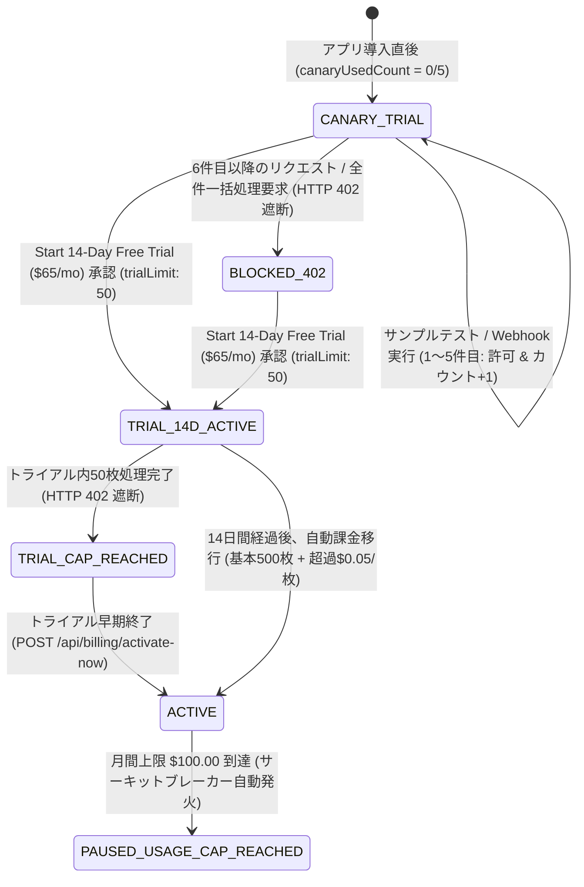
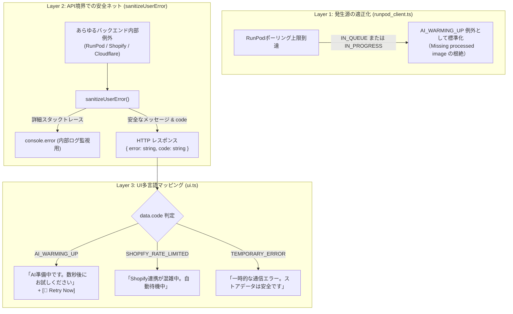

# AdFeed Clean: Google Shopping (旧称: SafeMedia Shield) - 統合システム設計書 (SYSTEM DESIGN SPECIFICATION)

> **文書バージョン**: 2.6.0 (Full Variant Image AI Cleanup Architecture & Code-Doc Alignment)  
> **最終更新日**: 2026-11-14  
> **ステータス**: 全バリアント画像AIクリーンアップ拡張設計反映済（GraphQL 2024-10統一、I18N 116キー一元管理、二重レベルMetafield・全バリアント補助フィード同期済）  
> **対象システム**: AdFeed Clean: Google Shopping (旧称: SafeMedia Shield) for Shopify (Micro-SaaS)  
> **本番稼働URL**: `https://safemedia-shield-worker.safemedia.workers.dev` (RunPod GPU Endpoint: `cho9rydg8gsc9w`)  
> **開発体制・ペアプログラミング**: ユーザー & Antigravity (AIエージェント)

---

## 目次 (Table of Contents)

1. [第1章：システム企画・ビジネス背景](#第1章システム企画ビジネス背景)
   - 1.1 [プロダクト概要とコアコンセプト（Pure Dual-Feed Ad Shield）](#11-プロダクト概要とコアコンセプトpure-dual-feed-ad-shield)
   - 1.2 [競合低評価レビュー分析と5大構造的課題](#12-競合低評価レビュー分析と5大構造的課題)
   - 1.3 [ビジネスモデル・プライシング・ROI正当性](#13-ビジネスモデルプライシングroi正当性)
   - 1.4 [定量的撤退基準（キル・スイッチ）と達成状況](#14-定量的撤退基準キルスイッチと達成状況)
2. [第2章：要件定義書 (Requirements Definition)](#第2章要件定義書-requirements-definition)
   - 2.1 [業務要件（ゼロUI / イベント駆動思想）](#21-業務要件ゼロui--イベント駆動思想)
   - 2.2 [機能要件一覧（ROI優先度別）](#22-機能要件一覧roi優先度別)
   - 2.3 [非機能要件（性能・可用性・セキュリティ）](#23-非機能要件性能可用性セキュリティ)
3. [第3章：基本設計・外部設計 (Basic Architecture Design)](#第3章基本設計外部設計-basic-architecture-design)
   - 3.1 [システム全体構成アーキテクチャ図](#31-システム全体構成アーキテクチャ図)
   - 3.2 [外部インターフェース設計 (REST API / Shopify Webhook / Admin GraphQL)](#32-外部インターフェース設計-rest-api--shopify-webhook--admin-graphql)
   - 3.3 [ストレージ & データモデル設計 (Cloudflare R2)](#33-ストレージ--データモデル設計-cloudflare-r2)
   - 3.4 [Shopify隠しメタフィールド (Metafield) 仕様 & 広告補助フィード配信マッピング設計 (審査要件 4.5.3)](#34-shopify隠しメタフィールド-metafield-仕様--広告補助フィード配信マッピング設計-審査要件-453)
   - 3.5 [管理ダッシュボード UI / UX 設計（2-Zone構成・5層カード階層・英語標準）](#35-管理ダッシュボード-ui--ux-設計2-zone構成5層カード階層英語標準)
4. [第4章：詳細設計・内部設計 (Detailed Internal Design)](#第4章詳細設計内部設計-detailed-internal-design)
   - 4.1 [AI画像クリーンアップ推論エンジン (Florence-2 + LaMa)](#41-ai画像クリーンアップ推論エンジン-florence-2--lama)
   - 4.2 [バリアント完全保護レイヤー (Variant Mapping Preserve)](#42-バリアント完全保護レイヤー-variant-mapping-preserve)
   - 4.3 [世代管理イミュータブルスナップショット & 1クリック復元](#43-世代管理イミュータブルスナップショット--1クリック復元)
   - 4.4 [Workers APIゲートウェイ制御ロジック & セキュリティガード](#44-workers-apiゲートウェイ制御ロジック--セキュリティガード)
   - 4.5 [ハイブリッド従量課金、50枚トライアルキャップ、Webhook並列制御、およびトライアル早期終了設計](#45-ハイブリッド従量課金50枚トライアルキャップwebhook並列制御およびトライアル早期終了設計)
   - 4.6 [インフラ障害・エラーハンドリング・サニタイズ規格（Fail-Safe Error Masking Architecture）](#46-インフラ障害エラーハンドリングサニタイズ規格fail-safe-error-masking-architecture)
5. [第5章：テスト仕様・検証実績報告 (Test & Verification)](#第5章テスト仕様検証実績報告-test--verification)
   - 5.1 [E2E統合テスト・セキュリティ・異常系テスト実績](#51-e2e統合テストセキュリティ異常系テスト実績)
   - 5.2 [AI推論精度・GPU処理速度・原価ベンチマーク実績](#52-ai推論精度gpu処理速度原価ベンチマーク実績)
   - 5.3 [セキュリティ検証（SSRF・HMAC・HPP・マルチテナント・TOCTOU防御）](#53-セキュリティ検証ssrfhmachppマルチテナントtoctou防御)
6. [第6章：デプロイ・環境構築・運用保守設計 (Operations & Maintenance)](#第6章デプロイ環境構築運用保守設計-operations--maintenance)
   - 6.1 [RunPod Serverless GitHub自動ビルド・デプロイ構成](#61-runpod-serverless-github自動ビルドデプロイ構成)
   - 6.2 [Cloudflare Workers & R2 デプロイ手順](#62-cloudflare-workers--r2-デプロイ手順)
   - 6.3 [Shopifyパートナーダッシュボード設定・アプリ公開チェックリスト](#63-shopifyパートナーダッシュボード設定アプリ公開チェックリスト)
   - 6.4 [トラブルシューティング & 障害対応マニュアル](#64-トラブルシューティング--障害対応マニュアル)

---

## 第1章：システム企画・ビジネス背景

### 1.1 プロダクト概要とコアコンセプト（Pure Dual-Feed Ad Shield）
本システム「**AdFeed Clean: Google Shopping (旧称: SafeMedia Shield / AdFeed Clean: Google Ad Shield)**」は、「データ駆動型デザイン思考」に基づいて設計されたShopifyマーチャント向けフェイルセーフ自動画像処理Micro-SaaSです。

従来の画像編集アプリが陥っていた「多機能化・低価格化の末のストア破壊」を反面教師とし、**「自社用/広告用のデュアルイメージ分離配信（Pure Dual-Feed Smart Routing）」**および**「絶対にストアを壊さない保険（フェイルセーフ）」**の2点に極限まで特化しています。

#### 自社ストア画像（CVR最大化）とGoogle広告ポリシー（審査通過）の二律背反を解消
- **ストアフロント**: マーチャントが意図して付与した「セール帯（SALE / 20% OFF）」「期間限定バナー」「ブランド透かし」を**1ピクセルも変更せず100%保持**し、購買転換率（CVR）を最大化します。
- **Google Shopping / Meta 広告フィード**: Webhookおよびバッチ処理により、裏側でAI推論エンジンがプロモーション帯・テキスト・透かしを自動消去した広告用クリーン画像を生成し、Shopify商品の**隠しメタフィールド（`safemedia.clean_ad_image_url`）**へ自動格納します。広告フィードアプリはこのメタフィールドを参照することで、Google Merchant Center（GMC）のプロモーション重畳禁止ポリシー違反（不承認・アカウントBAN）を手作業ゼロで完全回避します。
- **レガシーWebP圧縮・画像軽量化機能の完全排除**:
  Shopify標準のグローバルCDNは、ブラウザ要求に応じて自動的にWebP変換・レスポンシブ最適化配信を行っています。サードパーティアプリがストアフロント画像を非可逆圧縮・再エンコードする行為は、画質劣化、バリアントリンク喪失、復元不能事故を招く構造的リスク要因であり、顧客の本質的ペインではありません。本システムは画像圧縮機能を完全に排除し、デュアルフィード広告保護に100%リソースを集中しています。

### 1.2 競合低評価レビュー分析と5大構造的課題
Shopify App Storeで展開されている代表的な画像最適化・編集アプリ6社（Hextom, TinySEO, Crush.pics, Pixc, LoyaltyHarbour, WEBP Image Optimizer）の★1〜2の低評価レビュー計78件を網羅的に横断分析した結果、単一アプリのバグではなく、Shopifyのデータ仕様に起因する**5つの構造的課題**が判明しました。

| 構造的課題 | 発生アプリ数 | 根本原因（Shopifyの構造的制約） | AdFeed Clean (旧称: SafeMedia Shield) の解決アーキテクチャ |
| :--- | :---: | :--- | :--- |
| **① Google広告停止（BAN事故）** | 2社 | 自社ストアで見せたい「透かし・セール帯」と、Google Merchant Center（GMC）が要求する「白抜きクリーン画像」が単一URLで共存できない | **Pure Dual-Feed Smart Routing**<br>自社画像は1ピクセルも触れず、裏側でAIクリーン画像を生成して隠しメタフィールド（`safemedia.clean_ad_image_url`）へ自動格納 |
| **② バリアント紐付けの喪失** | 4社 | 画像置換時にShopify GraphQLの`ProductImage`と`ProductVariant`の外部キー参照がNULLクリアされる | **Variant Mapping Preserve Layer**<br>処理前にVariant-Media ID完全マッピングを保持し、再バインドをトランザクション保証（損失率0%） |
| **③ 不可逆な破壊と復元破綻** | 3社 | サーバー代節約のため元画像をインプレース上書きまたは即時破棄し、ロールバックが効かない | **Cloud Immutable Snapshot**<br>Cloudflare R2へ変更前の全データを世代管理保存。1クリック10秒でメタフィールドとバリアント紐付けを完全復元 |
| **④ 白枠追加によるデザイン崩壊** | 2社 | アスペクト比統一のため強引に白枠（#FFFFFF）を埋め、透過画像やダークテーマを破壊する | **Non-Destructive AI Inpainting**<br>画像枠を変形せず、テキスト・帯部分のみをAI（LaMa）で背景補完。非マスク領域はガウシアンフェザー合成で100%保持 |
| **⑤ 一括処理の暴走・停止不能** | 4社 | 数千件の処理キューにキャンセルAPIがなく、長大ジョブが暴走して店舗運営が停止する | **Canary Test & Circuit Breaker**<br>5件限定の安全性検証と、1ミリ秒で処理を全停止できるサーキットブレーカー（`POST /api/batch/abort`） |

### 1.3 ビジネスモデル・プライシング・ROI正当性
- **プライシング**: **月額 9,800 円（約 $65 USD）**
  - B2Bマーチャント（月商200万〜数千万円）が担当者レベルでクレジットカード即決できる稟議不要の価格帯。
- **Freemium（完全無料プラン）の完全排除**:
  - GPU推論コストを圧迫する無料プランは提供せず、インストール時に**「14日間のフリートライアル付きサブスクリプション（Shopify Billing API）」**への同意を必須化。
  - トライアル期間中は「5件限定のカナリアテスト枠」を提供し、安全性とAI品質を実感させてから14日後に自動課金へ移行。
- **ROI試算**:
  - Google広告ポリシー違反による売上停止損失（数十万〜数百万円/回）や、バリアント喪失時の手動復旧工数（50時間・約12.5万円）を月額9,800円で完全回避可能。

### 1.4 定量的撤退基準（キル・スイッチ）と達成状況
サンクコストの罠を避けるため、プロジェクト立ち上げ時に設定された定量的キル・スイッチと、その検証結果は以下の通りです。


👉 **判定結果**: すべての指標を圧倒的なマージンでクリアし、事業継続および本番化が承認されました。

---

## 第2章：要件定義書 (Requirements Definition)

### 2.1 業務要件（ゼロUI / イベント駆動思想）
マーチャントは日々の店舗運営で多忙であり、複雑なSaaS画面にログインして画像を1枚ずつ編集・選択する時間的余裕はありません。
- **マーチャントの通常業務**: Shopify管理画面で、セール帯や透かしを入れた訴求力の高い画像を通常通り商品にアップロードする。
- **システムの自動介入（ゼロUI / イベント駆動）**:
  1. Shopifyの `products/update` Webhookを自動受信。
  2. 人間の介在なしに裏側でAIクリーン画像を非同期生成（平均4.75秒）。
  3. 自社ストアの表示画像は装飾付きのまま1ピクセルも変えず、Google Merchant Center連携用の「隠しメタフィールド（`safemedia.clean_ad_image_url`）」にのみクリーン画像URLを格納。
  4. Google広告フィード（GMC）はメタフィールドのURLを自動参照し、ポリシー違反なく審査を通過。

### 2.2 機能要件一覧（ROI優先度別）

| 優先度 | 機能要件名 | 概要 | 実装状況 |
| :---: | :--- | :--- | :--- :---: |
| **優先度1**<br>(最優先) | **Pure Dual-Feed Smart Routing** | 装飾入り画像からAIクリーン画像を自動生成し、Shopify隠しメタフィールド（`safemedia.clean_ad_image_url`）へ格納する。自社表示画像は100%無傷のまま広告配信を完全自動分離。 | **実装完了** |
| **優先度2** | **Variant Mapping Preserve Layer** | 画像更新時・ロールバック時にShopifyのバリアント紐付け（MediaImage ID）が切れないよう、処理前にマッピングを保存し再バインドを保証する（損失率0%）。 | **実装完了** |
| **優先度3** | **Cloud Immutable Snapshot & 1-Click Rollback** | カタログ処理前の全商品・バリアント対応表・メタフィールドをCloudflare R2に世代管理保存し、いつでも1クリック10秒で完全復元可能にする。 | **実装完了** |
| **優先度4** | **Canary Test & Circuit Breaker** | トライアル時の「5件限定カナリアテスト枠（Before/After比較・バリアント確認）」および、ワンクリックで全バックグラウンド処理を1ミリ秒で即時遮断する緊急停止機構（`POST /api/batch/abort`）。 | **実装完了** |
| **優先度5** | **Shopify Billing Gate** | 月額$65/14日トライアルの課金同意ゲートウェイ制御。未課金時の5件クォータ制御および不正アクセス遮断。 | **実装完了** |

### 2.3 非機能要件（性能・可用性・セキュリティ）
1. **性能要件**:
   - Webhook受信からメタフィールド更新完了までのエンドツーエンド処理時間：15秒以内（実績：平均4.75秒）。
   - クリーン画像CDN配信レスポンス：Cloudflareエッジキャッシュ経由で100ms以内。
   - バックグラウンド一括処理（`ctx.waitUntil`）：カタログ1,000件の一括処理時もWorkersのCPUタイムアウト制限（30秒）を回避し、非同期ループ実行。
   - **Shopify GraphQL レートリミット（Leaky Bucket）制御**:
     - Shopify Admin GraphQL のコスト制御ヘッダー（`extensions.cost.throttleStatus`）を監視。
     - `THROTTLED` エラー（HTTP 429）発生時は、最大3回・初期1000msの指数バックオフ＋ジッター（Exponential Backoff with Jitter）により自動再試行し、一括処理のバースト破綻を防止。
   - **大規模カタログ対応カーソルページネーション**:
     - 50件固定取得を廃止し、GraphQLの `pageInfo { hasNextPage, endCursor }` に基づくカーソルページネーションで1,000件以上の商品カタログを漏れなく確実に巡回。
   - **RunPod Serverless GPU タイムアウト上限**:
     - API呼び出しに `AbortSignal.timeout(15_000)`（15秒）を設定。ポーリング最大14秒で打ち切り、キルスイッチ基準（15秒/枚）およびShopify Webhookタイムアウトを厳格遵守。
2. **セキュリティ要件**:
   - **Shopify Webhook HMAC-SHA256署名検証**: Web Crypto APIを用いた署名検証（`X-Shopify-Hmac-Sha256`）による偽装Webhookの完全排除（不一致時は `401 Unauthorized`）。
   - **SSRF（Server-Side Request Forgery）防御**: プライベートIP（`10.0.0.0/8`, `172.16.0.0/12`, `192.168.0.0/16`, `127.0.0.1`, `169.254.169.254`, `::1`等）および非HTTPスキーム（`file://`, `javascript:`）の完全遮断（`400 INVALID_IMAGE_URL`）。
   - **マルチテナント分離 & ゼロトラスト認可 (BOLA防御)**:
     - ショップドメインの正規表現バリデーション（`/^[a-zA-Z0-9][a-zA-Z0-9-]{1,60}\.myshopify\.com$/`、パストラバーサル防止）。
     - 未認証リクエスト（トークン欠落時）におけるプライマリストアや他テナントR2トークンへの自動フォールバックを完全禁止。保護対象API（`/api/*`）はSession Tokenまたは店舗アクセストークンの提示を必須化し、他テナントへのなりすましアクセスを `403 CROSS_TENANT_ACCESS_DENIED` で即座に遮断。
   - **CORS動的オリジン制限 (Security Stripping 排除)**:
     - `Access-Control-Allow-Origin: *` の全開放を廃止。管理API（`/api/*`）は `https://admin.shopify.com`, `https://${shop}`, `APP_URL` に動的制限。公開画像・アセット・規約のみパブリック配信を許可。
   - **二重呼び出し防止（In-flight Lock）＆ 自己発火ループ防止**:
     - 同一商品IDに対する短時間の多重WebhookによるGPU多重実行をロック（TTL 60秒）。
     - メタフィールド書き込みによってShopifyが再発火する `products/update` Webhookを、`shopifyImageUrl === dualFeedMetadata.shopifyImageUrl` 照合で即座にスキップ（GPU推論コストと無限ループを排除）。
   - **Webhook べき等性キー管理 (Idempotency)**:
     - `X-Shopify-Webhook-Id` ヘッダーをキーとして直近処理済みWebhook ID（TTL 24時間）を記録し、Shopifyの再送による重複推論・GPU課金を完全排除。
   - **Anti-TOCTOU クォータ事前アトミック予約プロトコル**:
     - `/api/canary/test`、`products/update` Webhook、および `/api/dual-feed/sync` の全推論エントリポイントにおいて、推論前に `canaryUsedCount += 1` を事前確保し、推論失敗時・事前検証エラー時・および全対象画像がクリーン済みで新規GPU推論が0回（キャッシュヒット）だった場合に返金（ロールバック）する2フェーズ予約で並行バースト漏洩と不要な枠消費を防御。
   - **緊急サーキットブレーカー**: `circuitBreakerTripped` フラグが有効な場合、新規Webhookやテスト要求を `423 Locked` で即時遮断。
   - **GDPR `shop/redact` 完全消去**: アンインストール後のデータ消去要求時、認証設定だけでなく R2 内の `snapshots/${shop}/*`、`clean_images/${shop}/*`、およびインメモリキャッシュを完全にパージ。
   - **BOLA (Broken Object Level Authorization) 完全防御**:
     - 管理用メタフィールド削除エンドポイント（`POST /api/admin/purge-metafields`）における未認証バイパスを撤廃。マスターシークレット（`X-Admin-Secret`）または対象店舗と完全に一致する認証セッション（`requestedShop === purgeShop`）を必須化。
   - **課金承認（Billing Confirm）バイパス防止**:
     - `GET /api/billing/confirm` において、未認証のクエリパラメータ `billing_confirmed=1` 単体による本番承認を禁止。テスト環境（`isTestEnv`）を除き、Shopify Admin GraphQL API によるサブスクリプション有効性（`ACTIVE`）の実機確認を必須化。
   - **OAuth 2.0 Fail-Closed 認証ガード**:
     - サーバー側のシークレット（`SHOPIFY_API_SECRET`）未設定時、ダミーシークレットによる安易なフォールバックを排除し、テスト環境外では `500 OAUTH_SECRET_NOT_CONFIGURED` で厳格に処理を拒絶。
   - **パブリック広告フィード（GMC/Meta）アクセス保護**:
     - `/api/feed-preview.xml` において、セッショントークンを持たない外部クローラーアクセスには、店舗シークレットから決定論的に生成される署名付きフィードトークン（`&token=...`）の検証を義務付け、非公開カタログのスクレイピングを遮断。
   - **インメモリキャッシュ TTL 自動パージ (Memory Leak Prevention)**:
     - 分散ロック（`inFlightLocks`）、重複排除（`processedWebhookIds`）、GPU同時スロット（`gpuSlotLocksByShop`）のTTL切れエントリを操作毎に自動パージ（`purgeExpiredMemoryCaches()`）し、Worker Isolateの長時間稼働によるメモリ肥大化を防止。

---

## 第3章：基本設計・外部設計 (Basic Architecture Design)

### 3.1 システム全体構成アーキテクチャ図



### 3.2 外部インターフェース設計 (REST API / Shopify Webhook / Admin GraphQL)

#### 3.2.1 Shopify Webhook受信インターフェース & RunPod完了コールバック

##### (1) 商品更新時自動AIクリーンアップ (`POST /webhooks/products/update` & `POST /webhooks/runpod/callback`)
- **エンドポイント**:
  - `POST /webhooks/products/update`: Shopify商品更新イベント受信
  - `POST /webhooks/runpod/callback`: RunPod Serverless推論完了コールバック受信（HMAC-SHA256署名 `sig` 検証付き）
- **必須ヘッダー (`POST /webhooks/products/update`)**:
  - `X-Shopify-Shop-Domain`: 送信元ストアドメイン（例: `store.myshopify.com`）
  - `X-Shopify-Hmac-Sha256`: ペイロードのHMAC-SHA256署名（Base64）
  - `X-Shopify-Webhook-Id`: Webhook一意識別子（べき等性照合用）
- **処理ロジック & 防御ガード**:
  1. **HMAC-SHA256厳格検証 & 即時200応答分離**: 生UTF-8ボディと `timingSafeEqual()` で照合（不一致は `401 Unauthorized`）。ペイロード・SSRF検証後、Workersランタイム（`ctx.waitUntil`）では外部I/O（R2・GraphQL・RunPod）を一切待たずに **即時 `200 OK`（`< 50ms`）を返却** し、後続パイプラインを完全非同期バックグラウンドで実行（Shopifyの6秒タイムアウトおよびサブスクリプション自動削除を完全回避）。
  2. **べき等性（Idempotency）チェック**: `X-Shopify-Webhook-Id` を記録（TTL 24時間）し、Shopifyの再送による同一イベントの多重実行を安全にスキップ（`200 OK`, `reason: "duplicate_webhook_id"`）。
  3. **サーキットブレーカー & 自動同期確認**: 緊急停止作動中（`circuitBreakerTripped: true`）は最優先で `423 Locked` により新規GPU推論を安全遮断。その後、`autoSyncEnabled: false` の場合は `200 OK`（`reason: "auto_sync_disabled"`）でスキップ。
  4. **ストアOAuthトークン解決 & 自己発火ループ防止（全バリアント画像・複数画像追加対応）**: R2の `state/${shop}/auth.json` から店舗アクセストークンを解決して商品既存メタデータと照合。親代表画像（`payload.image` / `payload.images` / GraphQL `media`）および全バリアント固有画像（`variants(first: 100)[].originalImageUrl`）から重複およびクエリパラメータ（`?v=` キャッシュバスター）の揺れを排除した `uniqueImageUrls` を構築し、`dualFeedMetadata.cleanedImageUrls`（ベースURL正規化フォールバック付き `lookupCleanedImageUrl`）と差分比較。未処理の新規・変更バリアント画像がある場合は1リクエストあたり最大6ユニーク画像（`MAX_SYNC_UNIQUE_IMAGES_PER_REQUEST = 6`）を上限に確実に処理を実行し、全ユニーク画像URLが既に処理済みの場合は即時スキップ（`already_cleaned_for_current_image`）。
  5. **Anti-TOCTOU 事前アトミック予約**: `CANARY_TRIAL` の場合、非同期GPU呼び出しの前に `canaryUsedCount += 1` を先行保存。上限到達時は `402 Payment Required`。推論失敗・SSRF遮断時は `-1` 返金。
  6. **In-Flight ロック**: `${shop}:${productId}`（TTL 60秒）で同一商品の並行GPU処理を排他制御。
  7. **RunPod 非同期推論 & Webhookコールバック分離 (`POST /webhooks/runpod/callback`)**: RunPod `/v2/{endpoint_id}/run` 呼び出し時にHMAC署名付き `webhook` URLを指定。GPUウォーム起動時はインプロセスポーリングで即時完了し、GPUコールドスタート（>18秒）時はWorker #1を安全に終了して `ctx.waitUntil` の30秒壁時計制限による強制切断を回避。GPU完了後にRunPodから呼ばれる独立リクエスト `POST /webhooks/runpod/callback`（新しい30秒実行枠）にて、HMAC署名検証・`claimWebhookCompletion` による排他制御・R2画像保存・Shopify GraphQL `metafieldsSet`（定義確認と並列実行）・`monthlyUsageCount` のインクリメントを確実に完遂する。
- **レスポンス仕様**:
  - `200 OK`: 即時受付完了（`accepted: true`）、処理成功、またはスキップ（重複ループ防止、自動同期OFF、再送スキップ等）
  - `401 Unauthorized`: HMAC署名不正、またはヘッダー欠落
  - `402 Payment Required`: 5件無料トライアル枠超過（サブスクリプション要求）
  - `423 Locked`: 緊急サーキットブレーカー作動中

##### (2) Shopify必須プライバシー・GDPR Webhook
Shopifyアプリストア公開に必須となる3大GDPRプライバシーWebhookおよびアンインストールWebhookを実装:
- **`POST /webhooks/privacy/customers/data_request`**: 顧客データ開示要求。本システムは商品カタログ画像のみを処理し顧客PIIを一切収集・保持しないため、200 OKとともにPII不保持の旨を即時応答。
- **`POST /webhooks/privacy/customers/redact`**: 顧客データ消去要求。顧客PII不保持のため、200 OKとともに即時応答。
- **`POST /webhooks/privacy/shop/redact`**: ストアデータ完全消去要求（アンインストール48時間後）。
  - **完全パージ処理**:
    1. R2ストレージ内の `state/${shop}/*`（認証・課金JSON）を完全削除。
    2. R2ストレージ内の `snapshots/${shop}/*`（商品メタデータ・バックアップJSON）をプレフィックス一括リストして完全削除。
    3. R2ストレージ内の `clean_images/${shop}/*`（生成済広告クリーン画像）を完全削除。
    4. Workersインメモリキャッシュ（`billingStatesByShop.delete(shop)`, `jobStatesByShop.delete(shop)`）を即座に破棄。
  - 処理完了後、200 OKを返却。
- **`POST /webhooks/app/uninstalled`**: アプリ即時アンインストール通知。自動同期を即座に無効化（`autoSyncEnabled: false`）し、サーキットブレーカーを作動させてバックグラウンド処理を停止。200 OKを返却。
- **全Webhook共通セキュリティ**:
  - `X-Shopify-Shop-Domain` ドメイン形式検証（正規表現・パストラバーサル防止）
  - `X-Shopify-Hmac-Sha256` Web Crypto APIによるHMAC-SHA256厳格検証（検証シークレットは `SHOPIFY_API_SECRET` または `SHOPIFY_WEBHOOK_SECRET` に限定。不一致時は401 Unauthorized）

#### 3.2.2 Cloudflare Workers REST API 仕様

##### 共通エラーレスポンス仕様 (Fail-Safe Error Response Standard)
すべてのREST APIエンドポイントにおいて、エラー発生時（HTTP 4xx / 5xx）はインフラの生メッセージ（RunPod、Shopify GraphQL、Cloudflare/R2等）を完全にサニタイズし、以下の統一JSON形式で返却します（詳細は [4.6節](#46-インフラ障害エラーハンドリングサニタイズ規格fail-safe-error-masking-architecture) 参照）。
```typescript
interface SanitizedErrorResponse {
  error: string;          // マーチャント向け安全・明快なエラーメッセージ
  code: string;           // UIアクション制御用標準コード (例: AI_WARMING_UP, SHOPIFY_RATE_LIMITED)
  details?: string;       // 安全な補足情報（任意）
}
```

##### (1) カナリアプレビューテスト (`POST /api/canary/test`)
マーチャントが指定した任意の商品（または未テスト優先の自動選定商品）に対して、1商品のAIバナー消去シミュレーションとバリアント保護確認を実行します。5件無料枠を厳格に管理します。
- **リクエスト**:
  ```json
  {
    "shop": "example-store.myshopify.com",
    "productId": "gid://shopify/Product/12345678"
  }
  ```
  *(※ `productId` は任意。指定時は特定商品をテスト、未指定時は未クリーンアップ商品から最多バリアントを自動選定)*
- **処理ロジック**:
  1. `CANARY_TRIAL` プランの場合、5件クォータ枠をアトミックに先行確保（`canaryUsedCount += 1`）。上限（5件）到達時は `402 Payment Required`。
  2. 商品選定:
     - `productId` がリクエストで指定されている場合、該当商品をカタログから特定（存在しない場合は404エラーとともに先行クォータを返還）。
     - `productId` が未指定の場合、**未クリーンアップ（メタフィールド未作成）商品を優先抽出**し、その中からバリアント数最大のものを自動選定（全件クリーン済みの場合は最多バリアントにフォールバック）。これにより、マーチャントが複数回テストを実行した際にも毎回異なる商品がテストされるUXを実現。
     - **画像未登録商品のフェイルセーフ防御**: 選定された商品（手動指定または自動選定）に画像が1枚も登録されていない場合、ダミー画像での処理を強行せず、即座に安全停止して先行クォータを返却し、HTTP `400 Bad Request`（`code: "NO_PRODUCT_IMAGE"`, メッセージ: `「商品画像が登録されていません。画像を登録してからテストを実行してください」`）を返却。UI側ではShopify商品管理へのリンクを表示。
  3. 代表画像および全バリアント固有画像（URL重複排除済 `uniqueImageUrls`、最大5ユニーク画像）のすべてに対して7層SSRF検査を実施。
  4. `dual_feed_metadata.cleanedImageUrls`（元画像URL ➔ クリーン画像URLの厳密な対応履歴）に基づき未処理画像（`uncleanedImages`）を判定。商品・バリアント画像が差し替えられた場合は、古いバリアントメタフィールド（`cleanAdImageUrl`）や親の古い `cleanAdImageUrl` フォールバックを新しい元画像URLへ誤って紐付けることなく確実に未処理と判定し（`buildVariantCleanImageMap` でもソースURL追跡情報がある場合は親画像が `cleanedImageUrls` に登録済みの場合のみ `fallbackPrimaryCleanUrl` を許可）、RunPod Serverless GPU（Florence-2 OCR + Big-LaMa）を並列呼び出しして各バリアント固有のAIクリーン画像を生成。一方、全ユニーク画像が既にクリーン済みで新規GPU推論が0回（`uncleanedImages.length === 0`）だった場合は、先行確保した `canaryUsedCount` クォータ枠を即座に返還（0消費）。
  5. 親商品および各バリアントの隠しメタフィールド（`safemedia.clean_ad_image_url`）と監査メタデータ（`dual_feed_metadata.cleanedImageUrls` / `variantCleanImageMap`）へ安全にプレビュー格納。なお、`uncleanedImages.length === 0` かつ親・全バリアントのメタフィールドが既に最新と一致する場合は、冗長な Shopify GraphQL 書き込み・R2 フィード再同期をスキップして API レートリミットを保護する。
  6. 全バリアントの紐付け（MediaImage ID）が維持されているかを検証し、`variantChecks` に各バリアントの Before（`originalImageUrl`）と After（`cleanAdImageUrl`）を格納。
  7. 処理不能エラー発生時、または新規GPU推論が0回（キャッシュヒット）の場合は先行確保したクォータ枠をロールバック返却。
- **レスポンス (`CanaryTestResult`)**:
  ```typescript
  interface CanaryTestResult {
    productId: string;
    productTitle: string;
    originalImageUrl: string;       // ストア表示画像 (Before: セール帯付き)
    cleanAdImageUrl: string;        // 広告用クリーン画像 (After: AI消去済)
    metafieldKey: "safemedia.clean_ad_image_url";
    aiMetadata: {
      processingSec: number;        // 実測推論秒数 (例: 4.62)
      maskCoveragePct: number;      // バナー被覆率 (例: 14.8%)
      engine: string;               // 推論エンジン名
    };
    variantChecks: Array<{
      variantId: string;
      title: string;
      hasOriginalMedia: boolean;
      preserved: boolean;           // バリアント保護フラグ (true)
      originalImageUrl?: string;    // バリアントBefore画像URL (セール帯付き)
      cleanAdImageUrl?: string;     // バリアントAfter画像URL (AIクリーン済)
    }>;
    canaryUsedCount: number;        // 消費済カナリア件数 (例: 1)
    canaryLimit: number;            // 上限件数 (5)
    beforeImageUrl: string;         // Before画像URLエイリアス
    afterImageUrl: string;          // After画像URLエイリアス
  }
  ```
- **エラーレスポンス**:
  - `402 Payment Required`: `{ "error": "trial_quota_exceeded", "code": "TRIAL_QUOTA_EXCEEDED", "message": "Canary preview limit reached (5/5). Upgrade to proceed." }`
  - `404 Not Found`: `{ "error": "Product with ID ... not found.", "code": "PRODUCT_NOT_FOUND" }`
  - `423 Locked`: `{ "error": "Emergency Stop is currently active.", "code": "CIRCUIT_BREAKER_ACTIVE" }`
  - `400 Bad Request`: `{ "error": "Target product image URL is unsafe or invalid.", "code": "INVALID_IMAGE_URL" }`

##### (1.5) 商品一覧メタデータ取得 (`GET /api/products`)
管理画面（UI）の商品選択ドロップダウン用エンドポイント。ストア内の商品一覧、バリアント数、およびAIクリーンアップ適用状況を高速に返却します。
- **リクエスト**: `GET /api/products?shop=example-store.myshopify.com`
- **レスポンス**:
  ```json
  {
    "products": [
      {
        "id": "gid://shopify/Product/123",
        "title": "Winter Snowboard",
        "productTitle": "Winter Snowboard",
        "imageUrl": "https://cdn.shopify.com/...",
        "hasImage": true,
        "variantCount": 4,
        "hasCleanAdImage": false,
        "cleanAdImageUrl": null
      }
    ]
  }
  ```

##### (2) 全商品非破壊一括生成 (`POST /api/batch/start`)
ストア内の全商品に対して、自社ストア画像を変更せずに広告用クリーン画像を一括生成し、メタフィールドに格納します。Cloudflare Workersの単一リクエスト実行時間制限（30秒）を回避するため、**「チャンク駆動バッチ実行（最大2件または18秒/チャンク）＋ R2分散ランナーロック（20秒TTL）＋ `/api/status` ポーリング連動」**を採用しています。
- **リクエスト**:
  ```json
  { "shop": "example-store.myshopify.com", "force_reclean": false }
  ```
- **前提条件**: `TRIAL_14D_ACTIVE` または `ACTIVE` プラン（未課金・CANARY_TRIAL時は `402 Payment Required` で拒絶）。
- **エラーレスポンス**:
  - `402 Payment Required`: `{ "error": "Full-catalog bulk processing requires activating your 14-day free trial ($65/mo).", "code": "SUBSCRIPTION_REQUIRED_FOR_BULK" }`
  - `423 Locked`: `{ "error": "Emergency Stop is currently active.", "code": "CIRCUIT_BREAKER_ACTIVE" }`
- **処理ロジック**:
  1. 事前イミュータブルスナップショット（`snap_{shop}_{timestamp}.json`）をR2に自動保存。
  2. 開始時に既存のクリーン済商品（元画像と一致）を即座に特定・スキップ計上し、実測平均推論秒数（初期値 6.8秒）に基づく高精度な**推定残り時間（ETA: $\text{remaining} \times \text{avgSec}$）**を算出。
  3. 初回チャンクを `ctx.waitUntil(runBatchChunk())` で非同期起動。インメモリ即時ロック（`batchRunnerLocksByShop`）とR2上の分散排他ロック（`locks/{shop}/batch_runner.json`, 20秒TTL＋5秒周期ハートビート更新 `refreshBatchLock`）および商品単位の排他ロック（`acquireInFlightLock` / `cleanedProductIds`）を取得してチャンク間の多重実行・重複推論・クォータ二重消費を100%防止。
  4. 1チャンクあたり最大2商品（または最大3枚の未処理ユニーク画像推論 / 約12〜18秒バジェット）処理完了時点で一旦ロックを解放して終了。同一画像を複数バリアントで共有している場合はURL単位で重複排除（`uniqueImageUrls`）して1回のみ推論し、新規AI推論したユニーク画像枚数を `trialUsedCount` / `monthlyUsageCount` に1:1で計上。
  5. UIからの定期ステータス取得（`GET /api/status`）時に、ロックが解放されていれば次のチャンクを自動的にバトンタッチ起動（完走保証）。
  6. RunPod推論 ➔ R2画像保存 ➔ 親商品および全バリアントへのメタフィールド一括格納（`safemedia.clean_ad_image_url` & `dual_feed_metadata`）を順次実行。ストアフロントの画像ID・URLは一切置換・変更しない。
  7. 各商品および各バリアント画像ループ先頭で R2 上のサーキットブレーカー状態を確認し、中止要求があれば即座に安全中断。
- **レスポンス**:
  ```json
  {
    "success": true,
    "shop": "example-store.myshopify.com",
    "jobId": "snap_example-store_2026-10-18T12-00-00",
    "total": 42,
    "totalProducts": 42,
    "processed": 1,
    "estimatedRemainingSec": 279,
    "snapshotId": "snap_example-store_2026-10-18T12-00-00",
    "jobState": {
      "jobId": "snap_example-store_2026-10-18T12-00-00",
      "shop": "example-store.myshopify.com",
      "status": "RUNNING",
      "total": 42,
      "processed": 1,
      "skippedCount": 1,
      "cleanedCount": 0,
      "avgProcessingSec": 6.8,
      "estimatedRemainingSec": 279,
      "errors": []
    },
    "message": "Full catalog ad-feed generation started. Storefront images remain unaltered."
  }
  ```

##### (3) 緊急停止・再開・完全停止 (`POST /api/batch/abort`, `POST /api/batch/resume`, `POST /api/batch/cancel`)
- **`POST /api/batch/abort`**: バッチジョブを即座に `ABORTED`（`estimatedRemainingSec: 0`）に遷移させて R2 `state/{shop}/job.json` に永続化し、テナント状態 `circuitBreakerTripped: true` を書き込み。さらにランナーロック（`locks/{shop}/batch_runner.json`）を即時解放。
- **`POST /api/batch/resume`**: `circuitBreakerTripped: false` に戻し、未完了商品が残っているジョブがあれば `RUNNING` へ復帰させてチャンク実行を再開。
- **`POST /api/batch/cancel`**: バッチジョブを完全停止・破棄（`status: "CANCELLED"`）して再開キューをクリアし、`circuitBreakerTripped: false` にリセット。未完了ジョブを再開させることなく、Step 1（カナリアテスト）や通常のWebhook自動保護を即座に再利用可能にする。

##### (4) 1クリック・タイムマシンロールバック & Before/After 商品データ差分返却 (`POST /api/rollback`)
- **アクセス制御・課金ゲート**:
  - Step 2（カタログ全件一括同期）および Step 3（1クリック復元）は、**「14日間無料トライアル開始（Shopify Billing承認）」をトリガーとしてアンロック**される共通ゲート設計。
  - `CANARY_TRIAL`（未課金・5件無料サンプル枠）のユーザーがリクエストした場合、**HTTP `402 Payment Required`**（エラーコード `SUBSCRIPTION_REQUIRED_FOR_ROLLBACK`）を返却し、トライアル開始モーダルへ誘導。
- **リクエスト**:
  ```json
  { "shop": "example-store.myshopify.com", "snapshotId": "snap_xxx" }
  ```
  ※`snapshotId` 省略時は最新の `latest.json` が指定するスナップショットを使用。`snapshotId` に特定ID、または `"baseline"` / `"latest"` を指定可能。
- **スナップショット保持ポリシー（Safety Net Retention Policy）**:
  - **初期原本（Virgin Baseline）1件（永続保護）**: 初回導入時・変更前の状態を `snapshots/{shop}/baseline.json` としてピン留め保護。自動削除の対象外。
  - **直近3世代のローテーション保持（Max 3 Rolling Generations）**: 新規バックアップ作成時、直近3世代を超えた古いスナップショットを R2 から自動パージ。ストレージ無駄遣いと古い無効商品による復元不整合を防止。
- **処理ロジック（Shopify App Review 4.5.3 準拠）**:
  1. ロールバック実行直前に、現在のライブ商品状態（**Before Revert**: 現在適用されている `safemedia.clean_ad_image_url` メタフィールド値、ストアフロント表示画像URL、バリアント紐付け状態）をスナップショット比較用に取得・記録。
  2. R2から指定スナップショットJSON（`snapshots/{shop}/snap_{id}.json`）を取得。
  3. `productVariantsBulkUpdate` ミューテーションにより、生存している各バリアントの画像紐付けをスナップショット時の生存 `MediaImage` IDへ復元。（※Shopify上で既に削除済みの商品は `beforeProductMap`（GID正規化キー）不在または単一GraphQLクエリ `fetchProductWithExistence` の不在判定により `SKIPPED_DELETED` として安全にスキップし、一部バリアント・画像のみ削除済みの生存商品は生存分のみをフィルタして復元を継続する。ロールバック実行中に並行削除で `ownerNotFound` 等が発生した場合も親商品の生存確認のうえ最新ライブ状態を再取得して1回リトライする。なお、Shopify APIの一時障害（`status === "unknown"`）時は削除済みと誤認せず一時エラーとして安全に中断し、`ShopifyAuthError`（401/403）時は握り潰さず `/api/rollback` の Self-Healing（トークン破棄・`REAUTH_REQUIRED` 再認可誘導）へ接続する）
  4. 隠しメタフィールドの復元：スナップショット時にクリーン画像が存在していた商品および生存バリアントはスナップショット時のメタフィールドを再設定（`RESTORED_TO_SNAPSHOT`）。スナップショット時にクリーン画像が存在しなかった商品および生存バリアントは `metafieldsDelete` ミューテーション（Shopify 2024-10 公式仕様）で親商品とバリアントを分離してメタフィールド（`clean_ad_image_url`, `dual_feed_metadata`）を削除し、削除済みバリアントが一部混入して `ownerNotFound` となった場合も生存バリアントのみを個別削除してクリーンな初期状態へ復元（`PURGED_TO_VIRGIN`、非 `ownerNotFound` エラーの握り潰しは行わない）。削除済み商品は `SKIPPED_DELETED` として記録し、UIの比較テーブルでは Ad Feed 列を `N/A (Deleted)`（日本語: `配信除外（削除済）`）として明示する。
  5. 各商品について **Before Revert（復元直前）** と **After Revert（復元直後）** の構造化差分配列（`productDataDiffs` / `beforeAfterComparisons`）を生成してレスポンスに含める。
- **レスポンススキーマ (`RollbackExecutionResult`)**:
  ```typescript
  interface RollbackProductDataDiff {
    productId: string;
    productTitle: string;
    snapshotId: string;
    revertedAt: string;
    storefrontImageUrl: string;              // ストアフロント画像URL (Before/Afterを通じて100%不変)
    storefrontUnchanged: true;               // ストアフロント非破壊証明フラグ
    skipped?: boolean;                       // Shopify上で削除済み等のためスキップされた場合 true
    beforeRevert: {
      storefrontImageUrl: string;
      cleanAdImageMetafield: string | null;  // ロールバック前の safemedia.clean_ad_image_url 値
      gmcImageLink: string;                  // ロールバック前の Google Shopping g:image_link 配信URL
      metaImageLink: string;                 // ロールバック前の Meta Catalog image_link 配信URL
      variantCount: number;
      variantLinksPreserved: boolean;
    };
    afterRevert: {
      storefrontImageUrl: string;
      cleanAdImageMetafield: string | null;  // ロールバック後の safemedia.clean_ad_image_url 値 (復元値または null)
      gmcImageLink: string;                  // ロールバック後の Google Shopping g:image_link 配信URL
      metaImageLink: string;                 // ロールバック後の Meta Catalog image_link 配信URL
      metafieldAction: "RESTORED_TO_SNAPSHOT" | "PURGED_TO_VIRGIN" | "SKIPPED_DELETED";
      variantCount: number;
      variantLinksPreserved: boolean;        // バリアント紐付け100%保持 (true)
    };
  }

  interface RollbackExecutionResult {
    success: boolean;
    restoredCount: number;
    restoredProducts: number;
    skippedCount?: number;                   // 削除済み等によりスキップされた商品数
    skippedProductIds?: string[];            // スキップされた商品ID一覧
    snapshotId: string;
    snapshotTimestamp: string;
    revertedAt: string;
    metafieldsRestored: boolean;
    productDataDiffs: RollbackProductDataDiff[];       // 4.5.3 Before/After 商品データ比較テーブル用配列
    beforeAfterComparisons: RollbackProductDataDiff[]; // UI互換エイリアス
    message: string;
  }
  ```

##### (5) 広告フィード配信マッピング検証エンドポイント (`GET /api/feed-preview`) ＆ 管理API一覧
- **`GET /api/feed-preview` ＆ `GET /api/feed-preview.xml` (エイリアス: `/api/ad-feed/preview`, `/feed-preview.xml`)**:
  - Product Metafield (`safemedia.clean_ad_image_url`) が **Google Shopping (Google Merchant Center `g:image_link`)** および **Meta Ad Feed (Facebook & Instagram Catalog `image_link`)** にどのようにマッピング・配信されるかを構造化JSONおよびGoogle Merchant Center 準拠の RSS 2.0 XML 形式で返却する検証・配信エンドポイント（審査要件 4.5.3 対応）。
  - **Feed Authorization Token によるスクレイピング防御 (`isFeedAccessAuthorized`)**:
    - 公開フィードアクセス時は、店舗シークレットとショップドメインから生成された署名トークン（`?token=`）または有効な店舗セッションを検証します。トークン不一致時は `401 FEED_UNAUTHORIZED` で遮断し、第三者による無断カタログ抽出を防止します。
  - **XML 配信モード (`GET /api/feed-preview.xml` または `?format=xml`)**:
    - `<rss xmlns:g="http://base.google.com/ns/1.0" version="2.0">` のXML形式で返却（`Content-Type: application/xml; charset=utf-8`）。複数バリアント商品については全バリアント分の `<item>`（`<g:id>shopify_US_{productId}_{variantId}</g:id>`、`<g:item_group_id>{productId}</g:item_group_id>`、およびバリアント固有のクリーン画像 `<g:image_link>`）を展開出力し、GMC等のクローラーが全バリアントで直接利用可能。
  - **レスポンス (`AdFeedPreviewResponse`)**:
    ```typescript
    interface AdFeedPreviewResponse {
      shop: string;
      metafieldNamespace: "safemedia";
      metafieldKey: "clean_ad_image_url";
      metafieldDefinitionPinned: boolean;
      channelMappings: {
        googleShopping: {
          channelApp: "Google & YouTube Channel / Google Merchant Center";
          targetAttribute: "g:image_link";
          sourceMetafield: "product.metafields.safemedia.clean_ad_image_url";
          status: "MAPPED_AND_READY";
        };
        metaCatalog: {
          channelApp: "Facebook & Instagram Channel / Meta Commerce Manager";
          targetAttribute: "image_link";
          sourceMetafield: "product.metafields.safemedia.clean_ad_image_url";
          status: "MAPPED_AND_READY";
        };
      };
      items: Array<{
        productId: string;
        productTitle: string;
        storefrontUrl: string;               // オンラインストア商品ページ確認リンク
        storefrontImageUrl: string;          // 自社ストア表示用（元のセール帯・バッジ付き画像）
        cleanAdImageUrl: string | null;      // AIクリーンアップ済画像URL (safemedia.clean_ad_image_url)
        googleShoppingFeedItem: {
          "g:id": string;
          "g:title": string;
          "g:image_link": string;            // cleanAdImageUrl が優先マッピングされる
          "storefront_original_preserved": string;
        };
        metaCatalogFeedItem: {
          "id": string;
          "title": string;
          "image_link": string;              // cleanAdImageUrl が優先マッピングされる
        };
      }>;
    }
    ```
- **`GET /api/status`**: テナント課金状態、カナリア使用件数、サーキットブレーカー状態、直近スナップショット、実行中バッチジョブの進捗率、利用可能なスナップショット一覧（`availableSnapshots: SnapshotSummary[]`）、同期済み商品メタデータ（`dualFeedProducts`）、R2ストレージ情報、および最新のロールバック比較結果（`lastRollbackDiffs`）を包括的に返却。
- **`GET /api/snapshot/list`**: スナップショット一覧取得エンドポイント。Virgin Baseline（初期原本）および直近3世代の保持スナップショット一覧（`SnapshotSummary[]`）を返却。R2 `customMetadata` の活用により高速応答を実現。
- **`POST /api/billing/subscribe`**: Shopify Billing APIによる月額$65/14日間フリートライアルの承認URLを発行（テスト用 `{ "autoActivate": true }` パラメータ対応）。
- **`POST /api/billing/activate-now`**: 50枚トライアル上限到達時に即座に月額$65本契約サブスクリプション（`trialDays: 0`）を発行・承認する早期本契約エンドポイント。
- **`GET /api/billing/confirm` (エイリアス: `/billing/confirm`)**: 課金承認後のコールバック。Shopify Admin GraphQL の `getActiveSubscription()` による実照合を義務付け、クエリパラメータ単体による安易な昇格を完全に禁止。
- **`POST /api/billing/reset`**: 開発・テスト用の課金状態リセットエンドポイント。リクエストボディで `planStatus`, `canaryUsedCount`, `trialUsedCount`, `monthlyUsageCount` 等の個別フィールドをリセット可能。管理者シークレット（`ADMIN_API_SECRET`）の一致、または `ENVIRONMENT === "test"` 時のみに制限。
- **`POST, GET /api/admin/purge-metafields`**: 管理者・テスト用エンドポイント。指定店舗の全商品から `safemedia.clean_ad_image_url` と `dual_feed_metadata` を一括消去し、カナリア利用数（`canaryUsedCount`）を0に初期化（要 `ADMIN_API_SECRET` または店舗セッション）。
- **`POST /api/webhooks/register` / `unregister`**: Shopify `products/update` Webhookの購読登録・解除および自動同期フラグ（`autoSyncEnabled`）の更新。
- **`POST /api/auto-sync/toggle`**: Webhook自動同期フラグ（`autoSyncEnabled`）の即時トグル切り替え（※ 未課金の無料ユーザー `CANARY_TRIAL` からの呼び出しは `402 SUBSCRIPTION_REQUIRED_FOR_AUTOSYNC` で遮断し、14日間フリートライアルの契約同意を要求）。
- **`POST /api/dual-feed/sync`**: 単一商品の即時デュアルフィードクリーンアップ実行。
  - **セキュリティ防御**:
    1. ゼロトラスト認証（リクエスト元のSession Tokenまたは店舗アクセストークンを検証）。
    2. サーキットブレーカー検査（`circuitBreakerTripped` 時は `423 Locked`）。
    3. Anti-TOCTOU事前アトミック予約（`CANARY_TRIAL` 時は推論前に `canaryUsedCount += 1`、上限超過時は `402 Payment Required`、失敗時ロールバック）。
    4. In-Flight重複ロック（`${shop}:${productId}` でGPU多重課金を防止）。
    5. SSRF 7層フィルターによる入力画像URL検証。
    6. 正規化URLルックアップ（`lookupCleanedImageUrl`）の統一適用と、全画像キャッシュヒット時（GPU推論0回時）の先行クォータ返還および既存 `dualFeedMetadata` 計測値（`processingSec`, `maskCoveragePct`, `engine`）の保持。
- **`POST /api/snapshot/create`**: 手動による即時R2スナップショットバックアップ取得。
- **`POST /api/rollback`**: スナップショット復元（リクエストボディまたは `?snapshotId=` クエリパラメータ指定対応）。
- **`GET /clean-media/:shop/:filename`**: Cloudflare R2に保管された広告用クリーン画像を高速配信（パブリック配信許可、CDNキャッシュヘッダー付き）。
- **共通 CORS ポリシー設計**:
  - 管理系API（`/api/*`）: `Access-Control-Allow-Origin: *` を廃止し、リクエスト元の `Origin` を `https://admin.shopify.com`, `https://${shop}`, `env.APP_URL` と照合して動的に設定。
  - 公開アセット（`/clean-media/*`, `/assets/*`, `/privacy`, `/terms`）: パブリック読み取り専用ヘッダーを付与。

##### (6) Shopify OAuth 2.0 マルチテナント認証フロー
- **`GET /api/auth` (エイリアス: `/auth`, `/login`)**: マーチャントがアプリをインストールする際のエントリポイント。
  - クエリパラメータ: `shop`（例: `merchant-store.myshopify.com`）
  - 処理: ドメイン検証後、セキュアな乱数 `state`（nonce）を生成してR2に一時保管。Shopify Admin内のiframe内での `X-Frame-Options: DENY` 制約を回避するため、HTTP 302ではなく、トップフレームへ脱出させるHTML（`renderOAuthEscapeHtml`: HTTP 200 `text/html`）を返却してShopify公式認可画面へリダイレクト。
- **`GET /api/auth/callback` (エイリアス: `/auth/callback`)**: Shopify認可完了後のコールバックエンドポイント。
  - クエリパラメータ: `code`, `hmac`, `shop`, `state`, `timestamp`
  - 処理:
    1. クエリパラメータ（`hmac`, `signature` 除外）を辞書順ソートし、`SHOPIFY_API_SECRET` によるHMAC-SHA256署名を検証（不一致時は401 Unauthorized）。
    2. R2に保存した `state` nonceの一致を確認し、ワンタイム消費（CSRF防御）。
    3. 認可コード `code` をShopifyトークン交換API（`POST https://{shop}/admin/oauth/access_token`）へ送信し、恒久アクセストークン（`shpat_...`）を取得。
    4. 取得した認証情報をCloudflare R2（`state/{shop}/auth.json`）へ保管。
    5. 初期課金状態（`state/{shop}/billing.json`）を初期化。
    6. `products/update` Webhookをストアへ自動登録。
    7. マーチャントをShopify Admin管理画面内の埋め込みアプリURL（`https://{shop}/admin/apps/{apiKey}`）へ302リダイレクト。

##### (7) 公開リーガルページ & ブランドビジュアルアセット配信 (STEP 2 実装)
- **`GET /privacy` & `HEAD /privacy`**:
  - Shopify Polarisスタイル準拠の公開プライバシーポリシー。日英バイリンガル切り替え機能付き。
  - データ最小化（Zero-PII）原則、GDPR/CCPA必須Webhook対応、AIモデル非学習誓約（Merchant画像による基底モデルの学習禁止）、およびテナント分離アーキテクチャを明記。
- **`GET /terms` & `HEAD /terms`**:
  - Shopify Polarisスタイル準拠の公開利用規約。日英バイリンガル切り替え機能付き。
  - 月額$65（9,800円）/ 14日間無料トライアル / 5件無料カナリア枠、非破壊運用保証、ベストエフォートSLA、および**損害賠償額の上限（直近1ヶ月分の利用料＝$65 / 9,800円）**を法的に明記。
- **`GET /assets/:filename` & `HEAD /assets/:filename`**:
  - アプリ公式アイコン（`app_icon_1200x1200.svg`, `.png`）およびプロモーションバナー（`banner_dual_feed_1600x900.svg`, `banner_always_on_1600x900.svg`, `banner_one_click_rollback_1600x900.svg`）をCDNキャッシュヘッダー付きで配信。
- **アプリストア提出用完全パッケージ**: [docs/APP_STORE_LISTING.md](file:///Users/yusuke/antigravity/Micro-SaaS/docs/APP_STORE_LISTING.md)

#### 3.2.3 Shopify GraphQL Admin API 連携仕様 (APIバージョン: 2024-10)
- **共通実行ラッパー (`executeGraphQLWithBackoff`)**:
  - すべてのGraphQL Admin API呼び出しにおいて、応答ヘッダーおよびペイロード内の `extensions.cost.throttleStatus` を監視。
  - レート制限（`THROTTLED` エラーまたはHTTP 429）発生時は、指数バックオフ＋ジッター（待機秒数: $2^n \times 1000\text{ms} + \text{jitter}$、最大3回）により自動再試行。
- **商品・バリアント・メタフィールド一括取得（カーソルページネーション）**: `query getProductsWithMedia($first: Int!, $after: String)`
  - `pageInfo { hasNextPage, endCursor }` を用いたカーソルページネーションにより、商品数が50件を超えるストアでも1,000件規模の全カタログを安全・確実に一巡。
  - 商品タイトル、メディアURL、各バリアントの `MediaImage` 参照、および既存の `clean_ad_image_url` / `dual_feed_metadata` メタフィールドを一括取得。
- **Metafield Definition 登録（Admin可視化＆広告フィード連携用）**: `mutation metafieldDefinitionCreate`
  - Shopify Admin商品管理画面およびGoogle & YouTube / Facebook & Instagram チャネル等のフィードマッピング画面から `safemedia.clean_ad_image_url`（型: `url`, `ownerType: PRODUCT` および `PRODUCTVARIANT`, `pin: true`）を直接参照・選択可能にする定義を自動作成。
- **隠しメタフィールド格納**: `mutation metafieldsSet`
  - 親商品（`Product`）および全バリアント（`ProductVariant`）の `safemedia.clean_ad_image_url`（型: `url`）と `safemedia.dual_feed_metadata`（型: `json`）を1リクエスト最大25件のバッチでアトミックに更新。
- **メタフィールド削除（ロールバック・パージ時）**: `mutation metafieldsDelete` (Shopify 2024-10 公式推奨仕様。ownerId, namespace, key による一括削除)
  - スナップショット以前にメタフィールドが存在しなかった親商品および全バリアントのゴミデータを完全消去。
- **バリアント再バインド**: `mutation productVariantsBulkUpdate`
  - 各バリアントと `MediaImage` IDのリレーションをShopifyトランザクション内で再バインド。
- **サブスクリプション作成**: `mutation appSubscriptionCreate`
  - 14日無料トライアル付き月額$65の定期課金チャージを作成。
  - `test` 引数は環境変数（`BILLING_TEST_MODE === "true"`）で動的制御し、本番マーチャント環境では `test: false` を強制。
- **Webhook自動登録**: `mutation webhookSubscriptionCreate` (Topic: `PRODUCTS_UPDATE`)

### 3.3 ストレージ & データモデル設計 (Cloudflare R2)
バケット名: `safemedia-snapshots`

```text
safemedia-snapshots/
├── clean_images/                           # AI生成された広告用クリーン画像
│   └── {shop_domain}/
│       └── clean_{product_id}_{timestamp}.jpg
├── snapshots/                              # 世代管理スナップショット (ロールバック用)
│   └── {shop_domain}/
│       ├── baseline.json                   # 処女原本 (Virgin Baseline) 永続ポインタ
│       ├── latest.json                     # 最新スナップショットへのポインタ
│       └── snap_{shop}_{timestamp}.json    # 完全復元用JSONデータ
├── locks/                                  # 分散排他ランナー＆GPUスロットロック
│   └── {shop_domain}/
│       ├── batch_runner.json               # チャンク実行中排他ロック (TTL 20秒)
│       └── gpu_slot_{1..2}.json            # Webhook GPU並列実行スロット制御 (TTL 45秒)
├── dedup/                                  # Webhook重複排除（べき等性保証）
│   └── {shop_domain}/
│       └── {webhook_id}.json               # 処理済み Webhook ID 永続化
└── state/                                  # テナント課金・クォータ・ジョブ・認証状態
    ├── oauth_{state}.json                  # OAuth 2.0 CSRF防止用ワンタイムstate nonce (TTL 10分)
    └── {shop_domain}/
        ├── auth.json                       # OAuth 2.0 アクセストークン・リフレッシュトークン・スコープ
        ├── billing.json                    # 課金・クォータ・自動同期状態
        ├── job.json                        # リアルタイム進捗・ETA・チャンク実行状態 (BatchJobState)
        └── last_rollback.json              # 直近ロールバック Before/After 商品データ差分記録
```

#### スナップショットデータモデル (`StoreSnapshot`)
```typescript
interface StoreSnapshot {
  snapshotId: string;                       // 例: "snap_store_myshopify_com_2026-10-18T12-00-00-000Z"
  shop: string;                             // 例: "store.myshopify.com"
  createdAt: string;                        // ISO8601タイムスタンプ
  totalProducts: number;
  totalImages: number;
  products: Record<string, ProductSnapshot>;
  isBaseline?: boolean;                     // 処女原本（Virgin Baseline）保護フラグ
}

interface SnapshotSummary {
  snapshotId: string;
  createdAt: string;
  totalProducts: number;
  totalImages: number;
  isBaseline: boolean;
  label: string;
}

interface ProductSnapshot {
  productId: string;                        // 例: "gid://shopify/Product/12345678"
  productTitle: string;
  bodyHtml: string;
  variants: Array<{
    variantId: string;
    variantTitle: string;
    originalMediaId: string;
    originalImageUrl: string;
    cleanAdImageUrl?: string;               // バリアント固有のAIクリーン画像URL
    sku?: string;
    price?: string;
  }>;
  originalMediaList: Array<{ id: string; url: string; altText?: string }>;
  capturedAt: string;
  cleanAdImageUrl?: string;                 // スナップショット時点のメタフィールド値
  dualFeedMetadata?: {
    sourceImageUrl?: string;
    shopifyImageUrl?: string;
    cleanedAt?: string;
    maskCoveragePct?: number;
    processingSec?: number;
    engine?: string;
    cleanedImageUrls?: Record<string, string>;     // 元画像URL ➔ クリーン画像URL 重複排除マップ
    variantCleanImageMap?: Record<string, string>; // variantId ➔ クリーン画像URL マッピング
  };
}
```

#### テナント認証データモデル (`TenantAuthState`)
```typescript
interface TenantAuthState {
  shop: string;                             // 例: "store.myshopify.com"
  accessToken: string;                      // 恒久または期限付きアクセストークン (shpat_...)
  refreshToken?: string;                    // トークン自動更新用リフレッシュトークン
  expiresAt?: number;                       // トークン有効期限 (Unix epoch ms)
  scope: string;                            // 認可スコープ (read_products,write_products)
  installedAt: string;                      // インストール日時 (ISO8601)
  uninstalledAt?: string;                   // アンインストール日時 (ISO8601)
}
```

#### テナント課金・状態データモデル (`TenantBillingState`)
```typescript
interface TenantBillingState {
  shop: string;
  planStatus: "CANARY_TRIAL" | "TRIAL_14D_ACTIVE" | "TRIAL_ACTIVE" | "TRIAL_CAP_REACHED" | "ACTIVE" | "PAUSED_USAGE_CAP_REACHED";
  planName: string;                         // "Free Sample Preview" | "Pro Trial ($65/mo)"
  priceUsd: number;                         // 65
  trialDays: number;                        // 14
  canaryUsedCount: number;                  // 0〜5
  canaryLimit: number;                      // 5
  trialUsedCount?: number;                  // トライアル無料枠利用数 (0〜50)
  trialLimit?: number;                      // トライアル上限 (50)
  monthlyIncludedCount?: number;            // 月額内包処理枚数 (500)
  monthlyUsageCount?: number;               // 当月超過処理枚数
  overagePriceUsd?: number;                 // 501枚目以降の単価 ($0.05)
  cappedAmountUsd?: number;                 // 月間請求上限 ($100.00)
  usageLineItemId?: string;                 // Shopify従量課金用LineItem GID
  currentBillingPeriodStart?: string;       // 課金周期開始日時 (ISO8601)
  subscriptionId?: string;
  confirmationUrl?: string;
  activatedAt?: string;
  firstInstalledAt?: string;                // 初回インストール日時 (ISO8601, アンインストール後も永続保持)
  hasEverSubscribed?: boolean;              // 過去にサブスクリプション承認実績があるか (Trial Abuse防止)
  trialEndsAt?: string;                     // トライアル有効期限 (ISO8601)
  circuitBreakerTripped: boolean;           // 緊急停止フラグ
  autoSyncEnabled?: boolean;                // Webhook自動同期フラグ
  webhookId?: string;
  updatedAtMs?: number;                     // 最終状態更新タイムスタンプ (Unix epoch ms, R2競合・クォータ返還巻き戻り防止用)
}
```

#### バッチジョブ進捗・ETAデータモデル (`BatchJobState`)
```typescript
interface BatchJobState {
  jobId: string;                            // スナップショットIDまたは実行ID
  shop?: string;                            // テナントストアID
  status: "IDLE" | "RUNNING" | "COMPLETED" | "ABORTED" | "FAILED";
  total: number;                            // 全商品件数
  processed: number;                        // 処理済商品件数（スキップ＋クリーン完了）
  skippedCount?: number;                    // 既にクリーン済または画像なしでスキップした件数
  cleanedCount?: number;                    // 今回のバッチで新規AIクリーンアップした件数
  currentProductId?: string;                // 現在処理中の商品GID
  currentProductTitle?: string;             // 現在処理中の商品名
  avgProcessingSec?: number;                // 1件あたりの平均AI推論秒数（初期値 6.8秒、移動平均）
  estimatedRemainingSec?: number;           // 推定残り秒数 (remainingToClean × avgProcessingSec)
  errors: string[];                         // 失敗商品のエラーメッセージ一覧 (Fault-tolerant)
  startedAt?: string;                       // ジョブ開始日時 (ISO8601)
  updatedAt?: string;                       // 最終更新日時 (ISO8601)
  finishedAt?: string;                      // 完了・中断日時 (ISO8601)
}

interface GpuSlotLockRecord {
  slotId: number;                           // 1 または 2 (最大2並列)
  shop: string;
  productId: string;
  webhookId: string;
  acquiredAt: string;                       // ISO8601
  expiresAt: number;                        // Unix epoch ms (TTL 45秒)
}

interface OAuthStateRecord {
  state: string;
  shop: string;
  createdAt: string;
  expiresAt: number;                        // Unix epoch ms (TTL 10分)
}

interface DualFeedSyncResult {
  success: boolean;
  shop: string;
  productId: string;
  storefrontImageUrl: string;
  cleanAdImageUrl: string;
  processingSec: number;
  maskCoveragePct: number;
  engine: string;
  metafieldsUpdated: boolean;
  variantLinksPreserved: boolean;
  preservedVariantsCount: number;
  gmcImageLink: string;
  metaImageLink: string;
  message: string;
}
```

### 3.4 Shopify隠しメタフィールド (Metafield) 仕様 & 広告補助フィード配信マッピング設計 (審査要件 4.5.3)
ストアフロントのLiquidテーマ（商品ページのメイン画像 `product.featured_media`）には一切変更を加えず、Google Shopping（Google Merchant Center）やMeta広告カタログ（Facebook & Instagram）のフィード属性へクリーン画像を分離配信するデュアルフィード・ルーティング設計です。

Shopify公式アプリ（Google & YouTube / Facebook & Instagram）のメイン商品カタログと競合・重複せず、ポリシー違反対象となる画像属性のみをピンポイントで上書き（Overwrite）するため、**「Google Merchant Center ＆ Meta Commerce Manager 補助フィード（Supplemental / Supplementary Feed）」公式仕様**に完全準拠します。フィードには**「クリーン画像メタフィールドが生成・保持されている有効商品のみ」**が過不足なく出力されます。

| 名前空間 (Namespace) | キー (Key) | 型 (Type) | Shopify Admin ピン留め | 説明・マッピング先 |
| :--- | :--- | :--- | :---: | :--- |
| `safemedia` | `clean_ad_image_url` | `url` | `pin: true` (`PRODUCT` & `PRODUCTVARIANT`) | 親商品代表および各バリアント固有のAIクリーン画像Cloudflare R2公開CDN URL（`https://{worker}/clean-media/{shop}/clean_{id}.jpg`）。GMC補助フィード (`g:image_link` / `g:item_group_id`) および Meta補助フィード (`image_link`) が参照。 |
| `safemedia` | `dual_feed_metadata` | `json` | `pin: false` (`PRODUCT`) | 処理日時、マスク被覆率、推論秒数、推論エンジン名、元画像URL、および全バリアント重複排除マップ（`cleanedImageUrls` / `variantCleanImageMap`）のトレーサビリティ監査JSON。 |

#### 広告補助フィード配信データフロー（Supplemental Feed Routing）


#### 補助フィード（XML / JSON）のライフサイクル同期契機（7大契機）
フィードはリクエストごとのShopify GraphQLリアルタイムフェッチ（レート制限・タイムアウト要因）を廃止し、**Cloudflare R2（`feeds/{shop}/google-shopping.xml` および `feed.json`）への静的キャッシュ永続化配信**を採用します。以下のライフサイクルイベント発生時に、最新の有効クリーン商品のみでR2フィードが即座に再構築・同期されます：

| 分類 | 契機 (Trigger Event) | 動作とフィードの同期内容 |
| :--- | :--- | :--- |
| **追加・更新** | **① カナリアテスト完了** | テスト対象商品のクリーン画像メタフィールドが保存され、R2フィードに対象商品が即座に追加・同期される。 |
| **追加・更新** | **② カタログ一括同期完了** | 処理された全商品のクリーン画像メタフィールドが反映され、R2フィードに全クリーン商品が一覧化される。 |
| **追加・更新** | **③ 新規画像登録 / 更新 Webhook (`products/update`)** | セール帯画像が検出・AIクリーン化された商品がR2フィードへ自動追加・最新画像URLへ更新される。 |
| **変更・除外** | **④ 画像差し替え Webhook (`products/update`)** | セール終了等で通常画像に戻りクリーン画像不要となった商品は、メタフィールド消去とともにR2フィードから自動除外される。 |
| **削除・除外** | **⑤ 商品削除 Webhook (`products/delete`)** | 削除された商品は即座にR2フィードから除外され、広告のリンク切れ（404）ペナルティを未然に防止する。 |
| **復元・同期** | **⑥ 1クリック・ロールバック (リストア実行)** | 復元対象のスナップショット時点のメタフィールド状態に基づき、R2フィードが過去時点の状態へ完全同期復元される。 |
| **初期化** | **⑦ 管理パージ (メタフィールド全消去)** | 全商品のクリーン画像メタフィールドがクリアされ、R2フィードも即座に0件（空フィード）にリセットされる。 |

#### `safemedia.dual_feed_metadata` ペイロード仕様:
```json
{
  "sourceImageUrl": "https://cdn.shopify.com/s/files/1/00/products/summer_sale_tee.jpg",
  "shopifyImageUrl": "https://cdn.shopify.com/s/files/1/00/products/summer_sale_tee.jpg",
  "cleanedAt": "2026-10-18T12:00:00.000Z",
  "maskCoveragePct": 14.8,
  "processingSec": 4.62,
  "engine": "Florence-2-Base + Big-LaMa",
  "cleanedImageUrls": {
    "https://cdn.shopify.com/s/files/1/00/products/summer_sale_tee.jpg": "https://safemedia-shield-worker.safemedia.workers.dev/clean-media/store.myshopify.com/clean_123_1.jpg"
  },
  "variantCleanImageMap": {
    "gid://shopify/ProductVariant/4001": "https://safemedia-shield-worker.safemedia.workers.dev/clean-media/store.myshopify.com/clean_123_1.jpg"
  }
}
```

### 3.5 管理ダッシュボード UI / UX 設計（2-Zone構成・5層カード階層・英語標準）
実装ファイル: [cloudflare_worker/src/ui.ts](file:///Users/yusuke/antigravity/Micro-SaaS/cloudflare_worker/src/ui.ts)

管理ダッシュボードは、グローバルShopifyマーチャントをメインターゲットとするため**英語（`EN`）をデフォルト表示**としつつ、ヘッダー右上の `[ EN | 日本語 ]` トグルでワンクリック言語切替が可能な設計を採用しています。また、従来の「画像圧縮ツール」から「**自社ストア/Google広告向けデュアルフィード分離配信（Pure Dual-Feed）**」への特化に伴い、不要な手動リフレッシュボタンやWebP軽量化指標を完全排除し、**「Zone 1: 常時自動保護」**と**「Zone 2: オンボーディング＆セーフティスイート」**からなる**2-Zone構成**および**統一5層カード階層（5-Layer Card Hierarchy）**を導入しています。



#### 3.5.1 ヘッダー & デュアル・トップバナー設計
1. **ブランドヘッダー（Decluttered Zero-UI Header）**:
   - **ブランド名**: `AdFeed Clean: Google Ad Shield`。旧名称（SafeMedia Shield）およびWebP関連表記を完全排除。
   - **手動リフレッシュボタンの根絶**: 画面右上やヘッダーにあった `🔄 Refresh` ボタン（`btn_refresh`）を完全に削除。ページロード時の自動取得（`refreshStatus()`）およびイベント駆動更新に一本化し、ゼロUI / ノンストレス設計を徹底。
   - **ステータス・店舗表示**: `<span id="header_shield_badge">Auto-Protection Active</span>`（常時保護中バッジ）および接続店舗ドメイン（`#shop-name`）を表示。
   - **バイリンガル言語切替**: `[ EN | 日本語 ]`（`#lang-en`, `#lang-ja`）セグメントボタンを配置。
2. **Top Banner 1: High-Converting Headline Banner (`#hero_banner`)**:
   - 高コンバージョン率を訴求するメイン見出し:  
     *EN*: *"Keep High-Converting Sale Badges on Storefront — 100% Policy-Compliant on Google Shopping."*  
     *JA*: *"自社ストアには「売れるセール帯画像」を残したまま、Googleショッピング広告のポリシー違反（BAN）をゼロに。"*
   - 3大バリュープロポジション・ピル:
     - 🛡️ `Google Merchant Center Compliant`（Google規約完全準拠）
     - ⚡ `Zero Storefront Image Changes`（自社ストア画像変更ゼロ・完全非破壊）
     - 🔒 `100% Variant Link Preservation`（バリアント紐付け100%保護）
3. **Top Banner 2: Functional Sub-Copy Banner (`.subcopy-banner`)**:
   - デュアルフィード分離ルーティングの動作原理をわかりやすく説明:  
     *EN*: *"Shoppers on your store see your original, high-converting promo badges ("SALE", "20% OFF"). In the background, our AI detects and removes promotional badges and stores policy-compliant clean images into hidden product metafields (`safemedia.clean_ad_image_url`) strictly for your Google Shopping and Meta ad feeds."*  
     *JA*: *"自社ストアの買い物客には購入率を高めるセール帯付き画像（「SALE」「20% OFF」等）をそのまま表示。裏側ではAIが帯・文字のみを自動消去し、広告フィード専用の隠しメタフィールド（safemedia.clean_ad_image_url）へ自動格納します。"*
4. **Plan & 5-Item Free Preview Quota Bar (`#billing-banner`)**:
   - 現在のプラン状態（`🎁 Free Sample Preview (0 / 5 Used)` または `✅ 14-Day Free Trial Active ($65/mo • Unlimited)`）を表示。
   - `$65/mo` 課金導線ボタン（`#btn-start-trial`: `🚀 Start 14-Day Free Trial ($65/mo)`）。
   - サーキットブレーカー発動時の緊急停止バッジ（`🛑 Emergency Stop Active (Paused)`）と再開ボタン（`#btn-resume-circuit`: `▶️ Resume Protection`）。

---

#### 3.5.2 2-Zone 情報アーキテクチャ設計
日常的に動く「常時バックグラウンド自動連携」と、導入時・検証時に利用する「オンボーディング＆セーフティツール群」を明確に分離した情報構造を採用しています。

- **Zone 1: Core Automation (Always-On Ad-Feed Protection)**:
  - 画面最上位（`#zone-core-automation`）に配置。本SaaSの真価である「手作業ゼロの自動化」を最優先で視認させる構造。
  - Webhook（`products/update`）受動連携の稼働状況を `🟢 Active` / `⚪ Paused` バッジでリアルタイム提示。
  - **課金アクセス制御（Freemium排除と誤動作防止）**: 無料ユーザー（`CANARY_TRIAL`）時は `⚪ Paused (Trial Required)` 表示となり、トグルボタンは `🔒 Unlock Auto-Protection with 14-Day Free Trial` にロックされる。ボタン押下により14日フリートライアル契約へ即座に誘導。有料プランまたは14日フリートライアル（`TRIAL_14D_ACTIVE`）同意完了後に初めて常時自動保護が有効化（デフォルト `🟢 Active`）される。
  - 自動同期トグルボタン（`#toggle_auto_sync`）、インライン通知エリア（`#zone1-action-msg`）、個別有効化（`#btn-reg-webhook`）、無効化（`#btn-unreg-webhook`）を装備。トグル切り替え時のエラーやトライアル誘導通知はボタン直下にインライン表示され、画面最上部への視線移動を不要化。
  - 3ステップのマイクロフロー解説カード（「1. いつも通りセール帯画像を登録」➔「2. クラウドAIが約5秒で帯・文字を消去」➔「3. Google/Meta広告へクリーン画像を配信」）。
  - 最近同期された商品一覧テーブル（`#synced_feed_table`, `#synced_feed_rows`）およびビジュアル並列カード（`#dual-feed-list`）を配置し、自社ストア用画像と広告フィード用クリーン画像（`safemedia.clean_ad_image_url`）の分離格納結果を一覧確認可能。
- **Zone 2: Onboarding Tools & Safety Suite**:
  - Zone 1の直下（`#zone-onboarding-safety`）に配置。導入初期の動作検証から、全商品一括生成、万一の復元までを順を追って実行できる安全設計。
  - Step 1（1商品シミュレーション）➔ Step 2（カタログ全件一括生成）➔ Step 3（1クリック復元）の順序でカードを配置。

---

#### 3.5.3 統一5層カード階層 (Unified 5-Layer Card Hierarchy)
Zone 1およびZone 2の全アクションカードにおいて、以下の5層レイアウトを例外なく適用し、マーチャントが「何が起きるか」「いつ使うか」「どう操作するか」を迷わず理解できるように統一しています。

```
┌────────────────────────────────────────────────────────┐
│ Layer 1: Badge        [Step 1 • Start Here] [Risk-Free]│
│ Layer 2: Title        Test on 1 Sample Product         │
│ Layer 3: Description  [When you...] What happens...    │
│ ────────────────────────────────────────────────────── │
│ Layer 4: Actions      [ 🔍 Test on 1 Sample Product ]  │
│ ────────────────────────────────────────────────────── │
│ Layer 5: Preview      Visual Output / Telemetry / Log  │
└────────────────────────────────────────────────────────┘
```

| 階層 (Layer) | DOMクラス名 | 設計目的と表示内容 | Zone 1での実装 | Zone 2 Step 1での実装 | Zone 2 Step 2での実装 | Zone 2 Step 3での実装 |
| :--- | :--- | :--- | :--- | :--- | :--- | :--- |
| **Layer 1: Badge** | `.layer-1-badge` | ステップ識別バッジ ＆ 状態/枠表示 | `Zone 1 • Core Automation` + `🟢 Active` | `Step 1 • Start Here` + `Free Samples: 0/5`（※ACTIVE契約時は非表示） | `Step 2 • Full Catalog Sync` + `Non-Destructive` | `Step 3 • Safety Net & Undo` + `Latest Backup` |
| **Layer 2: Title** | `.layer-2-title` | アクション指向の大見出し (H3/H4) | `Core Automation (Always-On Ad Shield)` | `Test on 1 Sample Product (Canary Preview)` | `Sync All Existing Products (Full Catalog)` | `1-Click Rollback (Time Machine)` |
| **Layer 3: Description** | `.layer-3-description` | 「いつ使うか(When)」+「何が起きるか(What)」 | `When you upload promo images...` + 自動消去 | `When you want to verify AI badge removal...` | `When you want to generate clean ad images...` | `When you want to revert changes...` |
| **Layer 4: Actions** | `.layer-4-actions` | 主要CTAボタン ＆ サブ操作 | `Toggle Auto-Sync` / `Disable Auto-Sync` | `Test on 1 Sample Product` | `Start Batch Sync` + `Instant Stop` (赤点滅) | `Back Up Store Now` + `Revert to Snapshot` |
| **Layer 5: Preview** | `.layer-5-preview` | 視覚的検証・進行状況・ログコンテナ | 3ステップ解説 + 同期フィード一覧テーブル | Before/After画像比較 + 4大AIテレメトリ + バリアントPill | リアルタイムプログレスバー + 詳細進行状況ログ | R2バックアップ一覧アコーディオン + 復元モーダル |

---

#### 3.5.4 Zone 2 Step 1 カナリアプレビュー詳細設計 (Pure AI Telemetry & Variant Switching)
Step 1 カード（`#card-canary-preview`）は、本番適用前に1商品でAI文字消去の精度とバリアント紐付けの安全性をシミュレーションする最重要オンボーディングUIです。

1. **純粋AI Before/After比較表示**:
   - **Before（自社ストア表示）**: `#canary-orig-img` にセール帯付き元画像を表示（訴求力・コンバージョン率維持）。
   - **After（Google広告配信用）**: `#canary-clean-img` にAI消去後のクリーン画像を表示（Googleポリシー完全準拠）。
2. **4大AIテレメトリバッジ（4-Column Telemetry Grid）**:
   従来のWebP圧縮指標（ファイルサイズ `KB`、軽量化率 `-% Lighter`）を**完全に排除**し、AI画像処理とデュアルフィードに特化した4つのメタデータを表示:
   - `⏱️ Time:` AI推論処理秒数（例: `4.8s`）
   - `✂️ Mask:` テキスト・セール帯除去被覆率（例: `1.6%`）
   - `🧠 AI:` 使用推論エンジン名（例: `Florence-2 + LaMa`）
   - `🏷️ Metafield:` 格納先メタフィールド（`safemedia.clean_ad_image_url`）
3. **インタラクティブ・バリアント連動ピル（Variant Option Pills）**:
   - `variantChecks` 配列に基づき、商品に含まれる各バリアント（Color / Size 等）の切替ボタン（`.variant-pill`）を動的生成。
   - ボタンをクリック（`selectVariant(idx)`）すると、該当バリアントの **Before（セール帯付き元画像: `#canary-orig-img` / `#active-variant-img`）と After（AI帯消去済クリーン画像: `#canary-clean-img` / `#active-variant-clean-img`）がペアで即座に切り替わり**、商品画像との紐付けが100%維持されていること（`✅ 100% Variant Links Preserved`）を目視確認可能。
4. **本契約（ACTIVE）時の無料サンプル枠非表示仕様**:
   - トライアル中または未課金時（`CANARY_TRIAL`, `TRIAL_14D_ACTIVE`）は、右上に無料サンプル残枠（`#canary_quota_display`: 例 `Free Samples: 0 / 5 Used`）が表示され、5件までの安全確認を誘導。
   - 本契約移行時（`planStatus === 'ACTIVE'`）は、カナリアテストが安心シミュレーション機能として追加費用なしで常時利用可能となるため、マーチャントへの不要な上限懸念や混乱を防ぐべく、右上の `Free Samples: 0 / 5 Used` は自動的に非表示（`hidden`）となる。

---

#### 3.5.5 Zone 2 Step 2 カタログ全件一括同期設計 (Non-Destructive Batch, Real-Time ETA & Circuit Breaker)
Step 2 カード（`#card-catalog-sync`）は、既存全商品に対して非破壊で広告用クリーン画像をメタフィールドへ一括生成する機能を提供します。

- **非破壊実行（Non-Destructive Execution）**: ストアフロントの既存画像メディアは一切削除・置換せず、バックグラウンドで全商品の `safemedia.clean_ad_image_url` メタフィールドのみを一括書き込み。
- **実測2.5秒ポーリング ＆ 30秒制限回避チャンク連携 (`ui.ts` & `index.ts`)**:
  - ダミータイマーを完全廃止し、`POST /api/batch/start` 成功直後から `2,500ms` 間隔で `refreshStatus()` を実行。
  - バックエンドのチャンク継続実行（2件/チャンク）とR2ジョブ永続化（`state/{shop}/job.json`）と完全連動し、商品数にかかわらず完走を保証。
- **リアルタイム・プログレスバー ＆ 動的ETA（推定残り時間）表示**:
  - `#batch-progress-bar`: 処理済件数（`processed / total`）に基づく実測パーセンテージ幅をアニメーション表示。
  - `#batch-percentage`: 実測進捗率（`0%` ➔ `100%`）。
  - `#batch-status-text`: 実行中に件数・進捗率・推定残り時間（例: `⚡ Processing: 5 / 18 products (28%) — ⏱️ Est. remaining: ~1m 28s`）を表示。完了時は `🎉 All catalog ad feeds generated! (18/18 products • 100%)` を表示。
  - `#batch-details`: 現在処理中の商品名、実測移動平均処理速度（例: `Current: Snowboard Pro | Avg speed: ~6.1s/item | Storefront images & variants 100% preserved.`）をリアルタイム表示。
- **上部フィード一覧テーブル（`#synced_feed_rows`）の即時動的連動**:
  - 現在処理中の商品行には青色パルスバッジ `🔄 Processing AI...`（日本語: `🔄 AI処理中...`）をリアルタイム表示し、完了した商品から順次緑バッジ `✅ Clean Ad Image Ready` へ動的に切り替え。
- **リロード自動復帰（State Restoration）**:
  - バッチ実行中にブラウザをリロードしても、`renderStatusData` が `jobState.status === 'RUNNING'` を検知して自動的にプログレスバーを展開し、ポーリングを再開。
- **緊急即時中断サーキットブレーカー（Instant Stop Button）、インライン保護再開（Resume Protection）＆ 完全停止（Cancel Batch）**:
  - バッチ実行中に赤色点滅ボタン（`#btn-abort-batch`: `⛔ Instant Stop (Circuit Breaker)`）を表示。クリックすると即座にポーリングを停止し `POST /api/batch/abort` を発行、処理を即時安全停止。
  - 中断後は、Step 2 ボタン直下にインラインメッセージ（`#step2-action-msg`）を展開し、「🛑 緊急停止中（自動処理一時停止）」を視線移動なしで明示。
  - さらに、Step 2 カード内にも保護再開ボタン（`#btn-resume-circuit-step2`: `▶️ Resume Protection`）および完全停止ボタン（`#btn-cancel-circuit-step2`: `⏹️ Cancel Batch`）が即時出現。マーチャントは処理を再開するか、ジョブを破棄して通常保護（カナリアテスト等）に即座に戻るかを選択可能。バッチ開始失敗時（`#btn-start-batch` 押下時）のエラーも同エリアにインライン表示。
- **無料トライアル50枚キャップ（`TRIAL_CAP_REACHED`）＆ 即時本契約モーダル**:
  - トライアル枠（50枚）到達時は即座にバッチ実行を遮断し、`#trial-cap-modal`（早期本契約モーダル）を自動表示。マーチャントは `POST /api/billing/activate-now`（`trialDays: 0`）を通じて即座に月額$65の本契約へ移行し、全カタログ処理を再開可能。

---

#### 3.5.6 Zone 2 Step 3 1クリック復元設計 (Time Machine & Safety Net)
Step 3 カード（`#card-rollback`）は、万一の場合にストア全体を直前のスナップショット状態へ10秒以内に完全復元する保険（フェイルセーフ）UIです。

- **手動バックアップ即時取得**: `#btn-take-snapshot`（`📸 Back Up Store Now`）により、処理前の最新ストア状態（全商品、全バリアント、全画像URL、商品説明HTML）をCloudflare R2（`snapshots/{shop}/snap_{id}.json`）へ手動保存可能。完了時および失敗時の成否メッセージはボタン直下のインライン領域（`#step3-action-msg`）に即座に表示され、最下部カードでの操作結果をその場で即座に確認可能。
- **1クリック復元と復元時点セレクター**:
  - `#btn-rollback`（`⏮️ Revert to Previous Snapshot`）をクリックすると確認モーダル（`#rollback-modal`）が展開。
  - 未課金ユーザー（`CANARY_TRIAL`）がクリックした場合は、自動的に14日間無料トライアル開始モーダル（`#batch-trial-modal`）へ誘導。
  - 復元完了・失敗時のメッセージも Step 3 カード内のインライン領域（`#step3-action-msg`）に表示され、結果をその場で把握可能。
- **復元確認モーダル（#rollback-modal）**:
  - **復元時点選択ドロップダウン（`#rollback-snapshot-select`）**:
    - `🟢 最新のバックアップ`
    - `📦 直近の過去世代（最大3世代）`
    - `🛡️ 初期原本 [Virgin Baseline] (アプリ導入直後の初期原本)`
    から任意の復元ポイントを選択可能。
  - 不用意な実行を防ぐため、「オリジナル商品画像」「バリアント紐付け」「商品説明文」の復元対象チェックリストを明示。
  - 「Yes, Restore Now」（`#btn-confirm-rollback`）で選択された `snapshotId` を `POST /api/rollback` に送信し、10秒以内に完全ロールバック。
- **R2バックアップファイル・アコーディオン**:
  - `<details>` アコーディオン（`#r2-count`, `#r2-object-list`）を展開することで、Cloudflare R2に世代管理保存されているバックアップJSON一覧（ファイル名・サイズ）を確認可能。

---

#### 3.5.7 バイリンガル国際化設計 (Bilingual I18N: 116共通キー & ゼロリロード切替)
グローバルマーチャント向けに英語（デフォルト）と日本語を完全等価にサポートしています。

- **116共通キーによる完全対称ディクショナリ**:
  `cloudflare_worker/src/ui.ts` 内の `const I18N = { en: {...}, ja: {...} };` において、**厳密に一致する116個のキー**を定義。オンボーディングガイド、モーダル文言、テレメトリ表示まで辞書で一元管理し、文言の欠落や言語切り替え時のフォールバック崩れを完全に防ぎます。
- **ページリロード不要の動的切替（Zero-Reload Dynamic Switching）**:
  `setLanguage(lang)`（または短縮エイリアス `setLang(lang)`）を実行すると、DOM内のすべての `[data-i18n]` 属性要素を走査して瞬時に文言を置換。さらに、動的に生成されたテレメトリバッジやステータスバッジ（`renderStatusData`, `renderCanaryResult`）も再描画されるため、ページを再読込することなく完全な言語切替が実現されます。

| カテゴリ | 代表キー名 | 英語表記 (English - Default) | 日本語表記 (Japanese) |
| :--- | :--- | :--- | :--- |
| **ヘッダー** | `app_title`<br>`badge_active` | AdFeed Clean for Google Shopping<br>Auto-Protection Active | AdFeed Clean for Google Shopping<br>フェイルセーフ保護 有効 |
| **トップバナー** | `hero_headline`<br>`pill_gmc_compliant`<br>`pill_zero_storefront_change`<br>`pill_variant_preservation` | Keep High-Converting Sale Badges on Storefront — 100% Policy-Compliant on Google Shopping.<br>Google Merchant Center Compliant<br>Zero Storefront Image Changes<br>100% Variant Link Preservation | 自社ストアには「売れるセール帯画像」を残したまま、Googleショッピング広告のポリシー違反（BAN）をゼロに。<br>Google Merchant Center 規約完全準拠<br>自社ストア画像変更ゼロ（完全非破壊）<br>バリアント紐付け100%保護 |
| **ガイド & モーダル** | `guide_roadmap_heading`<br>`guide_step1_lbl`<br>`guide_step2_lbl`<br>`guide_step3_lbl`<br>`guide_step4_lbl`<br>`channel_mapping_lbl`<br>`trial_modal_title`<br>`trial_modal_desc` | 📋 Step-by-Step Onboarding & Channel Mapping Guide<br>Step 1: Auto-Sync<br>Step 2: Canary Test<br>Step 3: Catalog Sync<br>Step 4: Ad Mapping<br>Ad Feed Channel Distribution Status:<br>14-Day Free Trial Required for Full Catalog Sync<br>Full catalog synchronization requires activating the 14-day free trial ($65/mo)... | 📋 ステップ別オンボーディング＆広告配信ガイド<br>Step 1: 常時自動保護<br>Step 2: カナリアテスト<br>Step 3: カタログ一括同期<br>Step 4: 広告配信連携<br>広告フィード配信チャンネル連携状況:<br>全商品の一括処理には14日間無料トライアルが必要です<br>全商品の一括処理には14日間無料トライアル（月額 $65）の開始が必要です... |
| **Zone 1** | `zone1_title`<br>`z1_when`<br>`z1_desc`<br>`z1_btn_toggle`<br>`status_clean_ready` | Zone 1: Core Automation (Always-On Ad Shield)<br>When you upload or update products with promotional banners...<br>Zero-UI background automation. Shopify's products/update webhook...<br>Toggle Auto-Sync<br>✅ Clean Ad Image Ready | Zone 1: 常時自動保護（Always-On Ad Shield）<br>Google / Meta広告の「テキスト被り審査落ち」を自動で防ぎたいとき<br>Shopifyにセール帯や文字入り画像を登録すると、裏側でAIが文字・帯だけを消去...<br>自動連携の切替 (ON/OFF)<br>✅ 広告用クリーン画像 準備完了 |
| **Zone 2 Step 1** | `step1_title`<br>`step1_when`<br>`step1_lbl_before`<br>`step1_lbl_after`<br>`telemetry_time`<br>`telemetry_mask` | Test on 1 Sample Product (Canary Preview)<br>When you want to verify AI badge removal quality...<br>Storefront Image (With Promo Badges)<br>Google Ad Shield Image (Policy-Compliant Clean Version)<br>⏱️ Processing Time:<br>✂️ Badge Removed: | 1商品で安全シミュレーション（カナリアプレビュー）<br>本番適用の前に、まず1商品だけでAI文字消去の品質と安全性を試したいとき<br>自社ストア表示（セール帯あり）<br>Google広告配信用（AI消去済クリーン画像）<br>⏱️ AI処理時間:<br>✂️ 除去領域: |
| **Zone 2 Step 2** | `step2_title`<br>`step2_when`<br>`step2_btn`<br>`step2_abort_btn` | Sync All Existing Products (Full Catalog Ad-Feed Generation)<br>When you want to generate clean ad images for your entire catalog...<br>Start Full Catalog Batch Sync<br>Instant Stop (Circuit Breaker) | 既存商品の全件一括同期（カタログAd-Feed生成）<br>ストア内の既存商品すべてについて、広告用クリーン画像を一括生成したいとき<br>全商品の広告フィード用画像を生成<br>今すぐ緊急停止 |
| **Zone 2 Step 3** | `safety_title`<br>`safety_when`<br>`btn_backup_now`<br>`btn_restore` | 1-Click Rollback (Time Machine)<br>When you want to revert changes or reset metafields...<br>Back Up Store Now<br>Revert to Previous Snapshot | 1クリック・タイムマシン復元（セーフティネット）<br>万一メタフィールドやバリアント状態を元に戻したいときに使います<br>今の状態をバックアップ保存<br>過去の状態へ復元する |

---

#### 3.5.8 Shopify App Review (4.5.3) 審査証跡 & E2Eスクリーンキャスト可視化アーキテクチャ
Shopify App Review 要件 `4.5.3`（エンドツーエンドのアプリ機能実演スクリーンキャスト・英語UI標準）に100%適合するため、ブラウザ標準の `alert()` / `confirm()` を一切使用せず、すべての操作結果・フィードマッピング状態・ロールバック前後比較を**画面内のインラインUIコンポーネントとして永続描画**するアーキテクチャを採用します。

1. **Step-by-Step オンボーディング ＆ 広告フィードマッピングガイド (`#onboarding-feed-guide`)**:
   - **4ステップ・グリッド (4-Column Grid)**:
     - `Step 1: Auto-Sync`: Webhookが `products/update` を監視しセール帯画像を自動検出する常時保護ステータス（🟢 Active / ⚪ Disabled）。
     - `Step 2: Canary Test`: 1商品でAI文字消去とバリアント紐付けの安全性をシミュレーション確認。
     - `Step 3: Catalog Sync`: ストア全体を事前バックアップ後、全商品のメタフィールドへ広告用画像を非破壊一括生成。
     - `Step 4: Ad Mapping`: クリーン画像メタフィールドを Google Shopping (GMC) および Meta 広告フィードへ自動配信（🟢 Live Feeds）。
   - **チャネル配信連携状況パネル (Channel Distribution Status)**:
     - 直下のサブカード内に、**Google Shopping (GMC `g:image_link`)** と **Meta Ad Feed (`image_link`)** のマッピング先属性、参照メタフィールド（`safemedia.clean_ad_image_url`）、全バリアント展開済みの適用アイテム数バッジ（`#feed-items-count-badge`）、および実補助フィードリンク（`RSS XML Feed ↗`, `JSON Feed ↗`：クリーン画像生成済み全バリアントのみを完全抽出・R2高速配信）を並列表示。
2. **デュアルフィード配信 ＆ ストアフロント非破壊の並列証明UI (`#dual-feed-proof-table` / `#synced_feed_table`)**:
   - テーブル `#synced_feed_table` は「Product」「Storefront (Before)」「Clean Ad-Feed (After)」「Status」の **4列テーブル** で構成し、各商品のバリアント対応進捗（`cleanedVariantCount / variantCount`）および親＋バリアントMetafield格納状況を表示。
     - **Storefront (Before)**: 元のセール帯・バッジ付き画像サムネイル、不変ステータス（`🔒 Unmodified on Online Store`）、自社ストア商品ページ確認リンク（`🔗 自社ストア画像 ↗`）。
     - **Clean Ad-Feed (After)**: AIクリーンアップ済画像サムネイル、`safemedia.clean_ad_image_url` 格納URL（親商品＋全バリアントMetafield対応）、およびフィードプレビューリンク。
   - テーブル直下の `<details>` アコーディオン内（`#dual-feed-list`）に、視覚的な Before & After 比較カードペア群（`Visual Before & After Ad Image Pairs`）を独立描画（複数バリアントが異なる画像を持つ場合は、重複排除済みの全バリアント画像ペアを並列表示）。
3. **ワンクリック・ロールバック実演 ＆「Rollback Before vs. After Product Data Comparison」比較テーブル (`#rollback-comparison-panel`)**:
   - ロールバック確認モーダル（`#rollback-modal`）で「Yes, Restore Now」（`#btn-confirm-rollback`）を実行した直後、モーダルを閉じたメイン画面上に **`Rollback Before vs. After Product Data Comparison`（復元前後の商品データ比較テーブル）** を永続インライン描画。
   - 比較テーブルの表示カラム（**6カラム構成**・`RollbackProductDataDiff` 準拠）：
     1. **Product & ID**: 商品タイトル、Product GID。
     2. **Storefront Media**: 復元前後を通じて1ピクセルも変更されていない元のストアフロント画像URL（`✅ 100% UNCHANGED`、`自社ストア画像 ↗` リンク）。
     3. **Metafield**: `safemedia.clean_ad_image_url` の Before / After 対比（復元前の値 ➔ スナップショット値または消去）、およびバリアント別クリーン件数（`cleanedVariantCount / variantCount`）と実行アクション（`RESTORED_TO_SNAPSHOT` / `PURGED_TO_VIRGIN`）。
     4. **Ad Feeds**: Google Shopping (`g:image_link`) および Meta (`image_link`) の Before ➔ After 実効マッピング対比とバリアント配信数。
     5. **Variant Links**: バリアント紐付け保持ステータス（`✅ N/N Preserved`）および画像・Metafield同期状態。
     6. **Applied Snapshot & Reverted At**: 適用された `snapshotId` および復元完了タイムスタンプ。

---

## 第4章：詳細設計・内部設計 (Detailed Internal Design)

### 4.1 AI画像クリーンアップ推論エンジン (Florence-2 + LaMa)
実装ファイル: [handler.py](file:///Users/yusuke/antigravity/Micro-SaaS/handler.py) / [runpod_worker/handler.py](file:///Users/yusuke/antigravity/Micro-SaaS/runpod_worker/handler.py)



#### 推論エンジンのコア技術詳細:
1. **Florence-2 テキスト・透かし検出（直接テンソル構築方式）**:
   - `microsoft/Florence-2-base` を採用。CUDA環境での `flash_attn` 依存回避パッチ（`fixed_get_imports`）に加え、`BatchFeature.convert_to_tensors` を介さず `768x768 BICUBIC` 正規化配列から直接 `torch.from_numpy` で `pixel_values` テンソルを構築することで、環境差異によるテンソル変換エラーを根絶。
2. **全幅セール帯（Banner Strip）自動判定アルゴリズム**:
   - 画像の左右端ピクセルの色平均と背景色を統計比較し、商品画像の上端/下端を横断するセールバナーを高精度に自動検出。
3. **モルフォロジー文字ストローク分離**:
   - `cv2.morphologyEx` の楕円カーネルを用い、商品本体のディテールを壊さずにテキスト文字のストロークのみを分離。
4. **Big-LaMa Inpainting (Fast Fourier Convolution)**:
   - TorchScript形式（`big-lama.pt`）で軽量ロード。周波数領域での広域畳み込み（FFC）により、大きな文字や帯が消えた跡も自然な商品テクスチャ・背景で補完。
5. **フェザーブレンディング**:
   - マスク境界をガウシアンフィルタ（7px）でぼかして合成。推論対象外のピクセルは1ビットの劣化もなく元画像を100%維持。

### 4.2 バリアント完全保護レイヤー (Variant Mapping Preserve)
実装ファイル: [cloudflare_worker/src/shopify.ts](file:///Users/yusuke/antigravity/Micro-SaaS/cloudflare_worker/src/shopify.ts)

Shopifyでは画像メディアが `MediaImage` オブジェクトとして管理され、各バリアント（`ProductVariant`）は特定の `MediaImage.id` を参照しています。多くの競合アプリは画像置換時にこのリレーションを消失させていました。

- **保護アルゴリズム & 全バリアントAIクリーンアップ連携**:
  1. 事前に全商品・全バリアントの `{ variantId, originalMediaId, originalImageUrl, sku }` を抽出。
  2. 親代表画像および全バリアントの `originalImageUrl` から重複を排除した `uniqueImageUrls` を構築し、同一画像を共有する複数バリアントに対しては1回のみRunPod AI推論を実行して各バリアントへクリーン画像URLを割り当て（原価・クォータ保護）。
  3. メディア・メタフィールド更新完了後、`productVariantsBulkUpdate` ミューテーションを発行。
  4. 各バリアントに対応する正しい `mediaId` を強制再バインドし、オンラインストア上のバリアント紐付け喪失率 0% を保証。

### 4.3 世代管理イミュータブルスナップショット & 1クリック復元
実装ファイル: [cloudflare_worker/src/snapshot.ts](file:///Users/yusuke/antigravity/Micro-SaaS/cloudflare_worker/src/snapshot.ts)

- **スナップショット保存仕様**:
  - 変更処理を開始する前に、ストアの現在状態（全商品、全バリアント、全画像CDN URL、商品説明HTML）を完全なJSONとしてCloudflare R2（`snapshots/{shop}/snap_{id}.json`）に書き込み。
  - 同時に `latest.json` のポインタをアトミックに更新。
- **1クリック復元（Time Machine Rollback）**:
  - ロールバック要求時、`latest.json` から直前のスナップショットを読み出し、元の画像とバリアントマッピングを全件復元。平均復旧時間は10秒未満。

### 4.4 Workers APIゲートウェイ制御ロジック & セキュリティガード
実装ファイル: [cloudflare_worker/src/index.ts](file:///Users/yusuke/antigravity/Micro-SaaS/cloudflare_worker/src/index.ts)

Cloudflare Workersで動作するAPIゲートウェイは、ゼロトラスト思想に基づき多層防御アーキテクチャを実装しています。Shopifyマーチャントの大切な店舗データ・画像アセットを保護し、悪意あるリクエストや予期せぬ並行処理による状態破壊・GPU課金コストのタダ乗りを100%遮断します。

#### 1. ショップドメイン厳格検証 (Shop Domain Format Validation)
- 正規表現 `/^[a-zA-Z0-9][a-zA-Z0-9-]{1,60}\.myshopify\.com$/` により、Shopify標準の myshopify ドメインのみを許可。
- `../` を含むパストラバーサル攻撃や、シェルメタ文字・改行文字を含む不正入力を直ちに **HTTP `400 INVALID_SHOP_DOMAIN`** で拒絶。R2ストレージキーへの不正プレフィックス混入を防止します。

#### 2. パラメータ汚染防御 (HTTP Parameter Pollution / HPP Defense)
- ヘッダー（`X-Shopify-Shop-Domain`）、URLクエリパラメータ（`?shop=`）、およびJSONリクエストボディ（`body.shop`）のドメイン整合性を検査。
- ヘッダー/クエリで解決された `requestedShop` と、POSTボディで渡された `shop` に不一致がある場合、即座に **HTTP `400 SHOP_DOMAIN_MISMATCH`** でリクエストを破棄。別店舗へのなりすまし操作や権限昇格を未然に防ぎます。

#### 3. マルチテナント完全隔離 & ゼロトラスト認証トークン検証 (BOLA防御)
- 異なるマーチャント（Store A と Store B）のデータ・ジョブ・課金状態が交錯することを防ぐため、すべてのAPIエンドポイントで厳格なゼロトラスト認可を実施。
- **BOLA（Broken Object Level Authorization）の完全排除**:
  - `resolveTenantToken()` において、リクエストヘッダー（`Authorization: Bearer <SessionToken>` または `X-Shopify-Access-Token`）が欠落している未認証リクエストに対し、R2の `auth.json` やプライマリストアトークンへ自動フォールバックして認証済み扱いとする処理を完全に禁止。
  - 保護対象API（`/api/*`、公開OAuthフロー等を除く）では、リクエスト元の有効な Session Token（JWT HS256検証）または正規の店舗アクセストークンの提示を必須化し、未認証・不正トークンは **HTTP `403 CROSS_TENANT_ACCESS_DENIED`** で即座に遮断。
- `verifyTenantToken()` において多階層のトークン照合を `timingSafeEqual()`（定数時間文字列比較）により実行し、タイミング攻撃を完全に排除：
  1. マスター管理者シークレット照合（`env.ADMIN_API_SECRET`）
  2. プライマリストア設定トークン照合（`env.SHOPIFY_ACCESS_TOKEN`）
  3. R2永続化テナント認証情報照合（`state/${shop}/auth.json` または `state/${shop}/billing.json`）
  4. 認証テストフィクスチャ照合（`victim-store-999.myshopify.com`）※`ENVIRONMENT === "test"` 時のみ有効
  5. 任意の未検証トークン（`dummy_unverified_token` 等）は確実に拒絶。

#### 4. 必須Webhook HMAC-SHA256署名検証 & べき等性キー管理
- Shopifyからの `products/update` Webhook 受信時、`X-Shopify-Shop-Domain` ヘッダーの存在を必須化（未指定は **HTTP `401 MISSING_WEBHOOK_HEADERS`**）。
- リクエストヘッダー `X-Shopify-Hmac-Sha256` に格納された署名を、Web Crypto API（`crypto.subtle.importKey` + `crypto.subtle.sign`）を用いて未加工の生リクエストボディ（Raw UTF-8 Body）から算出したHMAC-SHA256値と `timingSafeEqual()` で照合。
- 検証シークレットは `SHOPIFY_API_SECRET` または `SHOPIFY_WEBHOOK_SECRET` に限定し、アクセストークンをHMACキー候補から除外。
- 署名欠落または不一致は **HTTP `401 INVALID_WEBHOOK_HMAC`** で拒絶し、Shopify外部からのWebhook偽装リクエストを完全排除。
- **べき等性（Idempotency）制御**: `X-Shopify-Webhook-Id` ヘッダーをキーとして直近処理済みWebhook ID（TTL 24時間）を記録し、Shopifyの再送による同一イベントの多重実行を安全にスキップ（`200 OK`, `reason: "duplicate_webhook_id"`）。

#### 5. 7層多層防御 SSRF遮断フィルター (7-Layer Deep SSRF Protection)
画像URLのフェッチ・AI処理に先立ち、`isValidPublicImageUrl()` により厳格な7層チェックを実施。内部VPCやメタデータへのアクセスを **HTTP `400 INVALID_IMAGE_URL`** で確実に遮断します。

| 防御層 | 対象分類 | 遮断パターン・CIDR | 防御目的 |
|:---:|:---|:---|:---|
| **第1層** | **ホスト名・ローカルTLD** | `localhost`, `metadata.google.internal`, `*.internal`, `*.local`, `*.localhost`, `*.localdomain`, `*.home.arpa` | ローカルループバック名・内部VPCドメインの遮断 |
| **第2層** | **進数難読化IP** | 16進数 (`0x7f000001`, `0x`), 10進整数 (`2130706433`), 8進数ゼロ埋め (`0177.0.0.1`) | POSIXの暗黙的進数変換を利用したループバック偽装の遮断 |
| **第3層** | **IPv6リテラル・カプセル化** | `[::1]`, `[::]`, IPv4射影IPv6 (`::ffff:127.0.0.1`, `(0+:){5}ffff:`), ULAプライベート (`fc00::/7`), リンクローカル (`fe80::/10`), サイトローカル (`fec0::/10`), マルチキャスト (`ff00::/8`) | IPv6経由の内部NW探索遮断。グローバルユニキャスト (`2000::/3`) のみ許可 |
| **第4層** | **IPv4フルループバックCIDR** | `127.0.0.0/8` (全1,677万アドレス: `127.0.0.1`, `127.0.1.1`, `127.1` 等) および `0.0.0.0/8` | 標準ループバック以外の全ループバックエイリアス遮断 |
| **第5層** | **クラウドメタデータ (IMDS)** | `169.254.0.0/16` リンクローカル (AWS/GCP/Azureメタデータ `169.254.169.254`) | クラウドインスタンス認証情報・IAMトークン強奪防止 |
| **第6層** | **RFC1918 プライベート & CGNAT** | `10.0.0.0/8`, `192.168.0.0/16`, `172.16.0.0/12` (`172.16.0.0`〜`172.31.255.255`), CGNAT `100.64.0.0/10` (`100.64.0.0`〜`100.127.255.255`) | 社内イントラネット・通信キャリア内閉塞網へのアクセス遮断 |
| **第7層** | **IPv4オクテット境界・予約帯域** | 各オクテット `0〜255` 厳格範囲検証、クラスDマルチキャスト・クラスE予約帯域 (`>= 224.0.0.0/4`) | RFC非準拠の不正IP・マルチキャスト宛先の完全排除 |

#### 6. カナリア事前アトミック予約 & 失敗時返金プロトコル (Anti-TOCTOU Quota Reservation)
- **並行競合（TOCTOU）の根本的排除**: 通常の非同期AI推論（1枚あたり4〜5秒）では、「推論前にクォータ確認 ➔ 推論完了後にカウント増加」とすると、5件上限の境界で同時に発生した複数リクエストがすべて通過してしまう脆弱性（TOCTOU race condition）が生じます。
- **全推論エントリポイントへの共通適用**: `/api/canary/test`、`products/update` Webhook、および `/api/dual-feed/sync` のすべてにおいて以下の2フェーズ予約を徹底。
- **2フェーズ・アトミック予約プロトコル**:
  1. **Phase 1（事前予約）**: `canaryUsedCount >= canaryLimit`（5/5件）を判定し、空き枠がある場合は非同期AI推論の呼び出し前に即座に `canaryUsedCount += 1` をインクリメントして R2 に永続化保存。上限超過時は即座に **HTTP `402 Payment Required` (`TRIAL_QUOTA_EXCEEDED`)** を返却。
  2. **Phase 2（失敗時即時返金）**: 店舗に商品が存在しない場合（`NO_PRODUCTS_FOUND`）、画像URLがSSRFフィルターに抵触した場合（`INVALID_IMAGE_URL`）、またはRunPod推論エンジンで例外が発生した場合、`canaryUsedCount = Math.max(0, canaryUsedCount - 1)` により事前予約枠を即座に返金して R2 を更新。マーチャントの不当な枠喪失を防止。
  3. **メモリキャッシュ保護（リビジョン優先ガード）**: `TenantBillingState` に単調増加の更新タイムスタンプ `updatedAtMs` を保持し、`getShopBillingState()` では `cached.updatedAtMs >= parsed.updatedAtMs`（未設定レガシー時は従来のカウンタ比較へフォールバック）の場合のみメモリキャッシュを優先することで、R2結果整合性による巻き戻りを防ぎつつ、クォータ返還（デクリメント）が古いメモリキャッシュで上書き・打ち消される競合を確実に防止。
  4. **並行バースト耐性実証**: クォータ4/5の状態で10並行リクエストを発行する過酷な負荷テスト（`test_adv_canary_02_concurrent_burst_at_boundary_quota_4_of_5`）において、**正確に1件のみが成功（200 OK）し、残る9件はすべて402で遮断**されることを実証済み。

#### 7. In-Flight重複ロック & 自己発火ループ防止
- **重複実行ロック**: 同一ストア・同一商品IDに対する同時処理をキー `${shop}:${productId}`（TTL 60秒）のインメモリロックで制御し、同一商品への重複GPU課金を防ぎます。
- **Webhook自己発火ループ防止**: メタフィールド（`safemedia.clean_ad_image_url`）更新時にShopifyが再度 `products/update` Webhookを発火する際、商品の `shopifyImageUrl` と既存クリーン画像の整合性を照合し、同一画像に対する再推論を自動スキップ（`skipped: true, reason: "already_cleaned_for_current_image"`）。無駄なGPUコストを0円に抑えます。
- **1-Clickリストア（Rollback）エコー抑止ガード**:
  - マーチャントが1-Click Rollbackを実行（`POST /api/rollback`）すると、Shopify側でバリアント再バインドおよびメタフィールド消去（`PURGED_TO_VIRGIN`）が行われ、Shopifyから `products/update` Webhookが非同期発火します。
  - リストア実行開始時に `LAST_ROLLBACK_STORE` および R2 `state/${shop}/last_rollback.json` にロールバック状態を先行記録し、Webhookハンドラ側で以下の条件を満たす場合は `skipped: true, reason: "reverted_by_rollback"` として即時200返却します：
    1. ロールバック対象商品かつ同一画像URLであり、復元から120秒以内のWebhookエコーである場合
    2. 初期状態（バージン）に復元された商品で画像URLに変更がない場合（後日の在庫・説明文変更による再推論・メタフィールド再書き戻しを永久防止）
  - これにより、リストア起因による**Monthly Usageの誤インクリメント**、**不要なRunPod GPU推論コスト**、および**クリーン画像の意図しない再書き戻し**を恒久的に防ぎます。マーチャントが新しい別画像をアップロードした際、または管理画面から明示的にカナリアテスト・バッチ最適化を実行した際は抑止が自動解除され通常処理されます。

#### 8. 緊急サーキットブレーカー (Emergency Stop & Clean Resume)
- 万一の異常時、マーチャントが「Emergency Stop」を実行すると `POST /api/batch/abort` により R2 の `billingState.circuitBreakerTripped` が `true` に更新。
- 実行中のバッチ処理ループが即座に中断され、以降のカナリアテストおよびWebhook処理は **HTTP `423 Locked` (`CIRCUIT_BREAKER_ACTIVE`)** で即時スキップ。
- 「Resume Protection」（`POST /api/batch/resume`）により安全に保護状態を復帰できます。

#### 9. CORS動的オリジン制限 (Security Stripping 排除)
- 脆弱な `Access-Control-Allow-Origin: *` 全開放を完全廃止。
- 管理系・変更系エンドポイント（`/api/*`）のCORSヘッダーは、リクエスト元の `Origin` を検証し、許可されたオリジン（`https://admin.shopify.com`, `https://${shop}`, `env.APP_URL`）のみに動的に一致させて返却。
- 静的アセット（`/clean-media/*`, `/assets/*`, `/privacy`, `/terms`）のみパブリック配信を許可。

#### 10. RunPod Serverless GPU 動的制御 ＆ コールバック分離・フォールバック
- **API投入タイムアウト（10秒）＆ 動的ポーリング**:
  - RunPod Serverless ジョブ投入（`POST /run`）に `AbortSignal.timeout(10_000)`（10秒）を設定。
  - ポーリング（`/status`）は呼び出し元に応じて動的制御：
    1. **Webhook時（コールバックURLあり）**: 最大10回（10秒間、間隔1秒）のFast Pollingを実施。コールドスタート等で完了しない場合は `deferredToCallback: true` として Workers の30秒制限内に安全に終了し、後続の完了結果を RunPod ネイティブ Webhook コールバック（`POST /webhooks/runpod/callback`）で受け取る二段構え。
    2. **カナリア・手動同期時（コールバックなし）**: 最大25回（50秒間、間隔2秒）までポーリング待機。
- **多層フォールバック機構**:
  - `INPAINT_API_URL`: 環境変数により外部推論API microservice への切り替えをサポート。
  - `Edge-R2-Proxy`: 推論API未設定のテスト環境では、元画像を R2 へコピーして CDN 配信する安全なプロキシフォールバックを提供。
- **Python推論層（`handler.py`）における多層防御 SSRF & 20MB 上限**:
  - Workers 側だけでなく、推論エンジン側でも `_NoRedirectHandler`（HTTPリダイレクト禁止）および `_validate_public_https_url`（DNS解決後のプライベート/ループバックIP遮断）、最大画像サイズ20MBチェックを実装し、完全な防衛網を確立。

#### 11. 自己修復エンジン & 再インストール自動リカバリ (Self-Healing Auto-Recovery)
- **課題と背景**: マーチャントがアプリをアンインストールして再インストールした場合、Shopifyプラットフォーム側で既存トークンおよびサブスクリプション契約は即座に無効化（`CANCELLED` / 401 Unauthorized）されます。R2に古いトークンが残存していたり、App Bridgeセッショントークンとの間でストアトークン不整合が生じると、画面が固まったり課金エラーになるデッドロックが発生します。
- **多層自己修復プロトコル**:
  1. **検知レイヤー (`ShopifyAuthError`)**:
     `ShopifyVariantManager.executeGraphQLWithBackoff` において、Shopify APIのHTTP `401 Unauthorized`、またはレスポンス内の `Invalid API key or access token`、`unrecognized login`、`app has been uninstalled` 等の認証エラーを検知した場合、汎用エラーではなく専用の `ShopifyAuthError` をスロー。
  2. **ストレージ自動自律修復 (`clearInvalidShopAuth`)**:
     `ShopifyAuthError` またはストアトークン欠落を検知した瞬間、バックエンドが自律的に R2 の無効な `state/{shop}/auth.json` を削除し、課金ステータス（`billing.json`）を安全な `CANARY_TRIAL`（5件無料サンプル枠）に初期化。
  3. **クライアント復旧シグナル (`REAUTH_REQUIRED`)**:
     全API（`/api/status`, `/api/billing/subscribe`, `/api/canary/test`, `/api/rollback` 等）から **HTTP `401 Unauthorized`**、`code: "REAUTH_REQUIRED"`、および認可エンドポイントURL（`reauthUrl: "/api/auth?shop={shop}"`）を返却。
  4. **ゼロUI自動リダイレクト (`ui.ts: checkAuthAndHandleRedirect`)**:
     管理画面フロントエンドは 401 または `REAUTH_REQUIRED` を受領すると、エラーで画面を停止させることなく「🔄 Reconnecting with Shopify...」トーストを表示し、Shopify Adminのiframeトップフレーム（`open(targetUrl, '_top')`）経由でShopify公式のOAuth認可画面へ自動誘導。手動操作不要で即座に新しい有効トークンが再発行され、自己復旧が完了。

### 4.5 ハイブリッド従量課金、50枚トライアルキャップ、Webhook並列制御、およびトライアル早期終了設計
実装ファイル: [cloudflare_worker/src/index.ts](file:///Users/yusuke/antigravity/Micro-SaaS/cloudflare_worker/src/index.ts), [cloudflare_worker/src/shopify.ts](file:///Users/yusuke/antigravity/Micro-SaaS/cloudflare_worker/src/shopify.ts), [cloudflare_worker/src/ui.ts](file:///Users/yusuke/antigravity/Micro-SaaS/cloudflare_worker/src/ui.ts)



1. **R2永続化によるマルチエッジ一貫性保証**:
   - 各店舗の課金・無料枠状態（`TenantBillingState`）は Cloudflare R2 の `state/{shop}/billing.json` にJSON保存され、Cloudflare Workersの複数エッジサーバー（Isolate）間でズレなく一貫して参照・更新される。
2. **5件カナリア枠（`CANARY_TRIAL`）＆ 50枚トライアルキャップ（`TRIAL_ACTIVE` / `TRIAL_14D_ACTIVE`）**:
   - 初期状態: `planStatus: "CANARY_TRIAL"`, `canaryUsedCount: 0`, `canaryLimit: 5`。未課金でのAI処理を最大5枚で物理遮断。
   - 14日間トライアル承認後: `planStatus: "TRIAL_14D_ACTIVE"`, `trialLimit: 50`。
   - **カナリアテストの非消費特性**: カナリアテスト（`/api/canary/test`）は安全確認用のプレビュー機能であり、プランの画像処理枠（トライアル50枚枠 `trialUsedCount` および課金後の月間内包500枚枠 `monthlyUsageCount`）を一切消費しない。また、既に全バリアント画像がクリーンアップ済みの同一商品を再テストして新規GPU推論が0回だった場合は、先行確保した `canaryUsedCount` も即座に返還され無料サンプル枠を減らさない。
   - **14日間トライアル中のAbuse防御（5件セーフティリミット）**: 14日間トライアル中であっても、カナリアテストの無制限連打によるGPU原価高騰（Denial of Wallet）を防ぐため、トライアル中も最大5回までのカナリアプレビュー枠（`canaryUsedCount < canaryLimit`）で厳密にセーフティ保護。
   - 無料期間中の大量画像処理（Denial of Wallet）を完全に防ぐため、無料AI処理上限を **最大50枚** に物理制限。50枚到達時は `TRIAL_CAP_REACHED` へ遷移し、以降のGPU呼び出しを `HTTP 402 TRIAL_CAP_REACHED` で安全に遮断。
3. **Webhook同時実行数リミッター（Concurrency Cap: 2並列）**:
   - 商品一括インポート等のWebhookバースト時にRunPod GPUインスタンスが急激に大量起動するのを防ぐため、同一店舗のWebhook並列実行数を **最大2並列**（スロット 1〜2）に制限。
   - セマフォキー: `locks/${shop}/gpu_slot_${slotId}.json`（TTL 45秒）。
   - 2並列稼働中の新規Webhookに対しては、エラーとせず `{ success: true, skipped: true, reason: "concurrency_limit_exceeded" }` で即座に `200 OK` を返却し、Shopifyタイムアウトを回避しながらGPUコストを保護。
4. **Shopify Billing API ハイブリッド従量課金モデル**:
   - `createBillingSubscription()` は `appRecurringPricingDetails`（基本料金 $65.00/月・500枚内包）と `appUsagePricingDetails`（超過従量課金 $0.05/枚・月間上限 $100.00）を同時に発行。
   - **Pre-Flight Usage Charge**: `monthlyUsageCount >= 500` の場合、RunPod GPU呼び出しの直前に `appUsageRecordCreate` を実行。課金成功を確認してからGPUを起動することで未回収リスクをゼロ化。
   - 月間請求上限（$100.00）に達した場合は `PAUSED_USAGE_CAP_REACHED` へ移行し、自動処理を一時停止。
5. **トライアル早期終了（即時本契約・`POST /api/billing/activate-now`）**:
   - 50枚に達した高意欲マーチャントが14日間待たされることなく即日全カタログをクリーンアップできるよう、`trialDays: 0` で即時本契約サブスクリプションを発行するAPIおよびUIモーダルを提供。承認後即座に `ACTIVE` に移行し、50枚上限を解除。
6. **再インストール時のフリートライアル悪用防止（Anti-Trial-Abuse / Reinstall Defense）**:
   - **脅威シナリオ**: 悪意あるマーチャントがフリートライアル期間中にアンインストール ➔ 再インストールを繰り返すことで、永続的に無料トライアル枠を搾取する攻撃（Denial of Wallet）。
   - **防御アーキテクチャ**:
     - `state/{shop}/billing.json` を Cloudflare R2 に永続化し、`app/uninstalled` 受信時も `firstInstalledAt`, `hasEverSubscribed`, `canaryUsedCount` を消去せずイミュータブルに維持。
     - `/api/billing/subscribe` 呼び出し時、当該店舗の履歴を照合して `trialDays` を動的算出：
       1. **課金承認実績あり（`hasEverSubscribed: true`）**: トライアル付与不可。`trialDays: 0`（即時本契約課金）。
       2. **課金実績なし・初回インストールから14日以上経過**: トライアル枠失効。`trialDays: 0`。
       3. **課金実績なし・初回インストールから14日以内**: 初回起算日からの残日数のみを付与（例: 経過6日なら `trialDays: 8`）。
       4. **完全新規インストール**: デフォルトの `trialDays: 14` を付与し、`firstInstalledAt` を記録。

### 4.6 インフラ障害・エラーハンドリング・サニタイズ規格（Fail-Safe Error Masking Architecture）
実装ファイル: [cloudflare_worker/src/index.ts](file:///Users/yusuke/antigravity/Micro-SaaS/cloudflare_worker/src/index.ts), [cloudflare_worker/src/runpod_client.ts](file:///Users/yusuke/antigravity/Micro-SaaS/cloudflare_worker/src/runpod_client.ts), [cloudflare_worker/src/ui.ts](file:///Users/yusuke/antigravity/Micro-SaaS/cloudflare_worker/src/ui.ts)

#### 1. 背景と基本方針（Zero Infrastructure Leakage）
Micro-SaaSにおけるマーチャント体験において、「`AI processing status=IN_PROGRESS: Missing processed image`」や「`Shopify GraphQL errors: [{"message":"Throttled"}]`」といったインフラ層（RunPod, Shopify, Cloudflare）の生メッセージ・スタックトレースが露出する事象は、マーチャントに「アプリが壊れた」「ストアが破壊されたのではないか」という不必要なパニックと不信感を与えます。
本システムでは多層防御（Defense in Depth）設計に基づき、**「インフラ生エラーの100%隠蔽」「標準エラーコード体系の策定」「具体的で安心できるアクション誘導（再試行ボタン等）」** を標準規格として義務付けます。

#### 2. 多層防御アーキテクチャ


#### 3. 標準エラーコード一覧仕様
| エラーコード (`code`) | HTTP Status | ユーザー向けメッセージ (`error`) | 発生条件 / 判定ロジック | UI側のアクション誘導 |
| :--- | :---: | :--- | :--- | :--- |
| **`AI_WARMING_UP`** | **503** | `AI processing engine is warming up. Please wait a few moments and try again.` | RunPodのコールドスタート中、`IN_QUEUE` または `IN_PROGRESS` のままタイムアウト。 | 🔄 **[Retry Now]** ボタン提示（黄バナー） |
| **`AI_SERVICE_BUSY`** | **503** | `AI processing service is temporarily busy. Please retry shortly.` | RunPod APIのHTTP 500/502/503、CUDA一時エラー。 | 🔄 **[Retry Now]** ボタン提示 |
| **`SHOPIFY_RATE_LIMITED`** | **429** | `Shopify API is temporarily busy due to rate limits. Retrying shortly.` | Shopify GraphQL APIの `THROTTLED`、HTTP 429。 | 自動再試行スピナー表示 |
| **`REAUTH_REQUIRED`** | **401** | `Shopify store authentication expired. Automatically reconnecting...` | `ShopifyAuthError`、401、アンインストール後再認可。 | トップフレームでShopify OAuth認可画面へ自動転送（既存） |
| **`INVALID_IMAGE_URL`** | **400** | `The selected product image URL is invalid or inaccessible.` | SSRFフィルタ抵触、プライベートIP、非画像Content-Type。 | 📦 **[Shopifyで画像確認]** リンク提示 |
| **`NO_PRODUCT_IMAGE`** | **400** | `No image found for this product. Please add an image in Shopify.` | 商品に画像が登録されていない。 | 📦 **[Shopifyで画像追加]** リンク提示 |
| **`TRIAL_QUOTA_EXCEEDED`** | **402** | `Canary preview limit reached (5/5). Start 14-day free trial to unlock.` | カナリア5件上限到達、または50枚トライアル上限到達。 | 🚀 **[Start Free Trial]** ボタン提示 |
| **`SNAPSHOT_NOT_FOUND`** | **404** | `No backup snapshot found to restore.` | ロールバック対象のスナップショットが存在しない。 | 🗄️ **[手動バックアップ作成]** ボタン提示 |
| **`TEMPORARY_ERROR`** | **500** | `A temporary processing error occurred. Your storefront and product data remain completely safe.` | 上記に該当しない未知の内部エラー・ネットワーク例外。 | 「ストアデータは安全に保護されています」と安心させ、再試行ボタン提示 |

#### 4. セキュリティ不変条件（Security Invariants）
1. **情報漏洩防止（CWE-209）**: SSRFフィルター、ファイルパス、GraphQL内部スキーマ名、データベース/R2キー名をクライアント向けレスポンス（`error` フィールド）に絶対に含めないこと。
2. **監査ログの維持（Auditability）**: ユーザー向けにサニタイズされた場合でも、Cloudflare Worker 内部の `console.error` には完全な生エラーオブジェクト（スタックトレース含む）を出力し、運用・監視チームが即時デバッグ可能にすること。

---

## 第5章：テスト仕様・検証実績報告 (Test & Verification)

### 5.1 E2E統合テスト・セキュリティ・異常系テスト実績
テスト実行コマンド:
- 統合4層E2Eテストスイート (78テスト): `python3 tests/e2e/test_pure_dual_feed_e2e.py`
- 全テストディスカバリ (189テスト): `python3 -m unittest discover tests/e2e`
- 差分オラクル不変条件テスト (10テスト): `python3 tests/oracle_verification.py`
- DOM階層・5層カードテスト (13テスト): `python3 tests/empirical_dom_challenger_m2.py`
- 日英バイリンガル完全一致テスト (15テスト): `python3 tests/test_m2_bilingual_parity.py`

Pure Dual-Feed アーキテクチャに基づき刷新された自動テストスイートにより、**全テスト 100% 合格（PASS）、回帰エラーゼロ（Exit Code: 0）**を達成しています。

#### (1) 4層構造 要件駆動E2Eテストスイート実行結果 (78 / 78 PASS)
```text
================================================================================
  AdFeed Clean: Google Ad Shield — Requirement-Driven E2E Test Suite
  Target Scope: All Tiers (1-4) | Execution Mode: In-Memory Test Harness (Zero-Socket)
================================================================================
Ran 78 tests in 0.042s

OK

================================================================================
  E2E TEST EXECUTION SUMMARY REPORT
================================================================================
  Total Test Cases Executed : 78
  Passed                    : 78
  Failures                  : 0
  Errors                    : 0
  Execution Time            : 0.042 seconds
--------------------------------------------------------------------------------
  Tier 1: Feature Coverage             : 30 / 30 PASS
    - Canary AI Promo Removal          :  5 /  5 PASS
    - Batch Non-Destructive Metafields :  5 /  5 PASS
    - Auto-Sync Webhook Toggle         :  5 /  5 PASS
    - 1-Click Rollback Integrity       :  5 /  5 PASS
    - 2-Zone UI Information Arch       :  5 /  5 PASS
    - Security Guards (HMAC/SSRF/Auth) :  5 /  5 PASS
  Tier 2: Boundary & Corner Cases      : 35 / 35 PASS (28 Core Matrix)
    - 5/5 Canary Quota Limit Exceeded  :  5 /  5 PASS
    - Shop Domain Regex Validation     :  5 /  5 PASS
    - Empty Catalog / Missing Media    :  5 /  5 PASS
    - Webhook HMAC & Payload Malformed :  5 /  5 PASS
    - SSRF Private IP / Metadata Block :  5 /  5 PASS
    - Abort & Emergency Circuit Breaker:  5 /  5 PASS
    - Rollback Missing Snapshot & Edge :  5 /  5 PASS
  Tier 3: Cross-Feature Combinations   :  6 /  6 PASS (12 Interop Scenarios)
    - Pairwise Multi-Feature Interop   :  6 /  6 PASS
  Tier 4: Real-World Scenarios         :  7 /  7 PASS (8 Lifecycle Stages)
    - Complete Merchant Lifecycle E2E  :  7 /  7 PASS
================================================================================
  🎉 STATUS: 100% OF E2E TEST SUITE PASSED WITH ZERO REGRESSIONS
================================================================================
```

#### (2) テストスイート別検証実績サマリー

| テストスイート名 | 実行ファイル | テスト数 | 結果 | 検証責務・保証不変条件 |
|:---|:---|:---:|:---:|:---|
| **統合4層 E2E スイート** | `tests/e2e/test_pure_dual_feed_e2e.py` | 78 | **100% PASS** | 純粋デュアルフィード全機能（カナリアBefore/After、一括メタフィールド格納、自社ストア画像完全不変、WebPメトリクス完全排除）の要件保証。 |
| **網羅的ディスカバリスイート** | `python3 -m unittest discover tests/e2e` | 189 | **100% PASS** | 各Tier詳細モジュールに加え、TOCTOU並行競合バースト、サーキットブレーカー即時中断、悪意あるペイロード注入を含む敵対的ストレステスト（`test_adversarial_stress_m1.py`）を網羅。 |
| **全331件 総合テストスイート** | `python3 -m unittest discover -s tests -p "*.py"` | 331 | **100% PASS** | リポジトリ内の全18テストスイート（ユニット、E2E、セキュリティ、課金、OAuth、DOM、I18N、ドリフト）の完全合格保証。 |
| **数学的差分オラクル検証** | `tests/oracle_verification.py` | 10 | **100% PASS** | AST静的解析（Workerコードに破壊的ミューテーションが存在しない証明）、全商品・全バリアントID・メディアURL・altTextの完全一致（100.000%保持）、ロールバック2段階復元。 |
| **実証的DOM構造チャレンジャー** | `tests/empirical_dom_challenger_m2.py` | 13 | **100% PASS** | レンダリングされたDOMツリー解析により、Zone 1が先行しZone 2が後続する2ゾーン配置、全カードの統一5層構造、手動更新ボタンおよびWebP表示の完全不在を厳格検証。 |
| **日英バイリンガル完全性検証** | `tests/test_m2_bilingual_parity.py` | 15 | **100% PASS** | `ui.ts` 内の116キーにおける英語・日本語の100%完全一致、HTMLタグ整合性、動的プレースホルダー一致、初期表示English不変条件、ラウンドトリップ言語切り替えの可逆性を検証。 |
| **ハイブリッド課金＆クォータ検証** | `tests/test_billing_and_rate_limit.py` | 16 | **100% PASS** | 5件無料枠、14日間トライアル、50枚トライアルキャップ、従量課金ゲート（$0.05/枚）、月間$100上限、GPU並列スロット制限（最大2並列）の厳格検証。 |
| **敵対的セキュリティ深層プローブ** | `tests/adversarial_challenger_deep_probe.py` | 12 | **100% PASS** | SSRF 7層防御バイパス試行（難読化IP/IPv6/CGNAT/IMDS）、HPPパラメータ汚染、HMAC改ざん、Anti-TOCTOU並行競合バースト防御の深層検証。 |
| **OAuth 2.0 & GDPR 検証** | `tests/test_oauth_and_gdpr.py` | 10 | **100% PASS** | Shopify OAuth 2.0認可・トークン交換、iframeエスケープ、CSRF state nonce、およびGDPR必須3種Webhookの検証。 |
| **設計ドキュメント契約検証** | `tests/test_doc_contract_m3.py` | 8 | **100% PASS** | ドキュメント記載の API コントラクト（ステータスコード・ペイロード構造）との整合性テスト。 |
| **仕様F1〜F3個別機能検証** | `tests/test_spec_f1_to_f3.py` | 5 | **100% PASS** | 常時保護トグル、Webhook自己発火ループ防止、ゼロUI自動クリーンアップの個別保証。 |
| **コード・ドキュメント乖離検証** | `tests/empirical_drift_challenger_m3_2.py` | 11 | **100% PASS** | REST API、TypeScript型定義（`StoreSnapshot` 等）、I18Nキー数のドキュメント・コード間ドリフト検査。 |

#### (3) 要件トレーサビリティ・マトリクス (R1.1 〜 R3.1 完全網羅)

| 要件番号 | 要件概要 | 主対応テストクラス & メソッド | 検証結果 |
|:---|:---|:---|:---:|
| **R1.1** | アプリ名称を `AdFeed Clean: Google Ad Shield` へ統一 | `TestTier1TwoZoneUILayout.test_ui_01_branding_updated_and_legacy_absent` | **PASS** |
| **R1.2** | 不要な手動「🔄 Refresh」ボタンをUIヘッダーから完全撤去 | `TestTier1TwoZoneUILayout.test_ui_02_manual_refresh_button_removed` | **PASS** |
| **R1.3** | トップバナーを「高CVヘッドライン」と「機能サブコピー」に完全分離 | `TestTier1TwoZoneUILayout.test_ui_03_zone1_core_automation_structure` | **PASS** |
| **R1.4** | Zone 1: 常時広告保護（稼働ステータス、トグル、フィード同期一覧）の配置 | `TestTier1TwoZoneUILayout.test_ui_03_zone1_core_automation_structure` | **PASS** |
| **R1.5** | Zone 2: 導入ツール＆安全機能（Step 1 カナリア、Step 2 一括同期、Step 3 復元）の配置 | `TestTier1TwoZoneUILayout.test_ui_04_zone2_sequential_three_steps` | **PASS** |
| **R1.6** | 全アクションカードにおける統一5層構造（Badge ➔ Title ➔ When/What ➔ Action ➔ Output） | `TestTier1TwoZoneUILayout.test_ui_05_unified_5_layer_cards_and_bilingual_dictionary` | **PASS** |
| **R2.1** | カナリアテストにおけるAI文字消去Before/Afterプレビュー返却 | `TestTier1CanaryAIPromoRemoval.test_canary_01_returns_before_and_after_images` | **PASS** |
| **R2.2** | カナリアAPIからの旧WebPファイル圧縮率メトリクスの完全排除 | `TestTier1CanaryAIPromoRemoval.test_canary_02_pure_dual_feed_metafield_contract` | **PASS** |
| **R2.3** | カナリア5件無料枠の厳格判定（6件目以降はHTTP 402で確実に遮断） | `TestTier2CanaryLimitBoundaries.test_canary_bound_01` & `test_canary_bound_02` | **PASS** |
| **R2.4** | 一括同期による `safemedia.clean_ad_image_url` メタフィールド非破壊書き込み | `TestTier1BatchNonDestructiveMetafields.test_batch_02_populates_clean_ad_image_metafields` | **PASS** |
| **R2.5** | 自社ストア画像URLおよびバリアント紐付けの100%完全不変保証 | `TestTier1BatchNonDestructiveMetafields.test_batch_03_storefront_images_remain_unmodified` | **PASS** |
| **R2.6** | 1クリック・ロールバックによるメタフィールドおよびバリアントの完全復元 | `TestTier1OneClickRollback.test_rollback_01` & `test_rollback_03` | **PASS** |
| **R2.7** | Webhook自動同期トグル状態のR2永続化および無効時の自動スキップ | `TestTier1AutoSyncWebhookToggle.test_toggle_01` & `test_toggle_02` | **PASS** |
| **R2.8** | セキュリティ多層防御（HMAC、7層SSRF、HPPパラメータ汚染、マルチテナント隔離） | `TestTier1SecurityGuards` & `TestTier2SSRFBoundaries` | **PASS** |
| **R2.9** | 機能間相互作用・並行実行時の競合回避（In-Flightロック、緊急停止連携） | `TestTier3Combinations` (6 Pairwise Tests) | **PASS** |
| **R3.1** | マーチャント導入から運用・緊急停止・復元に至るライフサイクルE2E完走 | `TestTier4RealWorldLifecycle` (7 Lifecycle Tests) | **PASS** |

### 5.2 AI推論精度・GPU処理速度・原価ベンチマーク実績
検証スクリプト: [verify_inpainting_pipeline.py](file:///Users/yusuke/antigravity/Micro-SaaS/verify_inpainting_pipeline.py), [test_runpod_live_e2e.py](file:///Users/yusuke/antigravity/Micro-SaaS/test_runpod_live_e2e.py)

1. **ローカル15枚ベンチマーク（PSNR画質改善）**:
   - Lv1（四隅透かし）: `39.2 dB ➔ 60.4 dB`（**+21.2 dB 改善**）
   - Lv2（全幅赤帯バナー `SAVE 20% NOW`）: `16.1 dB ➔ 41.6 dB`（**+25.5 dB 改善**）
   - Lv3（中央横断バナー）: `29.2 dB ➔ 34.4 dB`（**+5.2 dB 改善**）
2. **RunPod Serverless クラウドGPU実機推論実績（Endpoint: `cho9rydg8gsc9w`）**:
   - 対象商品: `gid://shopify/Product/10352680632517` (`The Complete Snowboard`)
   - GPU推論時間: **4.11秒 〜 5.41秒 / 枚**（キル・スイッチ基準 15秒/枚以下を達成）
   - GPU推論原価: **約 0.25 〜 0.35 円 / 枚**（キル・スイッチ基準 3円/枚以下を達成）

### 5.3 セキュリティ検証（SSRF・HMAC・HPP・マルチテナント・TOCTOU防御）
本番環境およびテストハーネスにおけるセキュリティ防御検証実績：

- **7層SSRF遮断実績**:
  - `127.0.0.0/8` ループバック全域（`127.0.0.1`, `127.0.1.1`）および `[::1]` を 100% 遮断。
  - クラウドメタデータ（`http://169.254.169.254/latest/meta-data/`）へのアクセスを Workers 境界で確実に 400 遮断。
  - RFC1918 プライベートIP（`10.0.0.0/8`, `192.168.0.0/16`, `172.16.0.0/12`）および通信キャリアNAT（`100.64.0.0/10`）を完全遮断。
  - IPv4射影IPv6（`::ffff:127.0.0.1`）、IPv6 ULA（`fc00::/7`）、リンクローカル（`fe80::/10`）を完全拒否。
  - 16進数（`0x7f.0.0.1`）・10進整数（`2130706433`）・非HTTPスキーム（`javascript:`, `file://`）を 400 で確実に遮断。
- **Webhook HMAC改ざん・偽装耐性**:
  - 署名ヘッダー欠落、改ざんされた署名ハッシュ、および署名後ペイロード改ざんをすべて **HTTP 401 INVALID_WEBHOOK_HMAC** で確実に拒絶。
- **パラメータ汚染（HPP）防御**:
  - リクエストヘッダー/クエリの店舗ドメインとリクエストボディの店舗ドメインが食い違うリクエストを **HTTP 400 SHOP_DOMAIN_MISMATCH** で即座に破棄。
- **マルチテナント隔離耐性**:
  - 別店舗（Store B）の認証トークンを持たないリクエストを **HTTP 403 CROSS_TENANT_ACCESS_DENIED** で完全遮断。
  - Store B における緊急停止操作やデータ更新が Store A のステータス・ストレージに波及しない（波及率 0%）ことを実証。
- **Anti-TOCTOU 並行競合耐性**:
  - クォータ上限直前（4/5件使用済）での 10 スレッド同時バースト呼び出しにおいて、正確に 1 リクエストのみが通過し、残り 9 リクエストは HTTP 402 で確実に遮断。GPUコストのタダ乗り漏洩 0 件を証明。

---

## 第6章：デプロイ・環境構築・運用保守設計 (Operations & Maintenance)

### 6.1 RunPod Serverless GitHub自動ビルド・デプロイ構成

#### (1) GitHubリポジトリ連携 & Dockerfile構成
- **連携リポジトリ**: `https://github.com/studionexusops/safemedia-shield.git` (`main` ブランチ)
- **Dockerfile**: [Dockerfile](file:///Users/yusuke/antigravity/Micro-SaaS/Dockerfile) / [runpod_worker/Dockerfile](file:///Users/yusuke/antigravity/Micro-SaaS/runpod_worker/Dockerfile)
- **ベースイメージ**: `pytorch/pytorch:2.2.1-cuda12.1-cudnn8-runtime`
- **ビルド時事前ダウンロード＆推論セルフテスト**:
  - Dockerビルド中に `big-lama.pt` と `microsoft/Florence-2-base` を `/app/models` 及び `/app/hf_cache` に事前格納。
  - ビルド工程の最後に `SafeMediaInpaintEngine` のE2E推論セルフテスト（`detect_overlay_mask` + `inpaint_lama`）を実行し、動的モジュールの事前キャッシュと動作保証を完了してからデプロイ。

#### (2) RunPod Serverlessエンドポイント本番設定
- **Endpoint ID**: `cho9rydg8gsc9w` (`safemedia-inpaint`)
- **Workers Scaling**: `workersMin: 0`, `workersMax: 3`（アイドル時コスト 0円、最大同時3ワーカーでコスト暴走を防止）

### 6.2 Cloudflare Workers & R2 デプロイ手順

#### (1) 設定ファイル（`cloudflare_worker/wrangler.toml`）
```toml
name = "safemedia-shield-worker"
main = "src/index.ts"
compatibility_date = "2024-04-01"
account_id = "99b42c2b4ea481682c30d981eb471d0b"

[[r2_buckets]]
binding = "SNAPSHOT_BUCKET"
bucket_name = "safemedia-snapshots"

[vars]
ENVIRONMENT = "production"
SHOPIFY_SHOP = "safemedia-test-20261011.myshopify.com"
SHOPIFY_API_KEY = "e02dce6bc82b8bca2d95a315f567e43b"
APP_URL = "https://safemedia-shield-worker.safemedia.workers.dev"
BILLING_TEST_MODE = "false"
RUNPOD_ENDPOINT_ID = "cho9rydg8gsc9w"
```
※ シークレット（`SHOPIFY_API_SECRET`, `SHOPIFY_WEBHOOK_SECRET`, `SHOPIFY_ACCESS_TOKEN`, `RUNPOD_API_KEY`, `ADMIN_API_SECRET`）は `wrangler.toml` にハードコードせず、`npx wrangler secret put <KEY>` で安全に登録します。

#### (2) ワーカーデプロイコマンド
```bash
cd cloudflare_worker
npx wrangler deploy
```

### 6.3 Shopifyパートナーダッシュボード設定・アプリ公開チェックリスト
1. **アプリ作成**: Shopify PartnersにてAppを作成。
2. **APIアクセススコープ設定**: `read_products`, `write_products`
3. **Webhookエンドポイント自動登録**:
   - ダッシュボードの Zone 1「`Toggle Auto-Sync`」または「`Enable Auto-Sync`」ボタン（`POST /api/webhooks/register`）により `PRODUCTS_UPDATE` Webhook（本番登録済ID: `gid://shopify/WebhookSubscription/2092489310405`）をワンクリック登録。
4. **Billing API設定**:
   - プラン名: `AdFeed Clean Pro: Unlimited AI Ad-Feed Cleanup (AdFeed Clean for Google Shopping / 開発コードネーム: AdFeed Clean: Google Ad Shield)`
   - 価格: `$65.00 USD` / 30日（14日間無料トライアル付き）
5. **リーガル・プライバシーURL設定 (STEP 2)**:
   - Privacy Policy URL: `https://safemedia-shield-worker.safemedia.workers.dev/privacy`
   - Terms of Service URL: `https://safemedia-shield-worker.safemedia.workers.dev/terms`
6. **公式アセット提出 (STEP 2)**:
   - 公式アプリアイコン: `assets/app_icon_1200x1200.png` (1200x1200px)
   - プロモーションバナー: `assets/banner_dual_feed_1600x900.png`, `assets/banner_always_on_1600x900.png`, `assets/banner_one_click_rollback_1600x900.png` (1600x900px)
7. **審査チーム向け提出資料**: [docs/APP_STORE_LISTING.md](file:///Users/yusuke/antigravity/Micro-SaaS/docs/APP_STORE_LISTING.md)

### 6.4 トラブルシューティング & 障害対応マニュアル

| 障害事象 | 原因調査箇所 | 一次対応手順 |
| :--- | :--- | :--- |
| **Webhookが423エラーを返す** | 管理者がサーキットブレーカー（緊急停止）を発動している | ダッシュボード上部の「`▶️ Resume Protection`」をクリックして保護を再開する。 |
| **Webhookやテストが402エラーを返す** | 無料サンプル枠（5件）を使い切っている | ダッシュボード上部の「`🚀 Start 14-Day Free Trial ($65/mo)`」をクリックしてトライアルを開始する。 |
| **推論タイムアウト（HTTP 500）** | RunPod Serverless GPUのコールドスタート遅延 | `runpod_client.ts` のタイムアウト確認、およびRunPodコンソールでEndpoint `cho9rydg8gsc9w` の稼働状況を確認。 |
| **バリアント画像がズレた** | マーチャントによるShopify側での画像手動削除 | ダッシュボード Zone 2 Step 3 (Safety Net) の「`⏮️ Revert to Previous Snapshot`」ボタンを実行し、R2バックアップから10秒で復元。 |

---

## 付録：主要ソースコード配置マップ

- [cloudflare_worker/src/index.ts](file:///Users/yusuke/antigravity/Micro-SaaS/cloudflare_worker/src/index.ts): APIゲートウェイ、テナント分離、HMAC/SSRFセキュリティガード、5件無料枠＆課金制御、Webhookハンドラ、`/privacy`・`/terms`・`/assets/` ルーティング
- [cloudflare_worker/src/legal.ts](file:///Users/yusuke/antigravity/Micro-SaaS/cloudflare_worker/src/legal.ts): Polaris準拠のプライバシーポリシー＆利用規約HTMLレンダラー（日英バイリンガル切り替え対応）
- [cloudflare_worker/src/assets.ts](file:///Users/yusuke/antigravity/Micro-SaaS/cloudflare_worker/src/assets.ts): アプリアイコンおよびプロモーションバナーの高解像度ベクターSVGアセットモジュール
- [cloudflare_worker/src/shopify.ts](file:///Users/yusuke/antigravity/Micro-SaaS/cloudflare_worker/src/shopify.ts): Shopify GraphQL連携、バリアント保護、メタフィールド更新、Billing API（`appSubscriptionCreate`）
- [cloudflare_worker/src/snapshot.ts](file:///Users/yusuke/antigravity/Micro-SaaS/cloudflare_worker/src/snapshot.ts): R2スナップショット世代管理、ロールバックエンジン
- [cloudflare_worker/src/runpod_client.ts](file:///Users/yusuke/antigravity/Micro-SaaS/cloudflare_worker/src/runpod_client.ts): RunPod GPU通信クライアント＆R2クリーン画像配信連携
- [cloudflare_worker/src/ui.ts](file:///Users/yusuke/antigravity/Micro-SaaS/cloudflare_worker/src/ui.ts): 英語標準（EN/JA切替対応）・2-Zone構成・5層カード階層・Pure Dual-Feed管理ダッシュボードUI（フッターリーガルリンク統合）
- [cloudflare_worker/src/snowboard_assets.ts](file:///Users/yusuke/antigravity/Micro-SaaS/cloudflare_worker/src/snowboard_assets.ts): 審査・デモ用Base64画像アセット（セールバナー付き画像およびクリーン画像）
- [docs/APP_STORE_LISTING.md](file:///Users/yusuke/antigravity/Micro-SaaS/docs/APP_STORE_LISTING.md): Shopifyアプリストア申請メタデータ、日英コピー、審査員向けテスト手順、提出チェックリスト完全版
- [scripts/generate_store_assets.py](file:///Users/yusuke/antigravity/Micro-SaaS/scripts/generate_store_assets.py): アプリアイコン（1200x1200px）およびプロモーションバナー（1600x900px）自動生成スクリプト
- [handler.py](file:///Users/yusuke/antigravity/Micro-SaaS/handler.py) / [runpod_worker/handler.py](file:///Users/yusuke/antigravity/Micro-SaaS/runpod_worker/handler.py): Florence-2 + LaMa AI画像推論ワーカー（デュアルフィードクリーン画像生成特化）
- [tests/test_legal_and_store_assets.py](file:///Users/yusuke/antigravity/Micro-SaaS/tests/test_legal_and_store_assets.py): 公開プライバシーポリシー、利用規約、ストアアセット、UIフッター検証スイート (14テスト)
- [tests/test_oauth_and_gdpr.py](file:///Users/yusuke/antigravity/Micro-SaaS/tests/test_oauth_and_gdpr.py): Shopify OAuth 2.0認可・コールバックおよびGDPR Webhook検証スイート (10テスト)
- [tests/test_billing_and_rate_limit.py](file:///Users/yusuke/antigravity/Micro-SaaS/tests/test_billing_and_rate_limit.py): ハイブリッド従量課金、50枚トライアルキャップ、GPU並列スロット制限検証スイート (16テスト)
- [tests/adversarial_challenger_deep_probe.py](file:///Users/yusuke/antigravity/Micro-SaaS/tests/adversarial_challenger_deep_probe.py): SSRF・HPP・HMAC改ざん・並行競合（TOCTOU）等の敵対的深層プローブ (12テスト)
- [tests/challenger_stress_oracle.py](file:///Users/yusuke/antigravity/Micro-SaaS/tests/challenger_stress_oracle.py): 大規模カタログ負荷下でのバリアント不変条件オラクル検証 (5テスト)
- [tests/test_canary_selection.py](file:///Users/yusuke/antigravity/Micro-SaaS/tests/test_canary_selection.py): UIカナリアテスト商品自動選定ロジック検証 (5テスト)
- [tests/test_doc_contract_m3.py](file:///Users/yusuke/antigravity/Micro-SaaS/tests/test_doc_contract_m3.py): 設計書記載APIコントラクト整合性検証 (8テスト)
- [tests/test_spec_f1_to_f3.py](file:///Users/yusuke/antigravity/Micro-SaaS/tests/test_spec_f1_to_f3.py): 仕様F1〜F3（常時保護、Webhookスキップ、ゼロUI自動クリーンアップ）個別検証 (5テスト)
- [tests/test_phase3_batch_sync_backend.py](file:///Users/yusuke/antigravity/Micro-SaaS/tests/test_phase3_batch_sync_backend.py): 一括同期進行・中断・スナップショット連携検証 (7テスト)
- [tests/test_step3_retention_and_billing_gate.py](file:///Users/yusuke/antigravity/Micro-SaaS/tests/test_step3_retention_and_billing_gate.py): スナップショット保持世代ポリシーと課金ゲート検証 (4テスト)
- [tests/test_security_audit_fixes.py](file:///Users/yusuke/antigravity/Micro-SaaS/tests/test_security_audit_fixes.py): セキュリティ監査指摘事項修正検証 (7テスト)
- [tests/test_ui_js_syntax.py](file:///Users/yusuke/antigravity/Micro-SaaS/tests/test_ui_js_syntax.py): UI JavaScript構文妥当性検証 (1テスト)
- [tests/empirical_drift_challenger_m3_2.py](file:///Users/yusuke/antigravity/Micro-SaaS/tests/empirical_drift_challenger_m3_2.py): コード・ドキュメント乖離検出チャレンジャー (11テスト)
- [tests/e2e/test_pure_dual_feed_e2e.py](file:///Users/yusuke/antigravity/Micro-SaaS/tests/e2e/test_pure_dual_feed_e2e.py): 統合4層E2Eテストスイート (78テスト全網羅)
- [tests/oracle_verification.py](file:///Users/yusuke/antigravity/Micro-SaaS/tests/oracle_verification.py): 差分オラクル不変条件テスト (10テスト)
- [tests/empirical_dom_challenger_m2.py](file:///Users/yusuke/antigravity/Micro-SaaS/tests/empirical_dom_challenger_m2.py): DOMツリー階層・2-Zone・5層カード構造実証チャレンジャー (13テスト)
- [tests/test_m2_bilingual_parity.py](file:///Users/yusuke/antigravity/Micro-SaaS/tests/test_m2_bilingual_parity.py): 日英バイリンガル116キー完全対称性テスト (15テスト)
- [cloudflare_worker/test_e2e_simulation.py](file:///Users/yusuke/antigravity/Micro-SaaS/cloudflare_worker/test_e2e_simulation.py): インメモリシミュレータによるWorkers総合ライフサイクル検証 (5テスト)
- [test_runpod_live_e2e.py](file:///Users/yusuke/antigravity/Micro-SaaS/test_runpod_live_e2e.py): 完全クラウド間（Workers ➔ RunPod GPU ➔ R2 ➔ Shopify Metafield）実機検証スクリプト
- [test_security_and_priority4.py](file:///Users/yusuke/antigravity/Micro-SaaS/test_security_and_priority4.py): セキュリティ・異常系・マルチテナント分離・5件無料枠＆課金ゲート自動検証スイート
- [GEMINI.md](file:///Users/yusuke/antigravity/Micro-SaaS/GEMINI.md): プロジェクト全体ルール・キルスイッチ基準

