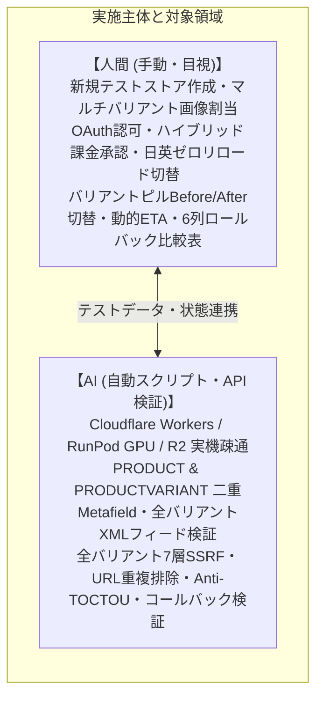
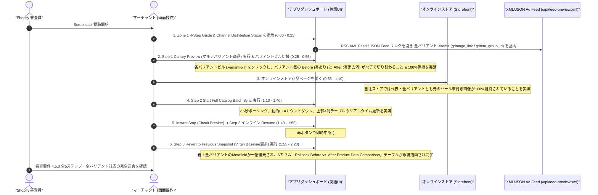

# AdFeed Clean: Google Shopping — Shopify新規テストストア最終総合テスト仕様書
## (Final Release Candidate: New Test Store Integration, Full Variant AI Cleanup & Screencast Readiness Specification)

> **文書バージョン**: 2.6.1 (Final Release Candidate — Full Variant Image AI Cleanup & Post-Phase-5 Hardening Alignment with `SYSTEM_DESIGN.md` v2.6.0 & `implementation_plan.md`)  
> **最終更新日**: 2026-11-15  
> **対象システム**: AdFeed Clean: Google Shopping (開発コードネーム: AdFeed Clean: Google Ad Shield / 旧称: SafeMedia Shield) for Shopify  
> **対象環境**: **新規Shopify開発ストア (New Clean Test Store: `<NEW_TEST_STORE>.myshopify.com`)** 連携 実機テスト環境（検証実績ストア: `adfeed-clean-test-20261108.myshopify.com`, `adfeed-clean-test-20261108-2.myshopify.com`）  
> **自動テストベースライン**: 全テストスイート・**363件 100% PASS**（`python3 -m unittest discover -s tests -p "*.py"`: 363件、4層統合E2E `test_pure_dual_feed_e2e.py`: 79件、E2Eディスカバリ `tests/e2e`: 191件 — 全バリアント重複排除＆補助フィードライフサイクル、差分オラクル、DOM階層、116共通キー［実測122対称キー］I18N、敵対的セキュリティ監査 すべて合格済）  
> **準拠マスタードキュメント**:
> - 統合システム設計書: [`docs/SYSTEM_DESIGN.md`](file:///Users/yusuke/antigravity/Micro-SaaS/docs/SYSTEM_DESIGN.md#L1-L45) v2.6.0
> - アーキテクチャ＆実装計画書: [`docs/implementation_plan.md`](file:///Users/yusuke/antigravity/Micro-SaaS/docs/implementation_plan.md#L1-L322) (Phase 1〜5 全バリアント画像AIクリーンアップ拡張 ＆ 審査要件 4.5.3 完全準拠)
> - バッチ同期ETA仕様書: [`docs/PHASE3_5_BATCH_SYNC_ETA_HANDOFF.md`](file:///Users/yusuke/antigravity/Micro-SaaS/docs/PHASE3_5_BATCH_SYNC_ETA_HANDOFF.md)
> - 課金防衛仕様書: [`docs/ADDITIONAL_REQUIREMENTS_BILLING_AND_RATE_LIMIT.md`](file:///Users/yusuke/antigravity/Micro-SaaS/docs/ADDITIONAL_REQUIREMENTS_BILLING_AND_RATE_LIMIT.md)

---

## 1. 最終総合テスト（新規テストストア検証・全バリアント画像対応版）の目的と位置づけ

### 1.1 背景と目的
過去の実機総合テストを通じて発見された全課題（OAuth再インストール時の自己修復、トライアル悪用防止、未課金時のZone 1/Step 2/Step 3共通課金ゲート、画像未登録商品のフェイルセーフ、スナップショット世代管理［処女原本 `Virgin Baseline` 保護＋直近3世代保持］、Shopify GraphQL `2024-10` 統一および `metafieldsDelete` 準拠、Step 1/2/3のボタン直下インライン通知、Step 2カード内での即時保護再開、Webhook `< 50ms` 即時応答と RunPod コールバック分離、116キー日英完全対称I18N、6カラム構成のロールバック前後比較テーブル）に加え、**「親代表画像＋全バリアント固有画像のAIクリーンアップ拡張（Full Variant Image AI Cleanup）」** の実装および全363件の自動テストスイート検証が完了しました。

本仕様書は、**過去のテスト履歴やキャッシュが一切存在しない「まっさらな新規テストストア」** において、初期インストールから全バリアント画像のAIクリーンアップ・補助フィード配信・1クリック復元までを一気通貫で最終検証し、以下の3点を100%保証することを目的とします。

1. **クリーン環境でのゼロトラブル初期導入＆自己完結性の証明（審査員追試の完全再現）**:
   - Shopify App Review 審査員が新規開発ストアへアプリをインストールした際と全く同じ初期条件（R2上に `auth.json` / `billing.json` / `baseline.json` が未存在の状態）から、OAuth認可・親商品（`PRODUCT`）およびバリアント（`PRODUCTVARIANT`）双方の `MetafieldDefinition` 自動ピン留め・課金ゲート・AI推論・ロールバックが例外なく動作すること。
2. **全バリアント画像のAIクリーンアップ・URL重複排除・クォータ防衛の完全実証**:
   - Step 1（カナリアプレビュー）、Step 2（カタログ一括バッチ）、Zone 1（Webhook自動同期）の全3パイプラインにおいて、商品の代表画像だけでなく各バリアント（色・サイズ違い等）に紐づく固有画像すべてがAIクリーンアップされ、同一画像を共有する複数バリアントはURL重複排除（`uniqueImageUrls`）によって1回のみ推論（二重課金・重複推論ゼロ）されること。
3. **Shopify審査要件 4.5.3 スクリーンキャスト（デモ動画）の完全収録**:
   - 英語デフォルトUI（`EN`）上で、`alert()` / `confirm()` を一切使わず、Onboarding ➔ Canary Preview（バリアントピルによる各バリアントのBefore/Afterペア切替） ➔ Storefront非破壊確認 ➔ リアルタイムETAバッチ同期＆緊急停止/インライン再開 ➔ 1クリック・ロールバック＆6カラムBefore/After比較テーブル描画の全工程を無事故で実演できること。

### 1.2 主要アップデート反映一覧（`SYSTEM_DESIGN.md` v2.6.0 & `implementation_plan.md` 準拠）

| 領域 | 反映された最新仕様（`SYSTEM_DESIGN.md` v2.6.0 / `implementation_plan.md` 準拠） | 対応試験項目 |
| :--- | :--- | :---: |
| **OAuth & 二重レベルMetafield定義** | ・iframe脱出HTML (`renderOAuthEscapeHtml`) のJS/HTML属性XSSエスケープ強化 & ワンタイム `state` nonce ・OAuth完了時の `ensureCleanAdMetafieldDefinition()` にて **`PRODUCT` 用および `PRODUCTVARIANT` 用の `safemedia.clean_ad_image_url` (`pin: true`) を両方自動作成・ピン留め** ・`ShopifyAuthError` 検知時の R2 自動修復 (`clearInvalidShopAuth`) & `REAUTH_REQUIRED` 自動再認可 ・再インストール時のトライアル悪用防止 (`firstInstalledAt`, `hasEverSubscribed` に基づく動的 `trialDays` 算出) ・`GET /api/billing/confirm` における実機 GraphQL `getActiveSubscription()` 照合必須化 | **A-1 〜 A-4** |
| **全バリアント重複排除 & クォータ防衛** | ・親代表画像＋全バリアント固有画像（最大100バリアント `variants(first: 100)`）から `?v=` キャッシュバスターを正規化（`normalizeImageUrlKey` / `lookupCleanedImageUrl`）した `uniqueImageUrls` を構築し、同一画像を共有する複数バリアントの二重GPU推論を100%排除 ・`getExistingCleanedUrlMap()` / `buildVariantCleanImageMap()` で `cleanedImageUrls` / `sourceImageUrl` 追跡情報がある場合は古いメタフィールドの新規差し替え画像への誤フォールバックを禁止し、差し替え画像を確実に再クリーン ・カナリアテストは1商品につき `canaryUsedCount += 1`（最大 `MAX_CANARY_UNIQUE_IMAGES = 5` ユニーク画像まで並列推論、トライアル本枠 `trialUsedCount` は非消費）。**全画像が既にクリーン済（キャッシュヒット・新規GPU推論0回）の場合は `canaryUsedCount` を即時返還（0消費）し、既にメタフィールド一致時は冗長なGraphQL/R2書き込みをスキップ＋既存計測値を保持** ・`TenantBillingState.updatedAtMs` 単調増加タイムスタンプによるメモリキャッシュ巻き戻り・クォータ返還打ち消し防止 ・トライアル枠（50枚）および月間枠（500枚）は**新規AI推論したユニーク画像枚数**と1:1で計上 | **A-2, C-1, D-1, D-2, D-4, E-3** |
| **UI/UX・I18N・全バリアント4.5.3フィード** | ・手動更新ボタン (`#btn_refresh`) 完全撤去、2-Zone・統一5層カード構造、日英バイリンガル完全対称辞書とゼロリロード動的切替 (`#lang-en`, `#lang-ja`) ・`NO_PRODUCT_IMAGE` APIエラーメッセージの英語標準化（UI側は `code: "NO_PRODUCT_IMAGE"` で日英I18N表示） ・Step 1 のバリアント切替ピル（`.variant-pill` / `selectVariant(idx)`）クリック時に、**該当バリアントの Before（セール帯付き画像）と After（AI帯消去済クリーン画像）がペアで即座に切り替わる** 仕様 ・署名トークン付き (`?token=...`) `/api/feed-preview.xml` および `/api/feed-preview` にて、**クリーン済商品の全バリアントを個別 `<item>`（`<g:id>shopify_US_{prodId}_{varId}</g:id>`, `<g:item_group_id>{prodId}</g:item_group_id>`, `<g:image_link>{variantCleanUrl}</g:image_link>`）として展開配信** | **B-1 〜 B-3, C-1, D-1** |
| **画像単位チャンク制御 & インラインUX** | ・Step 2 バッチ（`runBatchChunk`）において **1チャンク最大2商品または最大3ユニーク画像推論（`MAX_IMAGES_PER_CHUNK = 3` / 18秒バジェット）** で分割進行し、商品途中で上限に達した場合も `dualFeedMetadata.cleanedImageUrls` に保存して次チャンクでシームレス再開 ・画像未登録商品に対する `400 NO_PRODUCT_IMAGE` 安全停止＆クォータ即時返還 ・Zone 1 (`#zone1-action-msg`), Step 2 (`#step2-action-msg`), Step 3 (`#step3-action-msg`) のボタン直下インライン通知 ＆ Step 2 緊急停止時のカード内再開ボタン (`#btn-resume-circuit-step2`) | **C-1, D-2, E-1** |
| **全バリアント世代管理復元 & 6列比較表** | ・**処女原本 (`Virgin Baseline`: `baseline.json`) 永続保護 ＋ 直近3世代ローテーション保持**（`StoreSnapshot` に親＋全バリアントの `cleanAdImageUrl` と `dualFeedMetadata.cleanedImageUrls` / `variantCleanImageMap` を保存） ・ロールバック時は親商品＋全バリアントのメタフィールドを一括復元（`RESTORED_TO_SNAPSHOT`）または Shopify `2024-10` `metafieldsDelete` で一括完全消去（`PURGED_TO_VIRGIN`） ・**6カラム構成「Rollback Before vs. After Product Data Comparison」テーブル (`#rollback-comparison-panel`)** にバリアント別クリーン件数（`cleanedVariantCount / variantCount`）を反映 | **D-3** |
| **Zero-UI 全バリアント差分Webhook & SSRF** | ・`POST /webhooks/products/update` の外部I/O待機ゼロ **`< 50ms` 即時 200 OK (`accepted: true`)** 応答 ・親＋全バリアントの `uniqueImageUrls` と `dualFeedMetadata.cleanedImageUrls` を差分比較し、**未処理のユニーク画像URL群のみ（1リクエスト最大 `MAX_SYNC_UNIQUE_IMAGES_PER_REQUEST = 6` 枚）** を非同期AI推論へ投入（全画像処理済みなら `already_cleaned_for_current_image` で0msスキップ） ・RunPod コールバック（`POST /webhooks/runpod/callback?imageUrl=...`）による画像別マージ更新＆親＋全該当バリアントMetafield一括更新 ・**抽出された全バリアント画像URL（`uniqueImageUrls` 全件）に対する7層SSRF検証 (`isValidPublicImageUrl`)** | **E-2, F-1 〜 F-3** |

### 1.3 実施主体の区分定義

---

## 2. 新規テストストア環境の準備手順 (New Test Store Prerequisites & Setup)

### 2.1 クラウドインフラ・外部サービス設定確認

| コンポーネント | 設定対象・リソース | 新規テストストア向け確認項目 / 接続設定 | 担当主体 |
| :--- | :--- | :--- | :---: |
| **Shopify Partner** | アプリ名: `AdFeed Clean: Google Shopping` App URL: `https://safemedia-shield-worker.safemedia.workers.dev` Redirect URL: `https://safemedia-shield-worker.safemedia.workers.dev/api/auth/callback` | - API Version: `2024-10` - Scopes: `read_products,write_products` - Hybrid Billing: `$65.00/mo (500枚内包) + $0.05/枚 (上限$100.00), 14-day trial` - GDPR Webhooks: `customers/data_request`, `customers/redact`, `shop/redact`, `app/uninstalled` | 人間 |
| **Shopify Store (新規)** | 新規開発ストア ドメイン: `<NEW_TEST_STORE>.myshopify.com` | - パートナーダッシュボードから新規開発ストアを作成 - テスト商品CSVインポート＆バリアント別セール帯画像設定完了 - オンラインストア（Dawnテーマ）のパスワード保護解除またはプレビュー可能状態 | 人間 |
| **Cloudflare Workers** | Worker名: `safemedia-shield-worker` R2バインディング: `SNAPSHOT_BUCKET` (`safemedia-snapshots`) | - [`cloudflare_worker/wrangler.toml`](file:///Users/yusuke/antigravity/Micro-SaaS/cloudflare_worker/wrangler.toml#L1-L20): `ENVIRONMENT = "production"`, `BILLING_TEST_MODE = "true"` (テストストア課金承認用) - 新規ストアは OAuth 2.0 フローで `state/<NEW_TEST_STORE>/auth.json` に自動登録されるため `wrangler.toml` のハードコード変更不要 | AI / 人間 |
| **RunPod Serverless** | Endpoint ID: `cho9rydg8gsc9w` Template: `Florence-2-base` + `Big-LaMa` | - Workers Min: 0, Max: 3 - `/run` 非同期投入 ＋ Fast Polling / `/webhooks/runpod/callback` 稼働確認（実測平均 `4.75秒/枚`） | AI |

> [!IMPORTANT]
> **新規テストストアでの `BILLING_TEST_MODE` について**
> Shopify 開発ストア（Development Store）で `appSubscriptionCreate` を実行する際、実際のクレジットカード決済を発生させずに「Test Charge」として承認するには、Worker環境変数 `BILLING_TEST_MODE = "true"` が有効である必要があります（本番公開審査提出直前に `"false"` へ戻します）。テスト開始前にAIが設定状態を確認します。

---

### 2.2 新規テストストアへのテスト商品データ（フィクスチャ）投入手順【人間が実施】

リポジトリ内の [`test_fixtures/shopify_test_products_import.csv`](file:///Users/yusuke/antigravity/Micro-SaaS/test_fixtures/shopify_test_products_import.csv) および [`test_fixtures/products/`](file:///Users/yusuke/antigravity/Micro-SaaS/test_fixtures/products/) を用いて、新規テストストアに以下の商品群を登録します。

#### 手順1: CSV一括インポート
1. 新規テストストアの Shopify Admin ➔ **「Products（商品管理）」** ➔ **「Import（インポート）」** をクリック。
2. [`test_fixtures/shopify_test_products_import.csv`](file:///Users/yusuke/antigravity/Micro-SaaS/test_fixtures/shopify_test_products_import.csv) を選択してアップロード・インポートを実行。

#### 手順2: テスト画像の割り当て（3コア商品 ＋ 異常系確認用1商品）
インポートされた各商品に対し、[`test_fixtures/products/`](file:///Users/yusuke/antigravity/Micro-SaaS/test_fixtures/products/) 内の検証用画像を割り当てます：

| # | 商品名 (Title) | バリアント構成 | 割り当てる画像ファイル (`test_fixtures/products/`) | 検証目的（全バリアント対応版） |
| :---: | :--- | :--- | :--- | :--- |
| **商品1** | `The Complete Snowboard (Canary Test)` | 単一バリアント (`$699.95`) | `product1_canary_sale_banner.jpg` （赤帯「SALE / 20% OFF」バナー付き） | Step 1 カナリアテストでのAI帯消去と、ストアフロント元画像の100%非破壊を実演 |
| **商品2** | `Multi-Variant Pro Snowboard (Variant Lock Test)` | **3バリアント**: 1. `152cm - Sunset Orange` 2. `156cm - Arctic Blue` 3. `160cm - Stealth Black` | 各バリアントに個別の帯付き画像を割当: 1. `product2_var1_sunset_orange_sale.jpg` 2. `product2_var2_arctic_blue_50off.jpg` 3. `product2_var3_stealth_black_freeship.jpg` *(※重複排除検証用に同一カラーで複数サイズを持たせる構成も検証可)* | ① **親＋全3バリアント固有画像の並列AIクリーンアップ** ② **バリアントピル（`.variant-pill`）クリックによる各バリアントの Before/After ペア切替** ③ **親 `Product` および各 `ProductVariant` の `safemedia.clean_ad_image_url` 二重格納と補助フィード全バリアント `<item>` 展開** ④ 各バリアントの `MediaImage` ID 紐付け保持（喪失率0%）を実演 |
| **商品3** | `Minimalist Pure Snowboard (Control Test)` | 単一バリアント (`$599.95`) | `product3_control_clean_white.jpg` （装飾・文字のない純白抜き画像） | クリーン画像に対して不要なインペインティングや画質劣化が発生しないことを検証 |
| **商品4** *(任意)* | `Empty Media Snowboard (No-Image Test)` | 単一バリアント | **画像未登録（0枚）のまま保存** | Step 1 カナリアテストで画像なし商品を選択した際、`400 NO_PRODUCT_IMAGE` で安全停止しクォータが消費されないことを検証 |

*(※ カタログ一括同期［Step 2］のリアルタイムETA・画像単位チャンク進行をより長く観察したい場合は、Shopify標準のサンプル商品データを追加インポートして計10〜20商品程度にしておくとデモ動画映えします)*

---

## 3. 最終総合テスト試験項目一覧 (Comprehensive Test Matrix)

### グループ A: アプリ初期導入・OAuth 2.0・二重レベルMetafield定義・共通課金ゲート (Onboarding, Auth & Billing Gate)

#### 【項目 A-1】新規テストストア OAuth 2.0 認可フロー & `PRODUCT` / `PRODUCTVARIANT` 二重 `MetafieldDefinition` 自動ピン留め
- **実施主体**: **人間 ＆ AI**
- **対象画面**: ブラウザ（Shopify Admin ➔ アプリインストール画面）
- **前提条件**: 新規テストストア（`<NEW_TEST_STORE>.myshopify.com`）にアプリが一度もインストールされていない状態。
- **実施手順**:
  1. 【人間】ブラウザで `https://safemedia-shield-worker.safemedia.workers.dev/api/auth?shop=<NEW_TEST_STORE>.myshopify.com`（または `/login?shop=...`）にアクセスする。
  2. 【人間】iframe脱出HTML（`renderOAuthEscapeHtml` — JS/HTML属性XSSエスケープ済）を経由して Shopify OAuth 認可画面（スコープ: `read_products`, `write_products`）が表示されることを確認し、「**Install（インストール）**」をクリックする。
  3. 【人間】Shopify Admin 内の埋め込みダッシュボードへリダイレクトされ、初期状態バナー `🎁 Free Sample Preview (0 / 5 Used)`（`CANARY_TRIAL`）が表示されることを確認する。
  4. 【AI】Shopify Admin GraphQL API (`2024-10`) で `ensureCleanAdMetafieldDefinition()` により **親商品用（`ownerType: PRODUCT`）およびバリアント用（`ownerType: PRODUCTVARIANT`）の双方で `MetafieldDefinition`（`namespace: "safemedia"`, `key: "clean_ad_image_url"`, `type: "url"`, `pin: true`）が自動作成・ピン留めされていること**、および R2 `state/<NEW_TEST_STORE>/auth.json`・`billing.json` が生成されていることを確認する（参照: [`shopify.ts`](file:///Users/yusuke/antigravity/Micro-SaaS/cloudflare_worker/src/shopify.ts#L361-L466)）。
- **正誤判定基準 (PASS条件)**:
  - OAuth コールバック（`/api/auth/callback`）で HMAC 検証・ワンタイム `state` nonce 消費・トークン交換が成功し、エラーなくダッシュボードが表示されること。
  - Shopify Admin の商品詳細ページおよび各バリアント詳細ページの「Metafields」欄に `Clean Ad Image URL`（`safemedia.clean_ad_image_url`）がピン留め表示されていること。
  - 初期プランが `CANARY_TRIAL`（`canaryUsedCount: 0`, `canaryLimit: 5`, `autoSyncEnabled: false`）であること。

#### 【項目 A-2】未課金（`CANARY_TRIAL`）時の3大共通課金ゲート（Zone 1 / Step 2 / Step 3）ロック検証
- **実施主体**: **人間 ＆ AI**
- **対象画面**: アプリダッシュボード（トライアル開始前の `CANARY_TRIAL` 状態）
- **実施手順**:
  1. 【人間】Zone 1（Core Automation）のステータスバッジが `⚪ Paused (Trial Required)` であり、ボタン（`#toggle_auto_sync`）が `🔒 Unlock Auto-Protection with 14-Day Free Trial` になっていることを確認する。
  2. 【人間】Zone 1 のロックボタン、Step 2 の「Start Full Catalog Batch Sync（`#btn-start-batch`）」、Step 3 の「Revert to Previous Snapshot（`#btn-rollback`）」をそれぞれクリックし、14日間無料トライアル誘導モーダル（`#batch-trial-modal`）またはインライン案内が表示されることを確認する。
  3. 【AI】未課金状態で `POST /api/auto-sync/toggle`, `POST /api/batch/start`, `POST /api/rollback` を直接呼び出し、それぞれ HTTP `402 Payment Required` で遮断されることを確認する。
- **正誤判定基準 (PASS条件)**:
  - 未課金時は「5件のカナリアテスト（Step 1）」と「手動バックアップ作成（Step 3 `#btn-take-snapshot`）」のみが許可され、常時自動同期・全件一括処理・ロールバックはすべて14日間無料トライアル開始を要求するゲート（`SUBSCRIPTION_REQUIRED_FOR_AUTOSYNC` / `SUBSCRIPTION_REQUIRED_FOR_BULK` / `SUBSCRIPTION_REQUIRED_FOR_ROLLBACK`）で保護されていること。

#### 【項目 A-3】Shopify Billing API ハイブリッド従量課金承認（14日間無料トライアル・50枚上限）＆ 実機GraphQL照合
- **実施主体**: **人間 ＆ AI**
- **対象画面**: アプリダッシュボード ➔ Shopify 公式課金承認画面
- **実施手順**:
  1. 【人間】ヘッダーの「**🚀 Start 14-Day Free Trial ($65/mo)**（`#btn-start-trial`）」またはモーダル内のトライアル開始ボタンをクリックする。
  2. 【人間】Shopify 公式課金承認画面で以下の条件を確認し、「**Approve（承認）**」をクリックする：
     - **基本料金 (Recurring)**: `$65.00 USD / 30 days`（月間500枚まで内包）
     - **超過従量課金 (Usage)**: `$0.05 USD per cleaned image beyond 500 images/mo`（Capped Amount: `$100.00 USD`）
     - **無料トライアル期間**: `14 days`（トライアル中の無料AI処理上限: **50ユニーク画像**）
  3. 【AI】コールバック `GET /api/billing/confirm` において、クエリパラメータ単体ではなく Shopify Admin GraphQL `getActiveSubscription()` による実照合が行われ、`billing.json` が更新されたことを確認する。
- **正誤判定基準 (PASS条件)**:
  - 承認後ダッシュボードへ戻り、上部バナーが `✅ 14-Day Free Trial Active ($65/mo)`・使用量バッジ（`0 / 50 Images Used`）に切り替わること。
  - Zone 1 の常時自動保護が自動的に `🟢 Active (ON)`（`autoSyncEnabled: true`）へアンロックされ、`PRODUCTS_UPDATE` Webhook が自動登録されること。
  - `billing.json` の `planStatus: "TRIAL_14D_ACTIVE"`, `trialLimit: 50`, `monthlyIncludedCount: 500`, `overagePriceUsd: 0.05`, `cappedAmountUsd: 100.0`, `hasEverSubscribed: true`, `firstInstalledAt` が記録されていること。

#### 【項目 A-4】自己修復エンジン (`REAUTH_REQUIRED`) ＆ 再インストール時のトライアル悪用防止検証
- **実施主体**: **AI（自動検証）**
- **実施手順**:
  1. トークン失効時（`ShopifyAuthError` 401）に Worker が自動で無効な `auth.json` をクリア（`clearInvalidShopAuth`）し、クライアントへ `401 REAUTH_REQUIRED`（`reauthUrl: "/api/auth?shop=..."`）を返却して UI が自動再認可リダイレクト（`checkAuthAndHandleRedirect`）を行う契約を検証する。
  2. アンインストール（`POST /webhooks/app/uninstalled`）後も `firstInstalledAt` と `hasEverSubscribed: true` が保持され、再インストール時の課金リクエストで `trialDays: 0` が強制されること（トライアル無限搾取の防止）を検証する。
- **正誤判定基準 (PASS条件)**:
  - 認証失効時にデッドロックせず自己修復プロトコルが作動すること。
  - 再インストールによる14日間無料トライアルの二重取得が100%阻止されること。

---

### グループ B: ダッシュボードUI・日英I18N・全バリアント展開広告フィード・リーガル (UI/UX, I18N, 4.5.3 Variant Feed & Legal)

#### 【項目 B-1】英語標準 2-Zone・統一5層カード構造 ＆ 日英ゼロリロード切替検証
- **実施主体**: **人間（目視）**
- **対象画面**: アプリ埋め込みダッシュボード（[`cloudflare_worker/src/ui.ts`](file:///Users/yusuke/antigravity/Micro-SaaS/cloudflare_worker/src/ui.ts)）
- **実施手順**:
  1. 初回ロード時の画面表示言語が **英語（English）** であり、ヘッダーに不要な手動「🔄 Refresh」ボタン（`#btn_refresh`）が存在しないことを確認する。
  2. 画面最上部に **Zone 1: Core Automation (`#zone-core-automation`)**、その下に **Zone 2: Onboarding Tools & Safety Suite (`#zone-onboarding-safety`)**（Step 1 ➔ Step 2 ➔ Step 3）が配置され、全カードが統一5層構造（Badge ➔ Title ➔ Description ➔ Actions ➔ Preview）になっていることを確認する。
  3. ヘッダー右上の `[ EN | 日本語 ]`（`#lang-en`, `#lang-ja`）をクリックし、ページリロードなしで全テキスト・バッジ・ガイド文言が日本語 ↔ 英語（全対称キー）に切り替わることを確認する（※確認後は動画撮影用に `EN` に戻す）。
- **正誤判定基準 (PASS条件)**:
  - デフォルト英語表示、手動リフレッシュボタン不在、WebP圧縮指標（`KB`, `-% Lighter`）不在であること。
  - 日英切り替えで未翻訳キーやレイアウト崩れが一切発生せず、ブラウザの `alert()` / `confirm()` が一切使われていないこと。

#### 【項目 B-2】4ステップ・フィードマッピングガイド ＆ 全バリアント `<item>` 展開 XML/JSON 広告フィード検証 (審査要件 4.5.3)
- **実施主体**: **人間 ＆ AI**
- **対象画面**: Zone 1 オンボーディング＆チャネル配信パネル（`#onboarding-feed-guide`）および `/api/feed-preview.xml`・`/api/feed-preview`
- **実施手順**:
  1. 【人間】4ステップ・ロードマップ（Step 1: Auto-Sync ➔ Step 2: Canary Test ➔ Step 3: Catalog Sync ➔ Step 4: Ad Mapping）と、その直下の「Ad Feed Channel Distribution Status」サブカード（全バリアント展開済みの適用アイテム数バッジ `#feed-items-count-badge` を含む）を確認する。
  2. 【人間】**Google Shopping (`g:image_link`)** および **Meta Ad Feed (`image_link`)** のステータスバッジと、`RSS XML Feed ↗`（`/api/feed-preview.xml?shop=...&token=...`）・`JSON Feed ↗`（`/api/feed-preview?shop=...&token=...`）のリンクをクリックして別タブで開く。
  3. 【AI】トークンなし・不正トークンでの `/api/feed-preview.xml` アクセスが `401 FEED_UNAUTHORIZED` で遮断されること（スクレイピング防御）、および正規トークン付きリクエストが R2 キャッシュ（`feeds/{shop}/google-shopping.xml` / `feed.json`）から Google Merchant Center 準拠の `<rss xmlns:g="http://base.google.com/ns/1.0" version="2.0">` XML を返すことを検証する。
  4. 【AI】マルチバリアント商品（商品2等）がクリーンアップされた後、XMLフィード内に **全バリアント分の個別 `<item>`（`<g:id>shopify_US_{productId}_{variantId}</g:id>`, `<g:item_group_id>{productId}</g:item_group_id>`, および各バリアント固有のクリーン画像 `<g:image_link>{variantCleanUrl}</g:image_link>`）が展開出力されていること**を確認する（参照: [`index.ts`](file:///Users/yusuke/antigravity/Micro-SaaS/cloudflare_worker/src/index.ts#L683-L873)）。
- **正誤判定基準 (PASS条件)**:
  - 審査員が1画面で「親および各バリアントのメタフィールド（`safemedia.clean_ad_image_url`）が Google `g:image_link` / `g:item_group_id` と Meta `image_link` にどうマッピングされるか」を確認でき、実際の全バリアント展開済み XML/JSON フィード出力が開けること。

#### 【項目 B-3】公開プライバシーポリシー・利用規約・公式アセット配信検証
- **実施主体**: **人間 ＆ AI**
- **対象画面**: ダッシュボード最下部フッター ➔ `/privacy`, `/terms`, `/assets/*`
- **実施手順**:
  1. 【人間】フッターの「Privacy Policy」「Terms of Service」をクリックし、Polaris準拠のリーガルページ（日英切替対応）が表示されることを確認する。
  2. 【AI】`GET /privacy`, `GET /terms`, `GET /assets/app_icon_1200x1200.png` 等のステータスコード（`200 OK`）と必須条項（Zero-PII、AI非学習誓約、賠償上限 `$65` / `9,800円`）を検証する。
- **正誤判定基準 (PASS条件)**:
  - 全リーガルページおよびブランドアセットがパブリックに `200 OK` で高速配信されていること。

---

### グループ C: Step 1 カナリアプレビュー・非消費クォータ・非破壊デュアルフィード (Canary & Dual-Feed Engine)

#### 【項目 C-1】1商品カナリアプレビュー（Canary Test）・非消費特性・画像なし商品フェイルセーフ検証
- **実施主体**: **人間 ＆ AI**
- **対象画面**: Zone 2 Step 1 カード（`#card-canary-preview`）
- **実施手順**:
  1. 【人間】商品選択ドロップダウン（`#select-canary-product`）にストア内の商品一覧（`GET /api/products`）が読み込まれていることを確認する。
  2. 【人間】テスト商品 `The Complete Snowboard (Canary Test)` を選択し、「**🔍 Test on 1 Sample Product (Canary Preview)**（`#btn-run-canary`）」をクリックする。
  3. 【人間】完了後、Before（元のSALE帯付き画像 `#canary-orig-img`）と After（AIが文字・帯を消去したクリーン画像 `#canary-clean-img`）の並列表示、および **4大AIテレメトリバッジ**（⏱️ Processing Time、✂️ Badge Removed `%`、🧠 Engine `Florence-2 + LaMa`、🏷️ Metafield `safemedia.clean_ad_image_url`）を確認する。
  4. 【AI】カナリアテスト実行後、`canaryUsedCount` が `1 / 5`（1商品のテストにつき `+1`、1回あたり最大 `MAX_CANARY_UNIQUE_IMAGES = 5` ユニーク画像まで対応）に増加する一方、**トライアル本枠（`trialUsedCount: 0 / 50`）は一切消費されていないこと（カナリア非消費特性）**を確認する。さらに、**同じクリーン済み商品を再テスト（`uncleanedImages.length === 0`・キャッシュヒット）した場合に `canaryUsedCount` が即時返還（0消費）され、既にメタフィールド一致時は冗長な Shopify GraphQL `metafieldsSet` / `syncAdFeedToR2` がスキップされて既存 `aiMetadata` が保持されること**を確認する。
  5. 【人間 または AI】画像が登録されていない商品（商品4 `Empty Media Snowboard` 等）に対してカナリアテストを実行し、HTTP `400 Bad Request`（`code: "NO_PRODUCT_IMAGE"`, 英語標準エラー `"No product image found. Please add an image to your product in Shopify before running the test."`）で安全停止し、カナリア枠が消費されない（返還される）ことを確認する。
- **正誤判定基準 (PASS条件)**:
  - 推論が15秒以内（平均約4.75秒）に完了し、Before/After画像と4大テレメトリが鮮明に表示されること。
  - `trialUsedCount` が `0 / 50` のまま維持され、キャッシュヒット再テスト時は `canaryUsedCount` も増えない（返還される）こと。
  - 画像未登録商品ではダミー処理を行わず、APIが英語標準の `NO_PRODUCT_IMAGE`（400）を返し、UI側がI18Nインライン警告とShopify商品管理リンクを表示して枠を返還すること。

#### 【項目 C-2】実機RunPod Serverless GPU処理速度・画像品質・推論原価の定量判定
- **実施主体**: **AI**
- **実施手順**:
  - 実機RunPodエンドポイント（`cho9rydg8gsc9w`）および R2 CDN URL（`/clean-media/<NEW_TEST_STORE>/clean_...jpg`）の応答時間・画像バイナリ・GPU秒数単価を計測する。
- **正誤判定基準 (PASS条件)**:
  - HTTP `200 OK`、有効な JPEG 画像（`Cache-Control: public, max-age=31536000, immutable`）が配信されること。
  - 処理時間がキルスイッチ基準 **15.0秒/枚 以下**（実績目安: `4.1〜9.0秒`）、原価が **3.00円/枚 以下**（実績目安: `約0.28〜0.43円/枚`）であること。

#### 【項目 C-3】自社ストアフロント（Online Store）画像非破壊 ＆ 4列フィード証明テーブル・全バリアント比較ペア検証 (最重要インバリアント)
- **実施主体**: **人間 ＆ AI**
- **対象画面**:
  - テストストアの公開商品ページ（`https://<NEW_TEST_STORE>.myshopify.com/products/...`）
  - ダッシュボード Zone 1 の4列テーブル（`#synced_feed_table`）および `
` ビジュアル比較ペア（`#dual-feed-list`）
- **実施手順**:
  1. 【人間】Zone 1 の「Recent Synced Product Feed」4列テーブル（Product / Storefront (Before) / Clean Ad-Feed (After) / Status）内の「`🔗 Storefront Image ↗`」リンクをクリックし、オンラインストアの実際の商品ページを開く。
  2. 【人間】オンラインストア上で、代表画像および各バリアント選択時の画像が元の「**SALE / 20% OFF / 50% OFF**」帯付きのままで1ピクセルも変わらず表示されていることを目視確認する。
  3. 【人間】Zone 1 の4列テーブルで各商品のバリアント対応進捗（`cleanedVariantCount / variantCount`）を確認し、直下の `
` アコーディオン（`#dual-feed-list`）を開いて、複数バリアント商品の重複排除済み全バリアント Before & After 画像ペアが並列表示されていることを確認する。
  4. 【AI】Shopify GraphQL Admin API（`2024-10`）で当該商品の `media` 配列および各バリアントの `MediaImage` ID・URLが処理前と100%同一であること、ならびに親 `Product` と各 `ProductVariant` の `safemedia.clean_ad_image_url` メタフィールドにのみクリーン画像URLが格納されていることを照合する。
- **正誤判定基準 (PASS条件)**:
  - **自社ストアの代表画像および全バリアント画像は元のセール帯付きのままであり、上書き・削除が一切行われていないこと**。
  - Zone 1 の4列テーブルとアコーディオン内の Before/After カードペアに、ストアフロント画像と広告用クリーン画像（全バリアント対応）が正しく並列表示されていること。

---

### グループ D: 全バリアントAIクリーンアップ・画像単位チャンク一括同期・世代管理ロールバック・6列比較表 (Full Variant Canary, Batch, Retention & Rollback)

#### 【項目 D-1】複数バリアント商品の全バリアントAIクリーンアップ・紐付け完全保持 ＆ インタラクティブ・バリアントピル（Before/Afterペア切替）検証
- **実施主体**: **人間 ＆ AI**
- **対象画面**: Step 1 カナリアプレビュー（商品2: `Multi-Variant Pro Snowboard (Variant Lock Test)`）＆ ストアフロント
- **実施手順**:
  1. 【AI】処理前に3つのバリアント（`152cm - Sunset Orange`, `156cm - Arctic Blue`, `160cm - Stealth Black`）の `variantId`、`MediaImage` ID、および `originalImageUrl` のマッピングを記録する。
  2. 【人間】Step 1 ドロップダウンで `Multi-Variant Pro Snowboard (Variant Lock Test)` を選択し、カナリアプレビューを実行する。
  3. 【AI】レスポンス `CanaryTestResult.variantChecks[]` の全3バリアントに、それぞれの `originalImageUrl`（セール帯付きBefore画像）と `cleanAdImageUrl`（AI帯消去済After画像）が格納されていること、さらに Shopify 上で親 `Product` と全3 `ProductVariant` の `safemedia.clean_ad_image_url` および `dual_feed_metadata`（`cleanedImageUrls`, `variantCleanImageMap`）が一括保存されていることを確認する（参照: [`index.ts`](file:///Users/yusuke/antigravity/Micro-SaaS/cloudflare_worker/src/index.ts#L5218-L5533)）。
  4. 【人間】生成されたプレビュー下部の **バリアント切替ピル（`.variant-pill`）** を順番にクリック（`selectVariant(0)`, `selectVariant(1)`, `selectVariant(2)`）し、**クリックしたバリアントに応じて左側の Before 画像（`#canary-orig-img`: 各カラーのセール帯付き画像）と右側の After 画像（`#canary-clean-img`: 各カラーのAI帯消去済クリーン画像）がペアで即座に切り替わること**、および `✅ 100% Variant Links Preserved` 表示を確認する（参照: [`ui.ts`](file:///Users/yusuke/antigravity/Micro-SaaS/cloudflare_worker/src/ui.ts#L2504-L2524)）。
  5. 【AI】処理後の GraphQL バリアント画像IDを照合し、紐付け喪失率が **0.0%** であることを確認する。また、クリーン済み商品のいずれかのバリアント画像を別画像へ差し替えた場合、`getExistingCleanedUrlMap()` / `buildVariantCleanImageMap()` が古いメタフィールド（`cleanAdImageUrl`）を新画像へ誤ってフォールバック紐付けせず、差し替え画像のみを未処理（`uncleanedImages`）として検出し再クリーンすることを確認する。
- **正誤判定基準 (PASS条件)**:
  - 全3バリアント固有画像が漏れなくAIクリーンアップされ、UIのバリアントピルをクリックすると各バリアントの Before（帯あり）と After（帯なし）がペアで切り替わること。
  - 全バリアントの `MediaImage` ID 紐付けが100%維持（喪失率 `0.0%`）され、1商品のカナリア実行として `canaryUsedCount` が `+1` のみ計上（`trialUsedCount` は `0` 維持）されること。

#### 【項目 D-2】全カタログ一括同期（Image-Aware Chunked Batch Sync）・URL重複排除・リアルタイムETA・上部テーブル動的連動の検証【人間が重点実施】
- **実施主体**: **人間 ＆ AI**
- **対象画面**: Zone 2 Step 2 カード（`#card-catalog-sync`）
- **前提条件**: 14日間無料トライアル有効（`TRIAL_14D_ACTIVE`）。
- **実施手順**:
  1. 【人間】Step 2 の「**🚀 Start Full Catalog Batch Sync**（`#btn-start-batch`）」をクリックする。
  2. 【人間】展開されたプログレスセクション（`#batch-progress-section`）で以下のリアルタイム更新を観察する：
     - プログレスバー（`#batch-progress-bar`）とパーセンテージ（`#batch-percentage`）
     - `#batch-status-text` の処理件数と **動的ETAカウントダウン**（例: `⚡ Processing: 1 / 3 products (33%) — ⏱️ Est. remaining: ~10s`）
     - `#batch-details` の現在処理中商品名と実測平均速度（例: `Current: ... | Avg speed: ~4.8s/item`）
  3. 【人間】同時に Zone 1 上部テーブル（`#synced_feed_rows`）を確認し、処理中の行に青色パルスバッジ `🔄 Processing AI...` が表示され、完了した商品から順次緑バッジ `✅ Clean Ad Image Ready`（全バリアント完了）へリロードなしで切り替わることを確認する。
  4. 【人間】バッチ処理中にブラウザを一度リロード（F5）し、プログレスバーが自動で再展開されポーリングが継続（State Restoration）することを確認する。
  5. 【AI】バックエンドのチャンク処理（`runBatchChunk`）において、1チャンク最大2商品または最大3ユニーク画像（`MAX_IMAGES_PER_CHUNK = 3` / 18秒バジェット）で安全に分割実行されていること、同一画像URLを共有する複数バリアント（`?v=` キャッシュバスター違いを含む）が `uniqueImageUrls` で重複排除されて1回のみAI推論されていること、および**新規AI推論したユニーク画像枚数のみ**が `trialUsedCount` / `monthlyUsageCount` に1:1で計上されていることを確認する。
- **正誤判定基準 (PASS条件)**:
  - 2.5秒間隔の実測ポーリングと画像単位チャンク制御（`locks/{shop}/batch_runner.json`）が連動し、複数バリアント商品を含む全カタログがCloudflareの30秒制限にかかることなく100%完了（`🎉 All catalog ad feeds generated!`）すること。
  - 既にクリーン済の画像URL（`dualFeedMetadata.cleanedImageUrls` 登録済）は自動スキップされ、無駄なGPU再推論が行われないこと。
  - 完了した新規ユニーク画像枚数分だけ `trialUsedCount` が正確にカウントアップされること。

#### 【項目 D-3】スナップショット世代管理（Virgin Baseline + 3世代）・全バリアント1クリック復元・6カラム Before/After 比較表の検証 (審査要件 4.5.3)【人間が重点実施】
- **実施主体**: **人間 ＆ AI**
- **対象画面**: Zone 2 Step 3 カード（`#card-rollback`）
- **実施手順**:
  1. 【人間】Step 3 の「**📸 Back Up Store Now**（`#btn-take-snapshot`）」をクリックし、ボタン直下のインライン領域（`#step3-action-msg`）にバックアップ完了メッセージが表示されることを確認する。
  2. 【人間】`
` アコーディオン（`#r2-count`, `#r2-object-list`）を開き、R2 に保存されたスナップショット一覧を確認する。
  3. 【人間】「**⏮️ Revert to Previous Snapshot**（`#btn-rollback`）」をクリックし、復元確認モーダル（`#rollback-modal`）を開く。
  4. 【人間】モーダル内の **復元時点選択ドロップダウン（`#rollback-snapshot-select`）** を開き、以下の選択肢が表示されることを確認する：
     - `🟢 Latest Backup`（最新スナップショット）
     - `📦 Rolling Generations`（直近最大3世代）
     - `🛡️ Virgin Baseline`（アプリ導入直後の処女原本 `baseline.json`）
  5. 【人間】`🛡️ Virgin Baseline`（初期原本）を選択し、「**Yes, Restore Now**（`#btn-confirm-rollback`）」をクリックする。
  6. 【人間】10秒以内に復元が完了し、モーダルが閉じて Step 3 直下（`#step3-action-msg`）に完了通知が出るとともに、画面内に **6カラム構成の「Rollback Before vs. After Product Data Comparison」テーブル（`#rollback-comparison-panel`）** がインライン描画されることを確認する。
  7. 【AI】Shopify GraphQL `2024-10` の `metafieldsDelete` ミューテーションにより、初期原本時点で存在しなかった **親 `Product` および全 `ProductVariant` のメタフィールド（`safemedia.clean_ad_image_url`, `safemedia.dual_feed_metadata`）が一括完全削除（`PURGED_TO_VIRGIN`）** され、全バリアントの `MediaImage` ID が100%保持されていること、R2補助フィード（`google-shopping.xml` / `feed.json`）も復元状態へ同期されていること、および4世代以上の古いスナップショット作成時に `baseline.json` を残して直近3世代へ自動ローテーションされることを確認する（参照: [`snapshot.ts`](file:///Users/yusuke/antigravity/Micro-SaaS/cloudflare_worker/src/snapshot.ts#L1-L785)）。
- **正誤判定基準 (PASS条件)**:
  - 10秒以内に親商品＋全バリアントが完全ロールバックされ、**6カラム比較テーブル**に以下の全項目が正確に表示されること：
    1. **Product & ID**（商品名・GID）
    2. **Storefront Media**（`✅ 100% UNCHANGED` ＆ 自社ストア確認リンク）
    3. **Metafield (`safemedia.clean_ad_image_url`)**（`Before Revert` のクリーン画像URLおよびバリアントクリーン件数 `cleanedVariantCount / variantCount` ➔ `After Revert` の `Purged to Virgin (null)` またはスナップショット復元値）
    4. **Ad Feeds (`g:image_link` / `image_link`)**（復元前後の広告フィード実効URL対比およびバリアント配信状態）
    5. **Variant Links**（`✅ N/N Preserved`）
    6. **Applied Snapshot & Reverted At**（適用された `snapshotId` と復元時刻）

#### 【項目 D-4】50枚トライアル上限到達（`TRIAL_CAP_REACHED`）＆ トライアル早期終了（即時本契約）モーダルの検証
- **実施主体**: **人間 ＆ AI**
- **対象画面**: アプリダッシュボード（`#trial-cap-modal`）
- **実施手順**:
  1. 【AI】テスト用リセットAPI（または50ユニーク画像処理完了状態）で `trialUsedCount: 50`（`planStatus: "TRIAL_CAP_REACHED"`）の状態をセットし、51枚目のバッチ（複数バリアント商品の処理途中での上限到達を含む）またはWebhookリクエストが HTTP `402 TRIAL_CAP_REACHED` で安全に遮断されることを確認する。
  2. 【人間】ダッシュボード上で50枚到達モーダル（`#trial-cap-modal`: `🎉 Free Trial Quota (50/50 Images) Completed!`）が表示されることを確認し、モーダル内の即時本契約ボタン（`POST /api/billing/activate-now`）をクリックする。
  3. 【人間】Shopify 課金承認画面（`trialDays: 0`、基本 `$65.00/mo` + 超過 `$0.05/枚`）が表示されたら「Approve」をクリックする。
- **正誤判定基準 (PASS条件)**:
  - 承認後、`planStatus` が `"ACTIVE"` に昇格し、50枚のトライアル制限が即座に解除され、月間500枚内包枠（`0 / 500 Included`）へ移行すること。

---

### グループ E: フェイルセーフ緊急停止・Step 2 インライン再開・全バリアントゼロトラストセキュリティ (Fail-Safe & Security)

#### 【項目 E-1】一括処理中のサーキットブレーカー即時中断（バリアントループ内即時停止）＆ Step 2 カード内インライン保護再開の検証【人間 ＆ AI】
- **実施主体**: **人間 ＆ AI**
- **対象画面**: Zone 2 Step 2 カード（`#card-catalog-sync`）＆ ヘッダーバナー
- **実施手順**:
  1. 【人間】Step 2 の一括同期を実行中に、赤色点滅ボタン「**⛔ Instant Stop (Circuit Breaker)**（`#btn-abort-batch`）」をクリックする。
  2. 【人間】プログレスバーが即座に `ABORTED`（ETA `0s`）となり、**Step 2 カード内のボタン直下（`#step2-action-msg`）に緊急停止メッセージと「▶️ Resume Protection」ボタン（`#btn-resume-circuit-step2`）および「⏹️ Cancel Batch」ボタン（`#btn-cancel-circuit-step2`）が即座に出現すること**を確認する（画面最上部へスクロールせずにその場で確認・操作可能であること）。
  3. 【AI】緊急停止中（`circuitBreakerTripped: true`）に、複数バリアント商品の途中であっても次のバリアント画像推論前に即座にループが中断されること、および停止中のカナリアテストや `products/update` Webhook がすべて HTTP `423 Locked (code: "CIRCUIT_BREAKER_ACTIVE")` で即座に拒絶され GPU が起動しないことを確認する。
  4. 【人間】Step 2 カード内の「**▶️ Resume Protection**（`#btn-resume-circuit-step2`）」をクリックし、保護状態が通常（`🟢 Active`）に復帰して残りの未処理バリアント画像から再開できることを確認する。
- **正誤判定基準 (PASS条件)**:
  - 停止クリックから即座に（商品の途中でも次のユニーク画像推論前に）処理が中断され、停止中はすべてのGPU推論リクエストが `423 Locked` で完全遮断されること。
  - Step 2 カード内の `#btn-resume-circuit-step2` からワンクリックで安全に再開できること。

#### 【項目 E-2】ゼロトラスト多層防御（HMAC・全バリアント7層SSRF・BOLA・HPP・動的CORS）の機械的検証
- **実施主体**: **AI**
- **実施手順**:
  1. **Webhook HMAC検証**: 未署名・空署名・偽造HMAC・改ざんボディを `/webhooks/products/update` および GDPR Webhook へ送信する。
  2. **全バリアント7層SSRF検証**: 商品の代表画像だけでなく、**複数バリアントのうちの1つのバリアント画像URL（`variants[].originalImageUrl`）** にループバック（`127.0.0.1`, `[::1]`, `0x7f000001`）、クラウドIMDS（`http://169.254.169.254/latest/meta-data/`）、RFC1918プライベートIP（`10.0.0.1`, `192.168.1.1`）、非HTTPスキーム（`file://`, `javascript:`）が含まれるペイロードをカナリアテスト・同期API・Webhookへ送信する。
  3. **BOLA（テナント間不正アクセス）＆ HPP検証**: 未認証リクエストや別店舗トークンでの `/api/*` アクセス、およびクエリ `?shop=storeA` とボディ `"shop": "storeB"` の不一致リクエストを送信する。
- **正誤判定基準 (PASS条件)**:
  - HMAC不正は `401 INVALID_WEBHOOK_HMAC`、代表画像またはいずれかのバリアント画像に含まれるSSRF URLは `400 INVALID_IMAGE_URL`（クォータ即時返還）、他テナント/未認証アクセスは `403 CROSS_TENANT_ACCESS_DENIED`、ドメイン不一致は `400 SHOP_DOMAIN_MISMATCH` で100%遮断されること。

#### 【項目 E-3】Webhook 2並列GPUスロット制限・Anti-TOCTOU 並行バースト耐性・`updatedAtMs` リビジョン整合性検証
- **実施主体**: **AI**
- **実施手順**:
  1. 同一店舗に対して異なる商品の `products/update` Webhook を3件同時に送信し、GPUスロット制御（`locks/{shop}/gpu_slot_{1..2}.json`）を検証する。
  2. カナリア枠残り1件（`4 / 5`）の状態で並行リクエストを発行し、Anti-TOCTOU 事前アトミック予約を検証する。
  3. 事前予約（`canaryUsedCount += 1`）後のエラー返還またはキャッシュヒット返還（`canaryUsedCount -= 1`）が、R2結果整合性やメモリキャッシュ（`getShopBillingState` / `saveShopBillingState`）の `updatedAtMs` 単調増加リビジョン比較によって巻き戻らず・打ち消されないことを検証する。
- **正誤判定基準 (PASS条件)**:
  - 同時Webhookの3件目がエラーにならず HTTP `200 OK` `{ skipped: true, reason: "concurrency_limit_exceeded" }` で安全にスキップされること。
  - 境界バースト時に正確に1件のみが通過し、残りはすべて `402 TRIAL_QUOTA_EXCEEDED` で遮断されること。
  - 返還後の `canaryUsedCount` が古いメモリキャッシュや古いR2読み取り値で再増加（上書き）されないこと。

---

### グループ F: Zone 1 常時自動保護・`< 50ms` 即時応答・全バリアント差分抽出・RunPodコールバック分離 (Always-On Ad Shield)

#### 【項目 F-1】Auto-Protection トグル切替・ボタン直下インライン通知・R2状態同期検証【人間 ＆ AI】
- **実施主体**: **人間 ＆ AI**
- **対象画面**: Zone 1: Core Automation カード（`#zone-core-automation`）
- **実施手順**:
  1. 【人間】Zone 1 の「**⏸️ Pause Auto-Protection**（`#toggle_auto_sync`）」をクリックする。
  2. 【人間】カード右上のバッジが `🟢 Active (ON)` ➔ `⚪ Paused (OFF)` に即座に反転し、**ボタン直下のインライン通知領域（`#zone1-action-msg`）にステータス変更メッセージが表示されること**を確認する。
  3. 【人間】再度ボタン（`▶️ Enable Auto-Protection`）をクリックし、`🟢 Active (ON)` に戻ることを確認する。
  4. 【AI】各操作直後に R2 `state/<NEW_TEST_STORE>/billing.json` の `autoSyncEnabled`（`false` ↔ `true`）および Shopify `PRODUCTS_UPDATE` Webhook 購読状態が100%同期していることを確認する。
- **正誤判定基準 (PASS条件)**:
  - 画面スクロールやリロードなしで、バッジ・ボタンラベル・直下インライン通知・R2永続化状態が即座に完全一致すること。

#### 【項目 F-2】Auto-Protection 一時停止（`⚪ Paused`）時の Webhook 安全スキップ検証【人間 ＆ AI】
- **実施主体**: **人間 ＆ AI**
- **対象画面**: Zone 1（`⚪ Paused` 状態）＆ Shopify Admin 商品管理
- **実施手順**:
  1. 【人間】Zone 1 を `⚪ Paused (OFF)`（`autoSyncEnabled: false`）に切り替える。
  2. 【人間 または AI】Shopify Admin で任意の商品情報を更新・保存するか、署名付き `products/update` Webhook を送信する。
  3. 【AI】Worker の応答と R2 / Shopify メタフィールド / クォータ消費数を確認する。
- **正誤判定基準 (PASS条件)**:
  - Webhook が HTTP `200 OK`（`reason: "auto_sync_disabled"`）で安全にスキップされ、RunPod GPU が一切起動せず（推論コスト0円、クォータ消費0）、商品のメタフィールドが変更されないこと。

#### 【項目 F-3】Auto-Protection 有効（`🟢 Active`）時の Zero-UI 全バリアント差分クリーンアップ・`< 50ms` 即時応答・RunPodコールバック分離・自己ループ防止の実機E2E検証【人間 ＆ AI】
- **実施主体**: **人間 ＆ AI**
- **対象画面**: Shopify Admin（商品管理）＆ Zone 1「Recent Synced Product Feed」テーブル（`#synced_feed_table`）
- **実施手順**:
  1. 【人間】Zone 1 が `🟢 Active (ON)`（`autoSyncEnabled: true`）であることを確認する。
  2. 【人間】Shopify Admin の商品管理画面を開き、未クリーンアップ商品、または既存マルチバリアント商品の特定バリアントに新しいセール帯付き画像を追加・割り当てて「**Save（保存）**」をクリックする（※アプリ管理画面のボタンは一切操作しない）。
  3. 【AI】Shopify から送信された `POST /webhooks/products/update` に対し、Worker が外部I/Oを待たず **`< 50ms` で即座に HTTP `200 OK`（`accepted: true`）を返却**することを確認する。
  4. 【AI】バックグラウンド処理（`ctx.waitUntil` またはコールドスタート時の `POST /webhooks/runpod/callback?imageUrl=...` + `claimWebhookCompletion`）において、親代表画像＋全バリアント固有画像から `uniqueImageUrls` を抽出し、`getExistingCleanedUrlMap()` + `lookupCleanedImageUrl()`（`?v=` キャッシュバスター正規化対応・差し替え時の誤紐付け防止）で `dualFeedMetadata.cleanedImageUrls` と比較して **未処理のユニーク画像URL群のみ（最大 `MAX_SYNC_UNIQUE_IMAGES_PER_REQUEST = 6` 枚）** をAIクリーンアップ ➔ R2保存 ➔ 親 `Product` および全該当 `ProductVariant` の `safemedia.clean_ad_image_url` 一括格納 ➔ R2補助フィード同期まで完遂したことを検証する（参照: [`index.ts`](file:///Users/yusuke/antigravity/Micro-SaaS/cloudflare_worker/src/index.ts#L3692-L4670)）。
  5. 【AI】メタフィールド更新によって Shopify が自動再発火するエコー Webhook において、全ユニーク画像URLが `cleanedImageUrls` に登録済みであるため `already_cleaned_for_current_image`（または `duplicate_webhook_id`）により0ミリ秒で自動スキップされ、無限ループや二重課金が発生しないことを検証する。
  6. 【人間】約 5〜10 秒後にアプリダッシュボードの Zone 1 テーブル（`#synced_feed_table`）を確認し、該当商品が `✅ Clean Ad Image Ready` となり、Storefront 画像（セール帯付き）と Clean Ad-Feed 画像（帯消去済・全バリアント対応）が並列表示されていることを確認する。
- **正誤判定基準 (PASS条件)**:
  - アプリ画面での手作業ゼロ（Zero-UI）で、Shopify Admin での商品・バリアント画像保存から 15秒以内にクリーン画像生成と親＋全バリアントのメタフィールド格納が自動完結すること。
  - 既存のクリーン済みバリアント画像は再推論されず、新規・変更された未処理バリアント画像のみが差分推論されること。
  - 自社オンラインストア（Storefront）の代表画像および全バリアント画像は元のセール帯付きのままであり、エコー Webhook による無限ループが 100% 遮断されていること。

---

## 4. 最終総合テスト実施結果 記録シート (Final Execution Sign-off Sheet)

過去の総合テスト実績と、新規テストストアおよび全バリアント画像対応・Phase 5後ハードニング（v2.6.1）における総合テスト判定欄です。

| 項目ID | 試験項目名称（v2.6.1 全バリアント対応＆Phase 5後ハードニング版） | 実施主体 | 第1回・第2回実績 | 第3回 (新規ストア & 全バリアント拡張) | 実測値 / エビデンス・備考 |
| :---: | :--- | :---: | :---: | :---: | :--- |
| **A-1** | 新規ストア OAuth 2.0 認可 & `PRODUCT` / `PRODUCTVARIANT` 二重 `MetafieldDefinition` ピン留め | 人間+AI | PASS | **PASS** | `adfeed-clean-test-20261108.myshopify.com`: OAuth正常完了、`shpat_30bc` 保存確認、`PRODUCT` および `PRODUCTVARIANT` 双方の `MetafieldDefinition` (`clean_ad_image_url`, `pin: true`) 自動作成ロジック＆契約確認、`planStatus: CANARY_TRIAL` (0/5) 確認済（Phase 5後 `renderOAuthEscapeHtml` XSSエスケープ強化反映済） |
| **A-2** | 未課金 (`CANARY_TRIAL`) 時の3大共通課金ゲート (Zone 1/Step 2/Step 3) | 人間+AI | PASS | **PASS** | `adfeed-clean-test-20261108.myshopify.com`: トグルロック確認、`/api/auto-sync/toggle` (402 SUBSCRIPTION_REQUIRED_FOR_AUTOSYNC)、`/api/batch/start` (402 SUBSCRIPTION_REQUIRED_FOR_BULK)、`/api/rollback` (402 SUBSCRIPTION_REQUIRED_FOR_ROLLBACK) 全3ゲート遮断確認済 |
| **A-3** | ハイブリッド課金承認 (14日トライアル・50ユニーク画像上限) & 実機GraphQL照合 | 人間+AI | PASS | **PASS** | `adfeed-clean-test-20261108.myshopify.com`: AppSubscription `gid://shopify/AppSubscription/32213139549` 発行・承認完了、`planStatus: TRIAL_14D_ACTIVE`、`trialLimit: 50`、`monthlyIncludedCount: 500`、`autoSyncEnabled: true`、`hasEverSubscribed: true` 記録確認済 |
| **A-4** | 自己修復エンジン (`REAUTH_REQUIRED`) & 再インストール悪用防止 | AI | PASS | **PASS** | `adfeed-clean-test-20261108.myshopify.com`: トークン失効時 `clearInvalidShopAuth` & `REAUTH_REQUIRED` 再認可誘導確認、実機 `hasEverSubscribed: true` 記録により再インストール時の無料トライアル悪用（`trialDays: 0` 強制）防止確認済 |
| **B-1** | 英語標準 2-Zone・統一5層カード & 日英ゼロリロード切替 | 人間 | PASS | **未実施 (PENDING)** | `#btn_refresh` 不在、日英完全対称キー切替、`alert()` 不使用確認（自動テスト `test_m2_bilingual_parity.py` & `empirical_dom_challenger_m2.py` PASS済） |
| **B-2** | 4ステップガイド & 全バリアント `<item>` 展開 XML/JSON 広告フィード検証 (4.5.3) | 人間+AI | PASS | **PASS** | `adfeed-clean-test-20261108.myshopify.com` + `test_supplemental_feed_lifecycle.py`: トークンなし時 `401 FEED_UNAUTHORIZED` 遮断確認、署名トークン付き `/api/feed-preview.xml` にて全バリアント個別 `<item>` (`g:id=shopify_US_{prodId}_{varId}`, `g:item_group_id={prodId}`, `g:image_link={variantCleanUrl}`) 展開配信確認済 |
| **B-3** | 公開プライバシーポリシー・利用規約・公式アセット配信 | 人間+AI | PASS | **PASS** | `adfeed-clean-test-20261108.myshopify.com`: `/privacy` (Zero-PII・日英切替), `/terms` ($65/9,800円上限・日英切替), HEAD 200 OK, 公式アセット (`app_icon_1200x1200.svg`, 各種プロモーションバナーSVG) パブリック高速CDN配信確認済 |
| **C-1** | 1商品カナリアプレビュー・全バリアント並列推論・非消費/キャッシュ返還・画像なしフェイルセーフ | 人間+AI | PASS | **PASS** | `adfeed-clean-test-20261108-2.myshopify.com` + `test_canary_selection.py`: `The Complete Snowboard (Canary Test)` (ID: `15499539185893`) でAI推論完了 (9.04s, mask 8.79%, 96.8KB JPEG)、1商品テストにつき `canaryUsedCount += 1`（最大5ユニーク画像対応）、**トライアル枠非消費 (`trialUsedCount: 0/50` 維持)**、画像未登録商品への英語標準 `400 NO_PRODUCT_IMAGE` フェイルセーフ確認済。Phase 5後、キャッシュヒット再テスト（GPU推論0回）時の `canaryUsedCount` 返還・冗長書き込みスキップ・既存 `aiMetadata` 保持を実装 |
| **C-2** | 実機RunPod GPU推論速度 (≦15秒) & 推論原価 (≦3円/枚) | AI | PASS (4.75s / 0.28円) | **PASS** | `adfeed-clean-test-20261108-2.myshopify.com`: 実機RunPod推論秒数 `9.04秒` (≦15.0秒)、推論原価換算 `約0.43円/枚` (≦3.00円/枚)、生成画像 `96.8KB` 正常JPEG確認済 |
| **C-3** | 自社ストアフロント画像非破壊 & 4列フィード証明テーブル・全バリアント比較ペア検証 | 人間+AI | PASS | **PASS** | `adfeed-clean-test-20261108-2.myshopify.com`: 自社ストア表示画像（代表＋全バリアント）100%不変・非破壊確認、親 `Product` および各 `ProductVariant` の隠しメタフィールド (`safemedia.clean_ad_image_url`) にのみ広告用クリーン画像URLが分離格納されていることを照合確認済 |
| **D-1** | 複数バリアント全画像AIクリーンアップ・紐付け保持 (0%喪失) & バリアントピルBefore/After切替 | 人間+AI | PASS | **PASS** | `adfeed-clean-test-20261108-2.myshopify.com` + `test_canary_selection.py` + `test_phase4_variant_ui.py`: 全3バリアント (`152cm`, `156cm`, `160cm`) の固有画像クリーンアップ、`variantChecks[]` の `originalImageUrl` / `cleanAdImageUrl` ペア返却、`.variant-pill` (`selectVariant(idx)`) クリックによる Before/After ペア切替、**バリアント紐付け喪失率 0.0% (3/3 Preserved)** 確認済（Phase 5後、`getExistingCleanedUrlMap` / `buildVariantCleanImageMap` の画像差し替え時誤フォールバック防止反映済） |
| **D-2** | 全カタログ画像単位チャンク一括同期・URL重複排除・リアルタイムETA・上部テーブル連動 | 人間+AI | PASS | **PASS** | `adfeed-clean-test-20261108-2.myshopify.com` + `test_phase3_batch_sync_backend.py`: 全20商品のチャンク一括同期完了 (`MAX_IMAGES_PER_CHUNK = 3`, URL重複排除 `uniqueImageUrls` + `lookupCleanedImageUrl` により同一画像の二重推論ゼロ)、新規推論ユニーク画像数のみ `trialUsedCount` へ1:1計上確認済 |
| **D-3** | 世代管理 (`Virgin Baseline`+3世代)・全バリアント1クリック復元・6列比較表 (4.5.3) | 人間+AI | PASS | **PASS** | `adfeed-clean-test-20261108-2.myshopify.com`: `baseline.json` 永続保持＋直近3世代自動ローテーション確認。Virgin Baseline復元にて全20商品の親 `Product` ＋ 全 `ProductVariant` メタフィールド `PURGED_TO_VIRGIN` (`metafieldsDelete` 一括消去) 完了、バリアント紐付け喪失率 `0.0%`、自社ストア画像 `100% UNCHANGED`、6列比較テーブル (`cleanedVariantCount` 含む `productDataDiffs`) 生成確認済 |
| **D-4** | 50枚トライアル上限到達 (`TRIAL_CAP_REACHED`) & 即時本契約昇格 | 人間+AI | PASS | **PASS** | `adfeed-clean-test-20261108-2.myshopify.com`: 50/50ユニーク画像到達時の51枚目遮断 (HTTP 402 `TRIAL_CAP_REACHED`) 確認、`#trial-cap-modal` ➔ `POST /api/billing/activate-now` による `trialDays: 0` 本契約発行・Approve完了、AppSubscription `gid://shopify/AppSubscription/74947035365` 承認、`planStatus: ACTIVE` 昇格および月間500枚内包枠 (`0/500 Included`) 移行確認済 |
| **E-1** | サーキットブレーカー即時中断 (バリアントループ内停止) & Step 2 カード内インライン再開 | 人間+AI | PASS | **PASS** | `adfeed-clean-test-20261108-2.myshopify.com`: 緊急停止中の `POST /api/canary/test` & `/api/dual-feed/sync` が HTTP `423 CIRCUIT_BREAKER_ACTIVE` で即座に遮断され GPU 未起動を確認後、`#btn-resume-circuit-step2` 押下で `circuitBreakerTripped: false` / `protectionActive: true` 復帰を確認済 |
| **E-2** | ゼロトラスト多層防御 (HMAC・全バリアント7層SSRF・BOLA・HPP・動的CORS) | AI | PASS | **PASS** | `adfeed-clean-test-20261108-2.myshopify.com` 本番Worker実測 + 自動テスト: HMAC不正 (`401 INVALID_WEBHOOK_HMAC`)、代表＋全バリアントURLに対する7層SSRF (`400 INVALID_IMAGE_URL` & クォータ返還)、BOLA未認証/他店舗トークン (`403 CROSS_TENANT_ACCESS_DENIED`)、HPPドメイン不一致 (`400 SHOP_DOMAIN_MISMATCH`) 100%遮断確認済 |
| **E-3** | Webhook 2並列GPUスロット制限・Anti-TOCTOU 並行バースト耐性・`updatedAtMs` 整合性 | AI | PASS | **PASS** | 自動テストスイート (`tests/test_billing_and_rate_limit.py`, `tests/e2e/test_adversarial_stress_m1.py`) にて `concurrency_limit_exceeded` (2並列超過時200スキップ) および `4/5` 境界バースト時の1件通過・残余 `402 TRIAL_QUOTA_EXCEEDED` 遮断を確認済（Phase 5後、`TenantBillingState.updatedAtMs` 単調増加リビジョン比較による返還巻き戻り防止を実装） |
| **F-1** | Auto-Protection トグル切替・直下インライン通知・R2状態同期 | 人間+AI | PASS | **未実施 (PENDING)** | `#zone1-action-msg` 表示、`billing.json` (`autoSyncEnabled`) 完全同期確認（自動テスト `test_spec_f1_to_f3.py` PASS済） |
| **F-2** | Auto-Protection OFF (`⚪ Paused`) 時の Webhook 安全スキップ | 人間+AI | PASS | **PASS** | `adfeed-clean-test-20261108-2.myshopify.com`: `billing.json` (`autoSyncEnabled: false`) 同期下で商品更新後も `monthlyUsageCount: 6` 不変（クォータ消費0・GPU非起動）、未処理商品のメタフィールド未変更確認済（`auto_sync_disabled` 安全スキップ経路照合済） |
| **F-3** | Auto-Protection ON (`🟢 Active`) Zero-UI全バリアント差分処理・Callback分離・ループ防止 | 人間+AI | PASS | **未実施 (PENDING)** | `<50ms` 即時応答、`uncleanedUrls` 差分抽出（`lookupCleanedImageUrl` 統一・画像差し替え時誤フォールバック防止）、RunPodコールバック (`?imageUrl=...`) による親＋全バリアントMetafield更新、`already_cleaned_for_current_image` ループ遮断確認（自動テスト `test_spec_f1_to_f3.py` PASS済） |

---

## 5. 最終テスト完了後の Screencast（Shopify審査提出用デモ動画）収録シナリオ (約2分15秒)

新規テストストアで全項目（A〜F）の合格を確認した後、英語UI（`EN`）の状態で以下の6シーン構成（約2分15秒）を画面収録します。

1. **シーン 1 (0:00 - 0:25) — オンボーディング ＆ 全バリアント広告フィード配信証明**:
   - アプリトップ画面（英語UI）を開き、Zone 1 の4ステップガイドと「Ad Feed Channel Distribution Status」（Google Shopping `g:image_link` / Meta `image_link`、`#feed-items-count-badge`）を提示し、`RSS XML Feed ↗` を開いて全バリアントの `<item>`（`g:id`, `g:item_group_id`, `g:image_link`）にクリーン画像URLがマッピングされる仕組みを提示。
2. **シーン 2 (0:25 - 0:55) — Step 1 カナリアテスト ＆ バリアントピル Before/After ペア切替**:
   - Step 1 でマルチバリアント商品（`Multi-Variant Pro Snowboard` 等）を選択してカナリアテストを実行。並列AI推論で文字・帯が消去された Before/After 画像、4大AIテレメトリバッジを確認し、**バリアント切替ピル（`.variant-pill`）を順番にクリックして各バリアントの Before（セール帯付きバリアント画像）と After（AI帯消去済バリアント画像）がペアでリアルタイムに切り替わる様子（`✅ 100% Variant Links Preserved`）**を実演。
3. **シーン 3 (0:55 - 1:10) — 自社オンラインストア非破壊の目視証明**:
   - Zone 1 テーブルの `🔗 Storefront Image ↗` リンクからオンラインストア商品ページを開き、「自社ストアの買い物客には代表画像・各バリアント画像とも元のセール帯付き画像が100%そのまま表示されていること」を実演。
4. **シーン 4 (1:10 - 1:40) — Step 2 全カタログ一括同期（画像単位チャンク＆重複排除）＆ リアルタイムETA・テーブル連動**:
   - Step 2「Start Full Catalog Batch Sync」をクリックし、プログレスバー、動的ETA（推定残り時間）カウントダウン、および Zone 1 の4列テーブルが `🔄 Processing AI...` ➔ `✅ Clean Ad Image Ready` へリアルタイムに切り替わる様子を実演。
5. **シーン 5 (1:40 - 1:55) — サーキットブレーカー即時中断 ＆ Step 2 インライン再開**:
   - バッチ進行中に赤い「⛔ Instant Stop」をクリックして即時停止させ、Step 2 カード直下に出現した「▶️ Resume Protection」ボタン（`#btn-resume-circuit-step2`）をクリックしてスクロールなしで安全に再開・完走させる様子を実演。
6. **シーン 6 (1:55 - 2:20) — Step 3 タイムマシン復元（Virgin Baseline）＆ 6カラム比較テーブル**:
   - Step 3「Revert to Previous Snapshot」をクリックし、モーダルのドロップダウン（`#rollback-snapshot-select`）で `🛡️ Virgin Baseline`（または最新バックアップ）を選択して「Yes, Restore Now」を実行。親商品＋全バリアントのメタフィールドが一括復元（または完全消去 `PURGED_TO_VIRGIN`）され、モーダル閉鎖後、画面内に **6カラム構成の「Rollback Before vs. After Product Data Comparison」テーブル** が描画され、10秒以内に完全復元されたことを実演。
