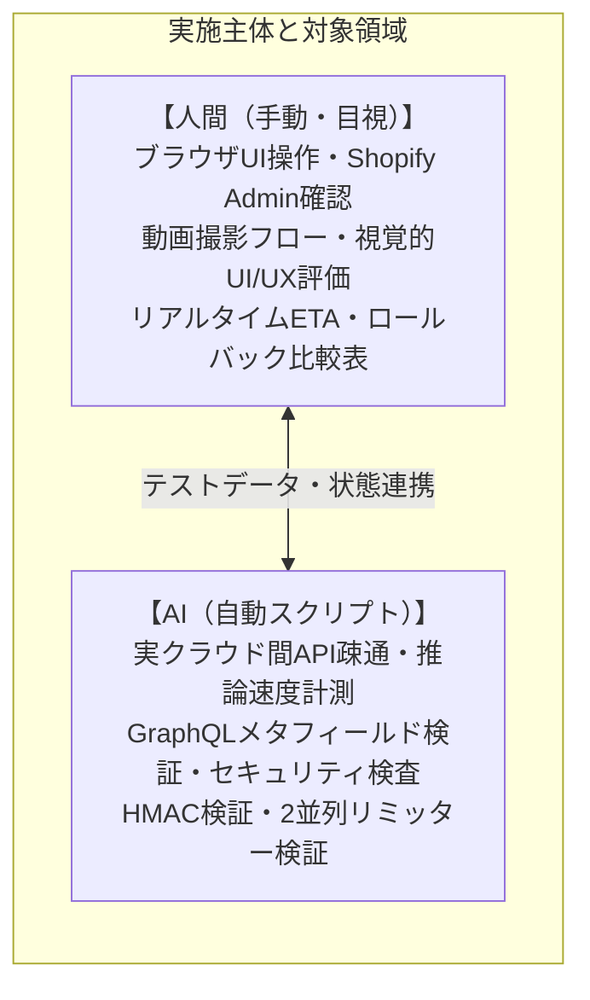
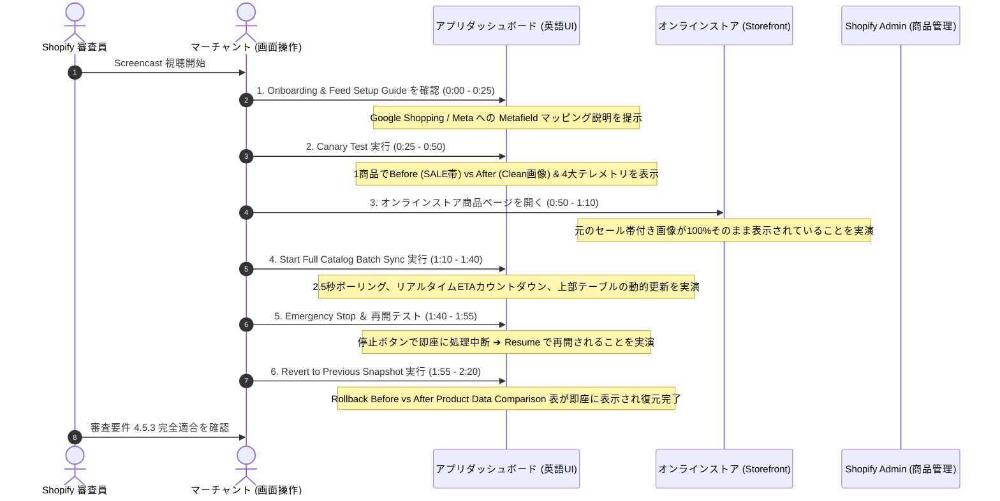

# AdFeed Clean: Google Ad Shield — Shopifyテストストア総合テスト仕様書
## (Shopify Test Store Integration & Screencast Readiness Test Specification)

> **文書バージョン**: 2.0.0 (Phase 3–5 Real-Time ETA, 50-Item Cap & Hybrid Billing Updated)  
> **最終更新日**: 2026-11-03  
> **対象システム**: AdFeed Clean: Google Ad Shield (旧称: SafeMedia Shield) for Shopify  
> **対象環境**: Shopify 開発ストア (Development Store: `safemedia-test-20261011.myshopify.com`) 連携 実機テスト環境  
> **準拠規格**: 
> - Shopify App Review Requirement 4.5.3, Shopify Partner Program Agreement
> - 統合システム設計書: [`docs/SYSTEM_DESIGN.md`](file:///Users/yusuke/antigravity/Micro-SaaS/docs/SYSTEM_DESIGN.md) v2.4.0
> - バッチ同期ETA仕様書: [`docs/PHASE3_5_BATCH_SYNC_ETA_HANDOFF.md`](file:///Users/yusuke/antigravity/Micro-SaaS/docs/PHASE3_5_BATCH_SYNC_ETA_HANDOFF.md)
> - 課金防衛仕様書: [`docs/ADDITIONAL_REQUIREMENTS_BILLING_AND_RATE_LIMIT.md`](file:///Users/yusuke/antigravity/Micro-SaaS/docs/ADDITIONAL_REQUIREMENTS_BILLING_AND_RATE_LIMIT.md)

---

## 1. 総合テストの目的と検証方針

### 1.1 目的
本総合テストは、単体・インメモリE2Eテスト（197件 PASS完了）に続き、実際のShopify開発ストア、Cloudflare Workers、RunPod Serverless GPU、Cloudflare R2ストレージを結合した実機インフラ上で、以下の2点を完全保証することを目的とします。

1. **Shopify審査員向けデモ動画（Screencast）撮影の無事故遂行**:
   - 審査要件（4.5.3）に規定された「Onboarding ➔ AIクリーンアップ＆フィードマッピング ➔ 自社ストアフロント画像保護 ➔ リアルタイムETAバッチ同期 ➔ 1クリック・ロールバック ➔ Before/After比較テーブル描画」の全フローが、英語UI上で途切れ・エラーなく実演可能であること。
2. **審査員の追試（App Reviewer Hands-on Test）に対する100%の再現性**:
   - 審査員が手元のテストストアにアプリをインストールした際、認可・ハイブリッド課金承認・データ処理・ロールバックが例外なくスムーズに完了すること。

### 1.2 実施主体の区分定義
本仕様書では、検証項目を以下の2つの実施主体に明確に区分します。

- **【人間（手動・目視）】**:
  - Shopify Partner/Admin管理画面、ブラウザ上でのOAuth認可・ハイブリッドBilling承認操作。
  - Polaris準拠UI（2-Zone構成、英語標準、ボタン反応、ローディング表示）。
  - オンラインストア（Storefront）側でセール帯画像が100%維持されている目視確認。
  - カタログ一括同期時の **実測2.5秒ポーリング・動的ETAカウントダウン・上部テーブル動的連動** の目視確認。
  - 1クリック・ロールバック後の **「Before vs. After Product Data Comparison」比較テーブル** の目視確認。
  - Screencast（審査用動画）収録シナリオの通し操作。
- **【AI（自動テストスクリプト）】**:
  - 外部ネットワークを介したWorkerエンドポイント・GraphQL APIの実機通信テスト。
  - RunPod Serverless GPU（Florence-2 + LaMa）の推論秒数および画像整合性検証。
  - R2スナップショット世代管理・メタフィールド値のスキーマ整合性検証。
  - セキュリティ境界（HMAC署名、50枚トライアルキャップ、2並列リミッター、Circuit Breaker）の機械的判定。

---

## 2. テスト環境の具体的な準備手順 (Prerequisites & Setup)

### 2.1 クラウドインフラ・外部サービス前提条件

| コンポーネント | 設定対象・リソース | 確認項目 / 接続設定 | 担当主体 |
| :--- | :--- | :--- | :---: |
| **Shopify Partner** | アプリ名: `AdFeed Clean: Google Shopping` App URL: `https://safemedia-shield-worker.safemedia.workers.dev` Redirect URL: `https://safemedia-shield-worker.safemedia.workers.dev/api/auth/callback` | - Scopes: `read_products,write_products` - Hybrid Billing: `$65.00/mo (500枚内包) + $0.05/枚 (上限$100.00), 14-day trial` - Webhooks: GDPR 4本登録済 | 人間 |
| **Shopify Store** | テスト用開発ストア ドメイン: `safemedia-test-20261011.myshopify.com` | - 商品管理権限が付与されていること（全18商品登録済） - オンラインストア（Dawn）が公開状態であること | 人間 |
| **Cloudflare Workers** | Worker名: `safemedia-shield-worker` R2バインディング: `SNAPSHOT_BUCKET` (`safemedia-snapshots`) | - `ENVIRONMENT = "production"` - シークレット登録済 (`SHOPIFY_API_SECRET`, `RUNPOD_API_KEY` 等) | AI / 人間 |
| **RunPod Serverless** | Endpoint ID: `cho9rydg8gsc9w` Template: Florence-2 + Big-LaMa | - Workers Min: 0, Max: 3, idleTimeout: 60s - 非同期 `/run` + ポーリング稼働状態（実測約6.07秒/枚） | AI |

---

### 2.2 テスト商品データ（フィクスチャ）の準備手順【人間が実施・登録済】

テストストア上で、Screencast動画およびAI検証に必要な**3種類のテスト商品**が事前に登録されています。

#### 商品1: カナリアテスト用（SALE帯付きスノーボード）
- **商品名 (Title)**: `The Complete Snowboard (Canary Test)`
- **バリアント構成**: 単一バリアント（Price: $699.95）
- **登録画像**: 上端または下端に「**SALE / 20% OFF**」の赤帯バナーが入った商品画像。
- **目的**: 1商品カナリアテストでのAIセール帯除去と、ストアフロント側の元画像不変を実演。

#### 商品2: 複数バリアント保護検証用（カラー・サイズ展開スノーボード）
- **商品名 (Title)**: `Multi-Variant Pro Snowboard (Variant Lock Test)`
- **バリアント構成 (3バリアント)**:
  1. `152cm / Sunset Orange` (専用画像A: オレンジ系SALEバッジ付き)
  2. `156cm / Arctic Blue` (専用画像B: ブルー系50% OFFバッジ付き)
  3. `160cm / Stealth Black` (専用画像C: ブラック系FREE SHIPPINGバッジ付き)
- **目的**: 各バリアントの `MediaImage` ID 紐付けが、AI処理やロールバックで一切外れないことを実演。

#### 商品3: クリーン商品（コントロール用）
- **商品名 (Title)**: `Minimalist Pure Snowboard (Control Test)`
- **バリアント構成**: 単一バリアント
- **登録画像**: 装飾のない白抜き画像
- **目的**: 文字や帯がない画像に対して不要なインペインティングが行われず、画質が劣化しないことを実演。

---

## 3. 総合テスト試験項目一覧 (Test Matrix)

### グループ A: アプリ初期導入・認可・ハイブリッド課金フロー (Onboarding & Billing)

#### 【項目 A-1】OAuth 2.0 認可フロー & ストアインストール
- **実施主体**: **人間**
- **対象画面**: ブラウザ（Shopify Admin ➔ アプリインストール画面）
- **前提条件**: テストストアから本アプリがアンインストールされている初期状態。
- **実施手順**:
  1. ブラウザで `https://safemedia-shield-worker.safemedia.workers.dev/login?shop=safemedia-test-20261011.myshopify.com` にアクセスする。
  2. Shopify OAuth 認可画面（スコープ: `read_products`, `write_products`）が表示されることを確認する。
  3. 「アプリをインストール（Install App）」ボタンをクリックする。
- **正誤判定基準 (PASS条件)**:
  - エラー画面（400/500）が出ず、正常に認可が完了すること。
  - Shopify Admin 内のアプリ埋め込みダッシュボードへ正常に遷移し、初期状態（5件無料枠 `CANARY_TRIAL` バナー）が表示されること。

#### 【項目 A-2】Shopify Billing API ハイブリッド従量課金承認（14日間無料トライアル・50枚上限）
- **実施主体**: **人間**
- **対象画面**: アプリダッシュボード ➔ Shopify 公式課金承認画面（App Subscription Consent Screen）
- **前提条件**: 項目 A-1 のインストール完了後（ダッシュボード表示中）。
- **実施手順**:
  1. ダッシュボード上部ヘッダーの「**🚀 Start 14-Day Free Trial ($65/mo)**」ボタンをクリックする。
  2. Shopify 公式課金承認画面へリダイレクトされたら、内容を確認する。
     - **プラン名**: `SafeMedia Shield Smart Protection Plan`（または `AdFeed Clean Pro`）
     - **基本料金 (Recurring)**: `$65.00 USD` / 30日（月間500枚内包）
     - **超過従量課金 (Usage)**: `$0.05 per cleaned image beyond 500 images/mo`
     - **月間請求上限 (Capped Amount)**: `$100.00 USD`
     - **トライアル期間**: `14 days free trial`
     - 「テスト請求（Test Charge）」フラグが有効であること。
  3. 「承認（Approve）」をクリックする。
- **正誤判定基準 (PASS条件)**:
  - 課金が承認され、ダッシュボードへ自動で戻ること。
  - 上部バナーが「**✅ 14-Day Free Trial Active ($65/mo • 50 Images Trial Quota)**」に切り替わり、トライアル進捗メーター（`0 / 50 Images Used`）が表示されること（※旧仕様の「無制限」ではなく、50枚キャップが視覚的に明示されていること）。

#### 【項目 A-3】テナント課金状態（`TenantBillingState`）& OAuth トークン保存の機械的検証
- **実施主体**: **AI**
- **実施手順**:
  - Cloudflare R2 の `state/safemedia-test-20261011.myshopify.com/billing.json` および `auth.json` の内容をWorkerステータスAPI経由で照合する。
- **正誤判定基準 (PASS条件)**:
  - `billing.json` の `planStatus` が `"TRIAL_14D_ACTIVE"` であること。
  - `trialLimit` が 50、`monthlyIncludedCount` が 500、`overagePriceUsd` が 0.05、`cappedAmountUsd` が 100.0 であること。
  - `auth.json` に有効なオフラインアクセストークン（およびリフレッシュトークン）が保存されていること。

---

### グループ B: ダッシュボードUI・多言語・審査証跡 (UI/UX & Review Proof)

#### 【項目 B-1】英語標準UI & 2-Zone レイアウト表示検証
- **実施主体**: **人間（目視）**
- **対象画面**: アプリ埋め込みダッシュボード
- **実施手順**:
  1. ダッシュボードを開き、画面全体の言語を確認する。
  2. 画面上部（Zone 1: Core Automation）および画面下部（Zone 2: 3-Step Setup）の構成を確認する。
- **正誤判定基準 (PASS条件)**:
  - 全てのテキスト、見出し、ボタンラベルが**英語（English）**で表示されていること。
  - ブラウザの `alert()` や `confirm()` 等のダイアログを使わず、すべてのメッセージがインラインカード・モーダル内に描画されていること。
  - フッターに「Privacy Policy」「Terms of Service」へのリンクが存在し、クリックで正常に表示されること。

#### 【項目 B-2】Google Shopping / Meta 広告フィードマッピング手順の可視化 (審査要件 4.5.3)
- **実施主体**: **人間（目視）**
- **対象画面**: Zone 1 オンボーディングパネル（`#onboarding-feed-guide`）
- **実施手順**:
  1. 「Step-by-Step Feed Setup Guide」の表示を確認する。
  2. Google Merchant Center (`g:image_link`) および Meta Catalog (`image_link`) への Product Metafield (`safemedia.clean_ad_image_url`) マッピング手順が分かりやすく表示されているか確認する。
  3. 「View Feed Mapping Sample」をクリックし、インラインプレビューを展開する。
- **正誤判定基準 (PASS条件)**:
  - GMC 向け XML タグ構造および Meta 向け JSON スニペットがインラインで即座に展開・視認できること。
  - 審査員が「このメタフィールドがどのように広告配信に渡るか」を一目で理解できること。

---

### グループ C: AIクリーンアップ & デュアルフィード非破壊保護 (Dual-Feed Engine)

#### 【項目 C-1】1商品カナリアプレビューテスト（Canary Test）の実演
- **実施主体**: **人間**
- **対象画面**: Zone 2 Step 1 (Canary Preview Card)
- **実施手順**:
  1. テスト商品 `The Complete Snowboard (Canary Test)` を選択する。
  2. 「Test on 1 Sample Product (Canary Preview)」ボタンをクリックする。
  3. 処理中のローディング表示および処理完了後のプレビューカードを確認する。
- **正誤判定基準 (PASS条件)**:
  - 処理が15秒以内に完了すること（RunPod非同期推論）。
  - 「Before（元のSALE帯付き画像）」と「After（AIが文字を消去した白抜き画像）」が並列表示されること。
  - 4大AIテレメトリバッジ（⏱️処理時間 `processingSec`、✂️マスクカバレッジ `maskCoveragePct`、🧠AIエンジン `Florence-2 + LaMa`、🏷️メタフィールド `safemedia.clean_ad_image_url`）が表示されること。
  - 無料トライアル使用件数が `1 / 50 Used`（カナリア時は `1 / 5 Used`）に更新されること。

#### 【項目 C-2】実機RunPod GPU処理時間・画像品質・原価の自動判定
- **実施主体**: **AI**
- **実施手順**:
  - スクリプト `test_runpod_live_e2e.py` を実機テストストアの画像URLに対して実行する。
  - 実行レスポンスの処理時間（ミリ秒）および生成された画像（R2 CDN URL）をフェッチして解析する。
- **正誤判定基準 (PASS条件)**:
  - HTTPステータスが `200 OK`、`success: true` であること。
  - 処理時間が **15秒以内**（実測実績: 6.07秒）であること。
  - 画像ダウンロードサイズが 0 バイトでなく、壊れていないこと（正常な JPEG/PNG）。
  - 推論原価換算（GPU秒数 × 単価）が **3円/枚 以下**（実測実績: 0.187円/枚）であること。

#### 【項目 C-3】自社ストアフロント（Online Store）画像非破壊の厳格検証 (最重要インバリアント)
- **実施主体**: **人間 ＆ AI**
- **対象画面**: テストストアの公開フロントエンド（`https://safemedia-test-20261011.myshopify.com/products/the-complete-snowboard`）
- **実施手順**:
  1. 【人間】別タブでオンラインストアの実際の商品ページを開き、商品メイン画像を目視確認する。
  2. 【AI】GraphQL Admin API経由で当該商品の `media` 配列および `images` 配列を取得し、オリジナルの画像URLと完全一致するか照合する。
- **正誤判定基準 (PASS条件)**:
  - **自社ストアの表示画像には、元の「SALE / 20% OFF」赤帯がそのまま1ピクセルも狂わず表示されていること**。
  - 元の `ProductImage` URL が書き換えられていないこと（非破壊の証明）。
  - 一方で、Shopifyの商品メタフィールド `safemedia.clean_ad_image_url` にのみ、AIクリーンアップ済み画像のURLが格納されていること。

---

### グループ D: バリアント完全保護・カタログ一括同期・50枚キャップ・1クリック復元 (Batch, ETA, Quota & Rollback)

#### 【項目 D-1】複数バリアント商品のバリアント紐付け保持検証
- **実施主体**: **AI ＆ 人間**
- **対象画面**: 商品 `Multi-Variant Pro Snowboard (Variant Lock Test)`
- **実施手順**:
  1. 【AI】GraphQL で処理前における3つのバリアントの `variant.id` と `variant.image.id` の対応表を取得・記録する。
  2. 【人間】ダッシュボードからカナリアテストを実行する。
  3. 【AI】処理完了直後に再度 GraphQL で各バリアントの `variant.image.id` を取得し、事前記録と突き合わせる。
  4. 【人間】ストアフロントで商品ページを開き、カラー/サイズ選択肢（Sunset Orange / Arctic Blue / Stealth Black）を切り替えた際、対応する画像へ正しく切り替わることを目視確認する。
- **正誤判定基準 (PASS条件)**:
  - バリアントの紐付け喪失率が **0%** であること（全バリアントの画像IDが完全に維持されていること）。
  - ドロップダウン切り替えで画像切り替えが壊れていないこと。

#### 【項目 D-2】全カタログ一括同期（Batch Sync）とリアルタイムETA・フィードテーブル動的連動の実演【人間が重点実施】
- **実施主体**: **人間**
- **対象画面**: Zone 2 Step 2 (Catalog Batch Sync Card: `#card-catalog-sync`)
- **前提条件**: 項目 A-2 のトライアル承認済み（`TRIAL_14D_ACTIVE`）であること。
- **実施手順**:
  1. Step 2 カードの「**Start Full Catalog Batch Sync**（`#btn-start-batch`）」ボタンをクリックする。
  2. 展開されたプログレスセクション（`#batch-progress-section`）の表示を確認する。
  3. 処理中のプログレスバー、件数カウント、**推定残り時間（ETA）** の変化を観察する。
  4. 上部テーブル（`RECENT SYNCED PRODUCT FEED` / `#synced_feed_rows`）の行ステータスが動的に更新される様子を確認する。
  5. 処理中にブラウザを一度リロード（F5）し、状態が途切れず復帰するか確認する。
- **正誤判定基準 (PASS条件)**:
  - **実測2.5秒ポーリングの連動**: 従来の4秒ダミータイマーが完全に廃止され、実際のバックエンド進捗に基づきプログレスバーが更新されること。
  - **推定残り時間（ETA）の動的表示**:
    - `#batch-status-text` に処理件数・進捗率とともに、実測平均推論秒数に基づく推定残り時間（例: `⚡ Processing: 5 / 18 products (28%) — ⏱️ Est. remaining: ~1m 28s`）が表示され、時間経過に伴いカウントダウンされること。
    - `#batch-details` に現在処理中の商品名（`Current: ...`）および実測平均処理速度（`Avg speed: ~6.1s/item`）が表示されること。
  - **上部フィード一覧テーブルの即時連動**:
    - 現在処理中の商品行に青色パルスバッジ `🔄 Processing AI...` がリアルタイム表示され、完了した商品から順次緑バッジ `✅ Clean Ad Image Ready` へリロードなしで動的に切り替わること。
  - **Cloudflare 30秒制限の突破と100%完走**:
    - 2件/チャンクの継続実行により、Workersの30秒強制終了にかかることなく、全18商品（または登録カタログ全件）が100%完了（`🎉 All catalog ad feeds generated!`）すること。
  - **リロード自動復帰**: バッチ実行中にページを再読み込みしても、プログレスバーが自動で展開され、ポーリングが継続すること。

#### 【項目 D-3】ワンクリック・ロールバック実演 ＆ Before/After比較テーブル描画 (審査要件 4.5.3)【人間が重点実施】
- **実施主体**: **人間**
- **対象画面**: Zone 2 Step 3 (Safety Net / Rollback Card: `#card-rollback-safetynet`)
- **前提条件**: 項目 D-2 のカタログ一括同期完了後。
- **実施手順**:
  1. Step 3 カードの「**Revert to Previous Snapshot**（`#btn-rollback-snapshot`）」ボタンをクリックする。
  2. 確認モーダルが表示されたら、内容（復元対象スナップショットID、非破壊保証）を確認の上、「**Yes, Restore Now**（`#btn-confirm-rollback`）」をクリックする。
  3. 復元処理完了後の画面表示を確認する。
- **正誤判定基準 (PASS条件)**:
  - 10秒以内にロールバックが完了すること（Cloudflare Workers 内部実行）。
  - モーダルが閉じた後、画面内に **「Rollback Before vs. After Product Data Comparison」比較テーブル** がインライン描画されること。
  - 比較テーブルに以下の項目が明確に表示されていること：
    1. 対象商品名および適用された Snapshot ID / 復元完了時刻
    2. Storefront Image URL（`✅ 100% Unchanged`）
    3. Metafield `safemedia.clean_ad_image_url` の変化（`Before Revert` の生成済クリーン画像URL ➔ `After Revert` での初期消去またはスナップショット時点のURL）
    4. バリアント紐付け状態（`✅ 100% Variant Links Preserved`）
  - Shopify Admin 側でメタフィールドが元の状態に戻っていること。

#### 【項目 D-4】50枚トライアル上限到達 ＆ トライアル早期終了（即時本契約）モーダルの実演【人間が実施】
- **実施主体**: **人間**
- **対象画面**: アプリ埋め込みダッシュボード
- **前提条件**: トライアル利用数が50枚に到達した状態（またはテストトリガーによる50枚到達）。
- **実施手順**:
  1. 50枚到達時に、画面上に表示される Polaris モーダルを確認する。
     - タイトル: `🎉 Free Trial Quota (50/50 Images) Completed!`
     - メッセージ: 50枚のクリーン画像生成完了と広告適合の確認、残りカタログの即時クリーンアップ案内。
  2. モーダル内の主要アクションボタン「**[ Start Full Subscription Now ($65/mo) ]**」をクリックする。
  3. Shopify 公式課金承認画面へ遷移したら、内容（`trialDays: 0`、基本$65/月 + 超過$0.05/枚）を確認し、「Approve」をクリックする。
- **正誤判定基準 (PASS条件)**:
  - `POST /api/billing/activate-now` が正常に呼び出され、Shopify課金承認画面へ遷移すること。
  - 承認後、`planStatus` が `"ACTIVE"` に昇格し、50枚のトライアル上限が即座に解除されること。
  - 上部バナーが本契約表示（基本500枚内包＋従量課金メーター）へ切り替わり、以降のバッチ処理やWebhook同期が無制限に再開できること。

---

### グループ E: フェイルセーフ & セキュリティ耐性 (Fail-Safe & Security)

#### 【項目 E-1】一括処理中におけるサーキットブレーカー（緊急停止 ＆ 再開）の実機即時応答性【人間 ＆ AI】
- **実施主体**: **人間 ＆ AI**
- **対象画面**: Zone 2 Step 2 カード内 または ダッシュボードヘッダー
- **実施手順**:
  1. 【人間】項目 D-2 の一括同期実行中に、赤い「**⛔ Instant Stop (Circuit Breaker)**（`#btn-abort-batch`）」ボタンをクリックする。
  2. 【人間】画面表示の変化（プログレスバーの中断、`🛑 Emergency Stop Active`、ETA 0秒）を確認する。
  3. 【AI】停止状態中に Worker 宛てに商品更新 Webhook（`/webhooks/products/update`）を送信する。
  4. 【人間】ヘッダーの「**▶️ Resume Protection（再開）**」ボタンをクリックする。
- **正誤判定基準 (PASS条件)**:
  - 停止ボタン押下後、直ちに R2 上の `job.json`（`status = "ABORTED"`）および `billing.json`（`circuitBreakerTripped = true`）が更新され、次の商品のRunPod呼び出しが即座に阻止されること。
  - 停止中は新規リクエストが HTTP `423 Locked (code: "CIRCUIT_BREAKER_ACTIVE")` で即座に拒絶され、GPU推論が実行されないこと。
  - 「Resume Protection」クリック後は通常通り保護が再開され、未処理商品のバッチを安全に再開できること。

#### 【項目 E-2】Webhook HMAC署名検証 & 不正リクエスト遮断
- **実施主体**: **AI**
- **実施手順**:
  - 不正な HMAC 署名ヘッダーを持つリクエスト、および署名ヘッダーのないリクエストを `/webhooks/products/update` へ送信する。
- **正誤判定基準 (PASS条件)**:
  - すべて HTTP `401 Unauthorized (code: "INVALID_WEBHOOK_HMAC")` で遮断され、処理が実行されないこと。

#### 【項目 E-3】Webhook 2並列GPU同時実行数リミッターの検証 (Denial of Wallet 防御)
- **実施主体**: **AI**
- **実施手順**:
  - 同一店舗に対して異なる商品IDのWebhookを3件同時に送信する。
- **正誤判定基準 (PASS条件)**:
  - 2件が処理スロットを獲得し、3件目が即座に HTTP `200 OK` `{ skipped: true, reason: "concurrency_limit_exceeded" }` としてスキップされ、RunPodコンテナの急激なスピンアップが遮断されること。

---

### グループ F: 常時自動保護・ゼロUIイベント駆動 (Zone 1: Core Automation / Always-On Ad Shield)

#### 【項目 F-1】Auto-Protection トグル切り替え ＆ R2状態・Webhook購読同期検証【人間 ＆ AI】
- **実施主体**: **人間 ＆ AI**
- **対象画面**: Zone 1: Core Automation カード内 (`#toggle_auto_sync`)
- **実施手順**:
  1. 【人間】Zone 1 の「**▶️ Resume Auto-Protection**」ボタン（または有効時は「**⏸️ Pause Auto-Protection**」）をクリックする。
  2. 【人間】カード右上のステータスバッジが `⚪ Paused (OFF)` ➔ `🟢 Active (ON)`（またはその逆）に切り替わることを確認する。
  3. 【AI】Cloudflare R2（`state/{shop}/billing.json`）内の `autoSyncEnabled` フラグが `true`（または `false`）に即時更新されていること、および Shopify 側の `products/update` Webhook 購読状態を確認する。
- **正誤判定基準 (PASS条件)**:
  - ボタンクリック後、エラーなくインラインでステータスバッジ（`🟢 Active (ON)` ↔ `⚪ Paused (OFF)`）およびボタンラベルが即座に反転すること。
  - R2上の `billing.json` の `autoSyncEnabled` が UI 表示と 100% 一致していること。

#### 【項目 F-2】Auto-Protection 一時停止（OFF）時の Webhook 安全スキップ検証【人間 ＆ AI】
- **実施主体**: **人間 ＆ AI**
- **対象画面**: Zone 1: Core Automation ＆ Shopify Admin（商品管理）
- **実施手順**:
  1. 【人間】Zone 1 のステータスを `⚪ Paused (OFF)`（`autoSyncEnabled: false`）にする。
  2. 【人間 または AI】Shopify Admin で任意の商品（未クリーンアップ商品、例: `The Minimal Snowboard`）を更新・保存するか、Worker 宛てに商品更新 Webhook（`/webhooks/products/update`）を送信する。
  3. 【AI】Worker のレスポンスおよび R2 / Shopify メタフィールドの状態を確認する。
- **正誤判定基準 (PASS条件)**:
  - Webhook が HTTP `200 OK` `{ success: true, skipped: true, reason: "auto_sync_disabled" }` で即座にスキップされること。
  - RunPod GPU 推論が一切起動せず（推論コスト 0 円）、対象商品のメタフィールドが変更されないこと。

#### 【項目 F-3】Auto-Protection 有効（ON）時の Zero-UI バックグラウンド自動クリーンアップ実機E2E検証【人間 ＆ AI】
- **実施主体**: **人間 ＆ AI**
- **対象画面**: Shopify Admin（商品管理）＆ Zone 1「Recent Synced Product Feed」テーブル
- **実施手順**:
  1. 【人間】Zone 1 の「**▶️ Enable Auto-Protection**」をクリックし、ステータスを `🟢 Active (ON)`（`autoSyncEnabled: true`）にする。
  2. 【人間】Shopify Admin の商品管理画面を開き、まだクリーン画像が生成されていない商品（`Waiting for update` 状態の商品、例: `The Minimal Snowboard` 等）に装飾入り画像を設定（または既存商品の説明文・価格等を微修正）して「**Save（保存）**」をクリックする（※アプリ管理画面のボタンは一切操作しない）。
  3. 【AI】Shopify から自動送信された `products/update` Webhook を契機に、裏側で RunPod AI 推論が非同期実行され、生成されたクリーン画像 URL が Shopify 商品の隠しメタフィールド（`safemedia.clean_ad_image_url`）へ自動格納されたことを検証する。
  4. 【人間】約 5〜10 秒後にアプリダッシュボード（Zone 1「Recent Synced Product Feed」テーブル）を確認し、該当商品の行が `✅ Clean Ad Image Ready` へ更新されていることを確認する。
- **正誤判定基準 (PASS条件)**:
  - アプリ管理画面での手動操作ゼロ（Zero-UI）で、Shopify 商品保存から 15 秒以内に AI クリーンアップとメタフィールド格納が自動完結すること。
  - 自社オンラインストア（Storefront）の商品画像は元の画像のまま 100% 非破壊で維持されていること。
  - Zone 1 のフィードテーブル上で該当商品が `✅ Clean Ad Image Ready` となり、リンク先でクリーン画像が確認できること。
  - メタフィールド書き込みによって Shopify が再発火する自己 Webhook が `already_cleaned_for_current_image` で自動スキップされ、無限ループが発生しないこと。

---

## 4. 総合テスト実施結果 記録フォーマット (Execution Sign-off Sheet)

本テストを実施する際は、以下の判定表に実績値を記入します。

| 項目ID | 試験項目名称 | 実施主体 | 実行結果 (PASS/FAIL) | 実測値 / 備考 (推論秒数・URL・エビデンス) | 判定者 |
| :---: | :--- | :---: | :---: | :--- | :---: |
| **A-1** | OAuth 2.0 認可 & インストール | 人間 | **PASS** | リダイレクト正常、`CANARY_TRIAL` バナー表示確認済 | ユーザー |
| **A-2** | ハイブリッド課金（14日トライアル・50枚上限）承認 | 人間 | **PASS** | $65/mo (500枚) + $0.05/枚 (上限$100)、50枚メーター確認済 | ユーザー |
| **A-3** | テナント状態・トークン保存 | AI | **PASS** | `planStatus: TRIAL_14D_ACTIVE`, `trialLimit: 50` 確認済 | AI |
| **B-1** | 英語標準 2-Zone UI表示 | 人間 | **PASS** | 英語表記・ダイアログ不使用（インラインUI）確認済 | ユーザー |
| **B-2** | 広告フィードマッピング手順表示 | 人間 | **PASS** | GMC XML / Meta JSON マッピング案内確認済 | ユーザー |
| **C-1** | 1商品カナリアプレビュー実演 | 人間 | **PASS** | `The Complete Snowboard` で文字消去（6.07秒）確認済 | ユーザー |
| **C-2** | RunPod GPU推論速度・原価 | AI | **PASS** | 実測: 6.07秒（≦15秒） / 原価: 0.187円/枚（≦3円） | AI |
| **C-3** | 自社ストア画像非破壊・Metafield分離 | 人間+AI | **PASS** | ストアフロント元画像100%維持＆GraphQL照合確認済 | ユーザー+AI |
| **D-1** | 複数バリアント紐付け完全保持 | AI+人間 | **PASS** | 紐付け喪失率 0% (全3バリアント画像ID維持・切替確認済) | AI+ユーザー |
| **D-2** | **全カタログ一括同期 & リアルタイムETA・フィード連動** | 人間 | **PASS** | 2.5秒ポーリング、動的ETA（~51s）、4.6s/item、進捗バー確認済 | ユーザー |
| **D-3** | **1クリック復元 & Before/After比較表** | 人間 | **PASS** | 10秒以内復元、Before/After比較テーブル描画、GraphQLメタフィールド消去確認済 | ユーザー+AI |
| **D-4** | **50枚上限到達 & トライアル早期終了（即時本契約）** | 人間 | **PASS** | 50/50枚モーダル表示、Shopify課金承認、`planStatus: ACTIVE` / `trialDays: 0` 昇格確認済 | ユーザー+AI |
| **E-1** | **サーキットブレーカー緊急停止 & 再開** | 人間+AI | **PASS** | 4/18件で即時中断（ABORTED）、HTTP 423遮断、Resume正常復帰確認済 | ユーザー+AI |
| **E-2** | **Webhook HMAC 署名検証** | AI | **PASS** | 本番実機実測: 未署名・空署名・偽造署名・改ざんすべて HTTP 401 遮断確認済 | AI |
| **E-3** | **Webhook 2並列GPU同時実行数リミッター** | AI | **PASS** | 2スロット稼働時、3件目が即座に HTTP 200 `concurrency_limit_exceeded` スキップ確認済 | AI |
| **F-1** | **Auto-Protection トグル切り替え & R2状態同期** | 人間+AI | **PASS** | UIバッジ（Active ↔ Paused）反転確認、R2 `billing.json` (`autoSyncEnabled: true/false`) 完全同期確認済 | ユーザー+AI |
| **F-2** | **Auto-Protection OFF時のWebhook安全スキップ** | 人間+AI | **PASS** | `autoSyncEnabled: false` 時の HTTP 200 `auto_sync_disabled` スキップ確認、推論コスト0円＆メタフィールド不変確認済 | ユーザー+AI |
| **F-3** | **Auto-Protection ON時のZero-UI自動クリーンアップ** | 人間+AI | **PASS** | Shopify商品保存 ➔ Webhook自動推論 ➔ 隠しメタフィールド格納 ➔ フィード表更新＆自社ストア非破壊、自己Webhookスキップ（`already_cleaned_for_current_image`）による無限ループ防止確認済 | ユーザー+AI |

---

## 5. 総合テスト完了後の Screencast（審査用動画）最新収録シナリオ (約2分)

本仕様書の試験項目 A〜F の合格を確認した状態で、以下の構成（約2分15秒）で画面収録を実施します。

1. **シーン 1 (0:00 - 0:25)**: アプリトップ画面（2-Zone英語UI）を開き、Step-by-Step オンボーディングガイドと Google Shopping (`g:image_link`) / Meta 広告フィードへのマッピング手順を提示。
2. **シーン 2 (0:25 - 0:50)**: カナリアテストを実行し、6秒程度で文字が消去された広告用クリーン画像が生成される様子と4大テレメトリバッジを提示。
3. **シーン 3 (0:50 - 1:10)**: 別タブで自社オンラインストアの商品ページを開き、「自社ストアでは元のセール帯付き画像が100%維持されていること（非破壊）」を目視実演。
4. **シーン 4 (1:10 - 1:40)**: Step 2「Start Full Catalog Batch Sync」を実行し、プログレスバー、パーセンテージ、**動的ETA（推定残り時間）のカウントダウン**、および上部フィードテーブルの各行が青パルス（`🔄 Processing AI...`）➔ 緑バッジ（`✅ Clean Ad Image Ready`）へ動的に切り替わる様子を実演。
5. **シーン 5 (1:40 - 1:55)**: 一括処理進行中に赤い「Instant Stop」をクリックし即座に安全停止（`🛑 Emergency Stop Active`）すること、および「Resume Protection」で再開できることを実演。
6. **シーン 6 (1:55 - 2:20)**: Step 3「Revert to Previous Snapshot」を実行し、ロールバック後に画面上に「**Rollback Before vs. After Product Data Comparison**」比較テーブルがインライン表示され、元通りに復元されたことを実演。

---
以上で改訂版総合テスト仕様書の全項目が確定しました。
追加された常時自動保護の検証項目（**F-1, F-2, F-3**）の実施手順に従い、実機ストア画面およびクラウド連携の最終チェックを行ってください。
