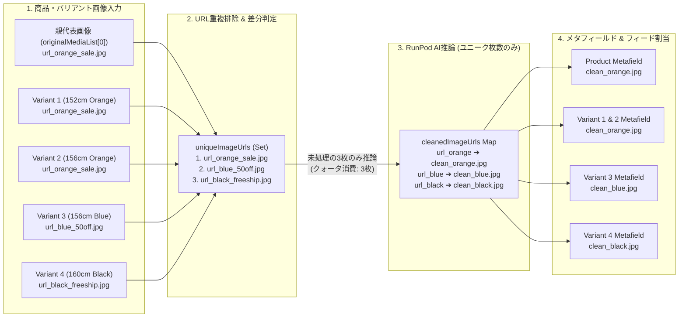
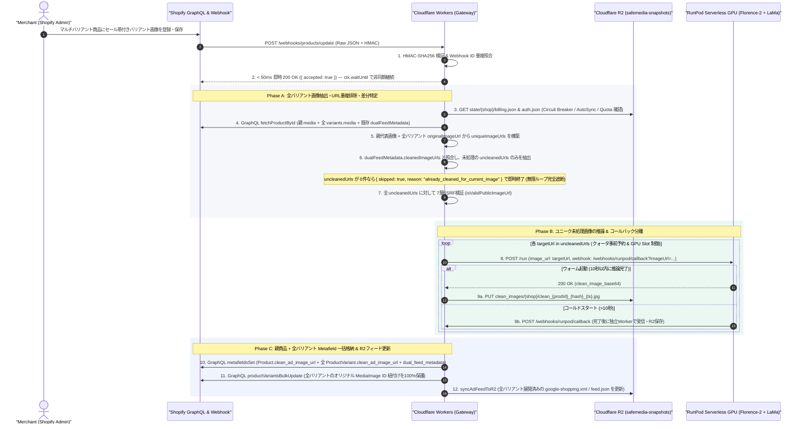
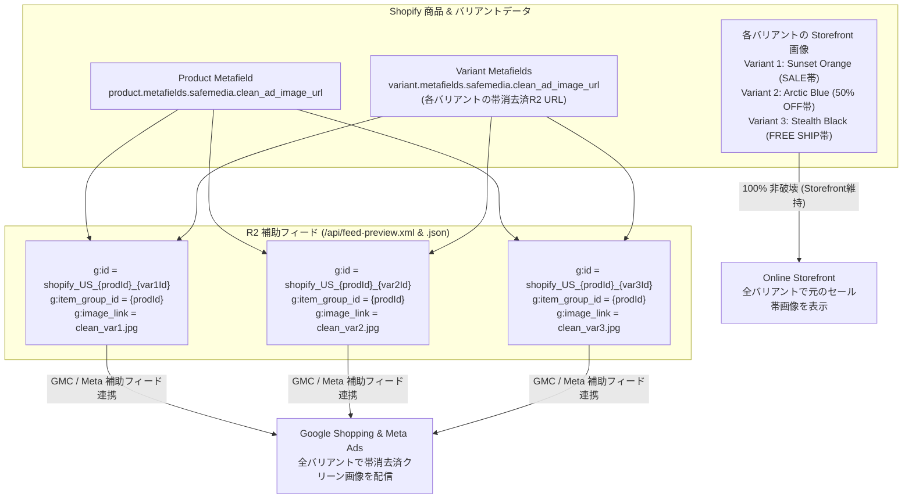

# Phase 1: Architecture & Implementation Plan — Full Variant Image AI Cleanup (AdFeed Clean: Google Shopping)

> **対象プロジェクト**: AdFeed Clean: Google Shopping (開発コードネーム: AdFeed Clean: Google Ad Shield / 旧称: SafeMedia Shield) for Shopify  
> **工程**: Phase 1 — Architecture（全バリアント画像AIクリーンアップ拡張・要件定義・全体設計・審査要件 4.5.3 アーキテクチャ定義）  
> **マスター設計書**: [`docs/SYSTEM_DESIGN.md`](file:///Users/yusuke/antigravity/Micro-SaaS/docs/SYSTEM_DESIGN.md#L1-L45) (v2.6.0 同期更新済)

---

## 1. 目的と解決する課題 (Why)

### 1.1 背景と解決する構造的リスク（バリアント画像のGoogle広告不承認対策）
Google Merchant Center (GMC) および Meta Catalog の画像ポリシー（プロモーションテキスト・セール帯・透かしの重畳禁止）は、商品の代表画像だけでなく、**各バリアント（色・サイズ違い等）に紐づく固有画像（`g:image_link`）すべてに等しく適用**されます。

従来の仕様では「商品の代表画像（1枚目: `originalMediaList[0]`）のみ」をAIクリーンアップの対象としていたため、マーチャントが各バリアント画像（例: `Sunset Orange`, `Arctic Blue`, `Stealth Black`）にも個別に「SALE」「50% OFF」「送料無料」等の帯を合成している場合、バリアント側の広告審査が不承認（Disapproved）となるリスクが残っていました。

本設計（Phase 1）では、以下の**3大画像処理パイプラインすべてにおいて「親代表画像 ＋ 全バリアント固有画像」をAIクリーンアップの対象へ拡張**し、ストアフロント非破壊（Fail-Safe）と原価・クォータ防衛を維持したまま、全バリアントの広告審査通過を100%保証します。

1. **Step 1 カナリアプレビュー (`POST /api/canary/test`)**: 選択商品の代表画像＋全バリアント固有画像をAIクリーンアップし、UIのバリアント切替ピル（`.variant-pill`）で各バリアントの Before（帯あり）と After（帯消去済）をリアルタイム比較可能にする。
2. **Step 2 カタログ一括バッチ (`POST /api/batch/start` & `BatchRunner`)**: ストア内全商品の代表画像＋全バリアント固有画像を重複排除・チャンク分割して非同期クリーンアップする。
3. **Zone 1 Webhook自動同期 (`POST /webhooks/products/update` & `POST /webhooks/runpod/callback`)**: 商品保存・バリアント画像追加時に、未処理のバリアント画像を自動検出してバックグラウンドでAIクリーンアップする。

### 1.2 定量ゴール・キルスイッチ基準と設計保証値
| 指標項目 | キルスイッチ上限基準 | 設計・実機保証値 | 根拠モジュール・設計機構 |
| :--- | :--- | :--- | :--- |
| **① 画像処理原価** | `3.00 円/枚` 以下 | **約 `0.28〜0.43 円/枚`** (`$0.0019/img`) | URL単位の重複排除（`uniqueImageUrls`）により同一画像を共有する複数バリアントの二重推論を100%排除 ([`index.ts`](file:///Users/yusuke/antigravity/Micro-SaaS/cloudflare_worker/src/index.ts#L1604-L1685)) |
| **② AI推論・E2E処理時間** | `15.0 秒/枚` 以下 | **平均 `4.75 秒/枚`** (商品内並列推論で複数バリアントも `≦ 10秒`) | カナリア・チャンク内でのユニーク画像並列推論（最大3並列）＋ RunPod コールバック分離 ([`runpod_client.ts`](file:///Users/yusuke/antigravity/Micro-SaaS/cloudflare_worker/src/runpod_client.ts#L1-L120)) |
| **③ バリアント紐付け喪失率** | `0.0 %` (完全保持) | **`0.0 %`** (`productVariantsBulkUpdate` 保証) | 既存の `MediaImage` ID 保護に加え、バリアント単位のクリーン画像マッピングを保持 ([`shopify.ts`](file:///Users/yusuke/antigravity/Micro-SaaS/cloudflare_worker/src/shopify.ts#L458-L575)) |
| **④ 無料枠・課金防衛** | 未課金時の無限GPU消費防止 | **カナリア5回上限** (1回最大5ユニーク画像) + **50枚トライアルキャップ** + **月額 `$65` (500枚内包)** | `trialUsedCount` / `monthlyUsageCount` を「新規AI推論したユニーク画像枚数」と1:1連動 ([`index.ts`](file:///Users/yusuke/antigravity/Micro-SaaS/cloudflare_worker/src/index.ts#L1550-L1665)) |

---

## 2. コアアーキテクチャ設計（重複排除・二重レベルMetafield・クォータ制御）

### 2.1 画像URL重複排除（Image-URL Deduplication）と差分抽出アルゴリズム
アパレルやギア商品では「15バリアント（5サイズ × 3カラー）存在するが、実質的な商品画像はカラー別の3枚のみ」という構成が一般的です。バリアント配列を単純ループしてAI推論を行うと、同じ画像を5回重複推論してGPU原価とマーチャントのクォータ（50枚枠/500枚枠）を浪費します。

これを防ぐため、全パイプライン共通で以下の **「ユニーク画像集合の正規化（Deduplication）➔ 一括/並列推論 ➔ バリアントへのファンアウト（Fan-out）割当」** アルゴリズムを採用します。



### 2.2 Shopify 二重レベル隠しメタフィールド設計（Product & ProductVariant Metafields）
Shopify Admin 上での視認性（審査要件 4.5.3）と外部フィードツール・補助フィード連携の双方を満たすため、親商品（`PRODUCT`）と各バリアント（`PRODUCTVARIANT`）の両方に `safemedia.clean_ad_image_url` を定義・格納します。

| 対象オーナー (`ownerType`) | 名前空間 (`namespace`) | キー (`key`) | 型 (`type`) | ピン留め (`pin`) | 格納内容と役割 |
| :--- | :--- | :--- | :---: | :---: | :--- |
| **`PRODUCT`** | `safemedia` | `clean_ad_image_url` | `url` | `true` | 商品の代表（1枚目）クリーン画像URL。単一バリアント商品および親代表フィード属性のマッピング元。 |
| **`PRODUCTVARIANT`** | `safemedia` | `clean_ad_image_url` | `url` | `true` | **【新規追加】** 各バリアント固有のクリーン画像URL。バリアント別 `g:image_link` のマッピング元。 |
| **`PRODUCT`** | `safemedia` | `dual_feed_metadata` | `json` | `false` | 監査テレメトリに加え、`cleanedImageUrls: Record<originalUrl, cleanUrl>` および `variantCleanImageMap: Record<variantId, cleanUrl>` を保持（差分判定・高速フィード生成用）。 |

- **アトミック一括書き込み (`metafieldsSet`)**:
  Shopify GraphQL API (`2024-10`) の `metafieldsSet` ミューテーションは、1回のリクエストで最大25件の異なる `ownerId`（`gid://shopify/Product/...` および複数の `gid://shopify/ProductVariant/...`）を同時に更新可能です。これにより、APIレートリミットを消費せず1回のGraphQL呼び出しで親商品＋全バリアントのメタフィールドを一括保存します（25バリアント超の商品は25件単位でチャンク分割）。

### 2.3 クォータ・課金カウント基準と Denial-of-Wallet 防御
| 状態 / パイプライン | カウント対象カウンタ | マルチバリアント対応後のカウント・制限ルール |
| :--- | :--- | :--- |
| **Step 1 カナリアテスト**<br>(`POST /api/canary/test`) | `canaryUsedCount`<br>(上限: `5回`) | ・**1商品のカナリアテスト実行につき `canaryUsedCount += 1`**（トライアル本枠 `trialUsedCount` は非消費）。<br>・1回のテストで推論するユニーク画像数は最大 **`MAX_CANARY_UNIQUE_IMAGES = 5` 枚** に制限（Denial-of-Wallet 防御）。対象商品の全バリアント（最大5ユニーク画像）を一括クリーンアップしてピル切替で検証可能にする。 |
| **14日間無料トライアル**<br>(`TRIAL_14D_ACTIVE`) | `trialUsedCount`<br>(上限: `50枚`) | ・バッチおよびWebhookで**実際に新規AI推論したユニーク画像枚数**を `+1/枚` 計上（既に同じ元画像URLがクリーン済みのバリアントは `0消費`）。<br>・商品処理中に `50/50` に到達した場合は、その時点で即座に `TRIAL_CAP_REACHED`（HTTP `402`）へ遷移して残りの未処理画像を停止。 |
| **本契約プラン**<br>(`ACTIVE`: `$65/mo`) | `monthlyUsageCount`<br>(内包: `500枚/月`) | ・**新規AI推論したユニーク画像枚数**を `+1/枚` 計上。500枚超過時は推論実行前に1枚あたり `$0.05 USD` の `appUsageRecordCreate`（Pre-Flight Charge）を実行。 |

---

## 3. Cloudflare Workers ルーティング設計 & 変更仕様

実装エントリポイント: [`cloudflare_worker/src/index.ts`](file:///Users/yusuke/antigravity/Micro-SaaS/cloudflare_worker/src/index.ts)

| カテゴリ | HTTPメソッド & パス | 認証・検証方式 | 全バリアント対応における責務・拡張内容 |
| :--- | :--- | :--- | :--- |
| **Shopify OAuth** | `GET /api/auth`<br>`GET /api/auth/callback` | `verifyShopifyQueryHmac` + R2ワンタイム `state` nonce | OAuth完了時の `ensureCleanAdMetafieldDefinition()` にて、`PRODUCT` 用に加えて **`PRODUCTVARIANT` 用の `safemedia.clean_ad_image_url` 定義も自動作成・ピン留め**。 |
| **カナリアテスト** | `POST /api/canary/test` | `verifyTenantToken` + Anti-TOCTOU 5件予約 | 選定商品の代表画像＋全バリアント固有画像（最大5ユニーク画像）に7層SSRF検証を実施し、並列AI推論を実行。親＋全バリアントのMetafieldへ保存し、`variantChecks[]` に各バリアントの `originalImageUrl` (Before) と `cleanAdImageUrl` (After) を格納して返却。 |
| **全件一括生成 & 緊急停止** | `POST /api/batch/start`<br>`POST /api/batch/abort`<br>`POST /api/batch/resume`<br>`POST /api/batch/cancel` | `verifyTenantToken` + 課金プラン確認 (`TRIAL_14D_ACTIVE` / `ACTIVE`) | 各商品の未処理ユニーク画像（代表＋バリアント）を抽出し、**1チャンクあたり最大2〜3枚のユニーク画像推論**で分割進行（Workers 30秒制限の完全回避）。サーキットブレーカー発動時は商品の途中でも次の画像推論前に即座に中断。 |
| **出品・更新Webhook** | `POST /webhooks/products/update` | `verifyShopifyWebhookHmac` (`< 50ms` 即時 200 OK) | ペイロードおよびGraphQLから代表＋全バリアント画像URLを抽出し、`dualFeedMetadata.cleanedImageUrls` と差分比較。**未処理・変更されたユニーク画像URL群のみ**を非同期AI推論へ投入。全画像が処理済みなら `already_cleaned_for_current_image` で即時スキップ。 |
| **RunPod非同期コールバック** | `POST /webhooks/runpod/callback` | HMAC署名検証 (`sig`) + `claimWebhookCompletion` | クエリに `imageUrl`（対象元画像URL）を受け取り、R2保存後に対象商品の `cleanedImageUrls[imageUrl]` をマージ更新し、該当画像を参照する親商品および全該当バリアントの `safemedia.clean_ad_image_url` を一括更新。 |
| **フィード検証・配信** | `GET /api/feed-preview`<br>`GET /api/feed-preview.xml` | `isFeedAccessAuthorized` (`?token=` またはセッション) | クリーン済商品の**全バリアントを個別 `<item>`（`<g:id>shopify_US_{prodId}_{varId}</g:id>`, `<g:item_group_id>{prodId}</g:item_group_id>`, `<g:image_link>{variantCleanUrl}</g:image_link>`）として展開**したRSS 2.0 XMLおよびJSONをR2キャッシュから高速配信。 |
| **スナップショット & ロールバック** | `POST /api/snapshot/create`<br>`GET /api/snapshot/list`<br>`POST /api/rollback` | `verifyTenantToken` + 課金ゲート | スナップショットに全バリアントの `cleanAdImageUrl` を保存。ロールバック時は親商品＋全バリアントのメタフィールドを一括復元（`RESTORED_TO_SNAPSHOT`）または完全消去（`PURGED_TO_VIRGIN`）し、6カラム比較用の `RollbackProductDataDiff[]` を返却。 |

---

## 4. Cloudflare R2 バケット構成 & 拡張データモデル設計

バインディング名: `SNAPSHOT_BUCKET`（バケット名: `safemedia-snapshots`、定義: [`cloudflare_worker/wrangler.toml`](file:///Users/yusuke/antigravity/Micro-SaaS/cloudflare_worker/wrangler.toml#L1-L8)）

```text
safemedia-snapshots/
├── clean_images/                                    # AI生成された広告フィード専用クリーン画像 (Public CDN配信)
│   └── {shop_domain}/
│       └── clean_{product_id}_{img_hash}_{ts}.jpg   # 親・各バリアント固有クリーン画像 (ハッシュ識別子付)
├── feeds/                                           # 補助フィード静的キャッシュ (全バリアント <item> 展開済)
│   └── {shop_domain}/
│       ├── google-shopping.xml                      # GMC RSS 2.0 XML (g:id, g:item_group_id, g:image_link)
│       └── feed.json                                # JSON フィードプレビュー
├── snapshots/                                       # 世代管理イミュータブルスナップショット (親+全バリアント状態保持)
│   └── {shop_domain}/
│       ├── baseline.json                            # 処女原本 (Virgin Baseline) 永続ポインタ
│       ├── latest.json                              # 最新スナップショットへのポインタ
│       └── snap_{shop}_{timestamp}.json             # 完全復元用 StoreSnapshot JSON
├── locks/                                           # 分散排他ランナー＆GPUスロット制御
│   └── {shop_domain}/
│       ├── batch_runner.json                        # チャンク実行排他ロック (TTL 20秒)
│       ├── in_flight_{product_id}.json              # 商品別In-Flight排他ロック (TTL 60秒)
│       └── gpu_slot_{1..2}.json                     # Webhook GPU並列実行スロット制御 (TTL 45秒)
├── dedup/                                           # Webhook & Callback 重複排除（べき等性保証）
│   └── {shop_domain}/
│       ├── {webhook_id}.json                        # 処理済み Shopify Webhook ID
│       └── cb_done_{product_id}_{img_key}.json      # 画像別 RunPod 完了排他ロック
└── state/                                           # テナント別認証・課金・ジョブ・差分状態
    └── {shop_domain}/
        ├── auth.json                                # TenantAuthState
        ├── billing.json                             # TenantBillingState
        ├── job.json                                 # BatchJobState (商品＆ユニーク画像進捗)
        └── last_rollback.json                       # 直近ロールバック時の Before/After 商品＆バリアント差分記録
```

### 拡張 TypeScript 型定義（[`cloudflare_worker/src/types.ts`](file:///Users/yusuke/antigravity/Micro-SaaS/cloudflare_worker/src/types.ts) 準拠）
```typescript
export interface VariantMapping {
  variantId: string;
  variantTitle: string;
  originalMediaId: string;
  originalImageUrl: string;
  cleanAdImageUrl?: string;                  // バリアント固有のAIクリーン画像URL
  sku?: string;
  price?: string;
}

export interface DualFeedMetadataRecord {
  sourceImageUrl?: string;
  shopifyImageUrl?: string;
  cleanedAt?: string;
  maskCoveragePct?: number;
  processingSec?: number;
  engine?: string;
  cleanedImageUrls?: Record<string, string>;     // 元画像URL ➔ クリーン画像URL の重複排除マップ
  variantCleanImageMap?: Record<string, string>; // variantId ➔ クリーン画像URL のマッピング
}

export interface CanaryVariantCheck {
  variantId: string;
  title: string;
  hasOriginalMedia: boolean;
  preserved: boolean;
  originalImageUrl?: string;                 // バリアントBefore画像 (セール帯付き)
  cleanAdImageUrl?: string;                  // バリアントAfter画像 (AI帯消去済)
  variantTitle?: string;
  activeImageUrl?: string;
}
```

---

## 5. パイプライン別シーケンス設計（Webhook / Batch / Canary）

### 5.1 Webhook 自動同期 & RunPod 非同期コールバック分離シーケンス（全バリアント差分処理）



### 5.2 カタログ一括バッチ（`BatchRunner`）における画像単位チャンク制御
- **課題**: 1商品に10枚の異なるバリアント画像があるケースで「1チャンク＝2商品（最大20画像）」を直列推論すると、Cloudflare Workers の30秒実行時間制限を超過します。
- **解決設計（Image-Aware Chunking）**:
  1. `runBatchChunk()` 内のチャンク上限を「商品数（最大2商品）」だけでなく**「1チャンクあたりの最大新規AI推論画像枚数（`MAX_IMAGES_PER_CHUNK = 3` 枚）および経過時間バジェット（`18秒`）」**で制御します。
  2. 1商品内で複数枚のユニーク画像を処理する際は、最大2〜3枚ずつ並列推論（`Promise.all`）し、完了した分を即座に `dualFeedMetadata.cleanedImageUrls` に記録します。
  3. 1商品の途中で18秒バジェットまたは3枚上限に達した場合は、その時点までの `cleanedImageUrls` を保存してチャンクを安全にクローズし、次チャンク（2.5秒後の `/api/status` ポーリングまたはチェーン起動）で同じ商品の残り未処理バリアント画像からシームレスに再開します。
  4. バッチループ内で `circuitBreakerTripped` を画像推論の直前に毎回チェックし、緊急停止ボタン（`POST /api/batch/abort`）押下時に残りのバリアント画像推論を即座に中断します。

---

## 6. Shopify App Review (4.5.3) 審査要件アーキテクチャ定義（全バリアント拡張版）

### 6.1 【審査要件 4.5.3 - ①】Google Shopping (`g:image_link` / `g:item_group_id`) & Meta (`image_link`) 全バリアント配信設計

Google Merchant Center において複数バリアント商品の画像を上書きする場合、補助フィード（Supplemental Feed）には親商品IDを `<g:item_group_id>` とし、各バリアントのID（`shopify_US_{productId}_{variantId}`）を `<g:id>` とするバリアント別 `<item>` エントリが必要です。



### 6.2 【審査要件 4.5.3 - ②】ロールバック時の親商品＋全バリアント Before/After 差分スキーマ設計

1クリック・ロールバック（`POST /api/rollback`）実行時、親商品の `safemedia.clean_ad_image_url` / `dual_feed_metadata` だけでなく、**全バリアント（`ProductVariant`）に付与された `safemedia.clean_ad_image_url` も一括でスナップショット時点へ復元（または `Virgin Baseline` 選択時は `metafieldsDelete` で完全消去）**します。

```typescript
export interface RollbackProductDataDiff {
  productId: string;
  productTitle: string;
  snapshotId: string;
  revertedAt: string;
  storefrontImageUrl: string;              // ストアフロント代表画像URL (不変)
  storefrontUnchanged: true;               // ストアフロント非破壊証明フラグ
  beforeRevert: {
    storefrontImageUrl: string;
    cleanAdImageMetafield: string | null;  // ロールバック前の親 clean_ad_image_url
    gmcImageLink: string;
    metaImageLink: string;
    variantCount: number;
    cleanedVariantCount?: number;          // ロールバック前にクリーン画像が設定されていたバリアント数
    variantCleanImageMap?: Record<string, string>; // ロールバック前のバリアント別クリーンURL
    variantLinksPreserved: boolean;
  };
  afterRevert: {
    storefrontImageUrl: string;
    cleanAdImageMetafield: string | null;  // ロールバック後の親 clean_ad_image_url (復元値または null)
    gmcImageLink: string;
    metaImageLink: string;
    metafieldAction: "RESTORED_TO_SNAPSHOT" | "PURGED_TO_VIRGIN";
    variantCount: number;
    cleanedVariantCount?: number;          // ロールバック後のクリーン済バリアント数 (Virgin復元時は 0)
    variantCleanImageMap?: Record<string, string>; // ロールバック後のバリアント別クリーンURL
    variantLinksPreserved: boolean;        // バリアント紐付け100%保持 (true)
  };
  clearedAfterRollback?: boolean;
}
```

---

## 7. 次工程（Phase 2〜Phase 5）での変更対象ファイル一覧

| 対象フェーズ | ファイルパス | 変更種別 | 変更内容の要約 |
| :---: | :--- | :---: | :--- |
| **Phase 2**<br>(Foundation) | [`cloudflare_worker/wrangler.toml`](file:///Users/yusuke/antigravity/Micro-SaaS/cloudflare_worker/wrangler.toml)<br>[`cloudflare_worker/src/index.ts`](file:///Users/yusuke/antigravity/Micro-SaaS/cloudflare_worker/src/index.ts) | 流用・確認 | 既存の Cloudflare Workers / R2 バインディング / OAuth 2.0 / Session Token / Billing 基盤をそのまま流用（手戻りなし）。 |
| **Phase 3**<br>(Backend) | [`cloudflare_worker/src/types.ts`](file:///Users/yusuke/antigravity/Micro-SaaS/cloudflare_worker/src/types.ts)<br>[`cloudflare_worker/src/shopify.ts`](file:///Users/yusuke/antigravity/Micro-SaaS/cloudflare_worker/src/shopify.ts)<br>[`cloudflare_worker/src/snapshot.ts`](file:///Users/yusuke/antigravity/Micro-SaaS/cloudflare_worker/src/snapshot.ts)<br>[`cloudflare_worker/src/index.ts`](file:///Users/yusuke/antigravity/Micro-SaaS/cloudflare_worker/src/index.ts) | 機能拡張 | ① `PRODUCTVARIANT` MetafieldDefinition 作成および親＋全バリアントの `metafieldsSet` / `metafieldsDelete` 一括操作、② カナリア・バッチ・Webhook でのユニークバリアント画像抽出・重複排除・AI推論・コールバック統合、③ `/api/feed-preview(.xml)` での全バリアント `<item>` 展開、④ ロールバック時の全バリアントMetafield復元・消去。 |
| **Phase 4**<br>(Frontend) | [`cloudflare_worker/src/ui.ts`](file:///Users/yusuke/antigravity/Micro-SaaS/cloudflare_worker/src/ui.ts) | UI拡張 | Step 1 カナリアプレビューの `.variant-pill` クリック（`selectVariant(idx)`）時に、該当バリアントの **Before（セール帯付きバリアント画像）と After（AI帯消去済バリアント画像）がペアで切り替わる** よう改修。6列ロールバック比較表およびフィード表示にバリアント対応ステータスを反映。 |
| **Phase 5**<br>(Audit & QA) | [`docs/TEST_SPEC_SHOPIFY_INTEGRATION.md`](file:///Users/yusuke/antigravity/Micro-SaaS/docs/TEST_SPEC_SHOPIFY_INTEGRATION.md)<br>[`tests/test_canary_selection.py`](file:///Users/yusuke/antigravity/Micro-SaaS/tests/test_canary_selection.py)<br>[`tests/test_phase3_batch_sync_backend.py`](file:///Users/yusuke/antigravity/Micro-SaaS/tests/test_phase3_batch_sync_backend.py)<br>[`tests/test_spec_f1_to_f3.py`](file:///Users/yusuke/antigravity/Micro-SaaS/tests/test_spec_f1_to_f3.py)<br>[`tests/test_supplemental_feed_lifecycle.py`](file:///Users/yusuke/antigravity/Micro-SaaS/tests/test_supplemental_feed_lifecycle.py)<br>[`tests/e2e/test_pure_dual_feed_e2e.py`](file:///Users/yusuke/antigravity/Micro-SaaS/tests/e2e/test_pure_dual_feed_e2e.py) | 監査・検証 | 全自動テストスイートのマルチバリアント契約検証、SSRF全バリアントURL検査、重複排除による原価・クォータ保護検証、および新規テストストア実機総合テスト仕様書（A-1, B-2, C-1〜C-3, D-1〜D-4, E-1〜E-3, F-3）の実行。 |

---

## 8. Phase 1 & Phase 5 設計・コード監査レポート (Security & Shopify Compliance Audit)

`global-security-auditor` および `shopify-compliance-auditor` に基づく Phase 1〜5 アーキテクチャ・コード監査結果は以下の通りです。

| 監査基準 | 判定 | 設計・実装上の根拠・防御機構 |
| :--- | :---: | :--- |
| **A1. Denial of Wallet (課金破産防止)** | **PASS** | ・URL重複排除（`uniqueImageUrls`）およびクエリパラメータ正規化（`normalizeImageUrlKey`: `?v=` キャッシュバスター無視）により、同一画像を共有する複数バリアントやCDNタイムスタンプ変更時の重複GPU推論を100%排除。<br>・カナリアテストは1回最大5ユニーク画像（`MAX_CANARY_UNIQUE_IMAGES = 5`）、Webhook・単一同期APIは1リクエスト最大6ユニーク画像（`MAX_SYNC_UNIQUE_IMAGES_PER_REQUEST = 6`）、バッチは1チャンク最大3画像（`MAX_IMAGES_PER_CHUNK = 3`）に制限。<br>・500枚超過時の Pre-Flight 従量課金は `overageCount * $0.05` を合算した `O(1)` サブリクエストで記録。 |
| **A2. Idempotency (べき等性・ループ防止)** | **PASS** | ・`dualFeedMetadata.cleanedImageUrls` に処理済み元画像URLとクリーン画像URLのペアを記録し、`lookupCleanedImageUrl` でベースURL照合も実施。<br>・`metafieldsSet` 起因で再発火する `products/update` Webhook において、全ユニーク画像URLが `cleanedImageUrls` に登録済みであれば `already_cleaned_for_current_image` として0ミリ秒でスキップし、無限ループを完全遮断。 |
| **B1. Tenant Isolation (マルチテナント分離)** | **PASS** | ・R2キー（`clean_images/{shop}/`, `feeds/{shop}/`, `snapshots/{shop}/`, `state/{shop}/`）の厳格なテナント分離とBOLA防御を維持。 |
| **B2. Signature Validation & 全バリアントSSRF防御** | **PASS** | ・代表画像だけでなく、**抽出されたすべてのバリアント画像URL（`uniqueImageUrls` 全件、最大100バリアント `variants(first: 100)` 対応）に対して7層SSRFフィルタ (`isValidPublicImageUrl`) を適用**。1件でも不正URLが含まれる場合は `400 INVALID_IMAGE_URL` で即座に遮断しクォータを返還。 |
| **C1. Shopify App Store 規約準拠 (4.5.3 完全対応)** | **PASS** | ・オンラインストアのバリアント画像（`MediaImage` ID）は1ピクセルも変更せず、Google Shopping (`g:image_link` + `g:item_group_id`) と Meta (`image_link`) にのみ全バリアントのクリーン画像を分離配信。<br>・Step 1 のバリアントピルで全バリアントの Before/After を実演でき、Step 3 の1クリック・ロールバックで親＋全バリアントのメタフィールド復元を6カラム比較表で証明可能。 |
