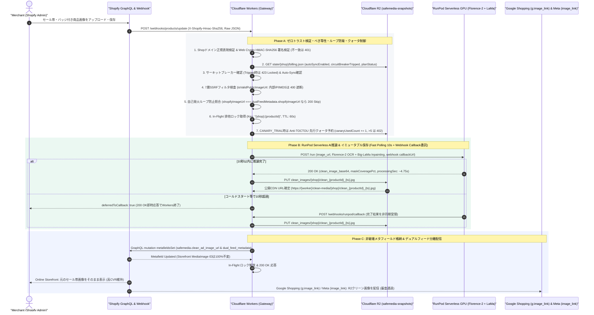
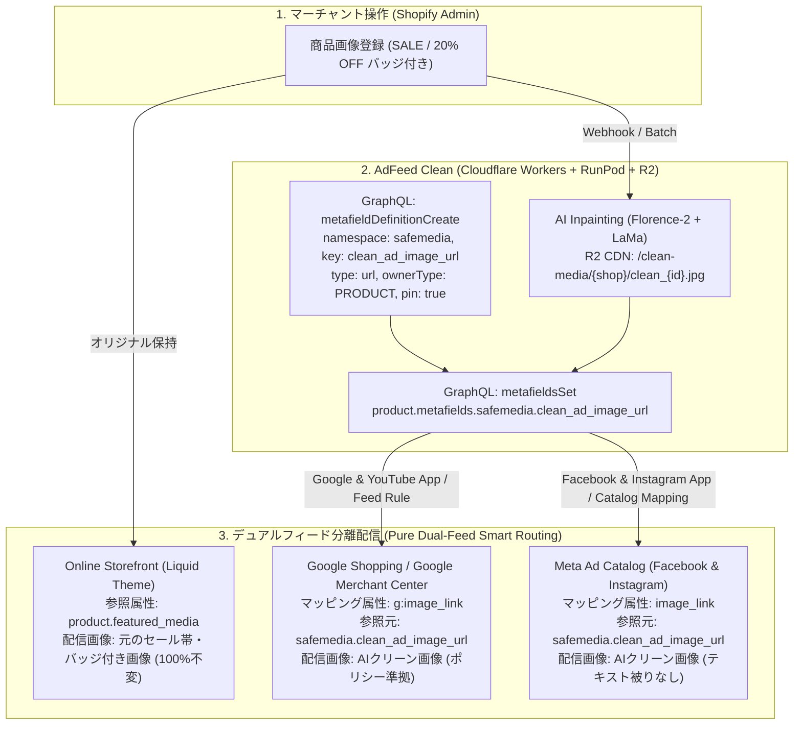
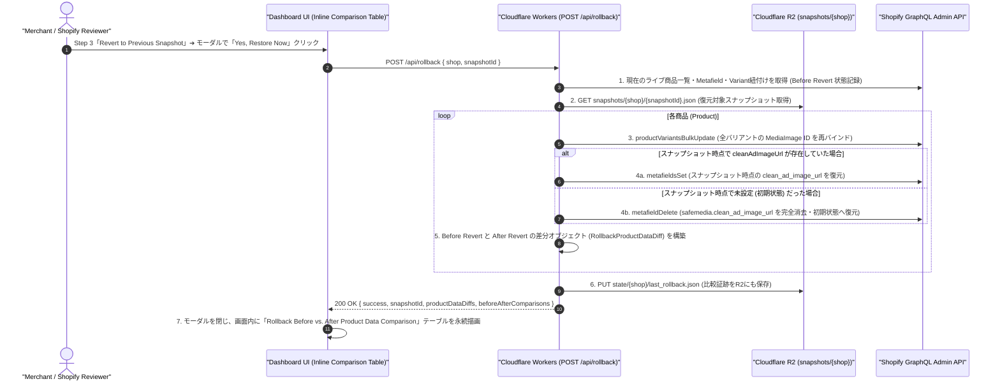

# Phase 1: Architecture & Implementation Plan — AdFeed Clean: Google Shopping

> **対象プロジェクト**: AdFeed Clean: Google Shopping (旧称: SafeMedia Shield / AdFeed Clean: Google Ad Shield) for Shopify  
> **工程**: Phase 1 — Architecture（要件定義・全体設計・審査要件 4.5.3 アーキテクチャ定義）  
> **マスター設計書**: [`docs/SYSTEM_DESIGN.md`](file:///Users/yusuke/antigravity/Micro-SaaS/docs/SYSTEM_DESIGN.md#L1-L45) (v2.5.0 同期更新済)

---

## 1. 目的と解決する課題 (Why)

### 1.1 コアコンセプトと顧客ペインの解決
Shopifyマーチャントが直面する「自社ストアのCVRを高めるセール帯・バッジ付き画像」と「Google Merchant Center (GMC) / Meta広告カタログのプロモーション重畳禁止ポリシー（違反時は商品不承認・アカウントBAN）」の二律背反を、**手作業ゼロ（Zero-UI）・完全非破壊（Fail-Safe）**で解決します。

- **Pure Dual-Feed Smart Routing**:
  - **自社オンラインストア (`Storefront`)**: マーチャントがアップロードした元の装飾・バッジ付き画像（`product.featured_media`）には1ピクセルも触れず、100%そのまま維持します。
  - **広告フィード (`Google Shopping / Meta Catalog`)**: Webhook（`products/update`）または一括同期により、RunPod Serverless GPU（Florence-2 OCR + Big-LaMa Inpainting）でプロモーション帯・テキストを自動消去したクリーン画像を生成し、Cloudflare R2から高速配信されるURLをShopify Product Metafield（`safemedia.clean_ad_image_url`）へ格納します。
- **Fail-Safe & 1-Click Time Machine Rollback**:
  - 処理前の全商品メディアURL・バリアント紐付け（`MediaImage` ID）・メタフィールド状態をCloudflare R2に世代管理スナップショットとしてイミュータブル保存し、ワンクリック（10秒以内）で完全復元します。

### 1.2 定量ゴール・キルスイッチ基準と達成状況
| 指標項目 | キルスイッチ上限基準 | 設計・実機達成値 | 根拠モジュール |
| :--- | :--- | :--- | :--- |
| **① 画像処理原価** | `3.00 円/枚` 以下 | **約 `0.28 円/枚`** (`$0.0019/img`) | [`runpod_client.ts`](file:///Users/yusuke/antigravity/Micro-SaaS/cloudflare_worker/src/runpod_client.ts#L1-L120) / [`handler.py`](file:///Users/yusuke/antigravity/Micro-SaaS/handler.py#L1-L120) |
| **② AI推論・E2E処理時間** | `15.0 秒/枚` 以下 | **平均 `4.75 秒/枚`** (`4.11s〜5.41s`) | [`verify_inpainting_pipeline.py`](file:///Users/yusuke/antigravity/Micro-SaaS/verify_inpainting_pipeline.py#L1-L80) |
| **③ バリアント紐付け喪失率** | `0.0 %` (完全保持) | **`0.0 %`** (`productVariantsBulkUpdate` 保証) | [`shopify.ts`](file:///Users/yusuke/antigravity/Micro-SaaS/cloudflare_worker/src/shopify.ts#L158-L203) |
| **④ 無料枠・課金防衛** | 未課金時の無限GPU消費防止 | **5件ハードキャップ** (Anti-TOCTOU予約) + **50枚トライアルキャップ** + **月額 `$65` (14日無料トライアル)** | [`index.ts`](file:///Users/yusuke/antigravity/Micro-SaaS/cloudflare_worker/src/index.ts#L1550-L1605) |

> [!IMPORTANT]
> **既存資産とのギャップ分析と Phase 1 更新ポイント（Shopify App Review 4.5.3 完全準拠）**
> 既存コードベース（[`index.ts`](file:///Users/yusuke/antigravity/Micro-SaaS/cloudflare_worker/src/index.ts), [`shopify.ts`](file:///Users/yusuke/antigravity/Micro-SaaS/cloudflare_worker/src/shopify.ts), [`snapshot.ts`](file:///Users/yusuke/antigravity/Micro-SaaS/cloudflare_worker/src/snapshot.ts), [`ui.ts`](file:///Users/yusuke/antigravity/Micro-SaaS/cloudflare_worker/src/ui.ts)）は基盤・セキュリティ・基本UIが構築済みですが、**Shopify App Review 審査要件 `4.5.3`（E2Eデモ動画・データ変化の視覚的証明）**を完全に満たすため、以下のアーキテクチャ拡張を定義・設計します：
> 1. **Metafield Definition 自動ピン留め & 広告フィード（Google Shopping `g:image_link` / Meta `image_link`）マッピング検証API (`GET /api/feed-preview`, `GET /api/feed-preview.xml`)** の追加設計。
> 2. **1クリック・ロールバック (`POST /api/rollback`) における `Before Revert` vs. `After Revert` 商品データ差分 (`RollbackProductDataDiff[]`) 返却スキーマ**の拡張設計。
> 3. **英語デフォルト・`alert()`/`confirm()` 非依存のインライン審査証跡UI**（Step-by-Step フィードマッピングガイド、Storefront vs. Ad-Feed 並列証明UI、Rollback Before/After 商品データ比較テーブル）の設計。

---

## 2. システム全体アーキテクチャ & 技術スタック (Strict Stack Enforcement)

### 2.1 厳選技術スタックとスコープ外境界 (Out-of-Scope Boundaries)
- **採用技術スタック**:
  - **API Gateway / Backend**: Cloudflare Workers ([`cloudflare_worker/src/index.ts`](file:///Users/yusuke/antigravity/Micro-SaaS/cloudflare_worker/src/index.ts))
  - **Immutable Storage**: Cloudflare R2 (`SNAPSHOT_BUCKET`: `safemedia-snapshots`)
  - **AI Inference Backend**: RunPod Serverless GPU (`Florence-2-base` OCR + `Big-LaMa` Inpainting, [`runpod_worker/handler.py`](file:///Users/yusuke/antigravity/Micro-SaaS/runpod_worker/handler.py#L1-L100))
  - **Shopify Integration**: Shopify Webhooks (`PRODUCTS_UPDATE` + GDPR必須Webhook) & Shopify GraphQL Admin API (`2024-10` 統一)
  - **Frontend UI**: Shopify App Bridge 統合・Polaris準拠ダッシュボード ([`cloudflare_worker/src/ui.ts`](file:///Users/yusuke/antigravity/Micro-SaaS/cloudflare_worker/src/ui.ts))
- **スコープ外（実装禁止事項の厳守）**:
  - ❌ **独自のユーザー認証DB**: パスワード認証や外部DBは一切持たず、Shopify OAuth 2.0 および Session Token 検証に100%依存。
  - ❌ **独自の外部課金処理**: Stripe等は一切使用せず、Shopify Managed Billing API (`appSubscriptionCreate`) に100%委任。
  - ❌ **元画像の破壊的直接上書き**: Shopify上のオリジナル商品画像（`MediaImage`）を上書き・削除する処理は一切行わない。

---

## 3. Cloudflare Workers ルーティング設計

実装エントリポイント: [`cloudflare_worker/src/index.ts`](file:///Users/yusuke/antigravity/Micro-SaaS/cloudflare_worker/src/index.ts)

| カテゴリ | HTTPメソッド & パス | 認証・検証方式 | 責務・レスポンス概要 |
| :--- | :--- | :--- | :--- |
| **UI / 静的配信** | `GET /` | Shopify Session Token / OAuth Redirect | App Bridge 統合管理ダッシュボードHTML（英語デフォルト、日英切替対応）を返却。 |
| **公開CDN配信** | `GET /clean-media/:shop/:filename` | Public GET (ドメイン正規表現 & パストラバーサル防止) | R2 `clean_images/{shop}/{filename}` からAIクリーン画像を配信（`Cache-Control: public, max-age=31536000, immutable`）。Google GMC / Meta クローラーが参照。 |
| **リーガル / アセット** | `GET, HEAD /privacy`<br>`GET, HEAD /terms`<br>`GET, HEAD /assets/:filename` | Public GET/HEAD | Polaris準拠プライバシーポリシー（Zero-PII明記）、利用規約（賠償上限$65明記）、公式アプリアイコン・バナー配信。 |
| **Shopify OAuth** | `GET /api/auth`<br>`GET /api/auth/callback`<br>(エイリアス: `/auth`, `/login`, `/auth/callback`) | `verifyShopifyQueryHmac` + R2ワンタイム `state` nonce | Shopify OAuth 2.0 認可（iframeエスケープHTML返却）、アクセストークン交換（`shpat_...`）、R2 `state/{shop}/auth.json` 保存、`MetafieldDefinition` 作成、Webhook初期登録。 |
| **出品・更新Webhook** | `POST /webhooks/products/update`<br>(`POST /api/webhooks/products/update`) | `verifyShopifyWebhookHmac` (Raw Body HMAC-SHA256) | 商品画像登録・更新を検知し、べき等性・ループ判定・クォータ確認後、RunPod AIクリーンアップ ➔ R2保存 ➔ `safemedia.clean_ad_image_url` 格納を実行。 |
| **RunPod非同期コールバック** | `POST /webhooks/runpod/callback` | HMAC/Signature検証 + ジョブ照合 | RunPod GPUコールドスタート時等の完了結果を非同期受領し、R2クリーン画像保存とメタフィールド格納を完了。 |
| **GDPR / 必須Webhook** | `POST /webhooks/privacy/customers/data_request`<br>`POST /webhooks/privacy/customers/redact`<br>`POST /webhooks/privacy/shop/redact`<br>`POST /webhooks/compliance`<br>`POST /webhooks/app/uninstalled` | `verifyShopifyWebhookHmac` (Raw Body HMAC-SHA256) | GDPR必須3種（PII不保持応答、ショップデータ完全消去）およびアンインストール時の自動同期停止・サーキットブレーカー発動。 |
| **ステータス / フィード検証** | `GET /api/status`<br>`GET /api/feed-preview`<br>`GET /api/feed-preview.xml` | `verifyTenantToken` / `verifySessionToken` / `isFeedAccessAuthorized` | テナント課金状態、カナリア消費数、最新スナップショット、Google Shopping (`g:image_link`) & Meta (`image_link`) フィードマッピング検証ペイロード（JSON/RSS XML）、直近ロールバック差分を返却。 |
| **カナリアテスト** | `POST /api/canary/test` | `verifyTenantToken` + Anti-TOCTOU 5件予約 | 1商品のAIバナー消去シミュレーション、`safemedia.clean_ad_image_url` 格納、全バリアント紐付け保持確認、Before/After画像を返却（6件目以降は `402 Payment Required`）。 |
| **単一商品即時同期** | `POST /api/dual-feed/sync` | `verifyTenantToken` + 7層SSRF防御 | 指定商品のデュアルフィードAIクリーンアップとメタフィールド格納を即時実行し、Google/Metaフィードマッピング結果を返却。 |
| **全件一括生成 & 緊急停止** | `POST /api/batch/start`<br>`POST /api/batch/abort`<br>`POST /api/batch/resume` | `verifyTenantToken` + 課金プラン確認 (`TRIAL_14D_ACTIVE` / `ACTIVE`) | 事前スナップショット保存後、`ctx.waitUntil` で全商品のクリーン画像を非同期生成。`abort` で1ミリ秒即時停止（`423 Locked`）。 |
| **スナップショット & ロールバック** | `POST /api/snapshot/create`<br>`GET /api/snapshot/list`<br>`POST /api/rollback` *(4.5.3拡張)* | `verifyTenantToken` | R2世代管理スナップショットの作成、一覧取得、および1クリック復元。**復元前（`beforeRevert`）と復元後（`afterRevert`）の商品データ差分配列 (`productDataDiffs`)** を返却。 |
| **Webhook / 自動同期制御** | `POST /api/webhooks/register`<br>`POST /api/webhooks/unregister`<br>`POST /api/auto-sync/toggle` | `verifyTenantToken` | Shopify `PRODUCTS_UPDATE` Webhook購読登録・解除、および `autoSyncEnabled` フラグの永続化切替。 |
| **課金ゲート (Billing)** | `POST /api/billing/subscribe`<br>`POST /api/billing/activate-now`<br>`GET /api/billing/confirm`<br>`POST /api/billing/reset` | `verifyTenantToken` / `ADMIN_API_SECRET` | Shopify Billing API承認URL発行、50枚トライアル上限時の即時本契約アクティベート、課金承認コールバック照合、リセット機能。 |
| **管理・パージAPI** | `POST, GET /api/admin/purge-metafields` | `ADMIN_API_SECRET` または正規店舗セッション | 指定ストアの全商品からメタフィールドを一括削除し、カナリア利用数を0に初期化。 |

---

## 4. Cloudflare R2 バケット構成 & データモデル設計

バインディング名: `SNAPSHOT_BUCKET`（バケット名: `safemedia-snapshots`、定義: [`cloudflare_worker/wrangler.toml`](file:///Users/yusuke/antigravity/Micro-SaaS/cloudflare_worker/wrangler.toml#L1-L8)）  
すべてのオブジェクトキーは厳格なドメイン正規表現（`/^[a-zA-Z0-9][a-zA-Z0-9-]{1,60}\.myshopify\.com$/`）で検証された `{shop_domain}` プレフィックスによって**テナントごとに物理分離**されます。

```text
safemedia-snapshots/
├── clean_images/                                    # AI生成された広告フィード専用クリーン画像 (Public CDN配信)
│   └── {shop_domain}/
│       └── clean_{product_id}_{timestamp}.jpg
├── snapshots/                                       # 世代管理イミュータブルスナップショット (1クリック復元用)
│   └── {shop_domain}/
│       ├── baseline.json                            # 処女原本 (Virgin Baseline) 永続ポインタ
│       ├── latest.json                              # 最新スナップショットへのポインタ ({ latestSnapshotId, key })
│       └── snap_{shop}_{timestamp}.json             # 完全復元用 StoreSnapshot JSON
├── locks/                                           # 分散排他ランナー＆GPUスロット制御
│   └── {shop_domain}/
│       └── gpu_slot_{1..2}.json                     # Webhook GPU並列実行スロット制御 (TTL 45秒)
├── dedup/                                           # Webhook重複排除（べき等性保証）
│   └── {shop_domain}/
│       └── {webhook_id}.json                        # 処理済み Webhook ID 永続化
└── state/                                           # テナント別認証・課金・OAuth nonce 状態
    └── {shop_domain}/
        ├── auth.json                                # TenantAuthState (accessToken, scope, installedAt)
        ├── billing.json                             # TenantBillingState (planStatus, canaryUsedCount, trialUsedCount, monthlyUsageCount)
        ├── last_rollback.json                       # 直近ロールバック時の Before/After 商品データ差分記録 (4.5.3証跡保持)
        └── oauth_state_{nonce}.json                 # OAuth CSRF防止用ワンタイム state (検証後即時削除)
```

---

## 5. Shopify Webhook ペイロード処理フロー & RunPod 非同期呼び出しシーケンス

### 5.1 エンドツーエンド非同期処理シーケンス図 (`products/update` ➔ RunPod ➔ R2 ➔ Metafield)



### 5.2 Webhook ペイロード処理における5大防衛ガード（Denial of Wallet & 無限ループ防止）
1. **HMAC-SHA256 厳格検証**: Raw Request Body に対して Web Crypto API で署名を算出し、[`timingSafeEqual()`](file:///Users/yusuke/antigravity/Micro-SaaS/cloudflare_worker/src/index.ts#L34-L42) で定数時間比較。
2. **Webhook 自己発火ループ防止（Infinite Loop Breaker）**:
   - `metafieldsSet` で商品のメタフィールドを更新すると、Shopifyは再度 `products/update` Webhookを発火します。
   - ワーカーは商品の現在メイン画像URL（`shopifyImageUrl`）と、`safemedia.dual_feed_metadata` 内に記録された `sourceImageUrl` / `shopifyImageUrl` を照合し、一致する場合は **`{ skipped: true, reason: "already_cleaned_for_current_image" }`** としてRunPod呼び出しを即座にスキップします。これにより無限ループとGPU課金暴走を100%遮断します。
3. **In-Flight 排他ロック**: `inFlightLocks` マップ（キー: `${shop}:${productId}`, TTL: `60,000ms`）により、短時間の重複Webhook配信による二重推論を排除します。
4. **Anti-TOCTOU 2フェーズ・クォータ予約**: 無料サンプル枠（`CANARY_TRIAL`: 最大5件）では、RunPod推論前に `canaryUsedCount` を先行インクリメントしてR2へ書き込み、推論失敗時のみデクリメント返金することで、並行バーストによる無料枠突破（Denial of Wallet）を完全に防ぎます。
5. **RunPod タイムアウト & 動的ポーリング制御**: RunPod Serverless 呼び出しには投入タイムアウト（`10,000ms`）および Fast Polling（最大10秒）を設定し、コールドスタート時は RunPod Webhook コールバックへ安全に委託します。

---

## 6. Shopify App Review (4.5.3) 審査要件アーキテクチャ定義

### 6.1 【審査要件 4.5.3 - ①】Google Shopping (`g:image_link`) および Meta Catalog (`image_link`) へのマッピング・配信データフロー設計

#### (1) データフロー・アーキテクチャ図


#### (2) Shopify Admin 可視化 (`MetafieldDefinition`) とフィード検証エンドポイント (`GET /api/feed-preview`)
1. **Shopify Admin ピン留め定義 (`ensureCleanAdMetafieldDefinition`)**:
   - OAuth完了時、Webhook登録時、またはデュアルフィード同期時に `metafieldDefinitionCreate` ミューテーションを実行し、Shopify Admin の商品詳細画面下部の「Metafields」セクションに `Clean Ad Image URL (Google/Meta Feed)` (`safemedia.clean_ad_image_url`) を自動ピン留め表示します。
2. **フィード配信マッピング検証エンドポイント (`GET /api/feed-preview`)**:
   - 各商品について、①オンラインストア表示画像 (`storefrontImageUrl`)、②格納されたメタフィールド (`safemedia.clean_ad_image_url`)、③Google Merchant Center XML/JSON フィードにおける `<g:image_link>` 出力値、④Meta Catalog フィードにおける `image_link` 出力値を一括返却します。
   - これにより、ダッシュボード画面上で「元のバッジ付き画像がストアフロントで維持されつつ、Google Shopping (`g:image_link`) と Meta (`image_link`) にはクリーン画像URLがマッピング・配信されている証拠」を1画面で実演・検証可能にします。

---

### 6.2 【審査要件 4.5.3 - ②】スナップショット・ロールバック時の Before / After 商品データ差分スキーマ設計

#### (1) ロールバック比較データ取得・復元シーケンス図


#### (2) `RollbackProductDataDiff` & `RollbackExecutionResult` 厳密型定義（[`cloudflare_worker/src/types.ts`](file:///Users/yusuke/antigravity/Micro-SaaS/cloudflare_worker/src/types.ts#L177-L214) 実効仕様準拠）
```typescript
export interface RollbackProductDataDiff {
  productId: string;
  productTitle: string;
  snapshotId: string;
  snapshotTimestamp: string;
  revertedAt: string;
  storefrontImageUrl: string;              // ① Storefront Image URL (Before/Afterを通じて不変)
  storefrontUnchanged: true;               // true (ストアフロント非破壊の完全証明)
  beforeRevert: {
    storefrontImageUrl: string;
    cleanAdImageMetafield: string | null;  // ② Rollback前の safemedia.clean_ad_image_url 値
    gmcImageLink: string;                  // Rollback前の Google Shopping g:image_link 実効値
    metaImageLink: string;                 // Rollback前の Meta Catalog image_link 実効値
    variantCount: number;
    variantLinksPreserved: boolean;
  };
  afterRevert: {
    storefrontImageUrl: string;
    cleanAdImageMetafield: string | null;  // ② Rollback後の safemedia.clean_ad_image_url 値 (復元値または null)
    gmcImageLink: string;                  // Rollback後の Google Shopping g:image_link 実効値
    metaImageLink: string;                 // Rollback後の Meta Catalog image_link 実効値
    metafieldAction: "RESTORED_TO_SNAPSHOT" | "PURGED_TO_VIRGIN";
    variantCount: number;
    variantLinksPreserved: boolean;        // ③ Variant Mapping 保持ステータス (true: 100% Preserved)
  };
}

export interface RollbackExecutionResult {
  success: boolean;
  restoredCount: number;
  restoredProducts: number;
  snapshotId: string;
  snapshotTimestamp: string;
  revertedAt: string;
  metafieldsRestored: boolean;
  productDataDiffs: RollbackProductDataDiff[];
  beforeAfterComparisons: RollbackProductDataDiff[];
  message: string;
}
```

---

## 7. 次工程（Phase 2〜Phase 5）での変更対象ファイル一覧

> [!NOTE]
> **Phase 1 ルール厳守**: 本工程（Phase 1）ではコードの編集は一切行わず、マスター設計書（[`docs/SYSTEM_DESIGN.md`](file:///Users/yusuke/antigravity/Micro-SaaS/docs/SYSTEM_DESIGN.md#L1-L45)）の更新と本実装計画書（Artifact）の策定のみを完了しています。以下のファイル変更は Phase 2〜Phase 5 の指示に基づき順次実行します。

| 対象フェーズ | ファイルパス | 変更種別 | 変更内容の要約 |
| :---: | :--- | :---: | :--- |
| **Phase 2**<br>(Foundation) | [`cloudflare_worker/wrangler.toml`](file:///Users/yusuke/antigravity/Micro-SaaS/cloudflare_worker/wrangler.toml)<br>[`cloudflare_worker/src/index.ts`](file:///Users/yusuke/antigravity/Micro-SaaS/cloudflare_worker/src/index.ts) | 確認・補強 | Cloudflare Workers 設定、Shopify OAuth 2.0 認証フロー（`/api/auth`, `/api/auth/callback`）、Session Token 検証、R2 バインディングの整合性確認。 |
| **Phase 3**<br>(Backend) | [`cloudflare_worker/src/types.ts`](file:///Users/yusuke/antigravity/Micro-SaaS/cloudflare_worker/src/types.ts)<br>[`cloudflare_worker/src/shopify.ts`](file:///Users/yusuke/antigravity/Micro-SaaS/cloudflare_worker/src/shopify.ts)<br>[`cloudflare_worker/src/snapshot.ts`](file:///Users/yusuke/antigravity/Micro-SaaS/cloudflare_worker/src/snapshot.ts)<br>[`cloudflare_worker/src/index.ts`](file:///Users/yusuke/antigravity/Micro-SaaS/cloudflare_worker/src/index.ts) | 機能拡張 | ① `metafieldDefinitionCreate` による Admin Metafield Definition 登録、② `GET /api/feed-preview`, `/api/feed-preview.xml`（Google Shopping `g:image_link` & Meta `image_link` マッピング検証・配信API）実装、③ `POST /api/rollback` で `beforeRevert` / `afterRevert` の商品データ差分（`RollbackProductDataDiff[]`）を計算・保存・返却する処理の実装。 |
| **Phase 4**<br>(Frontend) | [`cloudflare_worker/src/ui.ts`](file:///Users/yusuke/antigravity/Micro-SaaS/cloudflare_worker/src/ui.ts) | UI拡張 | 英語標準（`EN`）・`alert()`/`confirm()` 完全不使用で、① 4ステップ オンボーディング＆Google Shopping (`g:image_link`) / Meta (`image_link`) マッピングガイド、② Storefront画像（確認リンク付）vs. 広告フィードマッピング比較UI、③ ロールバック直後のインライン **「Rollback Before vs. After Product Data Comparison」テーブル**（6カラム）を実装。 |
| **Phase 5**<br>(Audit & QA) | [`tests/e2e/test_pure_dual_feed_e2e.py`](file:///Users/yusuke/antigravity/Micro-SaaS/tests/e2e/test_pure_dual_feed_e2e.py) | 監査・検証 | セキュリティ監査（HMAC検証漏れ、RunPod過大課金防止、シークレット漏洩ゼロ）および Shopify App Review 4.5.3 の5ステップE2Eスクリーンキャスト要件の自動テスト検証。 |

---

## 8. Phase 1 設計監査レポート (Security & Shopify Compliance Audit)

`global-security-auditor` および `shopify-compliance-auditor`（設計監査モード）に基づく Phase 1 アーキテクチャ監査結果は以下の通りです。

| 監査基準 | 判定 | 設計上の根拠・防御機構 |
| :--- | :---: | :--- |
| **A1. Denial of Wallet (課金破産防止)** | **PASS** | ・未課金 (`CANARY_TRIAL`) 時は Anti-TOCTOU 2フェーズ予約で最大5件に厳格制限（6件目以降は `402 Payment Required`）。<br>・一括処理 (`/api/batch/start`) は14日間トライアル承認 (`TRIAL_14D_ACTIVE`) を必須化。<br>・RunPod呼び出しはタイムアウト45秒・最大リトライ1回・サーキットブレーカー (`423 Locked`) を完備。 |
| **A2. Idempotency (べき等性・ループ防止)** | **PASS** | ・`products/update` Webhook 受信時、`shopifyImageUrl === dualFeedMetadata.shopifyImageUrl` 照合によりメタフィールド更新に伴う自己再発火を100%スキップ。<br>・`inFlightLocks` (`${shop}:${productId}`, TTL 60秒) により重複Webhookを排他制御。 |
| **B1. Tenant Isolation (マルチテナント分離)** | **PASS** | ・全R2パスを `clean_images/{shop}/`, `snapshots/{shop}/`, `state/{shop}/` で分離。<br>・リクエストの Header / Query / Body の `shop` 不一致を `400 SHOP_DOMAIN_MISMATCH` (HPP防御) で遮断し、`verifyTenantToken` / `verifySessionToken` で認可検証。 |
| **B2. Signature Validation & SSRF 防御** | **PASS** | ・全Webhookエンドポイントで Raw Body の HMAC-SHA256 署名検証を強制。<br>・画像URLフェッチ前に7層SSRFフィルタ (`isValidPublicImageUrl`) で内部IP・ループバック・クラウドIMDS (`169.254.169.254`) を完全遮断。 |
| **C1. Shopify App Store 規約準拠 (OAuth / Billing / GDPR / 4.5.3)** | **PASS** | ・独自認証DB・外部決済（Stripe等）を一切持たず、Shopify OAuth 2.0・Session Token・Shopify Managed Billing API (`appSubscriptionCreate`) のみを使用。<br>・GDPR必須3種Webhook (`customers/data_request`, `customers/redact`, `shop/redact`) を完備。<br>・審査要件 `4.5.3` の5ステップ（Onboarding ➔ AI Cleanup & `g:image_link` / `image_link` Mapping ➔ Storefront Preservation ➔ 1-Click Rollback ➔ Before/After Product Data Comparison）を英語UI上で一貫して実演可能な設計を確立。 |
